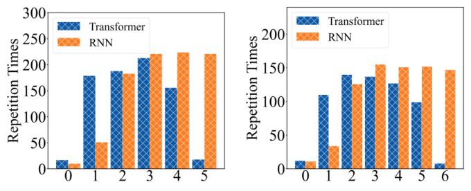
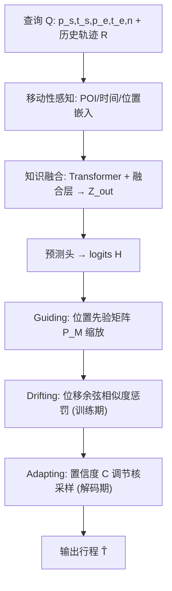
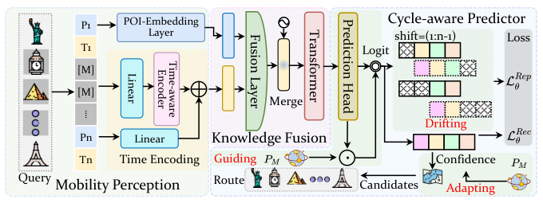

# Analyzing and Mitigating Repetitions in Trip Recommendation (行程推荐中重复现象的分析与缓解)

- **会议/期刊**: ACM SIGIR 2024 (Short Paper Track)
- **作者与机构**: Wenzheng Shu, Kangqi Xu, Wenxin Tai, Ting Zhong, Fan Zhou (电子科技大学，四川省智能终端重点实验室)；Yong Wang (香港科技大学)
- **推荐链路定位**: 端到端生成式（序列解码）
- **研究方向**: 时空轨迹与 POI 本地生活推荐 / 序列与会话推荐
- **论文原文**: [https://arxiv.org/abs/2507.19798v1](https://arxiv.org/abs/2507.19798v1)
- **开源代码**: [https://github.com/Joysmith99/AR-Trip](https://github.com/Joysmith99/AR-Trip)

## TL;DR (1分钟核心速览)

行程推荐（给定起终点、时间与期望长度生成 POI 序列）长期被 **行程重复问题 TRP**（同一 POI 在一条路线中被多次生成）困扰：规划式方法靠 ILP/剪枝硬性去重却牺牲精度，学习式方法精度高却重复严重。作者用统计与实验发现重复同时源于 **模型架构** 与 **解码策略**，且对 logits 加扰动可降低重复，据此提出 AR-Trip：以「引导矩阵 + 漂移惩罚 + 置信度自适应采样」在训练与解码两阶段重塑 logits。在 Flickr 四城上，相对 Bert-Trip，$F_1$提升约 4–7%、$PairsF_1$ 提升 13–20%，同时 REP 由 0.035–0.066 降至 0.016–0.049。

## Background & Motivation (背景与核心矛盾)

- **主流范式**: 早期为面向 Orienteering Problem 的规划式方法（Popularity / PersTour / POIRank / C-ILP / Markov / RankMarkov），近年为学习式序列生成（CTLTR、SelfTrip、DeepTrip、Bert-Trip），把行程推荐当作「给定查询补全句子」。
- **前人局限**: ① 规划式方法借助 ILP、分支定界、预算剪枝可消除重复，但因强约束导致 $F_1$/$PairsF_1$显著掉点（C-ILP 甚至无法计算$PairsF_1$）；② 学习式方法精度高，却无法解释重复成因、也缺乏有效对策，生成路线可用性差。
- **核心洞察 (Key Insight)**: 作者做两组实证：**(a) 模型维度**——RNN 因结构限制与查询的隐式表示，序列后半段重复频率显著高于可直接以终点为显式条件的 Transformer（图 1）；**(b) 解码维度**——把每个位置的 POI 转移概率视为稀疏矩阵 $M_i$（稀疏度$\xi=\frac{1}{k^2}\sum_{i}\sum_{j}\mathbb{I}$），加入 i.i.d. 噪声后$M_i' = M_i + N_i$，重复概率可由$\mathrm{PMR}=\prod_{j\ge 1}\mathrm{tr}\big[\prod_{i=1}^{2j}M_i'/(k\xi)^j\big]$刻画；Greedy 解码使$\xi=1/k$（最稀疏），最大特征值最大，因而 PMR 最高。**即：降低重复等价于压缩$\prod M_i'$ 的最大特征值、增大概率方差扰动。**
- **本文切入点**: 不做硬约束剪枝，而是在训练与解码两个阶段对 logits 注入「循环感知」扰动，让模型自己学会不回头。

<figure class="paper-figure" markdown="span">
  <figcaption>图1：模型选择：我们展示长度为六（图1(a)）和七（图1(b)）的轨迹，这些轨迹数据丰富且足够长，可供分析。</figcaption>
</figure>

## Method (核心方法设计)

### 1. 整体框架 (Overall Architecture)

AR-Trip 由三部分组成：**移动性感知**（POI 嵌入 + 时间嵌入，时间以 shift=$1{:}n{-}1$的相对编码注入）、**知识融合**（Transformer 编码 + 融合层，输出$Z_{out}$）、**循环感知预测器**（本文核心）。$Z_{out}$经预测头得到 logits$\mathbf{H}\in\mathbb{R}^{m\times|\mathcal{P}|}$ 后，被三个机制依次重塑：Guiding 用位置先验矩阵改写幅度、Drifting 在训练期拉开不同位移下表征的余弦相似度、Adapting 在解码期以置信度调节核采样温度。三者均为 plug-and-play 的 logits 层算子，不改变主干结构；训练用交叉熵与漂移惩罚多任务联合优化，推理用自适应核采样一次性解码整条路线。

<figure class="paper-figure" markdown="span">
  <figcaption>图2：所提出的AR-Trip框架概览。</figcaption>
</figure>

### 2. 关键设计拆解 (Key Designs)

1. **Guiding：位置先验引导矩阵**——痛点：模型对「某 POI 只适合出现在路线第几位」缺乏显式约束，容易在末段反复召唤同一点。做法：由历史轨迹统计位置频率，构造 $\mathbf{P}_M\in\mathbb{R}^{|\mathcal{P}|\times m_{max}}$，其元素为$f_{ij}/f_i$（第$i$个 POI 出现在第$j$位的频率占其总出现次数之比），再以残差式乘性改写 logits：$\hat{\mathbf{H}}=\mathbf{H}+\mathbf{H}\odot \mathbf{P}_M^{\top}{}_{[:m]}$。直觉：把「位置合法性」直接写进分数，使越界位置被相对压低，且残差形式不破坏原始分布。

2. **Drifting：位移漂移惩罚**——痛点：$t$与$t{+}\omega$位置的表征若高度相似，模型就有强烈的「回到原点」倾向（自环只是重复的一种特例）。做法：对 logits 序列做$\omega$步位移的余弦相似度$\mathrm{Pr}(\cdot)$，用 unlikelihood 目标反向惩罚：
$$\mathcal{L}_{Rep}=-\sum_{\omega=1}^{m-1}\sum_{i=1}^{m-\omega}\log\big(1-\mathrm{Pr}(\hat{\boldsymbol{h}}_i,\hat{\boldsymbol{h}}_{i+\omega})\big)$$
与仅惩罚「相邻重复」的常规做法不同，$\omega$ 遍历所有位移，因而能覆盖任意周期的环状重复（cycle），这是本文「cycle-aware」的核心。

3. **Adapting + 训练目标与推理**——痛点：Top-$k$/Top-$p$的固定阈值来自语言模型，不适配 POI 候选高度稀疏的行程场景。做法：从$\mathbf{P}_M$中统计「在第$j$位从未出现过的 POI 数量」$\{f_{0j}\}$，以$\{f_{0j}\}/|\mathcal{P}|$作为逐位置置信度$C$：候选越拥挤则$C$越低、logits 被平滑得越厉害，形成逐位置的动态温度而非全局固定阈值。总损失$\mathcal{L}_\theta=\mathcal{L}_{Rec}+\alpha\mathcal{L}_{Rep}$（$\mathcal{L}_{Rec}$为标准交叉熵，$\alpha=1.0$），Adam 优化，无需负采样（softmax 覆盖全 POI 集合），推理为核采样一次前向，无额外检索开销。

## Experimental Setup & Evaluation Protocol (实验设置与评估协议)

- **数据集与预处理**: 采用 Flickr 四城（Edinburgh / Glasgow / Osaka / Toronto）geo-tagged YFCC100M 签到，沿用 CTLTR/SelfTrip 的处理流程；原文未报告精确规模统计：

| 数据集 | #Users | #Items | #Interactions | 稀疏度/密度 | 特征/场景说明 |
| :--- | :---: | :---: | :---: | :---: | :--- |
| Flickr-Edinburgh | — | — | — | — | 苏格兰爱丁堡，含 POI/时间戳 |
| Flickr-Glasgow | — | — | — | — | 消融实验所在数据集 |
| Flickr-Osaka | — | — | — | — | 日本大阪，长尾更强 |
| Flickr-Toronto | — | — | — | — | 加拿大多伦多 |

（注：论文未给出 #Users/#Items/#Interactions 明细，仅说明与 CTLTR 保持一致；此处不臆造数值。）

- **数据划分与防穿越 (Splitting Strategy)**: 沿用 CTLTR 的固定查询集划分，每条样本为 $(p_s,t_s,p_e,t_e,n)$ 形式的查询—真值路线对；未报告额外的全局时间戳切分。
- **排名评测协议 (Ranking Protocol)**: 生成式序列级评测而非候选排序，$F_1$与$PairsF_1$ 基于生成序列与真值序列的重合度，解码时 softmax 覆盖全 POI 集合（相当于 Full 空间打分，无负采样候选集），所有基线 5 次重复实验取均值。
- **对比基线与超参**: 基线含 6 个规划/统计方法（Popularity、PersTour、POIRank、C-ILP、Markov、RankMarkov）与 4 个学习式方法（DeepTrip、CTLTR、SelfTrip、Bert-Trip）；嵌入维度 $d=32$（POI/时间/位置），学习率 1e-3，50 epoch，$\alpha=1.0$，解码阈值 0.8，单卡 RTX 3060。

## Key Experimental Results (实验关键数据)

### 1. 主实验对比 (Main Results)

| 数据集 | 方法 | $F_1$|$PairsF_1$ | REP↓ |
| :--- | :--- | :---: | :---: | :---: |
| Edinburgh | Bert-Trip | 0.814 | 0.672 | 0.066 |
| | SelfTrip | 0.728 | 0.688 | 0.199 |
| | CTLTR | 0.728 | 0.681 | 0.211 |
| | DeepTrip | 0.638 | 0.528 | 0.238 |
| | RankMarkov | 0.662 | 0.448 | 0.095 |
| | C-ILP | 0.743* | X | — |
| | **AR-Trip** | **0.868** | **0.808** | **0.049** |
| Glasgow | Bert-Trip | 0.849 | 0.740 | 0.043 |
| | SelfTrip | 0.834 | 0.773 | 0.116 |
| | CTLTR | 0.838 | 0.763 | 0.087 |
| | PersTour | 0.801 | 0.643 | — |
| | **AR-Trip** | **0.881** | **0.820** | **0.027** |
| Osaka | Bert-Trip | 0.854 | 0.740 | 0.052 |
| | SelfTrip | 0.840 | 0.774 | 0.117 |
| | CTLTR | 0.802 | 0.719 | 0.112 |
| | POIRank | 0.745 | 0.511 | — |
| | **AR-Trip** | **0.871** | **0.828** | **0.016** |
| Toronto | Bert-Trip | 0.859 | 0.733 | 0.035 |
| | SelfTrip | 0.790 | 0.751 | 0.134 |
| | CTLTR | 0.806 | 0.748 | 0.139 |
| | **AR-Trip** | **0.892** | **0.839** | **0.024** |

相对最强基线 Bert-Trip：Edinburgh $F_1$**+6.6%**、$PairsF_1$**+20.2%**；Glasgow$PairsF_1$**+10.8%**；Osaka$F_1$**+2.0%**、$PairsF_1$**+11.9%**；Toronto$PairsF_1$ **+14.5%**。

### 2. 消融实验 (Ablation Study)

Glasgow 数据集，`a`=Adapting、`g`=Guiding、`d`=Drifting：

| 配置 | $F_1$|$PairsF_1$ | REP↓ |
| :--- | :---: | :---: | :---: |
| Base (none) | 0.850 | 0.799 | 0.096 |
| +a | **0.886** | **0.852** | 0.062 |
| +d | 0.851 | 0.767 | 0.050 |
| +g | 0.852 | 0.793 | 0.093 |
| +ag | 0.884 | 0.849 | 0.048 |
| +ad | 0.879 | 0.828 | 0.035 |
| +gd | 0.848 | 0.761 | 0.051 |
| +agd (Ours) | 0.881 | 0.820 | **0.027** |

### 3. 关键实验发现 (Key Findings)

1. **去重的收益主要体现在 $PairsF_1$而非$F_1$**：Edinburgh 上$F_1$仅从 0.814 升到 0.868（+6.6%），但$PairsF_1$从 0.672 跃升至 0.808（+20.2%）。作者指出原指标本身对重复不敏感——真值$\{4,2,8,5\}$而输出$\{4,2,2,5\}$时$PairsF_1$ 仍可达 0.833，因此必须引入 REP 才能揭示 TRP 的真实严重程度。
2. **Adapting 是精度担当，Drifting 是去重担当，二者互补**：单加 `+a` 得到最高 $F_1$0.886 /$PairsF_1$0.852，但 REP 仍为 0.062；单加 `+d` 把 REP 从 0.096 压到 0.050 却使$PairsF_1$掉至 0.767；三者合用后 REP 达到最低 0.027，同时$F_1$ 保持 0.881，说明「训练期惩罚 + 解码期扰动」缺一不可。
3. **Guiding 必须与随机采样耦合才生效**：`+g` 单独使用仅把 REP 从 0.096 微降至 0.093，因为确定性编码下 $\hat{\mathbf{H}}=\mathbf{H}+\mathbf{H}\odot\mathbf{P}_M^{\top}$ 可被原分布近似抵消；而与 Adapting 组合（`+ag`）后 REP 降至 0.048。此外在 RNN 主干上迁移实验（图 3）显示：RNN 基线重复率明显高于 Transformer，套用全部三机制（RNN-AL）后可降至接近 Transformer 水平，且 RNN-TP（训练期惩罚）优于 RNN-DP（解码期惩罚），与消融结论一致。

## Highlights & Limitations (亮点、对比与审稿批判)

- **与代表作对比 (vs. Prior Work)**: 相对 **C-ILP/POIRank** 等规划式方法，本文不施加硬性唯一性约束，避免了「零重复但精度崩塌」；相对 **SelfTrip/CTLTR** 这些 RNN 序列模型，本文从编码结构（Transformer 显式终点条件）与解码策略（自适应核采样）两端同时下手，而非仅换主干；相对 **Bert-Trip**，本文额外引入位置先验与位移惩罚，在 $PairsF_1$ 上领先 10–20%，而不仅是把重复率压低到同等水平。
- **可迁移亮点**: ① 用「历史位置频率矩阵」做残差式 logits 重加权，可直接迁移到任何带强位置语义的序列生成任务（如路线规划、会话 bundle 推荐）；② 全位移余弦惩罚（$\omega$ 遍历）是抑制环状重复的通用正则项，与 unlikelihood 训练天然兼容，可直接插到 SASRec/BERT4Rec 类解码器上。
- **审稿级局限批判**: ① 仅 4 城市 Flickr 单源数据、无线上 A/B，且数据集规模统计与划分细节披露不足，复现边界模糊；② REP 把「合法重访」也判为重复（真实游客会二次到访热门 POI），缺乏按时间间隔/停留时长加权的重复定义；③ 置信度阈值 0.8 与 $\alpha=1.0$ 固定且未做敏感性分析，RNN 主干上的收益主要体现为降价而非精度提升。

## Rating (四维评分)

- **方法创新性 (Novelty)**: ⭐⭐⭐⭐ （首次给出 TRP 的「架构 + 解码」双归因，并用转移矩阵最大特征值/PMR 给出可解释的理论视角，三机制虽轻但闭环）
- **评估协议与实验扎实度 (Protocol & Experiments)**: ⭐⭐⭐ （四城交叉验证 + 自建 REP 指标 + 5 次重复实验较规范，但单数据源、无显著性检验、缺数据集规模与划分细节）
- **写作与数学规范度 (Clarity & Rigor)**: ⭐⭐⭐⭐ （PMR 与三机制公式推导清晰、动机—算子对应紧密，但符号略密、部分维度标注与消融解释依赖文字补充）
- **工业落地与复现价值 (Industrial & Practical Value)**: ⭐⭐⭐⭐ （三机制均为 logits 层 plug-and-play，无额外检索开销，代码已开源，可直接挂载现有行程规划服务）

