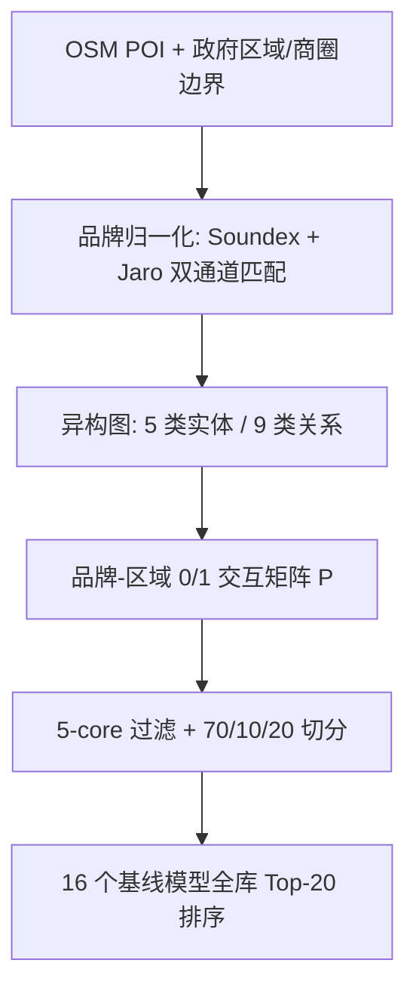
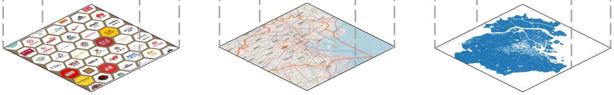
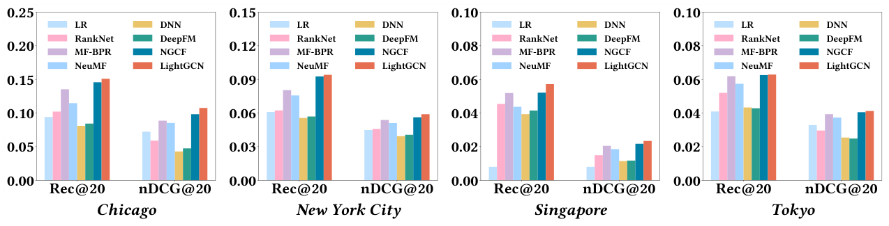

# OpenSiteRec: An Open Dataset for Site Recommendation (OpenSiteRec：一个面向选址推荐的开放数据集)

- **会议/期刊**: SIGIR 2024
- **作者与机构**: Xinhang Li, Xiangyu Zhao, Yejing Wang, Yu Liu, Yong Li, Cheng Long, Yong Zhang, Chunxiao Xing（清华大学、香港城市大学、南洋理工大学）
- **推荐链路定位**: 召回（品牌→区域 Top-N 候选排序）
- **研究方向**: 时空轨迹与 POI 本地生活推荐 / 图神经网络与知识图谱推荐
- **论文原文**: [https://arxiv.org/abs/2307.00856v1](https://arxiv.org/abs/2307.00856v1)
- **开源代码**: [https://github.com/HestiaSky/OpenSiteRec](https://github.com/HestiaSky/OpenSiteRec)

## TL;DR (1分钟核心速览)

选址推荐长期缺乏公开基准：既有工作各自定义任务、只覆盖极少数连锁品牌、数据从不公开，导致方法无法横向比较。本文给出统一问题定义（品牌集合 $\mathcal{B}$× 区域集合$\mathcal{R}$上的 0/1 交互矩阵$P\in\{0,1\}^{M\times N}$，为每个品牌排序候选区域），并发布首个公开数据集 OpenSiteRec——4 座都市、5 类实体、9 类关系的异构图。在 5-core 过滤 + 70/10/20 划分 + **全库排序（All-Ranking）** 协议下基准 16 个模型，LightGCN 在芝加哥/新加坡/东京三城 Recall@20 均夺冠，相对 MF-BPR 提升 13.2%–32.4%。

## Background & Motivation (背景与核心矛盾)

- **主流范式**: 选址推荐被视为排序任务，代表工作以人工特征工程（地理、人口、POI 密度）驱动点级打分，如 DeepStore、WANT、CityTransfer 的跨城知识迁移，以及 UrbanKG 的图神经网络方案。
- **前人局限**: ① 数据范围极窄——Geo-Spotting 只做纽约 3 个快餐品牌，DD3S 只有约 10 个候选区域，BL-G-CoSVD 只有 5 类店型，跨城工作仅覆盖 3 个连锁酒店品牌；② **无一公开数据集**，任务定义五花八门（店型推荐、消费额预测、KG 链接预测），彼此无法比较、必须从零重做。
- **核心洞察 (Key Insight)**: 所有既有定义在抽象层是同构的——最终都输出「站点排序列表」。因此可用「品牌–区域 0/1 共现矩阵」统一任务，并把品牌、类别、POI、商圈、区域组织成异构图表征，让商业关系（竞争、同集团）与地理关系（邻近、相似）同时进入模型。
- **本文切入点**: 以统一原型定义 + 首个大规模公开异构图数据集 + 16 模型基准，把选址推荐从「各自为战」变成可复现的开放任务。

## Method (核心方法设计)

### 1. 整体框架 (Overall Architecture)

OpenSiteRec 不是端到端模型，而是一条「数据构建 → 异构图组织 → 统一评测」的流水线。**输入**为 OpenStreetMap 抽取的 POI（2022-12-01 快照，要求至少一个 name 标签）与四城政府开放门户的区域/商圈多边形；**中间层**对每个 POI 做品牌归一（Soundex 音近 + Jaro 编辑距离双通道匹配 Wikidata）与三级类别指派，再用多边形包含关系判定其所属区域与商圈；**输出层**将 POI 视为连接 Brand 与 Region 的桥接实体，生成 $P\in\{0,1\}^{M\times N}$（Brand 当 "user"、Region 当 "item"），并按 5-core 过滤后投入 16 个推荐模型做 Top-20 全库排序。

<figure class="paper-figure" markdown="span">
  <figcaption>图 1：OpenSiteRec 的架构图。不同实体类型和关系分别用多边形和箭头表示。实线箭头表示不同实体类型之间的确定关系，虚线箭头表示未精确定义但可由现有信息推导出的不确定关系。</figcaption>
</figure>
（图 1：OpenSiteRec 异构图模式，实线为确定关系，虚线为可推导的不确定关系）

### 2. 关键设计拆解 (Key Designs)

1. **统一问题定义（把 4 种异构任务压成一张排序表）**：痛点在于既有定义互不兼容。本文令 $P_{ij}=1$当且仅当品牌$b_i$在区域$r_j$拥有至少一个 POI，任务即学习打分$\hat{s}_{ij}$并按$\hat{s}_{ij}$ 降序返回候选区域列表。因为不再需要 KG 链接预测的 relation 语义或消费额回归的连续监督，所有方法（图、CF、CTR、LTR）都能直接复用同一份数据与指标，这是"可比较性"的本体来源。

2. **异构关系补全（把"竞争"与"地理邻近"写成可算的边）**：痛点在于纯交互图极度稀疏（密度 0.18%–1.04%），几乎无法靠共现刻画相似性。本文将 Wikidata 的 `See Also`/同最低类别品牌连为 Related/Competitive 边；区域侧用最短距离阈值构造 NearBy（$\le 0.5$km），用窄类别分布余弦相似度构造 Similar：$s_{ij}=\frac{\boldsymbol{d}_i\cdot\boldsymbol{d}_j}{\|\boldsymbol{d}_i\|\|\boldsymbol{d}_j\|}\ge 0.9$，其中$\boldsymbol{d}_i=[n_1,\dots,n_K]$ 为区域内各窄类 POI 计数。直觉是：稀疏场景下，这些先验边充当隐式正则，把"和我在同一商圈开店"的信号注入 embedding 传播。

3. **品牌匹配双通道校验（保证标签可靠性）**：痛点是大多数 POI 无 brand 标签，品牌名存在多语种/多写法歧义。本文先做音译归一（日语 Hepburn、中文拼音）再转 Unicode，仅当 Soundex 音近与 Jaro 文本距离（阈值 0.8）**同时命中**才判为同一品牌，随后按并查集合并同品牌名集合。双通道策略把假阳性压到很低——每城人工抽检 5% 匹配结果"相当可信"。

4. **训练目标与评测口径**: 数据集本身不定义损失，基准实验沿用各基线原设定——pairwise 组使用 BPR 损失 $\mathcal{L}=-\sum_{(i,j,k)}\ln\sigma(\hat{s}_{ij}-\hat{s}_{ik})$（$j$已交互、$k$未交互，按 epoch 均匀采样），pointwise 组使用 BCE；embedding 维度统一$d=100$，Xavier 初始化 + Adam。推理为对全部$N$ 个区域打分排序，无 ANN 近似。

## Experimental Setup & Evaluation Protocol (实验设置与评估协议)

- **数据集与预处理**: 按品牌侧 `5-core`（品牌至少拥有 5 个 POI）过滤，统计如下（密度按 Sites/(Brands×Regions) 计）：

| 城市 | #Brands (用户) | #Regions (物品) | #Sites (交互) | 稀疏度/密度 | 原始 POI / 商圈数 |
| :--- | :---: | :---: | :---: | :---: | :--- |
| Chicago | 969 | 801 | 8,044 | 1.04% | 16,154 / 77 |
| New York City | 2,702 | 2,325 | 14,189 | 0.23% | 41,403 / 71 |
| Singapore | 1,922 | 2,043 | 9,912 | 0.25% | 18,580 / 387 |
| Tokyo | 4,861 | 3,036 | 26,765 | 0.18% | 60,042 / 无（政府未公开） |

- **数据划分与防穿越 (Splitting Strategy)**: 对每个品牌的 POI 做 `比例划分` **7:1:2**（随机，非时间切分，数据集本身无时间维）。
- **排名评测协议 (Ranking Protocol)**: **全库 `Full-Ranking`（All-Ranking）**——所有区域均为候选，指标 Recall@20 与 nDCG@20，无负采样，避免采样偏差。
- **对比基线与超参设置**: 16 个基线分四族——传统 ML（LR/GBDT/SVC/RankNet）、CF（MF-BPR/NeuMF/FISM/NAIS）、CTR（DNN/Wide&Deep/DeepFM/xDeepFM）、图（GC-MC/GraphRec/NGCF/LightGCN）。$d=100$，验证集网格搜索调参；原文未报告显著性检验。

## Key Experimental Results (实验关键数据)

### 1. 主实验对比 (Main Results)

| 模型族 | 方法 | Chicago R@20 | Chicago N@20 | NYC R@20 | NYC N@20 | Singapore R@20 | Singapore N@20 | Tokyo R@20 | Tokyo N@20 |
| :--- | :--- | :---: | :---: | :---: | :---: | :---: | :---: | :---: | :---: |
| ML | LR | 0.1203 | 0.0868 | 0.0886 | 0.0655 | 0.1784 | 0.1336 | 0.0795 | 0.0594 |
| LTR | RankNet | 0.2269 | 0.1427 | 0.1224 | 0.0654 | 0.4297 | 0.2271 | 0.1213 | 0.0667 |
| CF | MF-BPR | 0.2494 | 0.1465 | 0.1702 | 0.0917 | 0.4430 | 0.2351 | 0.1323 | 0.0781 |
| CF | FISM | 0.2547 | 0.1468 | 0.1745 | 0.0928 | 0.4583 | 0.2382 | 0.1343 | 0.0734 |
| CF | NAIS | 0.2534 | 0.1432 | 0.1743 | **0.0964** | 0.4557 | 0.2380 | 0.1328 | 0.0774 |
| CTR | DeepFM | 0.1898 | 0.1254 | 0.1184 | 0.0531 | 0.4177 | 0.2182 | 0.1225 | 0.0648 |
| Graph | NGCF | 0.2866 | 0.1838 | 0.1920 | **0.1102** | 0.4929 | 0.2674 | 0.1619 | 0.1012 |
| Graph | **LightGCN** | **0.2875** | **0.1902** | **0.2087** | 0.1088 | **0.5013** | **0.2745** | **0.1751** | **0.1068** |
| Graph | Improv.% vs MF-BPR | +15.3% | +29.8% | +22.6% | +18.6% | +13.2% | +16.8% | +32.4% | +36.7% |

### 2. 消融/族系对照分析 (Ablation-style Comparison)

本文为数据集论文，无自有模型消融，故以「损失类型 × 架构族系」的四城平均 Recall@20 做归因对照：

| 组别 | 损失类型 | 代表方法 | 四城平均 R@20 | 相对 LR 提升 |
| :--- | :---: | :--- | :---: | :---: |
| 传统 ML | — | LR / GBDT / SVC | 0.1167 | — |
| CTR 族 | Pointwise (BCE) | DeepFM / xDeepFM / DNN / Wide&Deep | 0.2115–0.2174 | +81% ~ +86% |
| CF 族 | Pairwise (BPR) | MF-BPR / FISM / NAIS / RankNet | 0.2251–0.2555 | +93% ~ +119% |
| 图 族 | Pairwise (BPR) | GC-MC / GraphRec | 0.2522–0.2549 | +116% ~ +118% |
| 图 族 | Pairwise (BPR) | NGCF / LightGCN | 0.2834–**0.2932** | +143% ~ **+151%** |
| 长尾场景 | — | 8 个代表基线 | 显著下降（图 5） | 图模型优势被压缩 |

### 3. 关键实验发现 (Key Findings)

1. **Pairwise 损失是选址任务的硬性选择**：同为深度模型，BPR 系的 FISM/NAIS 四城平均 R@20 达 0.2555/0.2541，而 BCE 系的 DeepFM/xDeepFM 仅 0.2121/0.2115，差距约 20%；因为每个品牌仅数十个正例，pointwise 极易被海量负例淹没。
2. **高阶图传播是稀疏场景的最大增益源**：LightGCN 四城平均 R@20 = 0.2932，比最强非图基线 FISM（0.2555）高 14.8%，在东京更把 R@20 从 0.1323 拉到 0.1751（+32.4%）——东京品牌数最多（4,861）、密度最低（0.18%），说明共现越稀疏、邻居聚合越不可替代。
3. **长尾区域是真正的天花板**：把 POI 最少的后 90% 区域单列为测试集后，所有基线性能"断崖式下跌"，且图模型相对优势明显收窄（图 5）；同时 LR/GBDT/SVC 三者在四城给出**完全相同**的数值（如芝加哥 R@20 均为 0.1203），证实高维稀疏 + 特征强相关条件下传统 ML 直接退化到同一局部最优。

<figure class="paper-figure" markdown="span">
  <figcaption>图 5：OpenSiteRec 上长尾区域的实验结果。</figcaption>
</figure>
（图 5：OpenSiteRec 长尾区域实验结果，四城基线性能普遍大幅下滑）

## Highlights & Limitations (亮点、对比与审稿批判)

- **与代表作对比 (vs. Prior Work)**: 相比 UrbanKG（仅头部品牌、未公开）与 $O^2$-SiteRec（单城、仅配送场景），OpenSiteRec 覆盖全城全品牌（东京 4,861 个品牌 vs DD3S 的 4 个）；相比 CityTransfer/WANT 依赖人工细粒度特征（房价、客流），本文用异构图表征替代特征工程，避免人为偏置；相比 UUKG（仅 15 个粗类、80% POI 集中在 2 类），本文提供宽/中/窄三级类别共 107–129 个窄类，粒度足以支撑品牌级选址。
- **可迁移亮点**: ①「音近 + 编辑距离双通道 + 并查集合并」是低成本实体对齐的通用范式，可直接迁移到 POI 名称去重与跨平台商户打通；② 用「窄类分布余弦相似度」定义区域相似边 $s_{ij}\ge 0.9$，为缺乏显式社交/序列信号的地理场景提供了可复用的构图 trick。
- **审稿级局限批判**: ① **无时间维度**——数据是单时点快照，学到的是"品牌已在哪里"而非"品牌将去哪里"，与真实的开店决策存在因果错位，且随机 7:1:2 划分会让同品牌邻近时段的 POI 互泄，掩盖真实泛化难度；② **4 城 + 静态 + 无显著性检验**，Tokyo 缺商圈、GitHub 仅给基线代码，跨城迁移与公平性（长尾区域几乎无人推荐，反而加剧商业中心化）均未给出方法层面的解，基准结论仅止于"图模型更好"这一层。

## Rating (四维评分)

- **方法创新性 (Novelty)**: ⭐⭐⭐ （贡献在数据与任务统一而非算法，异构 schema 与双通道品牌匹配设计扎实但非理论突破）
- **评估协议与实验扎实度 (Protocol & Experiments)**: ⭐⭐⭐⭐ （All-Ranking 全库排序 + 5-core + 16 基线四族覆盖 + 长尾专项，规范度高于同类数据集论文，但缺显著性检验与时间切分）
- **写作与数学规范度 (Clarity & Rigor)**: ⭐⭐⭐⭐ （问题定义、关系定义表、统计表与示例实例层层清晰，公式极简；对基线失效原因的现象级解释有说服力）
- **工业落地与复现价值 (Industrial & Practical Value)**: ⭐⭐⭐⭐⭐ （首个公开选址数据集 + 开源代码，直接可支撑连锁扩张选址、商圈规划与跨城品牌引入，工程复用门槛低）

