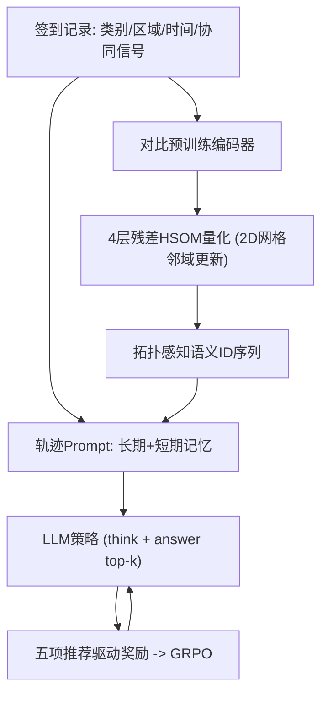
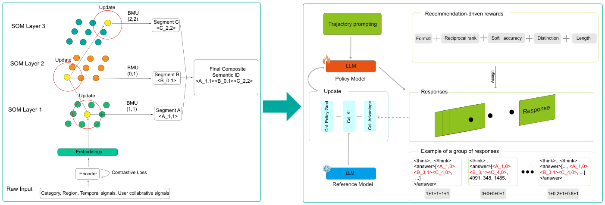

# Refine-POI: Reinforcement Fine-Tuned Large Language Models for Next Point-of-Interest Recommendation (强化微调大模型驱动的下一兴趣点推荐)

- **会议/期刊**: SIGIR（arXiv:2506.21599v5）
- **作者与机构**: Peibo Li, Shuang Ao, Hao Xue, Yang Song, Maarten de Rijke, Johan Barthélemy, Tomasz Bednarz, Flora D. Salim（UNSW / HKUST-GZ / 阿姆斯特丹大学 / Nvidia）
- **推荐链路定位**: 端到端生成式（Next-POI 生成式召回/排序一体化）
- **研究方向**: 时空轨迹与 POI 推荐 / 大语言模型推荐
- **论文原文**: [论文原文链接](https://arxiv.org/abs/2506.21599v5)
- **开源代码**: [开源代码仓库链接](https://github.com/neolifer/RefinePOI)

## TL;DR (1分钟核心速览)

现有 LLM 化 Next-POI 方案有两处硬伤：语义 ID 由 RQ/K-Means 式欧氏最近邻+随机初始化构造，属"拓扑盲"索引，编号相邻不等于语义相邻；SFT 只能精确复现单一 ground-truth，陷入"答案固着"，无法产出 top-$k$列表与推理。Refine-POI 用层次自组织映射（HSOM）把 POI 量化成二维网格坐标以保语义连续，再用 GRPO 的列表级奖励（格式/倒数排名/软准确/去重/长度）直接优化 top-$k$；三个 LBSN 数据集上 Acc@5 相对最强基线最高 +12.12%，MRR +12.53%。

## Background & Motivation (背景与核心矛盾)

- **主流范式**: Next-POI 已从 FPMC/LSTM/STHGCN 等序列-图模型转向 LLM 化路线，分 prompt 派（LLM-Mob、AgentMove）与微调派（LLM4POI、GNPR-SID），后者把签到轨迹转 QA 并做 SFT。
- **前人局限一（表征）**: 语义 ID 的码本是无序向量集合，映射仅靠欧氏距离最小化与随机初始化，码本索引相邻却在隐空间语义割裂，LLM 难以从 ID 序列中抽取模式。
- **前人局限二（监督）**: POI 数据缺少"推理路径"与"最优排序列表"标签；SFT 被迫把任务当作单 ID 确定性检索，产生答案固着，top-$k$ 与解释均无从习得。
- **核心洞察**: 若把码本组织成带邻域拓扑的二维格（SOM），坐标邻近即语义邻近；若把"是否命中、命中第几位、列表是否多样"写成奖励，单条 ground-truth 就足以监督整个 top-$k$ 列表。
- **本文切入点**: 拓扑感知 SID + 推荐驱动奖励的强化微调（RFT），并顺带定位了 RFT 训练中推理退化的熵坍缩根因。

## Method (核心方法设计)

### 1. 整体框架 (Overall Architecture)

离线阶段先抽取 POI 的四类特征（类别、Plus Codes 映射的区域、24 时槽时间画像、top-10 高频访客协同信号）拼成 $p_e$，用 InfoNCE 对比预训练平滑编码器并冻结；随后 4 层 HSOM 以残差方式逐层量化，输出形如 `⟨A_1,2⟩⟨B_2,3⟩⟨C_4,5⟩⟨D_1,1⟩` 的复合语义 ID。在线/训练阶段把用户长期记忆（按月分段的历史轨迹）与短期记忆（最近一条轨迹）转成 QA prompt，喂给 Qwen2.5-7B / Llama3.1-8B，模型先输出 `<think>` 推理再输出 `<answer>` 的 top-$k$ SID 列表；同一 prompt 采样 8 条 rollout，按五项奖励算组内优势，用 GRPO + KL 惩罚更新策略，推理时一次前向即得原生排序列表。

<figure class="paper-figure" markdown="span">
  <figcaption>图 2</figcaption>
</figure>

### 2. 关键设计拆解 (Key Designs)

1. **层次自组织映射量化（拓扑保序 SID）**：传统残差量化每层码本独立随机初始化、只按最近邻硬分配，邻域节点互不影响，导致索引空间与语义空间脱钩。本文每层是一个**全局** SOM 二维格，节点带固定坐标 $u_k$与可学习原型$w_k$，先求 BMU 再按高斯邻域批量平滑更新：

$$c^{(l)}=\arg\min_{k}\lVert r^{(l-1)}-w_k^{(l)}\rVert^2,\qquad r^{(l)}=r^{(l-1)}-w^{(l)}_{c^{(l)}}$$

$$\Delta w_k=\frac{\sum_{i=1}^{B}h(k,k_i^{*})(r_i-w_k)}{\sum_{i=1}^{B}h(k,k_i^{*})+\epsilon},\quad h(k,k_i^{*})=\exp\!\left(-\frac{\lVert u_k-u_{k_i^*}\rVert^2}{2\sigma^2}\right)$$

   分母按累计邻域影响归一化是关键：它抑制随机流式更新带来的拓扑撕裂，使语义相近的残差稳定落到相邻坐标；逐层贪心训练（上层收敛即冻结、下层只拟合残差）保证每个原型获得充分更新。

2. **推荐驱动的列表级奖励（替代标签模仿）**：单一 GT 无法评价整张列表，且 SFT 后模型爱输出重复项。本文用五项规则奖励加权：格式奖励 $r_F$（语法正确且恰$k$项）、倒数排名奖励$r_{RR}=1/\text{rank}$（命中越靠前越高）、软准确奖励$r_{soft}$（容忍早期格式错误）、去重奖励$r_{dis}=|\{\text{item}\}|$、长度奖励$r_{len}=\min(1, len_{out}/len_{tgt})$ 防止推理退化为一句话：

$$r=w_1 r_F+w_2 r_{RR}+w_3 r_{soft}+w_4 r_{dis}+w_5 r_{len}$$

   组内 8 条 rollout 归一化得优势，策略梯度 + KL 惩罚（系数 0.01）更新；奖励权重 0.6/0.2/0.4 分配给准确类/格式/长度，准确类内部再按 0.7/0.2/0.1 分给 RR/软准确/去重。RR 项把"排序位置"写进梯度，是原生 top-$k$ 能力的来源。

3. **KL-Cov 熵正则：修复推理退化**：朴素 GRPO 下策略熵在前 ~100 步从 1.47 nats 塌到 0.26 nats，有据推理（引用用户具体签到次数/时段）比例同步从 78% 跌至 2%（Pearson $r=0.72$），且熵坍缩**先于**推理坍缩发生。本文对"对数概率与优势协方差最高的少量 token"施加 KL 惩罚，只压制过度自信更新而不扰动整体训练：NYC 上有据推理从 23.9% 升至 98.7%，Acc@1 0.358→0.375、Acc@10 0.669→0.646 基本不掉点。

## Experimental Setup & Evaluation Protocol (实验设置与评估协议)

- **数据集与预处理**: 三个真实 LBSN 数据集，均按 Yan et al. 流程过滤——POI 与用户历史签到各少于 10 条者剔除（等价 10-core），按 24 小时间隔切分轨迹并丢弃单点轨迹。

| 数据集 | 平台/区域 | 采集跨度 | 预处理 | 说明 |
| :--- | :---: | :---: | :---: | :--- |
| NYC | Foursquare 纽约 | 11 个月 | 10-core + 24h 轨迹切分 | 密度较高、POI 集中 |
| TKY | Foursquare 东京 | 11 个月 | 同上 | 数据量最大、共享模式更强 |
| CA | Gowalla 加州+内华达 | 更长时段/更大地理范围 | 同上 | 跨城市稀疏场景 |

- **数据划分与防穿越**: 每条用户记录按时间戳排序后 **8:1:1 全局时序切分**（前 80% 训练 / 10% 验证 / 10% 测试）；验证与测试集必须包含训练集中的全部用户与 POI，未见过者直接剔除，杜绝冷启穿越。
- **排名评测协议**: 评测指标 Acc@{1,5,10} 与 MRR，属**生成式全库排序**（模型直接从整个 SID 码本生成列表，无负采样候选集，因此不存在采样负例带来的乐观偏差）；SFT 基线不原生支持列表，作者额外用温度 $T=1.0$ 采样 10 条并按长度归一化对数概率重排，以尽量公平对比。
- **对比基线**: 12 个基线分三类——序列/深度学习（FPMC、LSTM、PRME、STGCN、PLSPL、STAN、GETNext、STHGCN）、零样本 prompt（LLM-Mob、LLM-Move，GPT-4o 骨干）、SFT 微调（LLM4POI、GNPR-SID，Llama3.1-8B）。本文 backbone 为 Qwen2.5-7B 与 Llama3.1-8B，lr $5e^{-5}$、cosine 调度、3 epoch，HSOM 4 层网格 4×6/4×6/8×8/8×8，8 卡 A100/H200。

## Key Experimental Results (实验关键数据)

### 1. 主实验对比 (Main Results)

| 方法 | 训练范式 | NYC Acc@1 | NYC Acc@5 | NYC Acc@10 | NYC MRR | TKY Acc@5 | TKY MRR | CA Acc@5 | CA MRR |
| :--- | :---: | :---: | :---: | :---: | :---: | :---: | :---: | :---: | :---: |
| STAN | 序列 | 0.2231 | 0.4582 | 0.5734 | 0.3253 | 0.3798 | 0.2852 | 0.2348 | 0.1869 |
| GETNext | 图/GCN | 0.2435 | 0.5089 | 0.6143 | 0.3621 | 0.4417 | 0.3262 | 0.2852 | 0.2103 |
| STHGCN | 超图 | 0.2734 | 0.5361 | 0.6244 | 0.3915 | **0.5207** | **0.3986** | 0.3529 | 0.2558 |
| LLM-Mob | Zero-shot | 0.2343 | 0.5066 | 0.5660 | 0.3502 | 0.3837 | 0.2519 | 0.0779 | 0.0495 |
| LLM4POI | SFT | 0.3372 | 0.3982 | 0.5010 | 0.3807 | 0.3797 | 0.3492 | 0.2586 | 0.2371 |
| GNPR-SID | SFT | 0.3618 | 0.4472 | 0.5521 | 0.4133 | 0.3930 | 0.3662 | 0.2846 | 0.2559 |
| Refine-POI | SFT | **0.3751** | 0.4381 | 0.5269 | 0.4064 | 0.4100 | 0.3803 | 0.3099 | 0.2750 |
| **Refine-POI** | **RFT** | 0.3638 | **0.6011** | **0.6696** | **0.4651** | **0.5216** | **0.4072** | **0.3755** | **0.2833** |
| Improv.% | – | +0.55% | **+12.12%** | **+7.24%** | **+12.53%** | +0.17% | +2.16% | **+6.40%** | **+10.71%** |

（Improv.% 为最佳 Refine-POI 变体相对最强基线的相对提升；TKY Acc@10 为 0.5881 vs STHGCN 0.5980，即 −1.66%，是唯一负项。）

### 2. 消融实验 (Ablation Study)

| 变体 | NYC Acc@1 | NYC MRR | TKY Acc@1 | TKY MRR | CA Acc@1 | CA MRR |
| :--- | :---: | :---: | :---: | :---: | :---: | :---: |
| Refine-POI (full) | **0.3638** | **0.4651** | **0.3214** | **0.4072** | **0.2174** | **0.2833** |
| w/o SID（退回原子 ID） | 0.3400 | 0.4454 | 0.3154 | 0.3986 | 0.1939 | 0.2647 |
| w/o rr（去倒数排名奖励） | 0.1749 | 0.3218 | 0.1373 | 0.2728 | 0.1032 | 0.1947 |
| w/o soft acc | 0.3512 | 0.4502 | 0.3114 | 0.3648 | 0.2044 | 0.2722 |
| w/o distinct | 0.3372 | 0.4416 | 0.2979 | 0.3857 | 0.2015 | 0.2678 |
| w/o len | 0.3582 | 0.4617 | 0.3131 | 0.3944 | 0.1993 | 0.2699 |

### 3. 关键实验发现 (Key Findings)

1. **RR 奖励是绝对命门**：移除 `rr` 后 NYC Acc@1 从 0.3638 崩到 0.1749（−52%）、MRR 0.4651→0.3218，跌幅远超其他任何消融，说明"命中位置"必须写进奖励，仅靠软准确率的二值信号无法塑造排序。
2. **拓扑保序可量化**：用 gap-statistic 式零假设对比，Refine-POI 的归一化类内紧致度 NICC 0.6076（GNPR-SID 0.7941，↓23%），归一化类间分离度 NICS 0.7016（基线 0.2817，约 2.5 倍），逐类别最大降低类内散布 86%，佐证"坐标邻近=语义邻近"。
3. **top-1 与 top-k 存在系统性权衡**：SFT 变体拿下 NYC 最高 Acc@1 0.3751，但 Acc@5/Acc@10 仅 0.4381/0.5269，被 RFT 的 0.6011/0.6696 反超，说明 SFT 是"过拟合首位的猜测器"，RFT 才是"构造高质量列表"；与此同时熵控制几乎零成本地把有据推理从 23.9% 拉到 98.7%（Acc@1 0.358→0.375，Acc@10 0.669→0.646）。

## Highlights & Limitations (亮点、对比与审稿批判)

- **与代表作对比**: 相对 GNPR-SID（同为语义 ID + SFT），本文换掉了"欧氏最近邻+随机初始化"的拓扑盲码本，并把标签模仿换成列表奖励，因而在 Acc@5 上从 0.4472 跃至 0.6011；相对 STHGCN 这类图模型，本文不需要构图，靠 LLM 记忆 + 语义 ID 直接泛化；相对 LLM-Mob/LLM-Move 零样本 prompt，本文可训练记忆全量 POI，避免"候选只在 prompt 里"的召回天花板。
- **可迁移亮点**: (i) 把码本设计成带邻域核的 SOM 全局格，可直接嵌入 RQ-VAE/TIGER 类生成式召回的分词器，缓解 prefix 冲突；(ii) 用"倒数排名 + 去重 + 长度"三件套替代二值奖励，是把 R1 式 RFT 迁到列表任务的通用配方；(iii) 以策略熵/有据推理率作为 RFT 训练健康度的廉价诊断指标。
- **审稿级局限批判**: (i) 训练开销明显上升——NYC 上 4.5 h/epoch、632 GB 显存（LLM4POI 为 3.1 h、512 GB），源于每题 8 条 rollout 与长 CoT，线上部署成本未评估；(ii) 作者自承有据与空泛推理的准确率相当，自然语言理由并非预测的因果驱动，可解释性仍属"事后合理"；(iii) TKY 上 Acc@10 反而劣于 STHGCN、冷启动子集也输给 LLM4POI，且奖励权重仅在 NYC 调过直接迁移，跨域鲁棒性与显著性检验（未报告 $p$ 值）都偏弱。

## Rating (四维评分)

- **方法创新性 (Novelty)**: ⭐⭐⭐⭐ （把 SOM 邻域拓扑引入语义 ID 量化、并用列表级奖励替代标签模仿，两处都是对症下药的真增量；KL-Cov 修复熵坍缩的诊断链条尤具洞察）
- **评估协议与实验扎实度 (Protocol & Experiments)**: ⭐⭐⭐⭐ （3 数据集 + 12 基线 + 时序切分 + 消融/冷启/语义几何/效率四类分析齐全，但缺显著性检验，TKY 与冷启上并非全面领先）
- **写作与数学规范度 (Clarity & Rigor)**: ⭐⭐⭐⭐ （HSOM 批量更新与奖励公式定义清楚、动机-算子-效果闭环完整；个别改进幅度百分比与表格数值口径不完全一致，需读者自行核算）
- **工业落地与复现价值 (Industrial & Practical Value)**: ⭐⭐⭐ （代码已开源、语义 ID 可复用；但 RFT 训练显存与时延约为 SFT 的 1.4 倍，且需 LLM 全参微调，线上推理与成本优化尚待验证）

