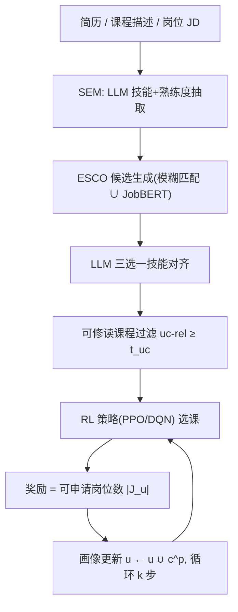
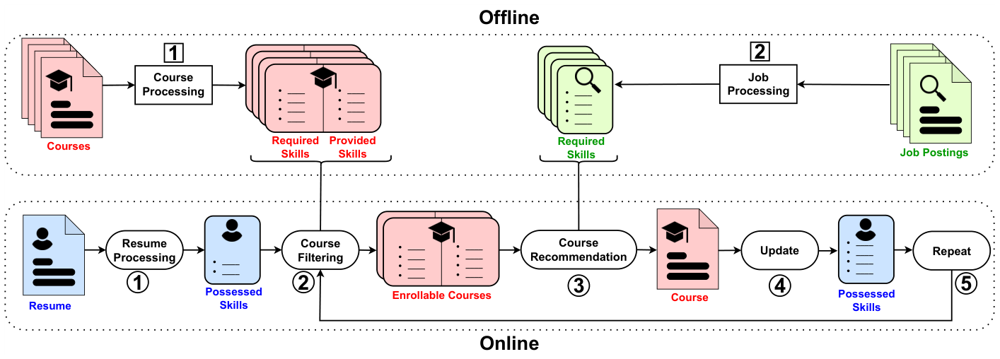

# Course Recommender Systems Need to Consider the Job Market (课程推荐系统需要考虑就业市场)

- **会议/期刊**: SIGIR 2024 (Perspective Paper)
- **作者与机构**: Jibril Frej, Anna Dai, Syrielle Montariol, Antoine Bosselut, Tanja Käser (EPFL ML4ED & NLP Labs)
- **推荐链路定位**: 端到端序列推荐（多轮课程路径规划，跨"召回-策略"链路）
- **研究方向**: 强化学习与动态探索推荐 / 大语言模型推荐
- **论文原文**: [arXiv:2404.10876v2](https://arxiv.org/abs/2404.10876v2)
- **开源代码**: [Jibril-Frej/JCRec](https://github.com/Jibril-Frej/JCRec)

## TL;DR (1分钟核心速览)

现有课程推荐只拟合"学习者-课程"交互与课程内容，忽视就业市场技能需求的演化，造成技能供需错配。本文提出 JCRec：用免监督 LLM 流水线 SEM 把简历、课程、岗位统一对齐到 ESCO 技能分类（含四级熟练度），再把"推荐 $k$门课程"建模为以"用户可申请岗位数$|\mathcal{J}_u|$"为奖励的 MDP，比较 Exhaustive、Greedy、DQN、PPO。在 52 份简历 / 100 课程 / 100 岗位的小规模评估中，PPO 在$k=4$ 时奖励 8.0（Greedy 7.0，+14.3%）且时延 21ms vs 102ms（约 4.9 倍加速）。

## Background & Motivation (背景与核心矛盾)

- **主流范式**: 课程推荐依赖学习者-课程交互矩阵、课程内容/讲师/评分/评论，近年多封装为知识图谱或神经序列模型来优化准确率、公平性与可解释性。
- **前人局限**: ① 训练信号来自历史选课，市场技能需求变化快于数据更新，模型会持续推荐"已过时技能"的课程；② 推荐单门课程而非有先后依赖的学习路径，用户目标（转岗/提升市场竞争力）无法被表达。
- **核心洞察 (Key Insight)**: 唯一使用简历+岗位的 Skill Scanner 仅把技能集编码到同一向量空间做相似度，未显式利用"技能需求分布"这一外部信号；若把"岗位需求"变成可计算的奖励，推荐目标就从"选课概率"转为"就业可及性"。
- **本文切入点**: 用 LLM 免监督技能抽取获得结构化技能-熟练度表示，再用 RL 求解最大化长期岗位覆盖的课程序列。

## Method (核心方法设计)

### 1. 整体框架 (Overall Architecture)

离线阶段，SEM 对每门课程抽取"入学所需技能 $c^{r}$"与"结课获得技能$c^{p}$"（各带熟练度），对每条岗位抽取所需技能集$j$；在线阶段，用户上传简历后 SEM 得到其技能集$u$，以用户-课程相关性阈值$t_{uc}$过滤出可修读集合$\mathcal{C}_u$，RL 策略从中选一门课，用户画像按$u \leftarrow u \cup c^{p}$确定性更新，并重新计算可申请岗位数作为奖励，循环$k$ 步输出完整课程路径。全过程无人工标注、无选课交互，只依赖文本文档。

<figure class="paper-figure" markdown="span">
  <figcaption>图 2</figcaption>
</figure>

### 2. 关键设计拆解 (Key Designs)

**1) SEM：把 13,890 条 ESCO 技能塞进有限上下文的三段式对齐**：直接让 LLM 在整张分类表上做实体链接会超上下文且同义词召回差，故拆为「抽取 → 候选 → 裁决」：先按句（简历逐句独立，岗位/课程两句一组保留上下文）做六-shot 抽取，输出技能+熟练度（beginner/intermediate/expert/unknown）；再为每个技能构造候选集
$\mathcal{K}(s)=\mathrm{Top3}_{\text{fuzzy}}(s)\cup \mathrm{Top3}_{\text{JobBERT}}(s)$，
规则路补精确匹配、嵌入路补同义改写（互补：前者命中别名但漏同义，后者语义近但事实错）；最后让 LLM 只做三选一裁决。这样分类表规模可任意扩张而不再受上下文限制。

**2) 公理化相似度：让奖励"可解释且不可作弊"**：若只用余弦相似度，用户重复学已掌握技能也能刷高奖励。作者按 IR 公理设计两条函数：用户-岗位匹配度
$\mathrm{uj\text{-}sim}(u,j)=\frac{1}{|j|}\sum_{s\in j}\frac{\min(l_s^{u},l_s^{j})}{l_s^{j}}$，
其中 $\min$ 保证"满足全部要求即得满分"（不会因超额能力突破 1）；用户-课程相关性
$\mathrm{uc\text{-}rel}(u,c)=\mathrm{uc}_r(u,c^{r})\cdot\left(1-\mathrm{uc}_p(u,c^{p})\right)$，
右因子在用户已掌握全部授课技能时归零，天然惩罚"重复学习"。阈值 $t_{uc}=t_{uj}=0.8$。

**3) MDP 建模、训练与推理开销**：状态 $=$用户技能集$u$，动作$=$课程$c\in\mathcal{C}$，奖励$r=|\mathcal{J}_u|=\left|\{j\in\mathcal{J}\mid \mathrm{uj\text{-}sim}(u,j)\ge t_{uj}\}\right|$，若推荐不可修读课程则$r=-1$并终止回合；转移确定性（学完即得技能）。DQN 与 PPO 均用 Stable-Baselines3 默认超参，输入维$|S|$、输出维$|\mathcal{C}|$，训练 5M 步，无负采样概念（免负采样，奖励即监督）。复杂度对比清晰：Exhaustive 为$O(|\mathcal{J}|\cdot|\mathcal{C}|^{k})$，Greedy 为$O(k|\mathcal{J}||\mathcal{C}|)$，RL 为$O(k|S||\mathcal{C}|)$——当技能数远小于岗位数时，RL 从复杂度上就赢。

## Experimental Setup & Evaluation Protocol (实验设置与评估协议)

- **数据集与预处理**: 领域限定为英语 IT / IT 管理；岗位 3,500 条爬取 JD，COCO 课程 43,113 → 英语 34,111 → IT 相关 27 类 12,291 → 随机抽 3,000；Kaggle 简历 2,484+166 → 去除非 IT 后 233 份。ESCO 13,890 技能过滤为 1,794 条 IT 技能。

| 文档类型 | 句子/文档 | 抽取技能数 | 有熟练度比例 | 成功对齐 ESCO |
| :--- | :---: | :---: | :---: | :---: |
| 岗位 JD | 26.9 | 43.2 | 71.1% | 16.6 |
| 课程-先修 | 2.0 | 3.2 | 72.0% | 2.2 |
| 课程-目标 | 2.0 | 6.8 | 79.6% | 4.2 |
| 简历 CV | 2.4 | 112.9 | 45.4% | 22.6 |

- **数据划分与防穿越**: 原文**未做训练/测试划分**，也无历史交互数据；RL 训练环境与评估环境同为这 100 岗位 / 100 课程 / 52 份简历（"技能数 < 15"以模拟职场新人），严格说属于**同环境仿真评估**而非留出验证。
- **排名评测协议**: 非 `Full-Ranking`、非 `Sampled Ranking`；采用两个自助指标——平均可申请岗位数 `Rwd` 与单次推荐时延 `Time(ms)`，不涉及 MRR/nDCG/Hit。
- **对比基线与超参**: 上界 Exhaustive（$k\le 3$）、启发式 Greedy、DQN、PPO；阈值均 0.8，LLM 为 GPT-3.5-turbo（temperature 0）。熟练度抽取在 10 条岗位、212 个技能的人工标注上准确率 **0.68**。

## Key Experimental Results (实验关键数据)

### 1. 主实验对比 (Main Results)

| 方法 | $k{=}1$Rwd |$k{=}2$Rwd |$k{=}3$Rwd |$k{=}4$Rwd |$k{=}5$Rwd |$k{=}5$ Time (ms) |
| :--- | :---: | :---: | :---: | :---: | :---: | :---: |
| Exhaustive (上界) | **1.0** | **2.5** | **5.6** | – | – | 102 ($k{=}3$) |
| Greedy | **1.0** | 2.0 | 4.1 | 7.0 | **10.5** | 102 |
| DQN | 0.9 | 1.7 | **4.1** | 6.3 | 7.1 | 24 |
| PPO | 0.5 | 1.1 | 3.4 | **8.0** | 10.4 | **21** |

（初始状态 $k{=}0$各方法 Rwd 均为 0.1；Exhaustive 在$k\ge 4$因预估时间超$10^6$ 秒未跑。）

### 2. 消融实验 (Ablation Study)

原文为 perspective paper，无标准消融，仅有算法替换式对照，下表按"组件移除"重新组织（取 $k=5$）：

| 配置 | 移除的组件 | Rwd | Time (ms) | 结论 |
| :--- | :--- | :---: | :---: | :--- |
| Full (PPO) | – | 10.4 | 21 | 长序列最优性价比 |
| w/o 值函数学习 (DQN) | 策略梯度、用 Q 学习 | 7.1 | 24 | 同一奖励下算法族差异巨大 |
| w/o 学习 (Greedy) | 全部参数化策略 | **10.5** | 102 | 短视贪心质量仍强但慢 5× |
| w/o 序列 ($k{=}1$ 单课) | 多步规划 | 1.0 | 16 | 单步收益远低于 5 步（10.5），验证 P3 |
| 无 RL 上界 (Exhaustive) | 采样近似 | 5.6 ($k{=}3$) | 102+ | 贪心在$k{=}3$ 落后 27% |

### 3. 关键实验发现 (Key Findings)

1. **序列长度决定算法选型，而非"RL 一定更强"**：$k\le 3$时 Greedy 与最优上界的差距被 FLOPs 换质量——但 Exhaustive 在$k=3$达 5.6 而 Greedy 仅 4.1（差 26.8%），说明贪心确实是短视的；一旦$k=4$ 贪心反被 PPO 超越（7.0 vs 8.0，+14.3%），因为"先学 Python 再学 LLM"这类互补技能的收益只有跨步才能显现。
2. **RL 的收益主要是时延不是精度**：$k=5$时 PPO 与 Greedy 奖励几乎持平（10.4 vs 10.5，−1.0%），但耗时 21ms vs 102ms，约 **4.9× 加速**，且$O(k|S||\mathcal{C}|)$与岗位库规模$|\mathcal{J}|$ 解耦，在真实百万级 JD 场景优势会进一步放大。
3. **DQN 在长程稀疏奖励下明显退化**：DQN 是全场最快（$k=5$仅 24ms，$k=1$为 4.8ms），但$k=3\to5$ 奖励从 4.1 掉到 7.1，远低于 PPO 的 10.4；由于奖励只有在"技能组合恰好跨过岗位匹配阈值"时才跳变，Q 学习的单步 TD 目标难以回传这种延迟增益，而 PPO 的策略梯度更适合这种平台型奖励。

## Highlights & Limitations (亮点、对比与审稿批判)

- **与代表作对比 (vs. Prior Work)**: 相比以交互矩阵为核心的神经课程推荐（Xuetang/COCO 上的 NCF/序列模型类工作），本文根本不使用选课日志，信号全部来自外部文本；相比唯一同源的 Skill Scanner（Word2vec/GloVe 聚类技能集），本文多了熟练度维度、显式需求分布（岗位计数）与时序决策；相比经典 RL 序列推荐（用点击/停留作奖励），其奖励是"就业可及性"这一外部社会指标，避免了曝光偏差但有阈值敏感问题。
- **可迁移亮点**: ① 「Top-3 规则 ∪ Top-3 嵌入 → LLM 三选一」的候选-裁决范式可直接迁移到任何大分类表（商品类目、POI 品类、标签体系）的零标注实体链接；② 用 $\min(l_u,l_j)/l_j$ 构造的"能力覆盖度"奖励，可迁移到技能/资质类匹配推荐（招聘、保险配置、课程-岗位双向推荐）。
- **审稿级局限批判**: ① 评估规模极小（52 用户、100 课程、100 岗位）且**无训练/测试划分**，RL 在同环境上训练评估，奖励方差极大（一门课可一次性解锁多个岗位），没有任何显著性检验，结论稳健性存疑；② 关键阈值 $t_{uc}=t_{uj}=0.8$、unknown 熟练度的启发式填补（用户填 beginner、岗位填 expert）与"学完即获得技能"的确定性转移假设，都未做敏感性分析；熟练度抽取准确率仅 0.68，误差会沿流水线放大；③ 仅支持英语 IT 单域，且视角上默认用户唯一目标为"最大化市场竞争力"，与 P4"用户目标对齐"自相矛盾。

## Rating (四维评分)

- **方法创新性 (Novelty)**: ⭐⭐⭐⭐ （把就业市场技能需求做成外部奖励并给出公理化相似度，问题定义本身比模型更创新；但 RL 与 LLM 抽取均为现成组件的组合）
- **评估协议与实验扎实度 (Protocol & Experiments)**: ⭐⭐ （无留出划分、无排序指标、52 用户小样本、无显著性检验，仅有时延与奖励两条曲线，属于原型验证而非严谨对比）
- **写作与数学规范度 (Clarity & Rigor)**: ⭐⭐⭐⭐ （P1–P5/RD1–RD6 的议题梳理清晰，相似度函数附公理与边界证明，复杂度分析明确；但缺少超参敏感性与误差传播分析）
- **工业落地与复现价值 (Industrial & Practical Value)**: ⭐⭐⭐ （代码开源、全免监督流水线易接入招聘/教育平台，PPO 推理仅 21ms；但依赖 GPT-3.5 批量处理百万级 JD 的离线成本与英语单域限制明显）

