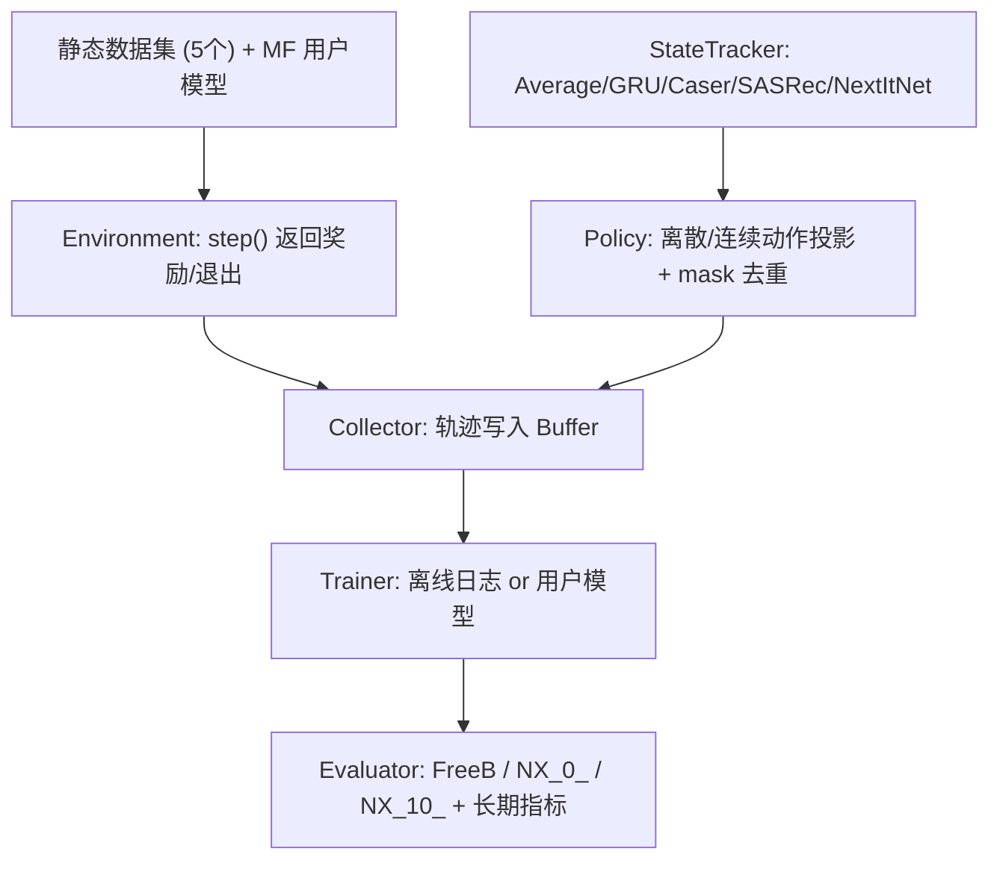
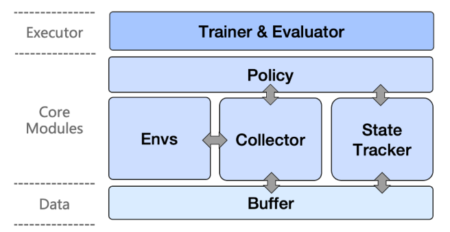
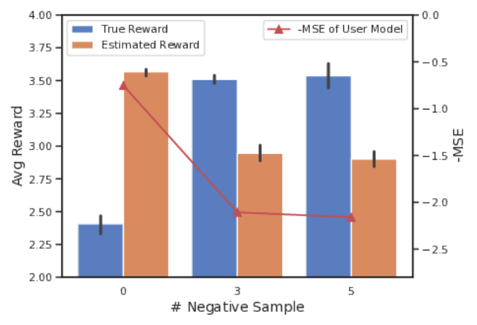

# EasyRL4Rec: An Easy-to-use Library for Reinforcement Learning Based Recommender Systems（面向强化学习推荐的易用代码库）

- **会议/期刊**: SIGIR 2024 (Resource Track)
- **作者与机构**: Yuanqing Yu, Chongming Gao, Jiawei Chen, Heng Tang, Yuefeng Sun, Qian Chen, Weizhi Ma, Min Zhang（清华大学、中国科学技术大学、浙江大学）
- **推荐链路定位**: 端到端（策略级）序列推荐 + 离线仿真评测
- **研究方向**: 强化学习与动态探索推荐 / 工业级架构与评测基准
- **论文原文**: [https://arxiv.org/abs/2402.15164v3](https://arxiv.org/abs/2402.15164v3)
- **开源代码**: [https://github.com/chongminggao/EasyRL4Rec](https://github.com/chongminggao/EasyRL4Rec)

## TL;DR (1分钟核心速览)

RL-based Rec 领域长期存在三大痛点：环境搭建成本高、评测指标各自为政（NDCG vs. 累计奖励）、以及超过 60% 工作未开源导致复现困难。EasyRL4Rec 给出一个统一代码库：基于 5 个真实公开数据集（Coat/YahooR3/MovieLens/KuaiRec/KuaiRand）构建轻量 Gymnasium 风格交互环境，解耦出 Environment / Policy / StateTracker / Collector 四大模块，并提供以长期收益为核心的统一离线仿真评测管线（含退出机制与去重机制）。在 MF 用户模型模拟的 Off-Policy 评测下，系统复现 15+ 策略并给出反直觉发现：离散动作显著优于连续动作（KuaiRec 上 A2C $R_{\text{cumu}}$ 25.24 vs. DDPG 9.22，约 2.7×），且 On-Policy 全面优于 Off-Policy。

## Background & Motivation (背景与核心矛盾)

- **主流范式**: 将推荐视为 MDP $\mathcal{M}=(\mathcal{S},\mathcal{A},P,R,\gamma)$，商品为动作，点击/评分/停留为奖励，目标是最大化累计奖励$G_T=\sum_{t=0}^{T}\gamma^{t}r(s_t,a_t)$。
- **前人局限 1（工程）**: RecoGym/RecSim/Virtual-Taobao/KuaiSim 等仅提供环境，缺少策略库与状态建模；rllib、Tianshou 等通用 RL 库又缺乏推荐场景的环境与状态构造，无法直接落地。
- **前人局限 2（评测）**: 一部分工作沿用 NDCG/HR 等单步排序指标，另一部分用累计奖励、交互长度，跨论文不可比；且大量工作细节缺失、复现困难。
- **核心洞察 (Key Insight)**: 推荐的状态**无法从环境直接观测**（不同于游戏），必须由历史行为序列人工建模；同时商品空间天然离散，连续动作策略需要一个显式的"动作→商品"投影机制。
- **本文切入点**: 不做新算法，而是把"环境—状态—策略—采样—训练—评测"整条链路标准化并开源，用统一协议把已有方法放到同一张表上比较。

## Method (核心方法设计)

### 1. 整体框架 (Overall Architecture)

库围绕四个核心模块组织：**Environment**（由静态数据集构建，`step()` 返回下一状态与奖励；空缺点由测试集训练的 MF 模型补全）、**StateTracker**（把用户画像与历史动作序列编码为状态向量）、**Policy**（继承 Tianshou 并针对推荐改造）、**Collector**（串联 Env 与 Policy，把轨迹 $\{(o_1,a_1,r_1),\dots,(o_T,a_T,r_T)\}$流式写入 Buffer）。Buffer 支持$n$ 个隔离环境并发交互，用起始符号切分轨迹。外层由 **Trainer**（离线日志学习 / 用户模型学习两种范式）与 **Evaluator**（FreeB / NX_0_ / NX_10_ 三种模式）两个执行器驱动整个闭环。

<figure class="paper-figure" markdown="span">
  <figcaption>图1：EasyRL4Rec 的架构。该库围绕四个核心模块构建：Environment（缩写为 Envs）、Policy、StateTracker 和 Collector。Buffer 是组织原始数据轨迹的基础数据结构，而 Trainer 和 Evaluator 作为执行器管理整个流程。</figcaption>
</figure>

### 2. 关键设计拆解 (Key Designs)

1. **离散化动作投影（连续动作策略的可用化）**：痛点在于 DDPG/TD3 等输出连续向量，而商品是离散 ID，直接回归会造成语义错位。库中先把状态编码为 $\mathbf{h}_t$，再用与商品嵌入的相似度做投影并屏蔽已推荐项：$a_t=\arg\max_{i\in\mathcal{I}}\ \langle \mathbf{h}_t,\mathbf{e}_i\rangle\cdot\left(1-\mathbb{I}[i\in\mathcal{R}_{<t}]\right)$。直觉上这是在潜空间里做"最近邻反量化"（把连续向量映射回最近的商品），既保留连续策略的探索噪声，又把动作约束回合法商品集合，去重 mask 则直接支撑多轮推荐场景。

2. **状态建模的解耦（StateTracker 可插拔）**：状态不可观测是推荐 RL 与传统 RL 的最大差异。库将状态编码从策略中剥离，提供 Average（用户嵌入 + 历史均值池化）、GRU、Caser（把行为序列当"图像"做 CNN）、SASRec（自注意力平衡长短期）、NextItNet（空洞卷积长程依赖）五种实现，状态嵌入与策略**联合优化**。这样研究者改状态、改策略时互不干扰，也使得"状态建模 vs. 策略学习"的贡献可被单独测量。

3. **训练范式与评测协议（本库最核心的增量）**：训练侧两种范式——(a) 从离线日志学习（Batch RL），日志切分支持 Sequential / Convolution / Counterfactual 三种 Buffer 构造；(b) 用预训练用户模型（DeepFM）代替真实用户做交互式 RLHF 式训练。评测侧统一为离线仿真：用测试集训练的 MF 补全缺失反馈，配合**退出机制**（满足终止条件即结束会话）与**去重选项**，形成三种模式 FreeB（允许重复 + 退出）、NX_0_（禁止重复 + 退出）、NX_10_（禁止重复、固定 10 轮无退出）。核心指标为 $R_{\text{cumu}}=\sum_{t}r_t$、$R_{\text{avg}}$、$Length$。

## Experimental Setup & Evaluation Protocol (实验设置与评估协议)

- **数据集与预处理**: 五个数据集覆盖电商/音乐/电影/短视频，训练-测试按用户划分（KuaiRec 另有独立测试用户）：

| 数据集 | #Users | #Items | #Interactions | 领域/说明 |
| :--- | :---: | :---: | :---: | :--- |
| Coat | 290 | 300 | 7.0k / 4.6k | 电商，含显式评分，小而密 |
| YahooR3 | 15,400 | 1,000 | 311.7k / 54.0k | 音乐，含缺失非随机评分 |
| MovieLens-1M | 6,040 | 3,952 | 800.4k / 200.5k | 电影，带时间戳 |
| KuaiRec | 7,176 | 10,728 | 12,530.8k / 4,676.6k | 短视频，含全曝光矩阵 |
| KuaiRand | 26,210 | 7,538 | 1,141.6k / 1,186.1k | 短视频，随机曝光 |

- **数据划分与防穿越**: 按用户划分训练/测试交互（非 `Leave-One-Out` 会话切分）；离线日志按时间序切轨迹，用户模型仅在训练集上拟合，测试集交互仅用于 MF 补全，作为奖励预言机。
- **排名评测协议**: 不是 Full-Ranking 也不是 Sampled Ranking，而是**离线仿真交互式评测（Simulated Interactive Evaluation）**——策略推荐后由 MF 用户模型给出反馈，评测跑 100 条 episode、单条最大长度 30，报告最后 25% 训练 epoch 的均值。
- **对比基线与超参设置**: 覆盖 Batch RL（BCQ/CQL/CRR/SQN）、Off-Policy（DQN/C51/DDPG/TD3）、On-Policy（PG/A2C/PPO）及推荐专用（DORL、Intrinsic）；用户模型为 DeepFM；100 epochs，学习率 $1e^{-3}$，随机种子 2023。

## Key Experimental Results (实验关键数据)

### 1. 主实验对比 (Main Results)

Model-free RL 在用户模型指导下训练（$R_{\text{cumu}}$/$Length$，均值越高越好）：

| 方法 | Coat $R_{\text{cumu}}$| Coat$Len$| ML-1M$R_{\text{cumu}}$| ML-1M$Len$| KuaiRec$R_{\text{cumu}}$| KuaiRec$Len$ |
| :--- | :---: | :---: | :---: | :---: | :---: | :---: |
| DQN (off) | 54.35 | 22.02 | 21.96 | 7.46 | 12.65 | 15.95 |
| C51 (off) | 41.08 | 15.83 | 18.00 | 6.34 | 11.59 | 14.23 |
| DDPG(C) | 16.33 | 7.02 | 9.37 | 3.12 | 9.22 | 9.04 |
| PG (on) | 79.34 | 29.84 | 27.95 | 8.57 | 18.89 | 29.86 |
| A2C (on) | **81.80** | **29.92** | 32.43 | 9.97 | **25.24** | 29.92 |
| PPO (on) | 73.03 | 28.86 | 29.23 | 8.00 | 19.08 | **30.00** |
| DORL | 76.99 | 29.58 | **45.77** | **17.34** | 22.52 | 29.90 |
| Intrinsic | 77.43 | 29.87 | 25.92 | 11.37 | 20.94 | 27.02 |

Batch RL（离线日志训练）：CRR 在三个数据集上均最优（Coat $R_{\text{cumu}}$**28.96** /$Len$ **13.00**；ML-1M 10.13 / 3.44；KuaiRec **8.57** / **9.83**），BCQ 最差（9.56/4.06、9.54/2.51、4.34/5.24），CQL 居中。

### 2. 消融实验 (Ablation Study)

| 变量 | 设置 | $R_{\text{cumu}}$|$R_{\text{avg}}$|$Len$ |
| :--- | :--- | :---: | :---: | :---: |
| StateTracker（A2C, KuaiRec） | Average | 18.89 | 0.6326 | 29.86 |
| | GRU | **19.14** | **0.6385** | 29.97 |
| | Caser | 18.67 | 0.6226 | 29.98 |
| | SASRec | 18.55 | 0.6184 | **30.00** |
| | NextItNet | 18.72 | 0.6239 | **30.00** |
| Buffer 构造（CRR, KuaiRec） | Sequential | 8.566 | 0.8713 | 9.833 |
| | Convolution | 8.564 | 0.8704 | 9.842 |
| | Counterfactual | **8.574** | 0.8701 | **9.852** |

覆盖度/多样性/新颖度（KuaiRec）：C51 覆盖度最高（0.1027）但新颖度低（2.5135）；PG 覆盖度最低（0.0015）而新颖度较高（2.9794）；PPO(C) 新颖度最高（3.5830）；DQN 多样性最高（0.8981）。

### 3. 关键实验发现 (Key Findings)

1. **动作空间离散化是决定性因素**：连续动作策略在所有数据集上大幅掉队，KuaiRec 上 A2C 的 $R_{\text{cumu}}$25.24 是 DDPG(C) 9.22 的 **2.7 倍**，$Length$ 29.92 vs. 9.04；说明把连续向量投影回离散商品时误差被放大，探索失效。
2. **On-Policy 显著优于 Off-Policy**：Coat 上 A2C 81.80 vs. DQN 54.35（**+50.5%**），KuaiRec 上 25.24 vs. 12.65（**+99.5%**）；目标策略与行为策略对齐后，更能在用户模型仿真环境里平衡探索-利用，而离线日志训练的 Batch RL 天花板明显（最佳 CRR 仅 28.96）。
3. **状态建模与日志构造几乎不敏感**：五种 StateTracker 间 $R_{\text{cumu}}$ 差距不到 3%（19.14 vs. 18.55），三种 Buffer 构造差距不足 0.15%，且 GRU 即已最优（19.14）。这反过来说明当前 RL 推荐瓶颈不在序列编码器，而在奖励设计与环境/策略结构。
4. **偏好高估 (Preference Overestimation)**：用 0 个负样本训练的用户模型 MSE 更低（拟合更准），但被策略利用后估计奖励虚高、真实奖励极低（图 5）；增加负样本可缓解，与离线 RL 的价值过估计同源。

<figure class="paper-figure" markdown="span">
  <figcaption>图5：在 MovieLens-1M 上偏好高估问题的展示，红线表示 User Model 的 -MSE，橙色柱和蓝色柱分别表示估计奖励和真实奖励。</figcaption>
</figure>

## Highlights & Limitations (亮点、对比与审稿批判)

- **与代表作对比 (vs. Prior Work)**: 相比 RL4RS（只关注数据集与评测、限定 slate 场景）与 KuaiSim（只给仿真器），EasyRL4Rec 是首个同时覆盖"环境 + 状态跟踪 + 离散/连续策略 + 统一训练评测"的完整框架；相比 BEARS/MABWiser/OBP 等 Bandit 库，它把深度 RL 策略（DQN/PPO/CRR 等）纳入同一接口。
- **可迁移亮点**: ①"连续动作→离散商品"的相似度投影 + logits mask 去重，可复用到任何需要软探索但硬约束候选集的检索式策略；②FreeB/NX_0_/NX_10_ 三档评测模式 + 退出机制，是把离线评测推向贴近线上会话行为的实用范式。
- **审稿级局限批判**: ① 奖励预言机是测试集上训练的 MF/DeepFM，只拟合交互矩阵、忽略因果与曝光偏差，偏好高估问题已被作者自己指出但未给出解法；② 仅支持 15+ 个经典策略，缺少近两年新工作（如 PrefRec 类），且连续动作支持本质是"伪连续"，工程价值受限；③ 评测为纯离线仿真，无线上 A/B 或 OPE 置信区间，跨数据集绝对值不可直接横向比较。

## Rating (四维评分)

- **方法创新性 (Novelty)**: ⭐⭐⭐ （作为资源型论文，算法增量有限，创新主要在"离散化动作投影 + 状态解耦 + 三档评测模式"的工程抽象）
- **评估协议与实验扎实度 (Protocol & Experiments)**: ⭐⭐⭐⭐ （5 数据集 × 15+ 策略 × 3 类指标的复现矩阵相当完整，且诚实报告了 StateTracker/Buffer 无显著差异的负结果）
- **写作与数学规范度 (Clarity & Rigor)**: ⭐⭐⭐⭐ （MDP 与模块职责定义清晰、代码示例与表格互相对应；但形式化只停留在 MDP 目标，缺少策略更新推导与复杂度分析）
- **工业落地与复现价值 (Industrial & Practical Value)**: ⭐⭐⭐⭐⭐ （全量开源、Gymnasium 兼容、随机种子固定、一键复现全部表格，是 RL4Rec 领域难得的可复现基座）

