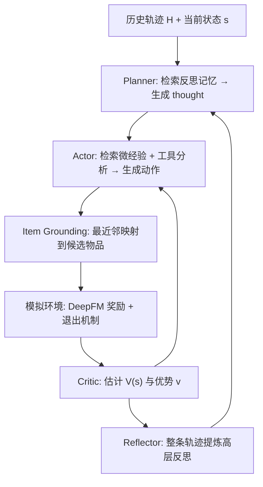
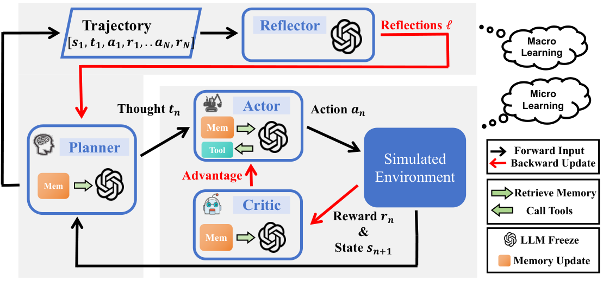

# Large Language Models are Learnable Planners for Long-Term Recommendation (大语言模型是可学习的长期推荐规划器)

- **会议/期刊**: SIGIR 2024
- **作者与机构**: Wentao Shi, Xiangnan He, Yang Zhang, Chongming Gao, Xinyue Li, Jizhi Zhang, Qifan Wang (Meta AI), Fuli Feng — 中国科学技术大学、Meta AI
- **推荐链路定位**: 端到端（交互式序列决策 / 多轮推荐策略）
- **研究方向**: 强化学习与动态探索推荐 / 大语言模型推荐
- **论文原文**: [https://arxiv.org/abs/2403.00843v2](https://arxiv.org/abs/2403.00843v2)
- **开源代码**: [https://github.com/jizhi-zhang/BiLLP](https://github.com/jizhi-zhang/BiLLP)（实验基于 [EasyRL4Rec](https://github.com/chongminggao/easyrl4rec)）

## TL;DR (1分钟核心速览)

长期推荐（最大化多轮累计收益、缓解信息茧房）长期由 RL 主导，但推荐日志稀疏长尾，从零训练 RL 易不稳定、过拟合热门物品。本文提出 BiLLP：把推荐拆成**宏学习**（Planner 生成"思考"、Reflector 从完整轨迹提炼高层反思）与**微学习**（Actor 落地下单、Critic 估计状态价值与优势），四个 LLM 实例全部冻结，纯靠外部记忆的检索/注入完成"策略更新"。在 Steam/Amazon 交互模拟环境（DeepFM 奖励 + 退出机制）中，轨迹长度 Len 较 Reflexion 提升 21.1%、累计收益 Rtraj 提升 20.5%（Steam），且长尾物品曝光比例明显高于 A2C。

## Background & Motivation (背景与核心矛盾)

- **主流范式**: 将交互推荐建模为 MDP，用离线/在线 RL（DQN、BCQ、CQL、A2C、DORL）从零训练策略以最大化累计奖励。
- **前人局限**: ① 推荐数据稀疏且长尾，RL 的价值估计方差大、训练不稳定，对长尾物品几乎学不出规划能力；② LLM 直接零样本推荐（ActOnly）缺乏对"提升长期留存"这一准则的常识，且无法把宏观准则个性化到具体物品。
- **核心洞察 (Key Insight)**: LLM 在少量样本上具备强规划与反思能力，若把多轮推荐视作"可分解的复杂任务"，用**外部记忆的写入—检索**替代梯度更新，即可在不微调的情况下实现与策略梯度等价的策略改进（图 2 的核心论点）。
- **本文切入点**: 用双层（宏/微）规划把"高层准则"与"细粒度个性化动作"解耦，各自由一对 LLM 模块学习。

## Method (核心方法设计)

### 1. 整体框架 (Overall Architecture)

每一轮 $n$，Planner 读取历史轨迹$H_{1\cdots n-1}$、当前状态$s_n$与检索到的反思记忆$M_P$生成思考$t_n$；Actor 融合$t_n$、阈值检索的微经验$\Psi_A^n$与"类别分析工具"输出$O_n$生成自由文本动作$a'_n$，再经 item grounding 映射到候选池真实物品$a_n$；模拟环境按 DeepFM 打分给出$r_n$并判断是否退出；Critic 估计$V(s_n)$与优势$v_n$，把$(s_n,v_n)$写入 Actor 记忆、$(s_n,r_n+\gamma V(s_{n+1}))$写入 Critic 记忆；一个 episode 结束后 Reflector 汇总写成反思$\ell_c$ 注入 Planner 记忆。全过程无梯度回传。

<figure class="paper-figure" markdown="span">
  <figcaption>图1：所提出的BiLLP框架概览。黑线表示该数据作为后续模块的提示输入。红线表示该数据用于更新后续模块的记忆。</figcaption>
</figure>

### 2. 关键设计拆解 (Key Designs)

1. **宏学习：反思记忆驱动的规划（Planner + Reflector）**：痛点在于 LLM 不懂"什么策略能留住用户"。Reflector 以整条轨迹为输入生成反思 $\ell_c=\mathrm{LLM}(P_R,H_{1\cdots N_c})$（如"重复推荐同类游戏导致退出，应保证品类多样性"），写回$M_P$；Planner 用 FAISS 按初始状态欧氏距离检索$K$条最近反思，$t_n\sim \mathrm{LLM}(P_P,\ell^K_{M_P},H_{1\cdots n-1},s_n)$。反思刻意停留在"准则层"而非具体物品，从而跨用户、跨 episode 复用。
2. **微学习：优势加权的记忆式策略改进（Actor + Critic）**：Critic 用上下文学习估计 $\hat V(s_n)$，并以
$$v_n=\sigma\!\left(r_n+\gamma \hat V(s_{n+1})-\hat V(s_n)\right),\quad \sigma(x)=\mathbb{I}[x\geq 0]$$
把优势二值化为"该动作是否优于平均"；只把正优势经验写入 $M_A$。相比此前用单条轨迹回报估计$Q$的做法（REINFORCE 类），引入基线$V(s)$显著降方差。Actor 记忆检索阈值为$\tau_A$；最终动作经 item grounding 消除幻觉：$a_n=\arg\min_{a\in\mathcal{I}}\lVert \boldsymbol{e}_a-\boldsymbol{e}_{a'_n}\rVert$（Llama2-7B 句嵌入）。
3. **训练目标、负采样与推理开销**：无显式损失函数、无负采样，学习信号完全来自记忆读写（图 2 所示"检索概率提升≈采样概率提升"）；LLM 方法仅用 100 条 episode 训练，而 RL 基线用 100k 条。代价是每步需 3 次 LLM 调用（Planner/Actor/Critic）+ 一次 FAISS 检索，在线延迟与 API 成本远高于轻量 RL 策略。

## Experimental Setup & Evaluation Protocol (实验设置与评估协议)

- **数据集与预处理**（Table 4）：

| 数据集 | #Users | #Items | #Interactions | 稀疏度/密度 | 特征/场景说明 |
| :--- | :---: | :---: | :---: | :---: | :--- |
| Steam | 6,012 | 190,365 | 1,654,303 / 958,452 (train/test) | 密度约 0.23% | 游戏评论；游玩 >3h 记评分 5，否则 2；过滤交互 <5 次的用户/物品 |
| Amazon-Book | 3,109 | 13,864 | 339,701 / 137,948 | 密度约 2.4% | 图书评论（1996–2018），评分 1–5；过滤交互 <90 次的用户/物品 |

- **数据划分与防穿越**: 按**全局时间戳**均分训练/测试，并各自训练一个 DeepFM 构造 train/test 两套模拟环境，避免测试环境信息泄漏；模型在训练环境学习、在测试环境评估。
- **排名评测协议**: 非静态排序，而是**交互式轨迹评估**——每方法跑 100 条 episode（3 个随机种子取均值），记录轨迹长度 `Len`、单轮平均奖励 `Reach`、累计奖励 `Rtraj`；退出机制为"最近 $W$个推荐物品相似度低于$\beta$"或"$r<2$"（$W=4$,$\beta_{Steam}=50$,$\beta_{Amazon}=15$，最大 100 轮）。注意 `Reach` 高不一定优，过高意味着过度迎合即时兴趣。
- **对比基线与超参**: 7 个 RL 基线（DQN、SQN、BCQ、CQL、CRR、A2C、DORL-SOTA）+ 3 个 LLM 基线（ActOnly、ReAct、Reflexion），LLM 主干统一 `gpt-3.5-turbo-16k`，$K=2$、$\tau_A=0.01$、$\tau_C=0.1$、$\gamma=0.5$、温度 0.5。

## Key Experimental Results (实验关键数据)

### 1. 主实验对比 (Main Results)

| 方法 | Steam Len | Steam Reach | Steam Rtraj | Amazon Len | Amazon Reach | Amazon Rtraj |
| :--- | :---: | :---: | :---: | :---: | :---: | :---: |
| DQN | 4.543 | 4.500 | 20.523 | 4.647 | 4.290 | 19.923 |
| BCQ | 4.720 | 3.997 | 18.873 | 4.847 | 4.367 | 21.150 |
| CQL | 5.853 | 3.743 | 21.907 | 2.280 | 4.497 | 10.263 |
| A2C | 9.647 | 4.367 | 42.180 | 7.873 | 4.497 | 35.437 |
| DORL (SOTA) | 9.467 | 4.033 | 38.300 | 7.507 | 4.510 | 33.887 |
| ReAct | 11.630 | 4.559 | 52.990 | 7.733 | 4.603 | 35.603 |
| Reflexion | 12.690 | 4.523 | 57.423 | 8.700 | 4.670 | 40.670 |
| **BiLLP** | **15.367** | 4.503 | **69.193** | **9.413** | 4.507 | **42.443** |
| Improv. (vs 最优基线) | **+21.1%** | -1.2% | **+20.5%** | **+8.2%** | -3.5% | **+4.4%** |

### 2. 消融实验 (Ablation Study)

| 变体 | Steam Len | Steam Rtraj | Amazon Len | Amazon Rtraj |
| :--- | :---: | :---: | :---: | :---: |
| w/o Macro（去掉反思增强 Planner） | 14.363 | 64.960 | 8.947 | 40.547 |
| w/o Micro（去掉微经验增强 Actor） | 14.270 | 64.720 | 8.800 | 41.420 |
| **BiLLP 完整模型** | **15.367** | **69.193** | **9.413** | **42.443** |

### 3. 关键实验发现 (Key Findings)

1. **双层缺一不可且贡献均衡**：去掉宏学习使 Steam Len 从 15.37 降至 14.36（-6.5%）、Rtraj -6.1%；去掉微学习使 Rtraj 降至 64.72（-6.4%）。亚马逊上宏学习损失更大（Rtraj -4.5%），说明稀疏域中"高层准则"比"细粒度经验"更难自学。
2. **记忆式上下文学习具备"百条样本"级数据效率**：LLM 系方法仅用 100 条 episode 即超过用 100k 条 episode 训练的 A2C/DORL，Steam Len 从 9.65 提升到 15.37（+59%），直接印证稀疏数据下从零训练 RL 的低效。
3. **规划能力带来长尾覆盖与低方差价值估计**：按训练集频次五等分统计推荐分布，A2C 显著集中于最热组，而 BiLLP 在长尾组的占比明显更高；同时 Critic 的 $V(s)$ 估计在 100 次重复下较"单轨迹蒙特卡洛"方差更小（图 4），且主干越强收益越大（GPT-4-32k Len 25.40 / Rtraj 118.24 vs GPT-3.5-16k 15.37/69.19，+65%/+71%）。

## Highlights & Limitations (亮点、对比与审稿批判)

- **与代表作对比 (vs. Prior Work)**: 与 Reflexion 相比，BiLLP 不止"自我反思文本"（宏），还引入 Actor-Critic 式优势反馈（微），因此 Reflexion 的 Len 在 Steam 上低 17%；与 ReAct 相比，加入 episode 级反思积累使规划可跨轮次改进，而非仅在单轮内 reason-act 交替；与 DORL 等离线 RL 相比，BiLLP 不做策略网络训练，天然规避离线 RL 的悲观惩罚与 Matthew 效应调参。
- **可迁移亮点**: ① 用"优势符号二值化 + 正经验写入外部记忆"替代策略梯度，可作为任意 LLM Agent 的低成本策略改进范式；② 反思刻意停留在与具体物品无关的准则层，是保证跨 episode 泛化的关键设计。
- **审稿级局限批判**: ① 训练仅有 100 条 episode、评估 100 条轨迹、3 个种子，统计功效有限，且单次推理需 3 次 LLM 调用，在线工业部署成本与延迟不可忽视；② 奖励环境由 DeepFM 拟合离线日志构造，其"退出机制"含 $W,\beta$ 等人工阈值，存在模拟器偏置风险；③ 单轮奖励 Reach 在 Steam/Amazon 上均略低于 Reflexion（-1.2%/-3.5%），说明长轨迹收益部分来自"更会拖延退出"，是否为真实满意度提升仍需线上验证。

## Rating (四维评分)

- **方法创新性 (Novelty)**: ⭐⭐⭐⭐ （把"记忆检索概率≈梯度上升的采样概率"讲清楚，双层宏/微规划与 LLM-Actor-Critic 组合是新颖且自洽的范式）
- **评估协议与实验扎实度 (Protocol & Experiments)**: ⭐⭐⭐ （交互式轨迹评测与长尾分桶分析到位，但 episode 数少、仅两数据集、无显著性检验、无真实线上 A/B）
- **写作与数学规范度 (Clarity & Rigor)**: ⭐⭐⭐⭐ （模块公式简洁、算法直觉论证清晰，但优劣势估计的一致性/收敛性缺乏理论分析）
- **工业落地与复现价值 (Industrial & Practical Value)**: ⭐⭐⭐ （代码与 EasyRL4Rec 环境开源便于复现，但多 LLM 调用链路与 item grounding 的工程开销限制上线）

