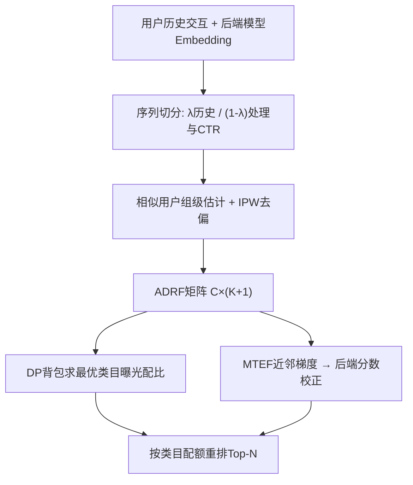

# Treatment Effect Estimation for User Interest Exploration on Recommender Systems（推荐系统中用户兴趣探索的处理效应估计）

- **会议/期刊**: SIGIR 2024
- **作者与机构**: Jiaju Chen, Wenjie Wang, Chongming Gao, Peng Wu, Jianxiong Wei, Qingsong Hua；USTC、NUS、BTBU、美团
- **推荐链路定位**: 重排（类别级配额调度 + 后端分数校正）
- **研究方向**: 强化学习与动态探索推荐 / 去偏公平与工业架构
- **论文原文**: [论文原文链接](https://arxiv.org/abs/2405.08582v1)
- **开源代码**: [开源代码仓库链接](https://github.com/Jiaju-Chen/UpliftRec)

## TL;DR (1分钟核心速览)

针对反馈偏差导致隐藏兴趣探索不足、bandit仅做单物品探索且缺少列表级全局调度的问题，UpliftRec将Top-N中各品类曝光比作为多元连续处理，用相似用户组级ADRF估计与IPW去偏，再以动态规划分配类目名额；MTEF近似降低方差。在Yahoo!R3、Coat、KuaiRec的RCT无偏测试上全候选排序，R@10相对最强基线最高提升17.4%。

## Background & Motivation (背景与核心矛盾)

- **主流范式**: 现有兴趣探索分为去偏重加权、多样性重排与bandit探索利用三类。
- **前人局限**: 去偏方法多被动强化少数兴趣；多样性方法忽略类目异构收益；bandit仅优化单物品策略，缺少Top-N列表级全局调度。
- **核心洞察 (Key Insight)**: 类目曝光比与用户满意度呈非单调关系，可把“类目曝光比”视为处理、“类目CTR”视为结果，从观察反馈估计反事实收益。
- **本文切入点**: 两阶段uplift：先估组级ADRF并IPW去偏，再以DP求最优类目曝光配比；MTEF提供轻量重排版本。

## Method (核心方法设计)

### 1. 整体框架 (Overall Architecture)

UpliftRec将每个用户交互序列按比例$\lambda$切为历史段与后段：历史段构造混杂特征，后段统计各类目曝光比$T$与CTR结果$Y$。若数据无类目标签，先用后端模型物品Embedding做k-means聚类。随后取Top-$K_s$相似样本来估计ADRF矩阵，并用Top-$K_p$相似样本的离散曝光分布估计倾向性$P(t|x)$做IPW。得到$C\times(K+1)$的ADRF后，可走DP求全局最优类目配额并重排；或用MTEF在 backend 分数上加类别级梯度校正。

### 2. 关键设计拆解 (Key Designs)

1. **组级ADRF + IPW去偏**：痛点是小众类目缺少用户自身反事实反馈，且用户特征同时影响处理与结果形成后门路径。本文用相似用户填充未曝光类目，并对结果做逆倾向加权：
$ADRF[c][\tilde t_c]=\frac{\sum_{j=1}^{K_s}\mathbb{I}(Dis(t_{u_j})=\tilde t_c)\cdot y_{u_j}/P[c][\tilde t_c]^\gamma}{\sum_{j=1}^{K_s}\mathbb{I}(Dis(t_{u_j})=\tilde t_c)}$其中$P[c][\tilde t_c]$由Top-$K_p$相似样本的离散曝光比频率估计。直觉是：相似用户可补全隐藏兴趣，IPW切断$X\to T$与$X\to Y$的混杂。

2. **DP全局配额调度**：Top-N被建模为类目资源分配背包问题，离散化后约束为$\sum_c \tilde t_c=K$，并限制偏离后端分布$t_0$不超过$\epsilon$：
$f[c][k]=\max_{|t_{0,c}-j|<\epsilon}\{f[c-1][k],f[c-1][k-j]+j\cdot ADRF[c][j]\}$
$f[C][K]$给出全局最优CTR及回溯配额。该设计把bandit的单点探索提升为列表级类别调度，复杂度$O(CK\epsilon)$。

3. **MTEF近似与推理**：ADRF在稀疏区间方差大，故用近$t_0$的边际处理效应做稳定校正：
$MTEF(t)=\frac{\mathbb{E}[y(t+\Delta t)]-\mathbb{E}[y(t)]}{\Delta t}$，
$s_{u,i}=s_{0,u,i}+\alpha MTEF(t_0)[c_i]$。
UpliftRec本身无独立训练损失，后端模型损失与负采样（比例4或24）照常；推理时MTEF仅需类别查表加和，DP版仅在小$C,K$上求解。

## Experimental Setup & Evaluation Protocol (实验设置与评估协议)

- **数据集与预处理**:

| 数据集 | #Users | #Items | #Interactions | 稀疏度/密度 | 特征/场景说明 |
| :--- | :---: | :---: | :---: | :---: | :--- |
| Yahoo!R3 | 15.4K | 1.0K | 125.1K正/167.9K负 | 1.9% | 音乐；无类目标签，不测RUE |
| Coat | 290 | 300 | 1.9K正/5.1K负 | 8.0% | 服装；含类目 |
| KuaiRec | 7.1K | 10.7K | 936.5K正/11.6M负 | 16.5% | 短视频；观看时长≥2倍为正 |

- **数据划分与防穿越 (Splitting Strategy)**: 用biased部分训练；unbiased RCT部分按50%/50%划为验证/测试，未用Leave-One-Out。
- **排名评测协议 (Ranking Protocol)**: 在RCT无偏测试集上做全候选排序（非采样负例排序），报告R@10、N@10、RUE@10与RUP@10。
- **对比基线与超参设置**: 对比MF、FM、LightGCN、IPS、BC Loss、iDCF、MMR、PMF-$\alpha$-$\beta$、LinUCB、HCB；Embedding维$d=512$；显著性用单样本t检验$p<0.05$。

## Key Experimental Results (实验关键数据)

### 1. 主实验对比 (Main Results)

| 方法 | Yahoo R@10 | Yahoo RUP@10 | Coat R@10 | Coat RUE@10 | Coat RUP@10 | Kuai R@10 | Kuai N@10 |
| :--- | :---: | :---: | :---: | :---: | :---: | :---: | :---: |
| MF | 0.0621 | 0.0735 | 0.0705 | 0.0636 | 0.0751 | 0.0870 | 0.2741 |
| LightGCN | 0.0614 | 0.0727 | 0.0796 | 0.0777 | 0.0848 | 0.0797 | 0.2417 |
| IPS | 0.0606 | 0.0717 | 0.0686 | 0.0734 | 0.0730 | 0.0886 | 0.2666 |
| BC Loss | 0.0694 | 0.0822 | 0.0819 | 0.0702 | 0.0873 | 0.0487 | 0.1465 |
| MMR | 0.0557 | 0.0660 | 0.0821 | 0.0730 | 0.0874 | 0.0784 | 0.2616 |
| LinUCB | 0.0610 | 0.0723 | 0.0571 | 0.0712 | 0.0608 | 0.0897 | 0.2758 |
| HCB | 0.0347 | 0.0411 | 0.0683 | 0.0791 | 0.0728 | 0.0777 | 0.2630 |
| **UpliftRec-MTEF** | **0.0715** | **0.0847** | **0.1027** | **0.0984** | **0.1093** | **0.0914** | **0.3169** |
| Improv. | +3.0% | +3.0% | +17.4% | +17.7% | +17.3% | +1.9% | +14.9% |

### 2. 消融实验 (Ablation Study)

| 变体 | Yahoo R@10 | Coat R@10 | Kuai R@10 | 说明 |
| :--- | :---: | :---: | :---: | :--- |
| Backend only | 0.0621(MF) | 0.0875(FM) | 0.0870(MF) | 无类目调度 |
| **+UpliftRec-MTEF** | **0.0715** | **0.1027** | **0.0914** | 全量 |
| w/o IPW ($\gamma=0$) | 图4最低点 | 图4最低点 | 图4最低点 | 去偏必要 |
| UpliftRec-ADRF | 低于MTEF，高于后端 | 低于MTEF，高于后端 | 低于MTEF | 高方差 |

### 3. 关键实验发现 (Key Findings)

- IPW在三个数据集的$\gamma>0$处达到峰值，$\gamma=0$退化为次优，说明用户特征混杂确实存在；过度去偏又会放大低倾向样本噪声。
- MTEF整体优于ADRF：Yahoo/Coat上ADRF虽高于后端，但稀疏类别比率导致方差大；MTEF仅调近邻梯度，更稳且保持个性化。
- 方法具模型无关性：Yahoo上MF的R@10由0.0621升至0.0715，Coat上FM由0.0875升至0.1027，LightGCN的Coat RUE@10由0.0777升至0.0968。

## Highlights & Limitations (亮点、对比与审稿批判)

- **与代表作对比 (vs. Prior Work)**: 相比IPS/BC Loss/iDCF的被动去偏，本文显式估计类目曝光收益；相比MMR/PMF-$\alpha$-$\beta$只求多样性，本文做收益感知配额；相比LinUCB/HCB单物品探索，本文实现Top-N列表级全局调度。
- **可迁移亮点**: 用相似用户组级估计补全未曝光类目；把连续处理离散化后转为DP背包；MTEF作为后端模型即插即用重排校正。
- **审稿级局限批判**: 效果依赖类目标签或聚类质量，$K_s,K,C,\lambda$均敏感；ADRF仍需大量相似样本，RCT评测成本高且缺少线上A/B与长期留存验证。

## Rating (四维评分)

- **方法创新性 (Novelty)**: ⭐⭐⭐⭐ （将Top-N类目曝光比建模为多元连续处理，并用DP做列表级uplift调度，视角新颖）
- **评估协议与实验扎实度 (Protocol & Experiments)**: ⭐⭐⭐⭐ （三数据集RCT无偏测试、准确性与惊喜度双指标、显著性检验较完整，但消融数值披露有限）
- **写作与数学规范度 (Clarity & Rigor)**: ⭐⭐⭐⭐ （因果假设、ADRF/MTEF与DP递推定义清晰，倾向性估计为聚类近似）
- **工业落地与复现价值 (Industrial & Practical Value)**: ⭐⭐⭐⭐ （代码开源，MTEF可低开销接在现有重排后；但依赖类目体系与线下RCT数据）

