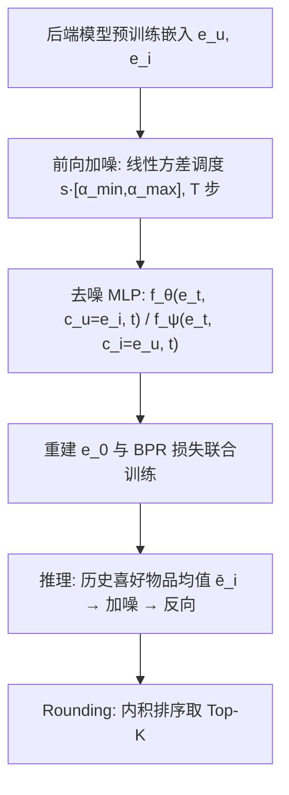

# Denoising Diffusion Recommender Model (去噪扩散推荐模型)

- **会议/期刊**: SIGIR 2024
- **作者与机构**: Jujia Zhao, Wenjie Wang, Yiyan Xu, Teng Sun, Fuli Feng, Tat-Seng Chua（Leiden University / NUS / USTC / 山东大学）
- **推荐链路定位**: 召回与精排前的表征增强（模型无关插件）
- **研究方向**: 自监督对比学习与交互去噪 / 生成式推荐
- **论文原文**: [https://arxiv.org/abs/2401.06982v4](https://arxiv.org/abs/2401.06982v4)
- **开源代码**: [https://github.com/Polaris-JZ/DDRM](https://github.com/Polaris-JZ/DDRM)

## TL;DR (1分钟核心速览)

隐式反馈的假阳性噪声难以用重采样/重加权（依赖大损失、跨模型一致等启发式假设）稳定去除，而 CDAE/SGL 一类的"模型视角"去噪又要求单一网络一步完成 噪声→干净 的映射，表征容量吃紧。本文提出 DDRM：把任意后端模型预训练好的用户/物品嵌入送入扩散前向过程注入可控高斯噪声，再用以"协同信息 + 步数编码"为条件的 MLP 反向逐步重建，推理时从用户历史喜好物品的均值嵌入出发、逆向生成一个"理想物品"并用内积 rounding 落回真实候选库。在 Yelp / Amazon-book / ML-1M 的自然噪声与 0–60% 随机噪声设定下，全排序 Recall@10 相对后端模型最高提升 25.2%（MFBPR+Yelp）。

## Background & Motivation (背景与核心矛盾)

- **主流范式**: 一条线是数据清洗（WBPR 重采样、T-CE/R-CE 重加权、DeCA 跨模型一致性、BOD 自编码器学权重）；另一条线是模型视角去噪（CDAE 随机破坏交互后重建、SGL/AdaGCL 图增广提升鲁棒性）。
- **前人局限**: ①数据清洗依赖强启发式假设（"大损失即噪声"、"干净样本上多模型预测一致"），一旦噪声分布偏移，需在后端模型与数据集上大量调参，自适应差；②模型视角方法把去噪压成"一步映射"，要求网络自身刻画复杂噪声模式，容量不足。
- **核心洞察 (Key Insight)**: 扩散模型天生是去噪器——前向过程以可控尺度与步数注入噪声，等价于扩大训练所见噪声谱；逆向过程把复杂去噪任务分解为 T 小步，每步难度大幅下降，正对上述容量瓶颈。
- **本文切入点**: 不重造推荐模型，而是只对后端模型的嵌入做"嵌入级"去噪，从而获得模型无关的插件式鲁棒表征。

## Method (核心方法设计)

### 1. 整体框架 (Overall Architecture)

后端推荐模型（MFBPR / LightGCN / SGL）先按常规 BPR 训练得到用户嵌入 $\boldsymbol{e}_u$与物品嵌入$\boldsymbol{e}_i$；DDRM 以$\boldsymbol{e}_0^u=\boldsymbol{e}_u$、$\boldsymbol{e}_0^i=\boldsymbol{e}_i$为起点，用线性方差调度注入高斯噪声至第$T$ 步，再由用户/物品两个结构相同但参数独立的去噪 MLP 逐步反向重建；重建出的干净嵌入回灌后端模型计算 BPR 损失，与重建损失联合优化。推理阶段为每个用户构造个性化起点，跑完"加噪–反向"闭环后生成一个理想物品嵌入，与候选库做内积排序取 Top-K。

### 2. 关键设计拆解 (Key Designs)

1. **嵌入级扩散与受限噪声调度**：常规扩散按 $q(\boldsymbol{e}_t|\boldsymbol{e}_0)=\mathcal{N}(\boldsymbol{e}_t;\sqrt{\bar\alpha_t}\boldsymbol{e}_0,(1-\bar\alpha_t)\mathbf{I})$加噪，但推荐场景下过度加噪会摧毁个性化信息。作者改用线性方差调度$1-\bar\alpha_t=s\cdot[\alpha_{\min}+\frac{t-1}{T-1}(\alpha_{\max}-\alpha_{\min})]$，用$s\in(0,1)$ 直接钳制最大噪声量——既保留适度噪声多样性，又避免把用户偏好彻底抹平（消融中 cosine/binomial 调度均更差）。

2. **协同信息引导的去噪模块**：这是本文最关键的一步：扩散引导不是文本 prompt，而是"对侧嵌入"。用户重建时以正反馈物品嵌入 $\boldsymbol{e}_i$为条件、物品重建时以$\boldsymbol{e}_u$为条件：$\tilde{\boldsymbol{e}}_0^u=f_\theta(\hat{\boldsymbol{e}}_t^u,\boldsymbol{c}_u=\boldsymbol{e}_i,t)$，步数$t$经正弦位置编码后与二者拼接送入 MLP。物理直觉：交互对本身就是弱协同信号，用它告诉去噪器"该往哪个偏好方向收敛"；而$t$ 提供当前噪声强度标尺，决定去噪力度。负样本不做去噪，因为随机采样使其噪声意义有限，避免无用开销。

3. **损失、推理起点与 rounding**：训练损失为 $\mathcal{L}(u,i,j)=\lambda\mathcal{L}_{bpr}(u,i,j)+(1-\lambda)\mathcal{L}_{re}(u,i)$，其中$\mathcal{L}_{re}=\frac{1}{2}\mathbb{E}_{t\sim U(1,T)}[\|\boldsymbol{e}_0^u-\hat{\boldsymbol{e}}_\theta\|_2^2+\|\boldsymbol{e}_0^i-\hat{\boldsymbol{e}}_\psi\|_2^2]$（去掉逐项权重的简化版）。推理起点取$\bar{\boldsymbol{e}}_i=\frac{1}{n}\sum_{i\in I_u}\boldsymbol{e}_i$而非纯噪声，再经前向-反向得到$\hat{\boldsymbol{e}}_i^0$，用$s(\hat{\boldsymbol{e}}_i^0,\boldsymbol{e}_i)=\hat{\boldsymbol{e}}_i^0\cdot\boldsymbol{e}_i$落回真实候选库。另附一个可选的清洗式重加权$w(u,i,j)=\mathrm{sigmoid}(s(u,i))^{\gamma}$作为补丁。开销上：只需生成**一个**理想物品嵌入再做内积，而 DiffRec 需对全候选逐一打分；且因起点已含个性化信息，最优步数$<100$（传统扩散常需 1000 步）。

## Experimental Setup & Evaluation Protocol (实验设置与评估协议)

- **数据集与预处理**: 用户-物品交互按时间戳排序，评分 $<4$ 视为假阳性；统计如下（N = 自然噪声设定，R = 随机噪声设定）：

| 数据集 | #Users | #Items (N/R) | #Interactions (N) | 密度 (N) | 场景说明 |
| :--- | :---: | :---: | :---: | :---: | :--- |
| Yelp | 54,574 | 77,405 / 34,395 | 1,471,675 | 0.035% | 餐厅点评，含大量假阳性点击 |
| Amazon-book | 108,822 | 178,181 / 94,949 | 3,145,223 | 0.016% | 图书购买与评分，极稀疏 |
| ML-1M | 5,949 | 3,494 / 2,810 | 618,297 | 2.97% | 电影评分，稠密对照 |

- **数据划分与防穿越**: 按时间戳的 `比例划分`（7:1:2），仅用真阳性（评分 $\ge4$）切分测试集；训练/验证集在两种噪声设定下均注入噪声——自然噪声引入评分$<4$ 的真实假阳性，随机噪声按比例采样未观测交互（0%–60%），且两设定训练/验证规模与原划分保持一致。测试集严格只含真阳性，属"训练脏、测试净"的防穿越设计。
- **排名评测协议**: 采用无偏 `Full-Ranking`（全库未交互候选排序），指标 Recall@{10,20}、NDCG@{10,20}；后端嵌入维度固定 $d=64$；显著性用$t$-test，$p<0.01$。
- **对比基线与超参**: 模型无关去噪 R-CE / T-CE / DeCA / BOD，模型视角与生成式 AdaGCL / CDAE / MultiVAE / DiffRec，后端 MFBPR / LightGCN / SGL 三族；DDRM 侧调 $T\in\{10,...,60\}$、$\alpha_{\min},\alpha_{\max},s$、$\lambda\in\{0.1..0.6\}$、$\gamma\in[0,0.9]$，后端超参固定为各自最优以保证公平。

## Key Experimental Results (实验关键数据)

### 1. 主实验对比 (Main Results)

自然噪声设定（表中为 Recall@10 / NDCG@10，**粗体**为各块最优，`*` 表示相对后端模型 $p<0.01$ 显著）：

| 方法 | Yelp R@10 | Yelp N@10 | Amazon R@10 | Amazon N@10 | ML-1M R@10 | ML-1M N@10 |
| :--- | :---: | :---: | :---: | :---: | :---: | :---: |
| MultiVAE | 0.0484 | 0.0289 | 0.0508 | 0.0300 | 0.0636 | 0.0450 |
| CDAE | 0.0305 | 0.0178 | 0.0219 | 0.0122 | 0.0355 | 0.0272 |
| AdaGCL | 0.0464 | 0.0277 | 0.0282 | 0.0166 | 0.0630 | 0.0453 |
| DiffRec | 0.0501 | 0.0307 | 0.0537 | 0.0329 | 0.0658 | 0.0488 |
| MFBPR | 0.0286 | 0.0176 | 0.0217 | 0.0131 | 0.0445 | 0.0429 |
| MFBPR + R-CE | 0.0324 | 0.0195 | 0.0227 | 0.0134 | 0.0472 | 0.0434 |
| **MFBPR + DDRM** | **0.0358\*** (+25.2%) | **0.0217\*** | **0.0249\*** (+14.7%) | **0.0148\*** | **0.0477\*** (+7.2%) | **0.0450\*** |
| LightGCN | 0.0502 | 0.0295 | 0.0432 | 0.0251 | 0.0618 | 0.0444 |
| **LightGCN + DDRM** | **0.0516\*** | **0.0305\*** | **0.0468\*** (+8.3%) | **0.0273\*** | **0.0667\*** (+7.9%) | **0.0508\*** |
| SGL | 0.0485 | 0.0287 | 0.0467 | 0.0267 | 0.0620 | 0.0448 |
| SGL + BOD | 0.0505 | 0.0303 | 0.0517 | 0.0300 | 0.0650 | 0.0458 |
| **SGL + DDRM** | **0.0517\*** (+6.6%) | **0.0312\*** | **0.0535\*** (+14.6%) | **0.0313\*** | **0.0698\*** (+12.6%) | **0.0530\*** |

### 2. 消融实验 (Ablation Study)

Yelp + SGL 后端下的设计变体（原文 Table 3）：

| 变体 | R@10 | R@20 | N@10 | N@20 |
| :--- | :---: | :---: | :---: | :---: |
| SGL（后端） | 0.0488 | 0.0841 | 0.0290 | 0.0397 |
| DDRM 完整版 | **0.0517** | **0.0860** | **0.0312** | **0.0415** |
| DDRM (Transformer 去噪器) | 0.0469 | 0.0786 | 0.0282 | 0.0378 |
| DDRM (纯噪声起点推理) | 0.0213 | 0.0364 | 0.0133 | 0.0179 |
| DDRM (调度: 线性 $\beta$) | 0.0496 | 0.0834 | 0.0303 | 0.0404 |
| DDRM (调度: cosine) | 0.0502 | 0.0834 | 0.0302 | 0.0406 |
| DDRM (调度: binomial) | 0.0491 | 0.0828 | 0.0295 | 0.0397 |

补充（原文图 4/图 5，仅给趋势）：仅保留重建损失即稳定优于后端模型；仅加重加权损失提升较小、且在部分数据集/后端上反而不及后端；仅保留物品去噪模块（去掉用户去噪）性能低于完整版但仍高于后端。

### 3. 关键实验发现 (Key Findings)

1. **弱后端获益最大，插件具有"补短板"性质**：MFBPR 在 Yelp 上 R@10 从 0.0286 提升到 0.0358（+25.2%），而本就强的 LightGCN 仅 +2.8%；SGL 在 ML-1M 上提升 12.6%（0.0620→0.0698），甚至反超专为全库打分设计的 DiffRec（0.0658）。
2. **推理起点比去噪网络结构更关键**：把起点换成纯噪声后 R@10 从 0.0517 崩到 0.0213（-58.8%），说明协同引导远弱于文本 prompt，缺个性化初始化时逆向过程无法定位偏好；反之把 MLP 换成 Transformer 也降到 0.0469（已低于后端），说明去噪任务需要的是低归纳偏置的简单重建器。
3. **噪声鲁棒性随比例线性可控，且步数开销可控**：在 0%→60% 随机噪声下 DDRM 始终高于后端、R-CE 与 BOD 且衰减更缓（图 3）；最优扩散步数 $<100$（远少于图像生成的 1000 步），因起点已含个性化信息，逆向只需修正而非从零生成——这是其推理可接受的根本原因。

## Highlights & Limitations (亮点、对比与审稿批判)

- **与代表作对比 (vs. Prior Work)**: 与 R-CE/BOD 等数据清洗方法的本质差异在于——不依赖"大损失即噪声"或跨模型一致性假设，而是把去噪搬到嵌入空间、由扩散多步分解自动学习噪声模式；与 DiffRec 相比，DiffRec 建模交互概率分布、推理需对全候选打分，DDRM 只在嵌入层生成单个理想物品，且可挂载任意后端；与 CDAE/SGL 相比，从"一步映射"变为"T 步由粗到细"降难度。
- **可迁移亮点**: ①"对侧嵌入作为扩散条件"这一协同引导方式可直接移植到序列推荐/跨域推荐的表征去噪；②"用历史均值嵌入替代纯噪声作为起点"是生成式推荐通用的降步数技巧。
- **审稿级局限批判**: ①推理需对每个用户跑完整 $T$步反向链，图 6 显示时间随步数近线性增长，大规模在线场景需蒸馏/缓存；②超参敏感（$T$、$s$、$\lambda$、$\gamma$ 四项均呈倒 U 型，需逐数据集调），且 reweighted 补丁的理论依据仍是旧启发式；③仅在 BPR 类、显式产出嵌入的后端上验证，对无双塔嵌入的模型（如树模型、序列 Transformer 端到端）适配性未讨论，也缺少线上 A/B 证据。

## Rating (四维评分)

- **方法创新性 (Novelty)**: ⭐⭐⭐⭐ （首次把扩散"多步分解降难度"用于隐式反馈嵌入去噪，协同条件引导 + 个性化起点两个设计均直击扩散用于推荐的痛点）
- **评估协议与实验扎实度 (Protocol & Experiments)**: ⭐⭐⭐⭐ （三数据集 × 三后端 × 两种噪声设定 + 0–60% 噪声扫描 + Full-Ranking + $p<0.01$ 显著性，消融覆盖损失、模块、架构、调度四维）
- **写作与数学规范度 (Clarity & Rigor)**: ⭐⭐⭐⭐ （从 DDPM 变分下界推到简化 MSE 的推导完整，$s$ 钳制噪声的动机解释清晰；但 reweighted 扩展与主框架的理论衔接略松散）
- **工业落地与复现价值 (Industrial & Practical Value)**: ⭐⭐⭐⭐ （代码已开源、插件式零侵入易接入，且生成单个嵌入比全候选打分更省；扣分在于逐用户 $T$ 步推理延迟与四项超参调优成本）

