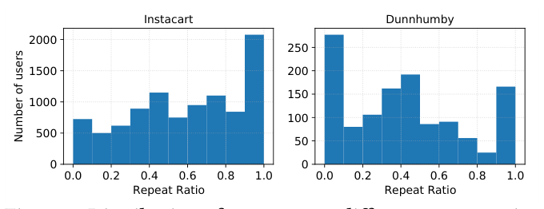
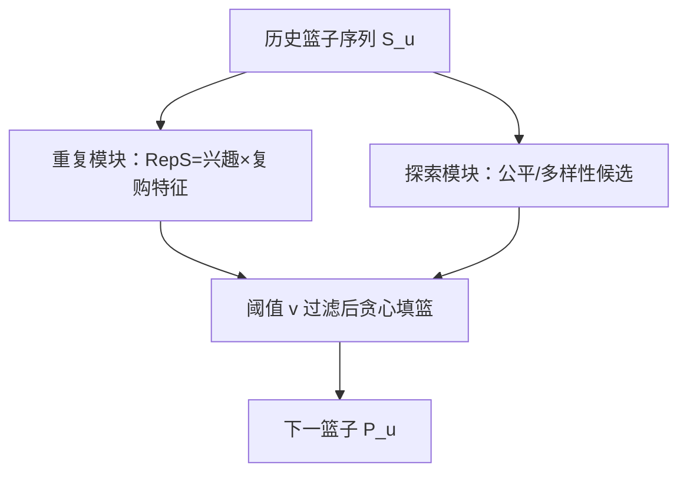

# Are We Really Achieving Better Beyond-Accuracy Performance in Next Basket Recommendation? (我们在下一篮子推荐中真的实现了更好的非精度性能吗？)

- **会议/期刊**: SIGIR 2024
- **作者与机构**: Ming Li, Yuanna Liu, Sami Jullien, Mozhdeh Ariannezhad, Andrew Yates, Mohammad Aliannejadi, Maarten de Rijke；University of Amsterdam / AIRLab / Booking.com
- **推荐链路定位**: 端到端篮子生成（重复/探索解耦 + 列表填充）
- **研究方向**: 序列与会话推荐 / 去偏公平与可信评测
- **论文原文**: [论文原文链接](https://arxiv.org/abs/2405.01143v1)
- **开源代码**: [开源代码仓库链接](https://github.com/lynEcho/TREX)

## TL;DR (1分钟核心速览)

本文针对下一篮子推荐只追精度、公平/多样性评测薄弱的问题，提出即插即用的TREx：重复槽用商品复购特征与时间衰减保精度，探索槽用 unpopular 采样或类别去重提升公平/多样性。在Instacart/Dunnhumby、固定篮子大小k=10/20、无采样负例的top-k篮子生成协议上，TREx-Rep与SOTA持平或更优，7/8项beyond-accuracy“更优”；但作者进一步揭示这是牺牲探索精度的评测捷径，并据此批判现有评测。

## Background & Motivation (背景与核心矛盾)

- **主流范式**: NBR将用户历史篮子序列编码后为全物品打分，取top-k填满下一篮子；研究长期以Recall/NDCG/PHR等精度指标为主，公平与多样性优化很少。
- **前人局限**: 重复商品与探索商品在候选空间、用户反馈、任务难度上差异巨大（重复仅数十个、探索有数千个），统一打分会让重复预测被探索噪声稀释；同时beyond-accuracy指标缺少细粒度验证。
- **核心洞察 (Key Insight)**: Instacart/Dunnhumby的重复比例分别约0.60/0.43；重复项贡献主要感知精度，探索项贡献低，因此存在“重复槽保精度、探索槽换公平/多样性”的捷径。
- **本文切入点**: 提出TREx解耦重复与探索预测，并进一步质疑：现有整体指标是否会把这种牺牲探索的捷径误判为成功？

<figure class="paper-figure" markdown="span">
  <figcaption>图 1</figcaption>
</figure>

## Method (核心方法设计)

### 1. 整体框架 (Overall Architecture)

TREx是即插即用两阶段框架：先按用户历史把候选分为重复集$I^{\mathrm{rep}}_{u,t}$与探索集$I^{\mathrm{expl}}_{u,t}$；重复模块用“商品复购特征×用户时衰兴趣”打分，经阈值$v$过滤后贪心填篮；若不足$k$，公平版按unpopular商品购买频率采样，多样性版按热度排序但强制类别去重；最后输出固定大小篮子。全过程无端到端训练，推理仅统计排序与规则填充。

### 2. 关键设计拆解 (Key Designs)

1. **重复模块（商品复购特征 + 时衰兴趣）**：PIF/UP-CF@r只重近期频率，忽略“牛奶比锅更易复购”的商品属性。TREx先跨用户统计复购频率并用$\alpha$抑制异常高频，再平滑，得$\mathrm{RepI}(i)=\mathrm{RepF}(i)+\overline{\mathrm{RepF}}/N_i$；用户兴趣为$E_{u,i}=\sum_{j=1}^{m}\beta^{T-l_j}$；最终$\mathrm{RepS}_u(i)=E_{u,i}\cdot \mathrm{RepI}(i)$。直觉：复购特征决定“买不买”，时间衰减决定“最近还买不买”。
2. **探索模块（公平/多样性）**：公平目标下，只在未购商品中按unpopular商品的购买频率采样，逼近真实曝光分布；多样性目标下，从探索候选按热度排序，挑选与篮内已有类别不同的item。两者均不参与重复精度竞争，避免多目标损失互相压制。
3. **训练目标、负采样与推理效率**：TREx没有总损失$\mathcal{L}$、无负采样、无反向传播；$\alpha,\beta,v$在验证集网格搜索。推理为重复项排序+规则填充，复杂度近似$O(|I^{\mathrm{rep}}|\log |I^{\mathrm{rep}}|+k)$，远低于RNN/GNN基线。

## Experimental Setup & Evaluation Protocol (实验设置与评估协议)

- **数据集与预处理**:

| 数据集 | #Users | #Items | #Interactions | 稀疏度/密度 | 特征/场景说明 |
| :--- | :---: | :---: | :---: | :---: | :--- |
| Instacart | 19,210 | 29,399 | 约305k篮子 | 平均篮10.06 | 随机采样约20k用户；重复比例0.60 |
| Dunnhumby | 2,482 | 37,162 | 约107k篮子 | 平均篮10.07 | 至少3个篮子、商品至少5次；重复比例0.43 |

- **数据划分与防穿越**: 训练集为除最后一篮外的所有篮子（用户超过50篮仅取末50篮）；末篮按50%/50%划分验证/测试；固定篮子大小$k=10$或$20$。
- **排名评测协议**: 在分层候选（重复集/探索集/全物品）上生成top-k篮子，与ground-truth篮子比对；无采样负例，**非sampled ranking**。公平分组按流行度：前20%为$G^+$，后80%为$G^-$。
- **对比基线与超参设置**: 三类基线——简单频率法G/P-TopFreq，近邻法UP-CF@r、TIFUKNN，神经法Dream、DNNTSP、ReCANet；嵌入维度16–128；TREx的$\alpha\in[0,1]$、$\beta\in[0.7,1]$、$v$扫描；用paired t-test检验与SOTA持平。

## Key Experimental Results (实验关键数据)

### 1. 主实验对比 (Main Results)

表1：精度主结果（$k=10$；$k=20$趋势一致，TREx-Rep以†表示与SOTA无显著差异）

| 数据集 | 方法 | Recall@10 | NDCG@10 | PHR@10 |
| :--- | :--- | ---: | ---: | ---: |
| Instacart | G-TopFreq | 0.0704 | 0.0817 | 0.4600 |
| Instacart | P-TopFreq | 0.3143 | 0.3339 | 0.8447 |
| Instacart | UP-CF@r | 0.3377 | 0.3582 | 0.8586 |
| Instacart | TIFUKNN | 0.3456 | 0.3657 | 0.8639 |
| Instacart | Dream | 0.0704 | 0.0817 | 0.4600 |
| Instacart | DNNTSP | 0.3295 | 0.3434 | 0.8581 |
| Instacart | ReCANet | **0.3490** | **0.3699** | **0.8668** |
| Instacart | TREx-Rep | 0.3476† | 0.3661† | 0.8655† |
| Dunnhumby | G-TopFreq | 0.0897 | 0.0798 | 0.3795 |
| Dunnhumby | P-TopFreq | 0.1628 | 0.1562 | 0.5399 |
| Dunnhumby | UP-CF@r | 0.1699 | 0.1639 | 0.5536 |
| Dunnhumby | TIFUKNN | 0.1763 | 0.1683 | 0.5729 |
| Dunnhumby | Dream | 0.0896 | 0.0759 | 0.3873 |
| Dunnhumby | DNNTSP | 0.0871 | 0.0792 | 0.4303 |
| Dunnhumby | ReCANet | 0.1730 | 0.1625 | 0.5655 |
| Dunnhumby | TREx-Rep | **0.1815** | **0.1689** | **0.5761** |

- **Improv. (TREx-Rep vs 最优基线)**: Instacart为-0.40%/-1.03%/-0.15%（无显著差异）；Dunnhumby为+2.95%/+0.36%/+0.56%。

### 2. 消融实验 (Ablation Study)

表2：重复模块消融（据原文图2/图3趋势；未给出精确数值）

| 变体 | 关键改动 | 结果趋势 |
| :--- | :--- | :--- |
| P-TopFreq | 仅个人频率 | 低基线 |
| +T | 加入时间衰减$\beta$ | 两数据集Recall/NDCG均提升 |
| +T+RF | 再乘商品复购特征$\mathrm{RepI}(i)$ | 进一步提升；Dunnhumby更明显 |
| +T+RF, 样本0.2→1 | 更多训练数据估RepI | 相对+T的Recall增益随样本比例扩大 |
| w/o探索模块 | 仅重复贪心填充 | 精度保留，但公平/多样性目标退化 |

### 3. 关键实验发现 (Key Findings)

1. **精度主要来自重复槽**：TREx-Rep仅用重复候选，在Instacart的0.3476/0.3661/0.8655与ReCANet的0.3490/0.3699/0.8668无显著差异，在Dunnhumby的Recall@10=0.1815对TIFUKNN的0.1763（+2.95%），说明无需复杂序列模型也能达到/超过SOTA。
2. **“捷径”对弱连接/无连接指标有效**：TREx在8个beyond-accuracy指标中7个“更优”；logDP、ILD、Entropy、DS与精度无连接最易被探索槽改善；logRUR与精度强连接，难以靠探索槽提升，甚至出现精度与公平同降的lose-lose。
3. **整体指标掩盖探索退化**：TREx-Div在Instacart的Recall$_{\mathrm{expl}}$@10=0.0002，低于TIFUKNN/DNNTSP的0.0014；Dunnhumby为0.0000对0.0042。整体精度因重复槽高分仍好看，但探索质量已坍缩，证明现有overall评测可能奖励“牺牲探索”的策略。

## Highlights & Limitations (亮点、对比与审稿批判)

- **与代表作对比 (vs. Prior Work)**: TIFUKNN/UP-CF@r仍统一建模重复与探索；ReCANet是repeat-only神经模型但较重；DNNTSP用GNN+self-attention追精度。TREx训练-free、两阶段解耦，核心价值不是刷榜，而是把“评测漏洞”显式做出来。
- **可迁移亮点**: 电商补货/复购场景可先解耦重复与探索候选，重复槽保底，探索槽单独服务公平/多样性；但必须同时报告explore-only指标，防止整体指标掩盖退化。
- **审稿级局限批判**: 探索模块是规则采样，未优化探索质量；仅两个grocery数据集、固定item set、无在线A/B，结论对$v$、$\alpha$、$\beta$和流行度分组（top20%）较敏感。

## Rating (四维评分)

- **方法创新性 (Novelty)**: ⭐⭐⭐⭐ （“short-cut”假设有洞察，TREx简单但评测批判加分）
- **评估协议与实验扎实度 (Protocol & Experiments)**: ⭐⭐⭐⭐ （两数据集、8个beyond指标、t检验与消融完整；但仅离线、主表以@10为主）
- **写作与数学规范度 (Clarity & Rigor)**: ⭐⭐⭐⭐ （符号与模块清晰，公式简洁；部分指标定义依赖附录）
- **工业落地与复现价值 (Industrial & Practical Value)**: ⭐⭐⭐ （训练-free易部署且开源，但探索质量差，不能直接上线）

