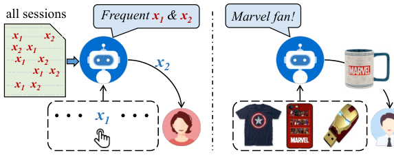
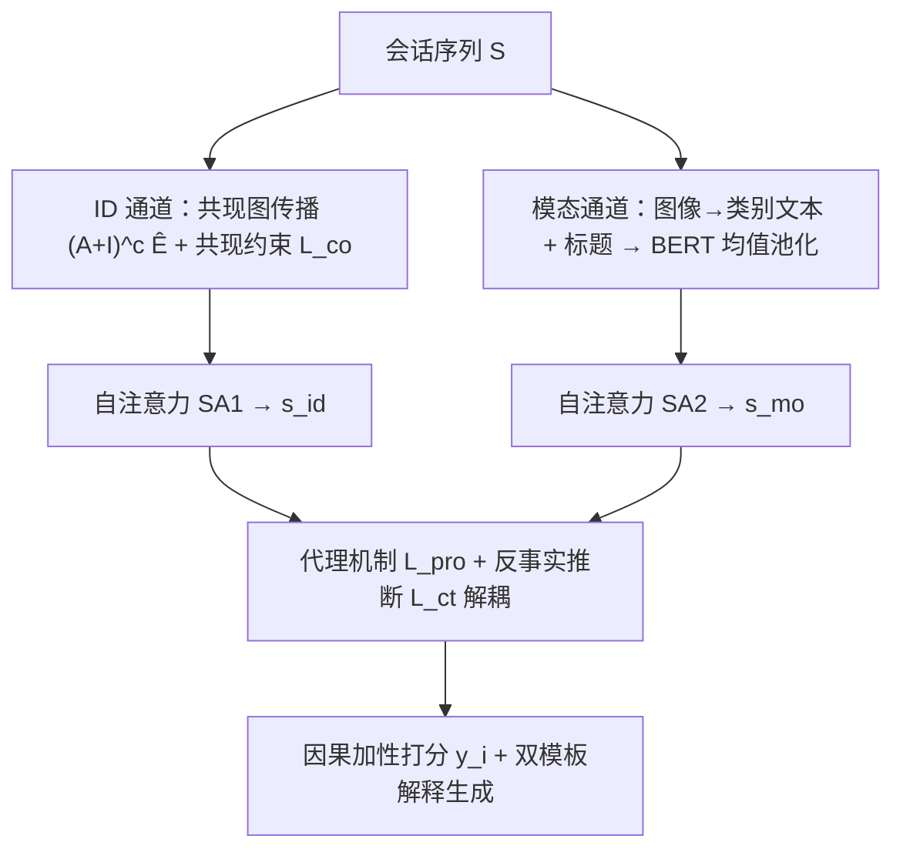
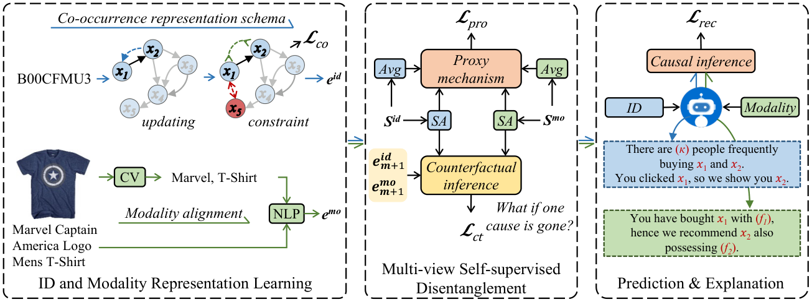

# Disentangling ID and Modality Effects for Session-based Recommendation (解耦 ID 与模态效应的会话推荐)

- **会议/期刊**: SIGIR 2024 (Full Paper)
- **作者与机构**: Xiaokun Zhang, Bo Xu, Hongfei Lin (大连理工大学)；Zhaochun Ren (Leiden University)；Xiaochen Wang, Fenglong Ma (Pennsylvania State University)
- **推荐链路定位**: 召回（会话级 next-item 检索）
- **研究方向**: 序列与会话推荐 / 自监督解耦与去噪
- **论文原文**: [https://arxiv.org/abs/2404.12969v1](https://arxiv.org/abs/2404.12969v1)
- **开源代码**: [https://github.com/Zhang-xiaokun/DIMO](https://github.com/Zhang-xiaokun/DIMO)

## TL;DR (1分钟核心速览)

匿名会话推荐中，Item ID 反映的是全库共现统计（群体智慧），模态反映的是细粒度偏好（个体品味），二者是**两条不同成因**；但现有方法（MMSBR/MGS 等）把 ID 与模态嵌入不加区分地级联融合，既损失精度又难以解释。DIMO 在物品级用共现矩阵显式注入 ID 表征、把图像转文本与标题对齐，在会话级用代理机制与反事实推断做**无监督双因解耦**，再以加性因果推断打分并生成双模板解释。四个数据集全指标超越 10 个基线，Cellphones 上 Prec@20 相对最优基线提升 55.12%。

## Background & Motivation (背景与核心矛盾)

- **主流范式**: ID 流派（NARM、BERT4Rec、SR-GNN、Atten-Mixer）用 RNN/Attention/GNN 隐式挖掘 ID 共现模式；模态流派（MGS、UniSRec、MMSBR）把文本、图像、类目特征拼进序列表征以缓解稀疏性。
- **前人局限**: ① ID 共现完全依赖隐式网络学习，没有显式约束，"高频共现的 ID 应更近"这一先验未被注入；② 文本与图像存在巨大语义鸿沟，直接级联/拼接融合无法统一表征；③ 最关键的是 ID 与模态两种成因被**纠缠**在一起，用户点一次咖啡杯可能因为"常与咖啡同购"，也可能因为"是漫威粉丝"，而无监督信号指示谁主导决策。
- **核心洞察 (Key Insight)**: 如图 1，ID 解释的是"x1 与 x2 常被同购"（群体共现），模态解释的是"买了漫威 T 恤 → 推荐漫威联名杯"（即便二者几乎不同购）；二者重叠度低，天然可分离，且分离后可解释性随之而来。
- **本文切入点**: 物品级显式编码共现 + 跨模态对齐，会话级用"代理对齐、反事实剔除"两路自监督把 ID 与模态效应掰开，最后因果加性融合。

<figure class="paper-figure" markdown="span">
  <figcaption>图1：建模用户行为的两种不同依据：ID共现模式；模态细粒度偏好。</figcaption>
</figure>

## Method (核心方法设计)

### 1. 整体框架 (Overall Architecture)

输入一条会话 $S=[x_1,\dots,x_m]$，DIMO 走双通道：ID 通道用全局共现图$(\mathbf{A}+\mathbf{I})^c$传播得到共现感知 ID 嵌入，并受共现对比约束$\mathcal{L}_{co}$监督；模态通道把图像经 GoogLeNet 转成类别文本、与标题/品牌拼接后过 BERT 均值池化，得到与 ID 同维的统一模态嵌入。两条序列分别经独立自注意力得到$\mathbf{s}^{id},\mathbf{s}^{mo}$，再在会话级通过代理机制$\mathcal{L}_{pro}$（拉近成因与其均值代理、推远另一成因）与反事实推断$\mathcal{L}_{ct}$（"若去掉某一因，标签由谁解释"）完成解耦。推理时两因加性打分，并与$\mathcal{L}_{rec}$ 多任务联合训练；解释阶段依据两因分别套用共现模板与特征模板。

<figure class="paper-figure" markdown="span">
  <figcaption>图3：DIMO的架构。ID与模态表示学习将共现模式显式融入ID嵌入，同时进行模态对齐以获得统一模态表示。多视图自监督解耦通过代理机制与反事实推断区分ID效应和模态效应。基于解耦原因，DIMO通过因果推断进行推荐，并基于两类模板生成解释。</figcaption>
</figure>

### 2. 关键设计拆解 (Key Designs)

1. **共现表征 Schema（把先验写进嵌入，而非让网络猜）**：痛点是不知 ID 在多大程度上相似。作者先由全体会话统计有向共现矩阵 $a_{ik}=\frac{\mathrm{count}(x_i,x_k)}{\sum_{x_j\in N_i}\mathrm{count}(x_i,x_j)}$，再做$c$次图传播$\mathbf{E}^{id}=(\mathbf{A}+\mathbf{I})^{c}\hat{\mathbf{E}}^{id}$，并用对比式约束强化"常共现者近、从不共现者远"：$\mathcal{L}_{co}=-\frac{\mathrm{sim}(\mathbf{e}^{id}_i,\bar{\mathbf{e}}^{+}_i)}{\sum_{k=1}^{l}\mathrm{sim}(\mathbf{e}^{id}_i,\mathbf{e}^{id-}_k)}$，正样本取 top-$l$共现、负样本取零共现（$l=10$）。直觉：$c$控制共现信息的注入深度，太小欠拟合、太大过平滑（实验中$c$ 呈先升后降）。
2. **跨模态统一对齐（消解图文鸿沟）**：不做嵌入层拼接，而是把图像"翻译"成语义符号——GoogLeNet 预测 top-2 类别词拼到标题/品牌后，统一过 BERT 并均值池化 $\mathbf{e}^{mo}_i=\frac{1}{t+r}\sum_{k=1}^{t+r}\mathbf{e}_k$。这样模态天然与文本同空间，既复用 NLP 语义能力，也让后面的特征模板解释可读（能直接指出"NBA"这一共同属性）。
3. **多视图自监督解耦（无标签下判断谁主导）**：代理机制用参数无关的均值池化构造 $\hat{\mathbf{s}}^{id},\hat{\mathbf{s}}^{mo}$作为各自成因的"锚"，损失$\mathcal{L}_{pro}=-\frac{\mathrm{sim}(\mathbf{W}_1\mathbf{s}^{id},\mathbf{W}_2\hat{\mathbf{s}}^{id})}{\mathrm{sim}(\mathbf{W}_1\mathbf{s}^{id},\mathbf{W}_2\hat{\mathbf{s}}^{id})+\mathrm{sim}(\mathbf{W}_3\mathbf{s}^{id},\mathbf{W}_4\mathbf{s}^{mo})}+(\text{模态侧对称项})$，迫使同一成因向自身代理靠拢、向另一成因远离；反事实则提问"若 ID 因消失会怎样"：当标签$x_{m+1}\notin N_s$（$N_s$为会话内物品共现邻域并集）时判为模态主导，$\mathcal{L}_{ct}=-\frac{\mathrm{sim}(\mathbf{s}^{mo},\mathbf{e}^{mo}_{m+1})}{\mathrm{sim}(\mathbf{s}^{mo},\mathbf{e}^{mo}_{m+1})+\mathrm{sim}(\mathbf{s}^{id},\mathbf{e}^{id}_{m+1})}$，反之交换分子项。因共现矩阵可直接查证，故反事实标签无需人工标注。
4. **训练目标与推理开销**：预测采用因果加性融合 $y_i=\mathbf{s}^{id\top}\mathbf{e}^{id}_i+\mathbf{s}^{mo\top}\mathbf{e}^{mo}_i$（"只要符合共现或符合偏好就应推荐"），总损失$\mathcal{L}=\mathcal{L}_{rec}+\lambda(\mathcal{L}_{co}+\mathcal{L}_{pro}+\mathcal{L}_{ct})$，$\mathcal{L}_{rec}$ 为交叉熵，**全程无负采样、全库 softmax**；辅助任务均基于 cosine，无需额外标注。推理仅需两次自注意力与一次加性内积，模态嵌入离线预计算，在线开销与 SR-GNN 同量级。

## Experimental Setup & Evaluation Protocol (实验设置与评估协议)

- **数据集与预处理**: 三个 Amazon 域（会话按"同一用户同一天行为"切分）+ Instacart（取最短 20% 交易模拟会话）。

| 数据集 | #Users | #Items | #Interactions | #Sessions | 平均长度 | 说明 |
| :--- | :---: | :---: | :---: | :---: | :---: | :--- |
| Cellphones | 匿名 | 9,091 | 123,186 | 40,344 | 3.05 | Amazon，文本+图像 |
| Grocery | 匿名 | 7,286 | 151,251 | 43,648 | 3.47 | Amazon，文本+图像 |
| Sports | 匿名 | 14,650 | 282,102 | 90,492 | 3.12 | Amazon，文本+图像 |
| Instacart | 匿名 | 10,009 | 380,230 | 88,022 | 4.32 | 仅文本模态 |

- **数据划分与防穿越**: 过滤长度=1 的会话与出现次数 <5 的物品（`5-core`）；会话内 **Leave-Last-Out**（末项为标签，前缀为输入）；样本按**全局时间戳 7:2:1** 切分训练/验证/测试。
- **排名评测协议**: `Full-Ranking` 全物品打分（沿用 NARM/SR-GNN 系全库评测惯例，未构造采样候选集）；指标 `Prec@K`、`MRR@K`，$K\in\{10,20\}$。
- **对比基线与超参**: 10 个基线分两类——ID 类（SKNN、NARM、BERT4Rec、SR-GNN、MSGIFSR、Atten-Mixer、MSGAT）与模态类（MGS、UniSRec、MMSBR）；统一 $d=100$，$c\in\{1..5\}$、$\lambda\in\{0.1,0.01,0.001,0.0001\}$网格搜索，$l=10$、模板阈值$\eta=10$、$\gamma=0.8$，batch=50、lr=0.001；显著性用$t$-test（$p<0.01$）。

## Key Experimental Results (实验关键数据)

### 1. 主实验对比 (Main Results)

| Model | Cell P@20 | Cell M@20 | Groc P@20 | Groc M@20 | Spor P@20 | Spor M@20 | Inst P@20 | Inst M@20 |
| :--- | :---: | :---: | :---: | :---: | :---: | :---: | :---: | :---: |
| SKNN | 16.48 | 9.06 | 42.40 | 27.78 | 33.98 | 24.39 | 11.79 | 2.41 |
| NARM | 16.80 | 12.53 | 47.14 | 40.59 | 36.67 | 33.57 | 12.19 | 3.25 |
| BERT4Rec | 22.44 | 12.25 | 49.07 | 38.56 | 40.34 | 34.01 | 16.00 | 3.81 |
| SR-GNN | 18.11 | 13.09 | 46.24 | 39.64 | 37.69 | 33.66 | 13.00 | 3.64 |
| Atten-Mixer | 22.28 | 14.71 | 49.56 | 40.84 | 39.19 | 33.86 | 11.53 | 3.36 |
| MGS | 25.02 | 14.48 | 48.37 | 38.98 | 38.45 | 32.50 | 13.74 | 3.09 |
| UniSRec | 23.78 | 14.56 | 50.21 | 41.05 | 40.62 | 33.76 | 12.55 | 3.62 |
| MMSBR | 22.82 | 14.13 | 47.89 | 39.23 | 38.29 | 32.73 | 14.37 | 3.84 |
| **DIMO** | **38.81** | **17.36** | **57.01** | **41.98** | **49.86** | **35.15** | **18.36** | **4.81** |
| Improv. | +55.12% | +18.01% | +13.54% | +2.27% | +22.75% | +3.35% | +11.68% | +19.65% |

### 2. 消融实验 (Ablation Study)

| 变体 | Cell P@20 | Cell M@20 | Groc P@20 | Groc M@20 | Spor P@20 | Spor M@20 |
| :--- | :---: | :---: | :---: | :---: | :---: | :---: |
| w/o 共现表征 (DIMO-co，改隐式注意力编码) | 37.76 | 16.49 | 55.88 | 41.23 | 48.48 | 34.27 |
| w/o 模态对齐 (DIMO$_{cas}$，图文嵌入级联) | 38.49 | 17.02 | 56.63 | 41.64 | 49.37 | 34.86 |
| w/o 代理机制 (DIMO-pro) | 有下降（Fig.4） | 有下降 | 有下降 | 有下降 | 有下降 | 有下降 |
| w/o 反事实推断 (DIMO-cou) | 有下降 | 有下降 | 有下降 | 有下降 | 有下降 | 有下降 |
| w/o 全部解耦 (DIMO-mul) | 显著下降 | 显著下降 | 显著下降 | 显著下降 | 显著下降 | 显著下降 |
| **完整 DIMO** | **38.81** | **17.36** | **57.01** | **41.98** | **49.86** | **35.15** |

### 3. 关键实验发现 (Key Findings)

1. **解耦带来的收益远超单一模态增强**：Cellphones 上 DIMO 的 Prec@20 达 38.81，而最强模态基线 MGS 仅 25.02（+55.12%）；同域上 ID 类最强的 Atten-Mixer 也只有 22.28。但同一批"模态增强"方法在 Cellphones/Sports 的 MRR 上反而输给 ID 方法，说明"加入模态"本身并非稳定增益，**区分成因**才是关键；解耦还显著拉大了 ID 与模态嵌入的 PCA 分布差异（图 6，ID 分散、模态聚拢）。
2. **显式共现表征贡献最大**：去掉 DIMO-co（退回隐式注意力编码共现）后，三个数据集 P@20 分别掉 1.05/1.13/1.38 点，是单项消融中跌幅最大的一环；而把统一模态对齐换成嵌入级联（DIMO$_{cas}$）掉 0.32/0.38/0.49 点，说明"先消语义鸿沟、再统一表征"比"各模态各自编码后拼接"更稳。
3. **两路自监督互补、且与数据集特性相关**：Fig.4 显示去掉代理机制或反事实推断均劣于完整模型，且两者互有胜负——Cellphones 上 DIMO-pro 弱于 DIMO-cou，Sports 上则相反，说明共现是否稠密决定哪一路信号更可靠；同时 $c$从 1 增至 5 时性能先升后降（过平滑），$\lambda$ 因数据集而异（Cellphones/Grocery 取 0.001，Sports/Instacart 取 0.01）。

## Highlights & Limitations (亮点、对比与审稿批判)

- **与代表作对比 (vs. Prior Work)**: 相比 Atten-Mixer/MSGIFSR 只在 ID 侧切分子序列强化共现，DIMO 把共现**显式写进嵌入**并额外引入独立模态因；相比 MMSBR/MGS 把图文当"额外特征"拼接，DIMO 先做语义空间对齐再做成因级的解耦与因果融合；相比 KG 解释类工作（需外部知识图谱路径），DIMO 的解释由模型内部两因直接生成，无需人工规则。
- **可迁移亮点**: ① 用"均值池化代理 + 跨成因互斥对比"在没有标签时做双通道解耦，可平移到"长期/短期兴趣""内容/协同"等任意双因场景；② "图像→类别词→BERT"的低成本跨模态对齐技巧，可零训练地复用到图文电商与短视频类目对齐。
- **审稿级局限批判**: ① 反事实标签依赖共现矩阵是否存在边，本质是启发式硬规则，Item 稀疏域（如 Instacart）会大量退化为"模态主导"，缺乏置信度建模；② 解释质量仅靠 2 个 case study 定性展示，无人工评测或解释指标；③ 全库 softmax + 共现矩阵 $n\times n$ 存储在大规模工业场景的内存与延迟代价未被讨论。

## Rating (四维评分)

- **方法创新性 (Novelty)**: ⭐⭐⭐⭐ （首次在 SBR 中显式区分 ID 与模态两因，代理+反事实的无监督解耦设计自洽，但反事实规则偏启发式）
- **评估协议与实验扎实度 (Protocol & Experiments)**: ⭐⭐⭐⭐ （4 数据集、10 基线、$t$-检验与充分消融，但解释部分缺少定量评测与线上验证）
- **写作与数学规范度 (Clarity & Rigor)**: ⭐⭐⭐⭐ （公式与符号定义清晰、动机图直观，但模态对齐与模板阈值 $\eta,\gamma$ 的选取缺乏敏感性分析）
- **工业落地与复现价值 (Industrial & Practical Value)**: ⭐⭐⭐⭐ （代码开源，模态嵌入可离线预计算、在线仅需加性内积，共现图构建可增量维护）

