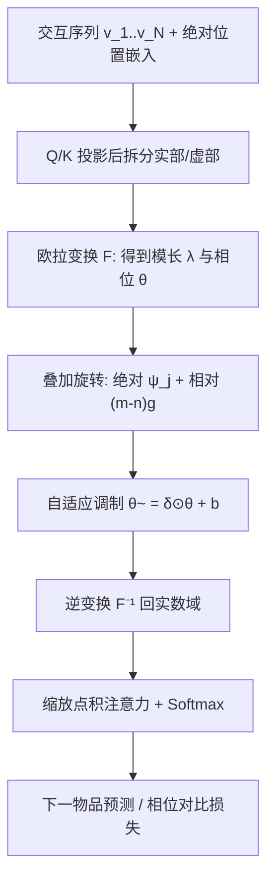
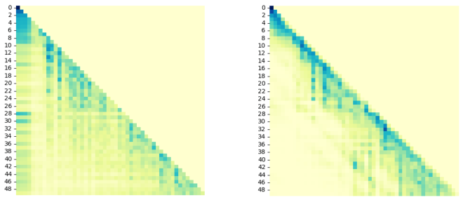
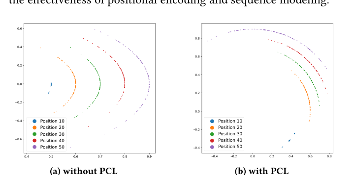

# EulerFormer: Sequential User Behavior Modeling with Complex Vector Attention (基于复向量注意力的序列用户行为建模)

- **会议/期刊**: SIGIR 2024
- **作者与机构**: Zhen Tian, Wayne Xin Zhao, Ji-Rong Wen 等（中国人民大学高瓴人工智能学院 & 华为泊松实验室）
- **推荐链路定位**: 召回 / 精排（作为 Transformer 序列编码器骨干，替换位置编码与注意力算子）
- **研究方向**: 序列与会话推荐 / 自监督对比学习
- **论文原文**: [https://arxiv.org/abs/2403.17729v2](https://arxiv.org/abs/2403.17729v2)
- **开源代码**: [https://github.com/RUCAIBox/EulerFormer](https://github.com/RUCAIBox/EulerFormer)

## TL;DR (1分钟核心速览)

序列推荐的主流 Transformer 依赖位置编码，而 RoPE 类方法把**语义差**用点积建模、**位置差**用旋转角建模，两套数学形式割裂，且当用户兴趣语义差异剧烈（如查询与键方向相反）时 RoPE 会彻底丧失位置建模能力。本文提出 EulerFormer：用欧拉公式把 token 映射为极坐标复向量，使语义差与位置差**统一为同一旋转形式** $\exp[i(\Delta\boldsymbol{S}+\Delta\boldsymbol{P})]$，再用可学习的自适应缩放/偏置对齐两者尺度，并以相位对比学习提升表征各向同性。在 ML-1M / Yelp2022 / Amazon_Books / ML-20M 四个数据集、Leave-One-Out 全库排序协议下，SASRec+EulerFormer 的 NDCG@10 分别提升 10.46% / 8.30% / 5.19% / 2.61%，延迟仅 2.14s，低于 RoPE 的 2.47s。

## Background & Motivation (背景与核心矛盾)

- **主流范式**: 以 SASRec/BERT4Rec 为代表的 Transformer 序列推荐，普遍使用**可学习绝对位置嵌入** $\boldsymbol{X}=\boldsymbol{P}+\boldsymbol{E}$；NLP 侧则流行 RoPE 这类旋转式相对位置编码。
- **前人局限一**: 绝对位置嵌入只能覆盖训练中观测到的位置，无法外推到更长序列，且天然刻画不了 item 间的相对距离依赖。
- **前人局限二**: RoPE 的核心式 $\mathrm{Re}[\boldsymbol{q}_m^\top\boldsymbol{k}_n^*\exp(i(m-n)\alpha)]$中，语义部分走**点积**、位置部分走**旋转角**，两种度量的数学性质并不一致；用户行为序列比自然语言更自由，语义差$\Delta\boldsymbol{S}$在不同层/不同用户间波动极大，而$\Delta\boldsymbol{P}$ 是预定死的，两者量级极易失配。
- **核心洞察 (Key Insight)**: 若能把语义差也表达为**相位角差**，则 $\Delta\boldsymbol{S}$与$\Delta\boldsymbol{P}$ 就落在同一个加法旋转群内，可统一建模、可自适应调权，并能显式控制长程衰减梯度。
- **本文切入点**: 用欧拉变换 $\mathcal{F}$ 把实向量拆成实/虚两半转成极坐标复向量，从而将点积重写为旋转；再引入层内可学习仿射变换调制语义相位。

## Method (核心方法设计)

### 1. 整体框架 (Overall Architecture)

输入序列先做常规 item 嵌入 + 可学习绝对位置嵌入，得到 $\boldsymbol{x}_j\in\mathbb{R}^d$；随后在每层注意力的 Query/Key 分支上执行：拆分 → 欧拉变换（实部/虚部 → 模长$\boldsymbol{\lambda}$与相位$\boldsymbol{\theta}$）→ 叠加绝对旋转嵌入$\boldsymbol{\psi}_j$与相对旋转量$(m-n)\boldsymbol{g}$→ 语义相位经 adaptation 仿射调制 → 逆变换$\mathcal{F}^{-1}$回实数域 → 标准缩放点积注意力。由于$\mathcal{F}$可逆且保内积，整个过程**无需任何复数乘法**，仅$O(Nd)$ 线性开销，可直接插入现有 Transformer 层。训练时叠加下一物品交叉熵与相位对比损失。

### 2. 关键设计拆解 (Key Designs)

1. **欧拉变换与统一旋转形式**：把 $\boldsymbol{x}_j$前后半维当作实部$\boldsymbol{r}_j$、虚部$\boldsymbol{s}_j$，得$\tilde{\boldsymbol{x}}_j=\mathcal{F}(\boldsymbol{x}_j)=\boldsymbol{\lambda}_j\exp(i\boldsymbol{\theta}_j)$，其中$\boldsymbol{\lambda}_j=\sqrt{\boldsymbol{r}_j^2+\boldsymbol{s}_j^2}$、$\boldsymbol{\theta}_j=\mathrm{atan2}(\boldsymbol{s}_j,\boldsymbol{r}_j)$。关键性质是点积被重写为**模长调制 + 角度差**：

$$\mathrm{Re}[\tilde{\boldsymbol{q}}_m^\top\tilde{\boldsymbol{k}}_n^*]=(\boldsymbol{\lambda}^Q_m\odot\boldsymbol{\lambda}^K_n)^\top\mathrm{Re}\Big[\exp\big(i(\underbrace{\boldsymbol{\theta}^Q_m-\boldsymbol{\theta}^K_n}_{\Delta\boldsymbol{S}}+\underbrace{(m-n)\boldsymbol{g}}_{\Delta\boldsymbol{P}})\big)\Big]$$

直觉上，语义相似度不再是"长度"，而是"朝向"，于是语义与位置可以在同一复平面上做角度加和，RoPE 只是 $\boldsymbol{\delta}=1,\boldsymbol{b}=0$ 的特例。

2. **差分旋转中的自适应调制 (Adaptive Rotation)**：痛点在于 $\Delta\boldsymbol{S}$的分布跨层剧烈漂移，而$\Delta\boldsymbol{P}$固定，直接相加会使相位被语义噪声淹没。作者对 Query 相位做层内仿射$\tilde{\boldsymbol{\theta}}^Q_j=\boldsymbol{\delta}_l\odot\boldsymbol{\theta}^Q_j+\boldsymbol{b}_l$（Key 只缩放不偏置，保持相对性），得到$\mathrm{Re}[\cdot]=\big(\boldsymbol{\lambda}^Q_m\odot\boldsymbol{\lambda}^K_n\big)^\top\mathrm{Re}\big[\exp(i(\boldsymbol{\delta}_l\odot\Delta\boldsymbol{S}+\boldsymbol{b}_l+\Delta\boldsymbol{P}))\big]$。由于梯度$\partial(\boldsymbol{q}_m^\top\boldsymbol{k}_n)/\partial D=-(\boldsymbol{\lambda}^Q_m\odot\boldsymbol{\lambda}^K_n\odot\boldsymbol{g})^\top\sin(\boldsymbol{\delta}\odot\Delta\boldsymbol{S}+\boldsymbol{b}+D\boldsymbol{g})$中的相位可被$\boldsymbol{\delta},\boldsymbol{b}$拉回，模型可主动维持"距离越远注意力越小"的长程衰减性质——这正是 RoPE 在$\Delta\boldsymbol{S}+\Delta\boldsymbol{P}\in[\pi+2k\pi,(2k+2)\pi]$ 时会出现注意力随距离递增的失效区间。

<figure class="paper-figure" markdown="span">
  <figcaption>图3：不同Transformer层中某一位置处词元差异分布的可视化。</figcaption>
</figure>

3. **相位对比学习与总损失**：Transformer 表征常呈各向异性（推荐场景 item 数量巨大更严重），导致 $\Delta\boldsymbol{S}\to 0$、与位置差融合失效。作者只对**相位**做随机掩码增广，构造$\mathcal{L}_{query}=-\frac{1}{B}\sum_{\tilde{\Theta}}\sum_{j=1}^{N}\log\frac{\exp(\boldsymbol{w}^\top\cos(\tilde{\boldsymbol{\theta}}^Q_j-\bar{\boldsymbol{\theta}}^Q_j)/\tau)}{\sum_{j'=1}^{N}\exp(\boldsymbol{w}^\top\cos(\tilde{\boldsymbol{\theta}}^Q_j-\bar{\boldsymbol{\theta}}^Q_{j'})/\tau)}$，并对 Key 同构地加一项，$\mathcal{L}_{Con}=\mathcal{L}_{query}+\mathcal{L}_{key}$。总目标$\mathcal{L}=\mathcal{L}_{CE}+\epsilon\cdot\mathcal{L}_{Con}$，$\mathcal{L}_{CE}$为全库 softmax 交叉熵；不使用额外负采样（同序列内 token 互为负例），$\epsilon$搜索于$\{10^{-4},10^{-5},10^{-6}\}$，$\tau$搜索于$\{0.5,1,5,10\}$。由于模长与相位解耦，该任务只调整朝向、不破坏模长语义。

<figure class="paper-figure" markdown="span">
  <figcaption>图5：使用（w）与不使用（w/o）相位对比学习（PCL）时的相位分布可视化。</figcaption>
</figure>

## Experimental Setup & Evaluation Protocol (实验设置与评估协议)

| 数据集 | #Users | #Items | #Interactions | 稀疏度 | 平均序列长 |
| :--- | :---: | :---: | :---: | :---: | :--- |
| ML-1M | 6,034 | 3,124 | 834,449 | 95.57% | 138.31 |
| Yelp2022 | 9,370 | 24,627 | 811,573 | 99.65% | 86.62 |
| Amazon_Books | 543,598 | 276,863 | 15,035,247 | 99.99% | 27.66 |
| ML-20M | 137,524 | 14,259 | 16,447,894 | 99.16% | 119.60 |

- **数据划分与防穿越**: `Leave-One-Out`（最后一交互为测试、倒数第二为验证、其余训练），严格按时间戳顺序构造序列。
- **排名评测协议**: 测试阶段将真实物品与**全部未交互物品**一起排序（无偏 Full-Ranking），报告 Recall@10 / MRR / NDCG@10 并按用户平均；无负采样排序，训练侧亦为全库 softmax 而非 BPR 采样。
- **对比基线与超参**: 插入式骨干基线 SASRec、BERT4Rec、CORE、SASRecF、FDSA；位置编码基线 Sinusoidal、XLNet 相对嵌入、T5 bias、ALiBi、RoPE。统一 $d=64$、层数$L=2$、头数$h=2$、FFN 256，Adam 优化，基于 RecBole 实现；主表用 paired$t$-test 标注$p<0.01$ 显著性。

## Key Experimental Results (实验关键数据)

### 1. 主实验对比 (Main Results)

以 SASRec 为统一骨干，替换不同位置编码方案（表 4 摘录）：

| 方法 | ML-1M R@10 | ML-1M MRR | ML-1M NDCG@10 | Yelp NDCG@10 | Amazon NDCG@10 | ML-20M NDCG@10 | 延迟(ML-1M) |
| :--- | :---: | :---: | :---: | :---: | :---: | :---: | :---: |
| Base (可学习绝对PE) | 23.70 | 8.88 | 12.33 | 2.65 | 7.13 | 11.13 | 1.85s |
| Sinusoidal | 23.54 | 8.94 | 12.34 | 2.28 | 6.87 | 10.72 | 1.94s |
| XLNet (相对PE) | 23.50 | 8.88 | 12.28 | 2.71 | 7.11 | 10.84 | 5.12s |
| T5 bias | 23.39 | 8.66 | 12.09 | 2.77 | 7.08 | 10.90 | 1.81s |
| ALiBi | 23.26 | 8.67 | 12.05 | 2.73 | 7.13 | 10.79 | 1.96s |
| RoPE | 23.85 | 8.91 | 12.39 | 2.81 | 7.17 | 10.90 | 2.47s |
| **EulerFormer** | **25.31** | **10.07** | **13.62** | **2.87** | **7.50** | **11.42** | 2.14s |
| Improv. vs Base | +6.79% | +13.40% | +10.46% | +8.30% | +5.19% | +2.61% | — |

插入到其他骨干（表 3）：EulerFormer+BERT4Rec 在 ML-1M 取得全局最优（R@10 28.11 / NDCG 15.42）；EulerFormer+CORE 在稀疏集上增益最猛（Amazon_Books R@10 +9.79%、MRR +13.24%，Yelp2022 NDCG +5.71%）；SASRecF/FDSA 增益较小（+0.44%~1.42%），作者归因于物品特征进一步加剧表征各向异性、削弱模型对位置的敏感度。

### 2. 消融实验 (Ablation Study)

| 变体 | ML-1M R@10 | ML-1M MRR | ML-1M NDCG@10 | Yelp R@10 | Yelp NDCG@10 |
| :--- | :---: | :---: | :---: | :---: | :---: |
| (0) EulerFormer 完整版 | **25.31** | **10.07** | **13.62** | **5.52** | **2.87** |
| (1) w/o adaptation function | 24.61 | 9.60 | 13.11 | 5.37 | 2.76 |
| (2) w 可学习位置编码（替代固定 $\boldsymbol{g}$） | 23.79 | 8.93 | 12.39 | 5.23 | 2.72 |
| (3) w/o differential rotation | 24.68 | 9.42 | 12.96 | 5.41 | 2.67 |
| (4) w/o rotary embedding | 24.76 | 9.57 | 13.11 | 5.37 | 2.74 |
| (5) w/o phase-contrastive learning | 24.76 | 9.44 | 13.02 | 5.31 | 2.78 |

### 3. 关键实验发现 (Key Findings)

1. **自适应调制是最大增益源，但"把位置基频设为可学习"是灾难**：去掉 adaptation 后 ML-1M NDCG 掉 0.51（13.62→13.11），而变体 (2) 直接把 $\boldsymbol{g}$ 交给学习反而跌到 12.39，甚至不如原始 SASRec 的 12.33——说明本文的价值在于"调语义相位、锁位置相位"，颠倒了就同时破坏外推性与长程衰减。
2. **序列越长收益越大**：按序列长度分桶后，ML-1M 在 $[200,250)$桶、Yelp2022 在$[90,100)$ 桶的相对提升最大（图 2），与注意力热力图显示"EulerFormer 把权重集中到近期物品、RoPE/SASRec 注意力弥散"的现象互相印证。
3. **效率与精度并非权衡**：EulerFormer 在 ML-1M 上延迟 2.14s，优于 RoPE 的 2.47s 与 XLNet 的 5.12s，仅比最简 Base 多 0.29s；线性 $O(Nd)$ 复杂度、无矩阵乘法与复数内积，使其实测推理成本与 Sinusoidal 相当，而 NDCG 高出 10.4%。

## Highlights & Limitations (亮点、对比与审稿批判)

- **与代表作对比**: 相较 RoPE（$\boldsymbol{\delta}=1,\boldsymbol{b}=0$的特例），EulerFormer 把"预定死的相对位置"变成"层内可调的旋转对齐"；相较 ALiBi/T5 bias 用注意力偏置硬加位置惩罚，本文是在复平面内做角度融合，不额外引入$O(N^2)$偏置矩阵；相较 XLNet 的相对嵌入需改注意力打分并带来 2.8 倍延迟，本文保持$O(Nd)$ 且精度全面领先。
- **可迁移亮点**: (i) "只对相位做掩码对比、保留模长"的解耦式自监督目标，可低成本移植到任意 RoPE 系 LLM4Rec 的序列编码器中；(ii) 用 $\boldsymbol{\delta},\boldsymbol{b}$ 显式控制长程衰减梯度符号的技巧，可推广到需要"局部性可控"的序列/时序建模。
- **审稿级局限批判**: (i) 数据集 $d=64$、$L=2$的轻量配置下验证充分，但未给出工业级千万 item、$d=256$的扩展实验，$\boldsymbol{\delta}$与$\boldsymbol{b}$的层数相关参数量增长与收敛稳定性存疑；(ii) 相位对比损失对$\epsilon$（最优约$10^{-5}$）与$\tau$（0.8~1.2）较敏感，且稀疏集需更低温度，实际部署需逐数据集调参；(iii) 仅验证 next-item 预测这一下游任务，未检验长序列外推（train-short/test-long）与跨域迁移能力。

## Rating (四维评分)

- **方法创新性 (Novelty)**: ⭐⭐⭐⭐⭐ （把语义差与位置差统一进同一复旋转群，并给出 RoPE 为特例的完整理论框架与长程衰减梯度分析，属真正的算子级创新）
- **评估协议与实验扎实度 (Protocol & Experiments)**: ⭐⭐⭐⭐ （四数据集 + Leave-One-Out + Full-Ranking + 显著性检验 + 位置编码/骨干双维度对比齐备，略欠大规模工业验证与长序列外推实验）
- **写作与数学规范度 (Clarity & Rigor)**: ⭐⭐⭐⭐⭐ （欧拉变换、差分旋转、梯度推导与复杂度分析环环相扣，$\mathcal{F}$ 可逆保内积的论证尤其干净）
- **工业落地与复现价值 (Industrial & Practical Value)**: ⭐⭐⭐⭐⭐ （开源完整、基于 RecBole 可直接替换注意力层，线性复杂度且实测延迟低于 RoPE，工程落地门槛极低）

