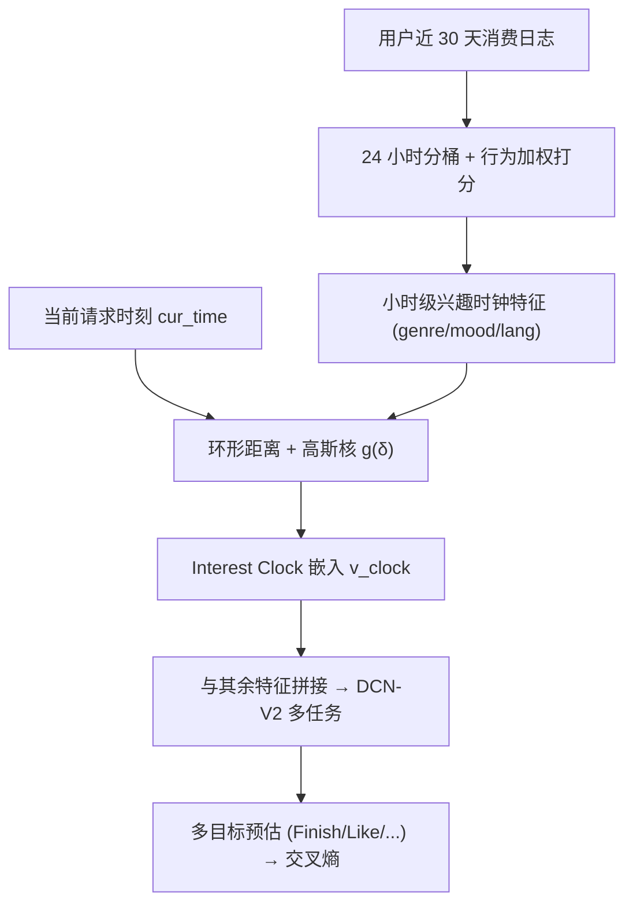
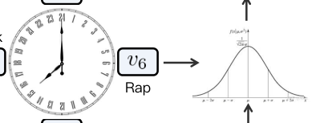
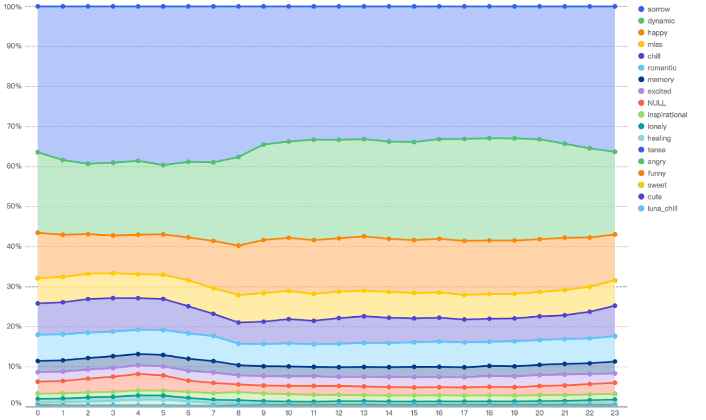

# Interest Clock: Time Perception in Real-Time Streaming Recommendation System (实时流式推荐系统中的时间感知)

- **会议/期刊**: SIGIR 2024 (Industrial Track / short paper, 5 pages)
- **作者与机构**: Yongchun Zhu, Jingwu Chen (通讯), Ling Chen, Yitan Li, Feng Zhang, Zuotao Liu — 字节跳动抖音集团 (Douyin Group)
- **推荐链路定位**: 精排 (Ranking，DCN-V2 多任务基座的特征侧插件)
- **研究方向**: 序列与会话推荐 / CTR 预估与特征交叉
- **论文原文**: [https://arxiv.org/abs/2404.19357v1](https://arxiv.org/abs/2404.19357v1)
- **开源代码**: 暂未开源

## TL;DR (1分钟核心速览)

工业推荐系统普遍用 one-hot 小时/星期嵌入做时间编码，但在**实时流式训练**下，某一时刻的千万级样本时间特征完全相同，模型只会拟合当前小时、遗忘其余时段，导致周期性震荡。本文提出 **Interest Clock**：把用户过去 30 天按 24 小时分桶统计的 genre/mood/language 偏好存成"时钟"，再用**循环高斯核**按请求时刻平滑聚合为一个稠密向量，作为普通特征喂入基座。抖音音乐 20B 样本离线 AUC 0.6631→0.6695、UAUC 0.6007→0.6069，线上 A/B 活跃天数 +0.509%、时长 +0.758%。

## Background & Motivation (背景与核心矛盾)

- **主流范式**: 业界时间建模以 **time encoding** 为主，即把"一天中的小时"与"一周中的星期"映射为可学习嵌入 $\mathbf{v}_{time}=[\mathbf{v}_{hour};\mathbf{v}_{day}]$，在按天收集、打散训练的框架下效果稳定。
- **前人局限**: ①外卖场景按早/午/晚/夜四时段分别建图（Zhang et al.），依赖品类固有的时段性，短剧/音乐等场景不成立；②序列模型中的 time gap 编码只调节历史项重要性，并不直接刻画"此刻我偏好什么"；③time encoding 在**流式训练**（sample 产生即训练）中失效——同一小时的样本时间特征同质，梯度只更新当前 hour 嵌入。
- **核心洞察 (Key Insight)**: 时间建模的困难本质不是"时间不可学"，而是**离散符号在流式数据分布下不可学**。若把时间从"ID 型特征"改造为"用户侧统计型特征"，则同一时刻不同用户携带不同取值，特征空间被重新铺满，周期性震荡自然消失。
- **本文切入点**: 用**个性化小时级兴趣画像**替代全局小时 ID，并用连续核函数替代硬切换，一举解决"流式遗忘"与"整点跳变"两个矛盾。

## Method (核心方法设计)

### 1. 整体框架 (Overall Architecture)

Interest Clock 不改动基座结构，只重写时间特征的生成方式。离线侧：以 24 个小时为桶，回溯用户过去 30 天的消费日志，按行为加权打分选出每小时 Top-3 的 genre / mood / language，落库为用户时钟特征 $\mathbf{v}^{t}_{genre},\mathbf{v}^{t}_{mood},\mathbf{v}^{t}_{lang}$（$t=1..24$）。在线侧：拿到请求时刻$cur\_time$后，计算 24 个小时与该时刻的**环形距离**，用经验高斯核加权求和得到单一$\mathbf{v}_{clock}$，与其余 ID/统计特征拼接后送入 DCN-V2 多任务网络，以交叉熵训练、输出多目标预估值。全流程无额外序列建模开销，特征可离线预计算、在线仅做 24 维加权。

<figure class="paper-figure" markdown="span">
  <figcaption>图1：Interest Clock 首先将用户的时间感知偏好编码为时钟（小时级个性化特征），然后根据当前时间使用高斯分布将其平滑并聚合为最终的兴趣时钟嵌入，以用于最终预测。</figcaption>
</figure>

### 2. 关键设计拆解 (Key Designs)

1. **行为加权兴趣打分（把时间变成用户特征）**: 直接统计点击频次会被 skip 噪声淹没，故对每小时的多行为标签加权：$score_{fea}=\alpha Cnt_{like}+\beta Cnt_{finish}-\gamma Cnt_{skip}-\omega Cnt_{dislike}$，取 Top-3 作为该小时画像。物理直觉：正负反馈差分近似"净偏好"，使时钟特征携带判别性而非单纯曝光量。

2. **环形高斯平滑聚合（消除整点跳变）**: 两个朴素方案各有缺陷——*Adaptive Clock* 拼接 24 小时嵌入交给网络自适应加权，在流式场景下权重同样只被当前小时样本更新而退化（实验中 UAUC 反降至 0.5859）；*Naive Clock* 只取当前小时嵌入，则 7:59 与 8:01 的兴趣表示突变。本文改用先验核： $\mathbf{v}_{clock}=\sum_{t=1}^{24}g(\delta_{time})[\mathbf{v}^{t}_{genre},\mathbf{v}^{t}_{mood},\mathbf{v}^{t}_{lang}]$，其中$\delta_{time}=\min(\mathrm{mod}(t+24-cur\_time,24),\ \mathrm{mod}(cur\_time+24-t,24))$，$g(\delta)=\frac{1}{\sqrt{2\pi}\sigma}\exp(-\frac{(\delta-\mu)^2}{2\sigma^2})$，$\mu=0,\sigma=1$。**环形取最小距**保证 23 点与 0 点相邻，高斯核让相邻时段平滑过渡、远端快速衰减，等价于一个不参与梯度更新的固定低通滤波器——恰好绕开了"流式数据无法学习时间权重"的根因。

3. **训练目标、负采样与推理开销**: 损失即基座的多目标交叉熵 $\mathcal{L}=-y\log\hat{y}-(1-y)\log(1-\hat{y})$（主标签为 Finish），**无负采样**（pointwise CTR 式二分类，全曝光样本训练）。推理侧每小时只需 1 次 24×3 向量加权，FLOPs 与一次 72 维 embedding lookup 同量级，存储为每用户 24 小时画像，可天级离线刷新。

## Experimental Setup & Evaluation Protocol (实验设置与评估协议)

- **数据集与预处理**: 单一工业日志数据集 DouyinMusic-20B，未做 k-core 过滤（保留全曝光样本）。

| 数据集 | #Users | #Items | #Interactions | 稀疏度/密度 | 特征/场景说明 |
| :--- | :---: | :---: | :---: | :---: | :--- |
| DouyinMusic-20B | 1000 万+ DAU | 百万级曲库 | >200 亿条曝光 | 极稀疏（负反馈占绝对多数） | 100+ 特征：非 ID 元特征(gender/age/genre/mood/scene) + ID 特征(user/item/artist/行为序列)，标签为 Finish |

- **数据划分与防穿越 (Splitting Strategy)**: **全局时间戳切分**——8 周数据（2023.08–09）中前 6 周训练、第 7 周验证、第 8 周测试，严格避免未来样本泄漏。
- **排名评测协议 (Ranking Protocol)**: 本文不采用 Top-K 检索式评测，而是**工业 CTR 协议**：离线用 AUC 与 UAUC（用户内 AUC，缓解用户活跃度偏置），线上用固定流量、一个多月的 A/B 实验，报告 95% 置信区间并做显著性检验。
- **对比基线与超参设置**: 因属短篇工业论文，离线对比均为**消融式自基线**：Baseline（原始 time encoding + DCN-V2 多任务）、Naive Clock、Adaptive Clock、Gaussian Clock；线上统一以 DCN-V2 多任务为基座替换时间特征，$\alpha,\beta,\gamma,\omega$与$\sigma=1,\mu=0$ 均为经验设定，未做网格搜索。

## Key Experimental Results (实验关键数据)

### 1. 主实验对比 (Main Results)

线上 A/B（相对提升，括号内为 95% CI 半宽；约束指标要求不显著劣化）：

| 用户分群 | Active Day | Duration | Like | Finish | Comment | Play |
| :--- | :---: | :---: | :---: | :---: | :---: | :---: |
| Low-active | **+0.731%** | **+1.201%** | **+1.327%** | **+0.956%** | +0.831% | **+1.371%** |
| Middle-active | +0.625% | +1.205% | +1.738% | +0.684% | **+1.253%** | +1.340% |
| High-active | +0.437% | +0.574% | **+2.187%** | +0.427% | +0.833% | +0.929% |
| **Overall** | **+0.509%** (±0.073) | **+0.758%** (±0.218) | **+1.514%** (±0.925) | **+0.617%** (±0.107) | **+0.962%** (±0.249) | **+1.136%** (±0.174) |

离线 DouyinMusic-20B（时间切分测试周，Improv. 相对 Baseline）：

| 模型变体 | AUC | Improv. | UAUC | Improv. |
| :--- | :---: | :---: | :---: | :---: |
| Baseline (time encoding) | 0.6631 | — | 0.6007 | — |
| Naive Clock (仅当前小时) | 0.6666 | +0.53% | 0.6015 | +0.13% |
| Adaptive Clock (24h 拼接自适应加权) | 0.6662 | +0.47% | 0.5859 | **−2.46%** |
| **Gaussian Clock (Ours)** | **0.6695** | **+0.97%** | **0.6069** | **+1.03%** |

### 2. 消融实验 (Ablation Study)

| 配置 | AUC | UAUC | 说明 |
| :--- | :---: | :---: | :--- |
| w/o Clock（原始 time encoding） | 0.6631 | 0.6007 | 离散时间符号，流式下震荡 |
| w/ Naive Clock（硬取当前小时，等价 $\sigma\to0$） | 0.6666 | 0.6015 | 去掉平滑，整点跳变 |
| w/ Adaptive Clock（可学习小时权重，等价去掉高斯先验） | 0.6662 | 0.5859 | 权重被当前小时样本主导而退化 |
| w/ Gaussian Clock（完整） | 0.6695 | 0.6069 | 环形高斯固定核 |

### 3. 关键实验发现 (Key Findings)

1. **平滑先验胜过可学习权重**：Adaptive 与 Gaussian 的 AUC 仅差 0.0033，但 UAUC 相差 **0.0210（−3.3%）**；Adaptive 甚至低于无时钟的 Baseline（0.5859 vs 0.6007），定量印证"流式分布下小时权重不可学"，冻结高斯核等价于为时间维度注入归纳偏置。
2. **线上收益量级远超常规迭代**：论文给出对照——生产算法平均 Active Day 提升约 0.05%、Duration 约 0.1%，本文 **+0.509% / +0.758%** 约为其 10 倍与 7 倍，被作者称为 2023 年单模型最大涨幅。
3. **低活用户受益最大、高活用户受益最小**：Active Day 提升从 Low-active +0.731% 单调降至 High-active +0.437%，与"高活用户已有充足 ID 序列可刻画兴趣、低活用户只能依赖时间先验补足"的解释一致；同时高活用户 Like 提升最高（+2.187%），说明时钟在兴趣宽度大的群体中主要提升内容匹配精度而非使用频次。

<figure class="paper-figure" markdown="span">
  <figcaption>图2：推荐系统中时间信息的分析。横轴表示小时，纵轴表示曝光次数百分比。</figcaption>
</figure>

## Highlights & Limitations (亮点、对比与审稿批判)

- **与代表作对比 (vs. Prior Work)**: 与 time encoding（小时/星期 ID 嵌入）相比，本文把"时刻符号"换成"用户画像统计量"，从根上规避了流式同质样本问题；与外卖四时段分图建模相比，不做场景强假设、可作为任意基座的通用插件；与序列模型中的 time gap 编码相比，后者只调历史项注意力权重，本文直接产出用于最终预估的时间表征。
- **可迁移亮点**: ①"**离散 ID → 用户侧分桶统计 + 固定核平滑**"这一范式可平移到位置、设备、场景等其他易在流式训练中退化的高基数特征；②环形距离 + 高斯衰减的写法可直接用于周期性变量（星期、节假日、生理周期）的连续化编码。
- **审稿级局限批判**: ①**证据面过窄**：全部结论建立在单一内部数据集与一条线上业务上，无公开基准、无开源代码，且离线对比只有 3 个自变体，缺少 TiSASRec/Time2Vec 等时间建模基线；②**潜在穿越与调参缺失**：时钟特征用"过去 30 天"回溯构造，但离线训练样本跨 8 周，窗口若按样本时刻回溯则测试周特征窗口会包含训练期之外的分布漂移，论文未说明窗口如何对齐划分边界；同时 $\sigma=1$与$\alpha,\beta,\gamma,\omega$ 全靠经验，无敏感性分析，AUC 绝对增益仅 +0.0064，稳健性存疑。

## Rating (四维评分)

- **方法创新性 (Novelty)**: ⭐⭐⭐ （"离散时间→个性化时钟+高斯平滑"是巧妙的工程化重构，但本质为特征工程插件，缺乏理论刻画与端到端学习成分）
- **评估协议与实验扎实度 (Protocol & Experiments)**: ⭐⭐⭐ （线上一个多月 A/B + 95% CI + 分群分析颇具说服力，但离线仅单数据集三变体、无公开基准与显著性检验）
- **写作与数学规范度 (Clarity & Rigor)**: ⭐⭐⭐⭐ （公式与动机链条清晰、环形距离定义严谨，5 页短文信息密度高，但特征窗口与切分边界未交代）
- **工业落地与复现价值 (Industrial & Practical Value)**: ⭐⭐⭐⭐⭐ （已在抖音音乐多业务上线，推理开销近似一次 embedding lookup，思路零依赖即可复现到任意精排模型）

