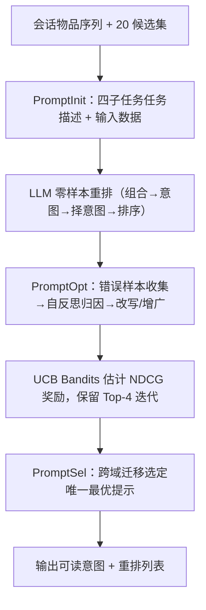

# Large Language Models for Intent-Driven Session Recommendations (大语言模型驱动的意图感知会话推荐)

- **会议/期刊**: SIGIR 2024
- **作者与机构**: Zhu Sun, Hongyang Liu, Xinghua Qu, Kaidong Feng, Yan Wang, Yew-Soon Ong（A\*STAR CFAR/IHPC、Macquarie University、Shanda Group AI Lab、Yan Shan University、NTU）
- **推荐链路定位**: 重排（会话级候选集重排，候选规模 20）
- **研究方向**: 序列与会话推荐 / 大语言模型推荐 (LLM4Rec)
- **论文原文**: [https://arxiv.org/abs/2312.07552v1](https://arxiv.org/abs/2312.07552v1)
- **开源代码**: [https://github.com/llm4sr/PO4ISR](https://github.com/llm4sr/PO4ISR)

## TL;DR (1分钟核心速览)

意图感知会话推荐（ISR）的痛点在于：主流模型把「会话意图数量」当成全局固定的超参，且意图只存在于不可读的隐空间。本文提出 PO4ISR——不做任何参数微调，而是用「初始提示 → 基于错误样本自反思的提示改写/增广 → UCB Bandits 评测 → 跨域提示选择」的自动提示优化闭环，让 LLM 在语义层面自行决定每个会话有哪些、有几个意图。在 20 候选采样重排协议下，三个数据集上 HR/NDCG 平均相对提升 57.37% / 61.03%，且给出可读的意图归因。

## Background & Motivation (背景与核心矛盾)

- **主流范式**: 会话推荐从 GRU4Rec/STAMP/NARM 的单一主意图建模，走向 MCPRN、HIDE、Atten-Mixer、NirGNN 的多意图建模；LLM 侧则多用 zero-shot ICL（NIR）或参数高效微调（BIGRec、LlamaRec）。
- **前人局限 1（意图数刚性）**: 多意图模型把意图通道数 $K$设为全局超参，但真实会话意图数剧烈变化——图 1 中会话 1 只有「笔记本+配件」一个意图，会话 2 同时含「笔记本保护壳」与「相机配件」两个意图，固定$K$ 在稀疏会话上直接失配。
- **前人局限 2（不可解释）**: 意图仅以隐向量/注意力权重形式存在，无法向用户或运营解释「为什么推荐这个」；且小样本下多通道 RNN 参数欠拟合（MCPRN 在三个数据集上全线最差）。
- **核心洞察 (Key Insight)**: LLM 的零样本推理与自我反思能力足以在自然语言层完成「组合切分 → 意图归纳 → 意图择一 → 重排」；差的不是模型能力，而是**提示本身的任务描述质量**，因此提示应当被当作可训练的「参数」来搜索。
- **本文切入点**: 把提示优化（而非模型微调）作为 ISR 的新范式，用错误样本驱动提示的自动改写，再用跨域泛化能力一次性选定最优提示。

## Method (核心方法设计)

### 1. 整体框架 (Overall Architecture)

输入是一条匿名会话的物品标题序列与 20 个候选物品。PromptInit 给出四子任务式任务描述（发现物品组合 → 每个组合推断交互意图 → 选出最能代表当前偏好的意图 → 按交互可能性重排候选集），配合输入数据提示交给 ChatGPT(GPT-3.5-turbo)。PromptOpt 随机采样 $N_t=32$条训练会话跑一遍，把目标物品落在重排列表后半段（rank > 10）的会话判为错误样本，令 LLM 自反思给出$N_r=2$条致错原因，据此改写（refine）并做语义等价增广（augment），每条错误样本产出 2 个候选提示；候选提示用 UCB Bandits 在小批会话上估计 NDCG 奖励，保留 Top-$N_o=4$进入下一轮，共迭代$E_2=2$ 轮。PromptSel 则利用 LLM 的跨域鲁棒性，直接用 Games 域的最优提示作为所有域的最终提示。

### 2. 关键设计拆解 (Key Designs)

1. **错误驱动的自反思提示优化（PromptOpt）**：痛点是没有梯度可回传、提示空间离散。本文用「排名位置」定义错误样本 $\mathcal{E}=\{s \mid \mathrm{rank}(\text{target}_s) > |\mathcal{C}|/2\}$，再让 LLM 生成致错理由集$\mathcal{R}_s$，把「提示 + 错误样本 + 理由」一起喂回模型改写提示：$p^{\text{ref}} = \mathrm{LLM}(p \,\|\, s \,\|\, \mathcal{R}_s)$，并对$p^{\text{ref}}$做同义增广得到$p^{\text{aug}}$。直觉是：错误样本定位了提示的语义盲区（如初版提示只让模型看会话物品、未要求引入用户偏好），理由文本就把盲区翻译成可执行的补充指令。
2. **UCB Bandits 高效提示评测**：直接在全量会话上评测 $2N_e$个提示代价不可接受，本文把提示选择建成多臂老虎机：$p^{*}=\arg\max_{p}\left(R[p]+\gamma\sqrt{\log e_{1}/S[p]}\right)$，其中$R[p]$为累计 NDCG 奖励均值、$S[p]$为被评测次数、$e_1$为轮次、$\gamma$控制探索。这样只需$O(N_t \cdot E_1)$ 次 API 调用即可把「高潜力但尚未充分评测」的提示捞回来，避免早熟。
3. **跨域提示选择（PromptSel）与目标函数**：作者发现 Top-2 提示在部分会话上反超 Top-1（图 3 中 NDCG@5 差值出现负值），但同域集成（EnSame）与跨域集成（EnCross）都因「多数会话的下降抵不过少数会话的提升」而失效。于是改为从三个域各自优化出的 Top-1 提示中挑一个全局最优：$p^{\text{final}}=\arg\max_{p\in\{p^{\text{top1}}_{\text{ML-1M}},p^{\text{top1}}_{\text{Games}},p^{\text{top1}}_{\text{Bundle}}\}}\mathbb{E}_{s\sim\mathcal{S}}[\mathrm{NDCG@5}(p,s)]$，最终 Opt-Games 在三个域上一致胜出（因其平均会话最短、密度适中，提示无需承载过多局部信息）。**训练/推理开销**：全程无梯度、无负采样、无参数更新，仅 GPT-3.5 的 API 调用；优化完成后线上只需一次前向重排。

## Experimental Setup & Evaluation Protocol (实验设置与评估协议)

- **数据集与预处理**:

| 数据集 | #Items | #Sessions | 平均会话长度 | 密度指标 | 场景说明 |
| :--- | :---: | :---: | :---: | :---: | :--- |
| ML-1M | 3,416 | 784,860 | 6.85 | 1573.86 | 电影评分，按天切会话 |
| Games | 17,389 | 100,018 | 4.18 | 24.04 | Amazon 视频游戏 |
| Bundle | 14,240 | 2,376 | 6.73 | 1.12 | 电商捆绑包，含众包标注的真实意图 |

- **数据划分与防穿越**: 按用户评分时间排序成序列后按天切分为会话，再按 **8:1:1 比例划分** train/valid/test（时间上顺序切分，无未来泄漏）。
- **排名评测协议**: **Sampled Ranking**——所有方法统一候选规模为 20（1 正 + 19 负），非 Full-Ranking；为控制 API 成本，ML-1M 与 Games 各从验证/测试集随机抽 1000 条会话，并以 seed ∈ {0,10,42,625,2023} 重复 5 次生成不同候选集后取均值。指标 HR@{1,5}、NDCG@{1,5}。
- **对比基线与超参**: 传统方法 MostPop/SKNN/FPMC；单意图 NARM/STAMP/GCE-GNN；多意图 MCPRN/HIDE/Atten-Mixer；LLM 方法 NIR。非 LLM 基线用 150 条训练会话（PO4ISR 仅用 50 条），Optuna 50 次搜索；PO4ISR 设置 $N_t=32$、$N_r=2$、$N_o=4$、$E_1=16$、$E_2=2$，每轮随机取 8 个提示进 UCB，并报告$p$值（多数$p<10^{-4}$）。

## Key Experimental Results (实验关键数据)

### 1. 主实验对比 (Main Results)

| 数据/指标 | NARM | STAMP | GCE-GNN | MCPRN | HIDE | Atten-Mixer | NIR | **PO4ISR** | Improv. |
| :--- | :---: | :---: | :---: | :---: | :---: | :---: | :---: | :---: | :---: |
| ML-1M HR@1 | 0.1692 | 0.1584 | 0.1312 | 0.1434 | 0.1498 | 0.1490 | 0.0572 | **0.2000** | +18.20% |
| ML-1M HR@5 | 0.5230 | 0.5078 | 0.4748 | 0.4788 | 0.4998 | 0.4932 | 0.2326 | **0.5510** | +5.35% |
| ML-1M NDCG@5 | 0.3501 | 0.3367 | 0.3044 | 0.3157 | 0.3256 | 0.3216 | 0.1436 | **0.3810** | +8.83% |
| Games HR@1 | 0.0572 | 0.0556 | 0.0692 | 0.0522 | 0.0696 | 0.0530 | 0.1168 | **0.2588** | +121.58% |
| Games HR@5 | 0.2574 | 0.2586 | 0.2744 | 0.2416 | 0.2694 | 0.2472 | 0.3406 | **0.5866** | +72.23% |
| Games NDCG@5 | 0.1534 | 0.1555 | 0.1701 | 0.1432 | 0.1662 | 0.1475 | 0.2310 | **0.4313** | +86.71% |
| Bundle HR@1 | 0.0322 | 0.0365 | 0.0360 | 0.0360 | 0.0458 | 0.0525 | 0.0975 | **0.1697** | +74.05% |
| Bundle HR@5 | 0.2322 | 0.2352 | 0.2237 | 0.2352 | 0.2585 | 0.2644 | 0.2832 | **0.4328** | +52.82% |
| Bundle NDCG@5 | 0.1303 | 0.1339 | 0.1267 | 0.1490 | 0.1495 | 0.1549 | 0.1939 | **0.3040** | +56.78% |

### 2. 消融实验 (Ablation Study)

| 变体 | ML-1M HR@1 / NDCG@5 | Games HR@1 / NDCG@5 | Bundle HR@1 / NDCG@5 |
| :--- | :---: | :---: | :---: |
| Initial（仅初始提示） | 0.1430 / 0.2823 | 0.0790 / 0.2110 | 0.0504 / 0.1396 |
| Top-1（同域最优提示） | 0.2070 / 0.3662 | 0.1540 / 0.3574 | 0.1176 / 0.2202 |
| EnSame（同域 Top-1&2 集成） | 0.1120 / 0.2693 | – | 0.0294 / 0.1119 |
| EnCross（跨域 Top-1 集成） | 0.1070 / 0.2640 | 0.1090 / 0.2779 | 0.0840 / 0.1745 |
| **PO4ISR（Opt-Games）** | **0.2110 / 0.3975** | **0.2600 / 0.4381** | **0.1933 / 0.3183** |

### 3. 关键实验发现 (Key Findings)

1. **提示优化是主要增益来源，且跨域选提示远胜集成**：从 Initial 到 Top-1，Bundle 的 HR@1 从 0.0504 涨到 0.1176（+133%）；但把多提示做排序集成（EnSame/EnCross）反而崩到 0.0294/0.0840——说明意图推断类提示不存在「互补性」，只存在「语义正确性」，选一个最好的远比融合多个更安全。
2. **LLM 范式对稀疏短会话收益最大，与密度指标强相关**：Games（密度 24.04、均长 4.18）上相对 NIR 提升 121.58%，而稠密的 ML-1M（密度 1573.86）仅 18.20%；多意图模型 MCPRN 在 50~150 条小样本下因多通道 RNN 欠拟合而全线垫底，反证了「用推理替代参数学习」在小样本稀疏场景的性价比。
3. **初始提示质量决定天花板，但低质量提示的相对增益更大**：把 Prompt 1 换成仅 2 子任务的 Prompt 9 后，Bundle 的 Top-1 HR@1 从 0.1176 升到 0.1807（+53.7%），说明简化描述与子任务拆分会显著助力；同时也意味着表 2 的结果并非上界。**幻觉代价**：约 5.55% 会话出现幻觉（ML-1M 0.23% vs Bundle 9.38%），加 JSON 模式虽能压降坏例，但 Bundle HR@1 从 0.1176 跌到 0.0756，收益被显著牺牲，改用 GPT-4 是更优折中。

## Highlights & Limitations (亮点、对比与审稿批判)

- **与代表作对比 (vs. Prior Work)**: 与 MCPRN/HIDE 等隐空间多意图模型相比，PO4ISR 的意图数由 LLM 按会话自适应决定而非超参；与 NIR 这类 zero-shot 提示相比，它多了一层「错误样本 → 归因 → 改写」的闭环，故在 Games 上把 HR@1 从 0.1168 翻到 0.2588；与 BIGRec/LlamaRec 的微调路线相比，它完全免训练、免开源权重，代价是依赖闭源 API。
- **可迁移亮点**: (1) 「以排名位置定义错误样本 + 自反思归因」可直接迁移到召回解释生成、列表重排的提示设计；(2) UCB 采样评测是低预算下评估离散提示的有效手段，可用于任何 API 昂贵的 prompt 搜索。
- **审稿级局限批判**: (1) 评测仅为 20 候选的采样排序且 ML-1M/Games 只抽 1000 条会话，与真实全库排序的难度差距大，离线增益未必能兑现；(2) 每次重排都需一次 GPT-3.5 前向，延迟与费用远高于 GNN 基线，且 5.55% 幻觉会话直接被记 0 分，鲁棒性未从机制上解决；(3) 跨域选择依赖「Games 恰好最优」这一经验观察，缺乏可解释的提示选择准则，换域后需重跑全流程。

## Rating (四维评分)

- **方法创新性 (Novelty)**: ⭐⭐⭐⭐ （首次把「提示自动优化」确立为 ISR 的新范式，用 LLM 自适应意图数替代固定 $K$，思路简洁但理论刻画偏弱）
- **评估协议与实验扎实度 (Protocol & Experiments)**: ⭐⭐⭐ （三域数据集 + 5 seed 重复 + $p$ 值检验较规范，但候选仅 20、抽样 1000 会话，非 Full-Ranking，基线训练样本数不对等）
- **写作与数学规范度 (Clarity & Rigor)**: ⭐⭐⭐⭐ （八个提示模板全文公开、算法伪代码清晰，公式极少但 UCB 与选择准则表述完整；缺少复杂度与成本量化分析）
- **工业落地与复现价值 (Industrial & Practical Value)**: ⭐⭐⭐ （代码与提示已开源、零微调易复现，但强依赖在线 LLM API，延迟/成本/幻觉使其更适合作为离线意图标注器或教师模型）

