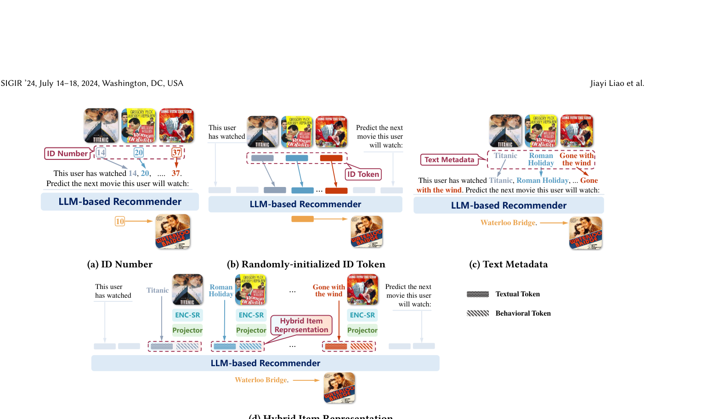
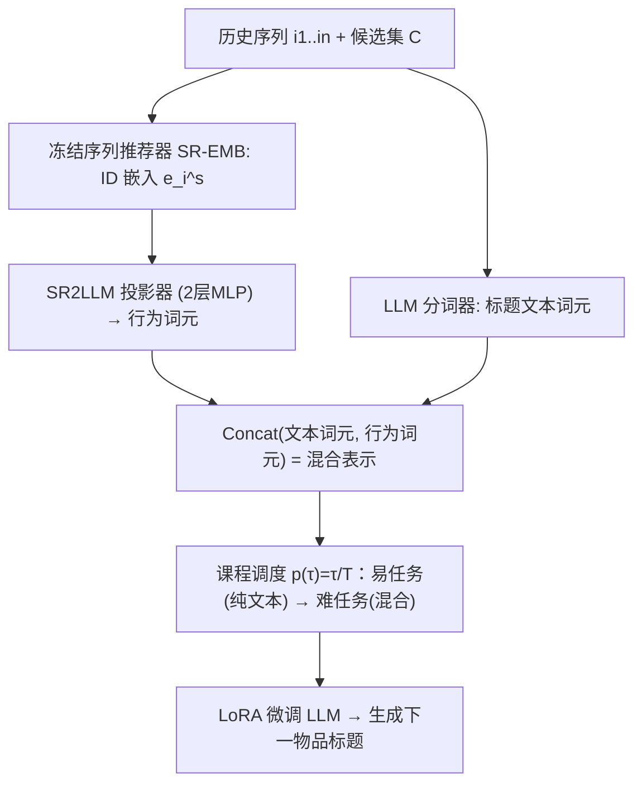
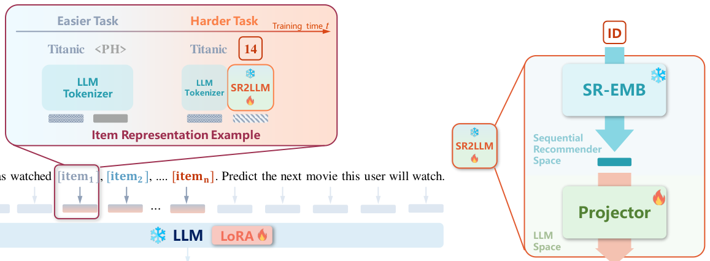

# LLaRA: Large Language-Recommendation Assistant (大语言推荐助手)

- **会议/期刊**: SIGIR 2024
- **作者与机构**: Jiayi Liao, Sihang Li, Zhengyi Yang, Jiancan Wu, Yancheng Yuan, Xiang Wang, Xiangnan He（中国科学技术大学、香港理工大学）
- **推荐链路定位**: 精排 / 端到端生成式（LLM 直接生成下一物品）
- **研究方向**: 序列与会话推荐 / 大语言模型推荐 (LLM4Rec)
- **论文原文**: [https://arxiv.org/abs/2312.02445v4](https://arxiv.org/abs/2312.02445v4)
- **开源代码**: [https://github.com/ljy0ustc/LLaRA](https://github.com/ljy0ustc/LLaRA)

## TL;DR (1分钟核心速览)

现有 LLM4Rec 把历史序列塞进提示时，要么用 ID 编号/随机 ID 词元（丢掉 LLM 的世界知识，且与自然语言不兼容），要么只用标题等文本元数据（丢掉传统推荐器学到的协同行为模式）。LLaRA 把"用户序列行为"视为一种新模态：冻结已训练的序列推荐器（GRU4Rec/Caser/SASRec），用两层 MLP 投影器把其 ID 嵌入映射为"行为词元"，与文本词元拼接成混合提示，再用课程学习从纯文本提示渐进过渡到混合提示。在 MovieLens/Steam/LastFM 的 20 候选采样排序协议下，HitRatio@1 达 0.4737/0.4949/0.4508，相对最强 LLM 基线 TALLRec 提升 21.6%/6.7%/7.9%。

## Background & Motivation (背景与核心矛盾)

- **主流范式**: 把序列推荐重写为语言建模：将历史序列填进指令模板，由 LLM 自回归生成下一物品；物品在提示中的表示方式分 ID 类（ID 编号、随机初始化 ID 词元）与文本类（标题、描述）两条路线。
- **前人局限**: (1) ID 类表示与 LLM 的自然语言预训练分布不匹配，且完全浪费了 LLM 内的物品世界知识；(2) 文本类表示无法表达用户的协同行为模式（如"最近连续看动作片"这种序列规律），使 LLM 只能靠语义相关性推断。
- **核心洞察 (Key Insight)**: 传统推荐器训练后的 ID 嵌入本质上压缩了"用户行为模态"，其信息与物品文本语义互补而非重叠——正如 MLLM 用投影器对齐图像空间与语言空间，行为嵌入也应作为一种独立模态被显式对齐进 LLM 词元空间。
- **本文切入点**: 不做"LLM 当推荐器"或"LLM 当特征增强器"的二选一，而是把已训练推荐器冻结、只训投影器，让 LLM 同时读文本词元与行为词元。

<figure class="paper-figure" markdown="span">
  <figcaption>图1：三种现有物品表示方法与本文方法的比较。(a) ID编号：用数值索引表示物品。(b) 随机初始化的ID词元：用与OOV无关的词元表示物品。(c) 文本元数据：用物品的文本特征（如物品标题）表示物品。(d) 混合物品表示：融合文本词元，以及由传统推荐模型学习得到的基于ID的物品嵌入所导出的行为词元。</figcaption>
</figure>

## Method (核心方法设计)

### 1. 整体框架 (Overall Architecture)

给定用户历史序列与候选集，先由离线训练好的序列推荐器（SASRec 等）取每个物品的 ID 嵌入 $\mathbf{e}^{s}_i\in\mathbb{R}^{64}$，经可训练两层 MLP 投影为行为词元；同时用 LLM 分词器把物品标题切成文本词元，两者按物品逐一拼接得到混合物品表示，再填进"任务定义 + 交互序列 + 候选集 + 答案"的指令模板。训练阶段冻结 LLM 主干与推荐器，仅用 LoRA 微调注意力参数并训练投影器；采用课程调度器，训练初期以高概率采样纯文本提示（占位符 `<PH>`），随训练推进概率性切换为行为词元版本，使 LLM 平滑接纳新模态。推理时直接用最终混合提示做列表级生成，输出候选中的某个标题。

<figure class="paper-figure" markdown="span">
  <figcaption>图2：LLaRA框架。(a) 序列推荐数据被转换为指令微调格式。物品表示示例展示了从纯文本词元到文本词元与行为词元融合的转变。(b) 序列推荐模型经充分训练后冻结，而可训练投影器连接序列推荐模型与LLM空间。</figcaption>
</figure>

### 2. 关键设计拆解 (Key Designs)

1. **混合物品表示 (Hybrid Item Representation)**：痛点是 ID 表示无世界知识、文本表示无行为模式。做法是对物品 $i$ 分别取文本词元与行为词元并拼接：
$\mathbf{h}^{c}_{i}=\mathrm{Concat}\big(\mathrm{LLM\text{-}TKZ}(txt_i),\ \mathrm{Proj}(\mathbf{e}^{s}_{i};\Theta_p)\big)$其中行为分支$\langle emb^{s}_i\rangle=\mathrm{Proj}(\mathbf{e}^{s}_i)$把$d$ 维协同向量升维到 LLM 隐空间。直觉上文本词元负责"这是什么物品"（语义先验），行为词元负责"用户为何此时选它"（序列先验），二者拼接让同一物品在提示中同时携带两类证据。

2. **课程提示微调 (Curriculum Prompt Tuning)**：痛点是直接把陌生模态塞进 LLM 会造成训练震荡与指令跟随退化。作者定义易任务 $\mathcal{L}_{easy}$（纯文本提示）与难任务$\mathcal{L}_{hard}$（混合提示），用线性调度$p(\tau)=\tau/T$ 控制难任务被采样的概率，总目标为
$\min_{\Theta,\Theta_p}\sum_{(x,y)}\big[(1-\mathbb{I}(\tau))\,\mathcal{L}_{easy}(x,y)+\mathbb{I}(\tau)\,\mathcal{L}_{hard}(x,y)\big],\ \ \mathbb{I}(\tau)\sim\mathrm{Bernoulli}(p(\tau))$
先用与预训练分布一致的纯文本任务"热身"并教会模型推荐任务格式，再逐步注入行为知识，等价于在参数空间里做由易到难的连续性插值。

3. **训练目标、负采样与推理开销**：损失即标准的答案段自回归负对数似然（同指令微调），无显式负采样——负例完全由候选集构造，答案段只监督目标物品标题的 token；微调用 LoRA（rank 默认）+ 投影器全参训练，推荐器与 LLM 主干冻结。推理时一次前向生成一个标题，成本与序列长度、候选集长度成正比，需要把全部候选标题写进提示，故 prompt 长度显著大于传统精排。

## Experimental Setup & Evaluation Protocol (实验设置与评估协议)

- **数据集与预处理**: MovieLens 选用 100K 版本（控制 LLM 微调开销）；Steam 先剔除评论数 < 20 的用户（对齐 MovieLens 处理），再随机采 1/3 用户与 1/3 游戏；LastFM 用用户-艺术家收听关系。每个序列保留最近 10 次交互作为历史，不足填充。

| 数据集 | #Users(序列) | #Items | #Interactions | 稀疏度/密度 | 特征/场景说明 |
| :--- | :---: | :---: | :---: | :---: | :--- |
| MovieLens | 943 | 1,682 | 100,000 | 密度 6.31% | 电影评分 + 电影标题 |
| Steam | 11,938 | 3,581 | 274,726 | 密度 0.64% | 游戏评论 + 游戏标题 |
| LastFM | 1,220 | 4,606 | 73,510 | 密度 1.31% | 音乐收听 + 艺术家名 |

- **数据划分与防穿越 (Splitting Strategy)**: 按时间排序后每条序列按 **8:1:1 比例划分** train/val/test，保证后续交互不进入训练集，规避信息泄漏。
- **排名评测协议 (Ranking Protocol)**: **Sampled Ranking**——对每条测试序列随机采 20 个未交互物品，与真实下一物品组成 21 候选集（正负比约 1:20），指标为 **HitRatio@1**；额外报告 **valid ratio**（生成结果落在候选集内的比例），用于衡量生成式模型的指令跟随能力。
- **对比基线与超参设置**: 传统模型 GRU4Rec / Caser / SASRec；LLM 类 Llama2-7B（零样本）、GPT-4、MoRec（文本特征增强的 SASRec）、TALLRec（指令微调，YES/NO 改造为候选选择）。LLM 主干为 Llama2-7B，推荐器嵌入维度 $d=64$、Adam、lr=1e-3、batch=256，LLM 侧最多 5 epoch、batch=128、cosine + warm-up，报告 5 个随机种子均值，显著性$p<0.05$（表中标注 *）。

## Key Experimental Results (实验关键数据)

### 1. 主实验对比 (Main Results)

| 类别 | 模型 | MovieLens HR@1 | Steam HR@1 | LastFM HR@1 | ValidRatio (ML/Steam/LastFM) |
| :--- | :--- | :---: | :---: | :---: | :---: |
| 传统 | GRU4Rec | 0.3750 | 0.4168 | 0.2616 | 1.00 / 1.00 / 1.00 |
| 传统 | Caser | 0.3861 | 0.4368 | 0.2233 | 1.00 / 1.00 / 1.00 |
| 传统 | SASRec | 0.3444 | 0.4010 | 0.2233 | 1.00 / 1.00 / 1.00 |
| LLM | Llama2 (zero-shot) | 0.0421 | 0.0135 | 0.0246 | 0.44 / 0.17 / 0.34 |
| LLM | GPT-4 | 0.2000 | 0.3626 | 0.3770 | 0.99 / 0.98 / 1.00 |
| LLM | MoRec | 0.2822 | 0.3911 | 0.1652 | 1.00 / 1.00 / 1.00 |
| LLM | TALLRec | 0.3895 | 0.4637 | 0.4180 | 0.93 / 0.98 / 0.98 |
| Ours | LLaRA (GRU4Rec) | 0.4421 | 0.4924 | 0.4344 | 0.97 / 0.998 / 0.98 |
| Ours | **LLaRA (Caser)** | **0.4737** | 0.4874 | 0.4344 | 0.97 / 0.997 / 0.99 |
| Ours | **LLaRA (SASRec)** | 0.4421 | **0.4949** | **0.4508** | 0.97 / 0.998 / 1.00 |
| Improv. | vs. 最佳基线 TALLRec | **+21.6%** | **+6.7%** | **+7.9%** | — |

### 2. 消融实验 (Ablation Study)

| 变体 | MovieLens | Steam | LastFM | 说明 |
| :--- | :---: | :---: | :---: | :--- |
| Direct（全程混合提示） | 0.4211 | 0.4899 | 0.4508 | 无课程，直接注入难任务 |
| Two-stage（先文本 2 epoch，再混合 3 epoch） | 0.4316 | 0.4840 | 0.4344 | 硬切换，非渐进 |
| **LLaRA (Curriculum)** | **0.4421** | **0.4949** | **0.4508** | 概率调度 $p(\tau)=\tau/T$ |
| 物品表示：Numerical Index | 最低（图 4） | 最低 | 最低 | ID 编号被分词器切碎 |
| 物品表示：Behavioral Token only | 次低 | 次低 | 次低 | 无世界知识 |
| 物品表示：Textual Feature only | 中 | 中 | 中 | 无行为模式 |
| **混合表示（LLaRA）** | **最优** | **最优** | **最优** | 语义 + 行为互补 |

### 3. 关键实验发现 (Key Findings)

1. **行为模态与语义模态互补性被量化证实**：四种表示中"仅行为词元"与"仅文本特征"均劣于混合表示，说明传统推荐器的 ID 嵌入不只是压缩了文本语义，而是提供了 LLM 无法从标题推断的序列信号；LLaRA 相对纯行为的增益主要来自语义先验，反之亦然。
2. **课程学习在小数据集上收益最大、差距最大处最脆弱**：MovieLens 上 CL 比 Direct 高 2.1 个点（0.4421 vs 0.4211），比 Two-stage 高 1.05 点；但在 LastFM 上 CL 与 Direct 完全持平（均 0.4508），说明当数据量足够小时，渐进式注入带来的稳定性收益会被随机性淹没——这也是作者只报 5 种子均值、未报方差的可疑之处。
3. **指令微调本身就是最大的"valid ratio 增益器"**：零样本 Llama2 的 valid ratio 仅 0.44/0.17/0.34，而 LLaRA 提升到 0.97/0.998/1.00；同时传统模型虽 valid ratio 恒为 1，但 HR@1 全面落后，表明生成式推荐的能力瓶颈不在"能否按格式输出"，而在"是否理解行为序列"。

## Highlights & Limitations (亮点、对比与审稿批判)

- **与代表作对比 (vs. Prior Work)**: 与 **TALLRec** 的本质区别在于 TALLRec 只做文本指令微调、彻底抛弃传统推荐器，且把推荐退化为 YES/NO 二分类；LLaRA 保留了推荐器的行为先验并做列表级候选选择。与 **MoRec** 的区别在于 MoRec 只把 LLM 当文本编码器、推理仍由 SASRec 完成，LLM 的推理能力未被使用；LLaRA 让 LLM 成为最终决策者。与同期的 **LLaRA 类并发工作（如引入协同嵌入的工作）**相比，本文的核心增量是课程调度而非一次性拼接。
- **可迁移亮点**: (1) "冻结领域模型 + 轻量投影器 + 课程调度"是把任意强判别式推荐器（如 GNN、多任务精排模型）接入 LLM 的通用模板；(2) 用 `<PH>` 占位符先占位、后期替换为连续嵌入的做法，可以在不改变提示模板与分词长度的前提下平滑替换模态，便于工程复用。
- **审稿级局限批判**: (1) **评测协议偏弱**：仅 20 负例的 Sampled Ranking 且每条序列只采一次候选，方差极大，无法反映全库排序能力，也未与 Full-Ranking 结果对齐；(2) **实用性与可复现性存疑**：需把全部候选标题写入提示，推理成本随候选集线性膨胀，与工业级全库召回/排序场景不匹配；同时 MovieLens 仅用 943 条序列、LLM 侧仅训 5 epoch，超参（课程总步数 $T$、LoRA rank、投影器宽度）敏感性未做分析。

## Rating (四维评分)

- **方法创新性 (Novelty)**: ⭐⭐⭐⭐ （"序列行为作为新模态"的类比清晰且成立，混合提示 + 课程调度的组合是首个系统化方案，但投影器对齐本身借鉴 MLLM，理论分析缺位）
- **评估协议与实验扎实度 (Protocol & Experiments)**: ⭐⭐⭐ （三数据集 + 三类推荐器背板 + valid ratio 补充较完整，但 1:20 采样排序、单次候选采样、未报方差使结论稳健性打折）
- **写作与数学规范度 (Clarity & Rigor)**: ⭐⭐⭐⭐ （四种物品表示的对比图与课程三阶段（复杂度评估/调度/执行）映射清晰，公式简洁；但混合表示的信息冗余与维度对齐细节未展开）
- **工业落地与复现价值 (Industrial & Practical Value)**: ⭐⭐⭐ （代码已开源、LoRA + 冻结推荐器成本可控，但需在线拼接长候选提示、生成式解码延迟高，短期更适合作为精排后的小候选重排或冷启动物品的语义补充）

