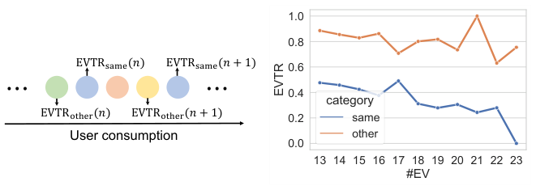
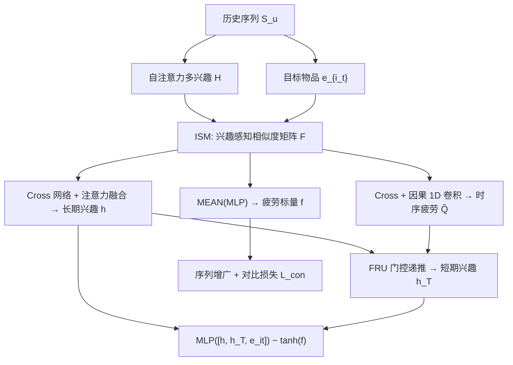
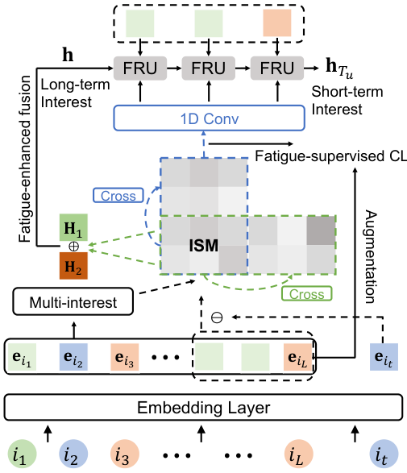

# Modeling User Fatigue for Sequential Recommendation (面向序列推荐的用户疲劳建模)

- **会议/期刊**: SIGIR 2024 (47th ACM SIGIR)
- **作者与机构**: Nian Li, Xin Ban, Cheng Ling, Chen Gao, Lantao Hu, Peng Jiang, Kun Gai, Yong Li, Qingmin Liao（清华大学 SIGS/电子系、快手）
- **推荐链路定位**: 精排（CTR 预估 / Next-Item 打分）
- **研究方向**: 序列与会话推荐 / 自监督对比学习与交互去噪
- **论文原文**: [https://arxiv.org/abs/2405.11764v2](https://arxiv.org/abs/2405.11764v2)
- **开源代码**: [https://github.com/tsinghua-fib-lab/SIGIR24-FRec](https://github.com/tsinghua-fib-lab/SIGIR24-FRec)

## TL;DR (1分钟核心速览)

序列推荐普遍只建模"用户喜欢什么"，却忽略"用户已经看腻了什么"。本文提出 FRec：先用多头自注意力抽出多兴趣，再把目标物品与最近 $T$ 个历史物品在每个兴趣子空间上做投影距离度量，构建**兴趣感知相似度矩阵 (ISM)** 作为细粒度疲劳特征；该矩阵经 Cross 网络做高阶特征交叉后，一路以注意力加权重 fusion 得长期兴趣，一路经因果 1D 卷积生成时序疲劳向量，注入 GRU 的更新/重置门 (FRU) 得短期兴趣；最后用"把子序列中若干物品替换成目标物品以制造更强疲劳"的序列增广构造对比监督。在 Kuaishou/Taobao 采样排序协议下 AUC 分别达 0.8533/0.8795（较最强基线 +0.009/+0.026），工业级 A/B 中类目集中度下降 0.136%。

## Background & Motivation (背景与核心矛盾)

- **主流范式**: 序列推荐以 GRU4Rec/SASRec 类模型建模长短期兴趣，ComiRec 类工作用动态路由或自注意力抽多兴趣，CLSR 以因果视角解耦长短期兴趣。
- **前人局限**: ①疲劳建模只停留在**粗粒度**信号（同物品/同类目重复次数），直接拼进 DIN 或喂给决策树、二次函数，无法区分同类目下语义差异巨大的内容；②既有方法要么忽略疲劳对兴趣的削弱作用，要么用固定二次函数手工定义，无法刻画"多个历史物品共同造成疲劳"的**非线性 + 联合效应**。
- **核心洞察 (Key Insight)**: 论文在快手千万级用户数据上验证——随着同类目视频有效观看数上升，该类目后续的 EVTR 持续下降且显著低于其他类目（图 1b），说明疲劳是**独立于兴趣相关性**的负向因子，必须显式建模并从打分中扣减。
- **本文切入点**: 用隐空间投影距离替代类别计数，把疲劳同时注入长期兴趣融合权重与短期兴趣的状态演化，并用反事实增广制造"显式疲劳标签"。

<figure class="paper-figure" markdown="span">
  <figcaption>图 1</figcaption>
</figure>

## Method (核心方法设计)

### 1. 整体框架 (Overall Architecture)

输入用户序列 $S_u$，先经自注意力得$K$个兴趣向量$\mathbf{H}=S_uA$；以目标物品与最近$T$个历史物品在$\mathbf{H}$各列上的投影距离构成$T\times K$的 ISM$\mathbf{F}$。$\mathbf{F}$分两路：一路 Cross 交叉后 softmax 融合$K$个兴趣得长期兴趣$\mathbf{h}$；一路 Cross + 因果 1D 卷积得到逐位置时序疲劳$\hat{Q}_l$，作为 FRU 的门控输入，从$\mathbf{h}$出发递推得短期兴趣$\mathbf{h}_{T_u}$。同时用替换式增广生成"高疲劳"副本，输出疲劳标量$f$ 做对比学习；最终打分由兴趣项减去疲劳惩罚。

<figure class="paper-figure" markdown="span">
  <figcaption>图 2</figcaption>
</figure>

### 2. 关键设计拆解 (Key Designs)

1. **兴趣感知相似度矩阵 (ISM)**：类别计数式疲劳特征粒度太粗。本文将目标与历史物品分别投影到第 $k$个兴趣方向，以投影点距离定义相似度$F_{l,k}=\frac{1}{1+\left|\frac{\mathbf{e}_{i_t}^\top \mathbf{H}_k}{\|\mathbf{H}_k\|}-\frac{\mathbf{e}_{i_l}^\top \mathbf{H}_k}{\|\mathbf{H}_k\|}\right|}$，距离越近疲劳越强，且只在最近$T_u=\min(T,L_u)$ 项上计算。直觉：疲劳由"在当前兴趣维度上高度重合"驱动，多兴趣分解使同一对物品可在"拍摄风格重合但主题不同"时判定为低疲劳。
2. **疲劳增强的多兴趣融合 (Cross + Attention)**：简单把 $\mathbf{F}$喂 MLP 无法刻画疲劳对相似度的非线性依赖与多物品联合效应。作者堆叠$C$层 Cross：$\mathbf{P}_{c+1}=\mathbf{P}_0\odot(\mathbf{W}_c\mathbf{P}_c)+\mathbf{P}_c$，$W_c\in\mathbb{R}^{T\times T}$显式建模历史物品两两交互；融合权重取$\mathbf{w}=\mathrm{softmax}(\mathrm{MLP}_2([\mathbf{P}_C^\top,\mathbf{P}_0^\top]))$，$\mathbf{h}=\mathbf{H}\mathbf{w}$，即疲劳越高的兴趣子空间权重被压低。
3. **疲劳门控循环单元 (FRU) 与增广对比监督**：短期兴趣需要"疲劳累积到一定程度就丢弃旧状态"。先用 $\mathbf{Q}_{c+1}=\mathbf{Q}_0\odot(\mathbf{Q}_c\mathbf{W}'_c)+\mathbf{Q}_c$与因果 1D 卷积得到$\hat{Q}_l$，再改造 GRU：$z_l=\sigma(\mathbf{W}_z x_l+\mathbf{U}_z h_{l-1}+\mathbf{V}_z\hat{Q}_l+b_z)$（$r_l$同理），以$\mathbf{h}$为初态。由于历史中无显式疲劳标签，作者把子序列中$N\in[\max(N_r,1),T_u]$个物品**替换为目标物品**制造更强疲劳副本，用$f=\mathrm{MEAN}(\mathrm{MLP}_3([\mathbf{Q}_C,\mathbf{Q}_0]))$与四个增广副本做对比损失$\mathcal{L}_{con}=-\log\frac{e^{-f}}{e^{-f}+\sum_j e^{-f'_j}}$。
4. **训练目标与推理**：打分 $y=\mathrm{MLP}_4([\mathbf{h}^\top,\mathbf{h}_{T_u}^\top,\mathbf{e}_{i_t}^\top])-\tanh(f)$，显式扣减疲劳；总损失$\mathcal{L}=\mathcal{L}_{rec}+\alpha\mathcal{L}_{con}$，$\mathcal{L}_{rec}$ 为 softmax 损失，每正样本均匀采样 4 个负样本（免难负采样）。推理仅多出一次 Cross+Conv+FRU 前向，单 epoch 训练 23.2 min（Kuaishou），与 SASRec(59.3)、SUM(83.2) 相比开销可控。

## Experimental Setup & Evaluation Protocol (实验设置与评估协议)

| 数据集 | #Users | #Items | #Interactions | 稀疏度/密度 | 特征/场景说明 |
| :--- | :---: | :---: | :---: | :---: | :--- |
| Kuaishou | 37,502 | 131,063 | 6,427,764 | 平均序列长 171.4 | 短视频点击序列（2020.10.22–10.28） |
| Taobao | 41,101 | 90,524 | 2,256,967 | 平均序列长 54.9 | 电商 page-view 序列（2017.11.25–12.3） |
| Industrial | 38,467,817 | 19,863,454 | 804,934,827 | 平均序列长 20.9 | 快手 1 小时全行为埋点，工业级 CTR |

- **数据划分与防穿越**: 公开集采用 `10-core` 过滤 + **全局时间戳顺序 8:1:1** 切分；最大序列长度 Kuaishou=250、Taobao=100。
- **排名评测协议**: **Sampled Ranking**——每个正样本配 9 个随机负样本构成 10 路排序（非 Full-Ranking），指标 AUC / GAUC / HR@{2,4} / NDCG@{2,4} / MRR；工业集使用**真实曝光未点击**作为负样本，更贴近线上分布。
- **对比基线与超参**: 基线覆盖长短期兴趣（DIN、DIEN、GRU4Rec、SASRec、SLi-Rec、CLSR、Caser、AdaMCT）、多兴趣（SUM、ComiRec-DR/SA、MGNM）与疲劳建模（DFN）。TensorFlow + Microsoft Recommender 实现，Adam 学习率 0.001，批大小 500，$d=40$，$K=4$，$C=2$，卷积核$s=5$，$T=50/40$，$\alpha=0.4$；五次实验均值并以$p<0.001$ 的 t 检验标注显著性。

## Key Experimental Results (实验关键数据)

### 1. 主实验对比 (Main Results)

| 数据集 | Model | AUC | GAUC | HR@2 | NDCG@2 | NDCG@4 |
| :--- | :--- | :---: | :---: | :---: | :---: | :---: |
| Kuaishou | GRU4Rec | 0.8306 | 0.8401 | 0.6570 | 0.5784 | 0.6765 |
| Kuaishou | SASRec | 0.8298 | 0.8270 | 0.6226 | 0.5428 | 0.6486 |
| Kuaishou | SLi-Rec | 0.8258 | 0.8388 | 0.6651 | 0.5897 | 0.6812 |
| Kuaishou | CLSR | 0.8263 | 0.8473 | 0.6703 | 0.5901 | 0.6869 |
| Kuaishou | ComiRec-SA | 0.8441 | 0.8464 | 0.6658 | 0.5869 | 0.6837 |
| Kuaishou | DFN | 0.6613 | 0.8159 | 0.6284 | 0.5509 | 0.6519 |
| Kuaishou | **FRec** | **0.8533** | **0.8564** | **0.6878** | **0.6077** | **0.7016** |
| Kuaishou | Improv. | +1.1% | +1.1% | +2.6% | +3.0% | +2.1% |
| Taobao | SASRec | 0.8455 | 0.8430 | 0.6964 | 0.6373 | 0.7079 |
| Taobao | SLi-Rec | 0.8333 | 0.8381 | 0.6857 | 0.6224 | 0.6983 |
| Taobao | CLSR | 0.8527 | 0.8601 | 0.7305 | 0.6754 | 0.7397 |
| Taobao | ComiRec-SA | 0.8359 | 0.8333 | 0.6667 | 0.6039 | 0.6845 |
| Taobao | MGNM | 0.7291 | 0.7279 | 0.4897 | 0.4258 | 0.5271 |
| Taobao | DFN | 0.7630 | 0.8459 | 0.7144 | 0.6631 | 0.7263 |
| Taobao | **FRec** | **0.8795** | **0.8792** | **0.7660** | **0.7143** | **0.7716** |
| Taobao | Improv. | +3.1% | +2.2% | +4.9% | +5.8% | +4.3% |

工业集（真实曝光负样本）：FRec AUC 0.7408 / GAUC 0.6709，优于 SLi-Rec 0.7302 / 0.6604 与 CLSR 0.7267 / 0.6584，提升超 0.01 绝对值。

### 2. 消融实验 (Ablation Study)

| 变体 | Kuaishou AUC / NDCG@2 | Taobao AUC / NDCG@2 | 结论 |
| :--- | :---: | :---: | :--- |
| w/o Fusion（均值池化替注意力融合） | 下降 | 下降 | 疲劳感知的兴趣加权有效 |
| w/o FRU（退回普通 GRU，去卷积疲劳） | 小幅下降 | **下降最明显** | 电商意图切换依赖门控疲劳 |
| w/o Cross（稠密层替 Cross） | **下降最明显** | 下降 | 相似度特征需高阶交叉 |
| w/o CL（$\alpha=0$） | **下降最大** | 下降较小 | 短视频重复即疲劳，增广信号强 |
| **FRec（完整）** | **最优** | **最优** | 各模块互补，五折 95% CI 分离 |

### 3. 关键实验发现 (Key Findings)

1. **疲劳信号与兴趣信号正交而非冗余**：DFN 虽注入粗粒度重复特征，Kuaishou AUC 仅 0.6613，远低于 DIN 的 0.6054→其他基线区间；而用 ISM 的 FRec 达 0.8533，说明"喂特征"与"按兴趣子空间度量相似度再调权"存在本质差距。
2. **疲劳收益在难负样本下被放大**：公开集随机负采样时 AUC 提升 0.009，工业集改用曝光未点击负样本后提升 $\ge 0.01$（规模放大数百倍），因为曝光候选已由强推荐系统保证了相关性，此时"重复导致不点"的信息量最高。
3. **按疲劳重要度分桶验证鲁棒性**：以 $m=\sum(m_{i_n}-m_{i_p})$度量"负样本比正样本更接近历史"的程度，Taobao 上$m\ge 5$ 时 CLSR/DFN 的 AUC 与 NDCG@2 明显下滑，而 FRec 保持平稳且全面领先——即 FRec 学会把"因疲劳而放弃的近邻物品"正确压到正样本之后（图 6 案例中 basketball 从 SLi-Rec 的第 1 位降至末位）。
4. **线上效果**：7 天 A/B（百万级用户）App 时长 +0.300%、有效播放 +0.466%、消费类目数 +0.408%、短窗口类目集中度 -0.136%，EVTR 在重复消费较多时段的提升尤为明显。

## Highlights & Limitations (亮点、对比与审稿批判)

- **与代表作对比 (vs. Prior Work)**: 与 CLSR 相比，本文不解耦因果结构，而是**显式减去**疲劳项 $\tanh(f)$；与 ComiRec-SA 相比，多兴趣不只是融合表征，还被复用为相似度度量的投影子空间；与 DFN 相比，疲劳从"输入特征"变成"被预测并参与损失的隐变量"。
- **可迁移亮点**: ①"替换为目标物品"的序列增广，可用作任何重复度/单调性单调先验的自监督构造；②把外部信号（疲劳向量）注入 GRU 的 $\mathbf{V}_z,\mathbf{V}_r$ 门控项，比拼接输入更省参数且语义更清晰。
- **审稿级局限批判**: ①评估仍是 1:9 采样排序（工业集除外），未报告 Full-Ranking，负样本敏感；②增广强度 $N$与截断阈值$T$需按域调节（Taobao 上$T=10$或$60$ 都显著掉点），且短视频"重复即疲劳"的假设在长内容/电商场景减弱（消融中 CL 在 Taobao 收益明显小于 Kuaishou），跨域泛化证据不足。

## Rating (四维评分)

- **方法创新性 (Novelty)**: ⭐⭐⭐⭐ （首次将细粒度投影距离相似度矩阵与疲劳门控 RNN 结合，反事实增广构造疲劳监督的思路新颖，但基础组件多为成熟模块的语义化重组）
- **评估协议与实验扎实度 (Protocol & Experiments)**: ⭐⭐⭐⭐ （两个公开集 + 千万级工业集 + 7 天线上 A/B，$p<0.001$ 检验与五折置信区间齐备；扣一星因公开集仅采样排序、缺少 Full-Ranking）
- **写作与数学规范度 (Clarity & Rigor)**: ⭐⭐⭐⭐ （三类挑战—三类模块的对应关系清晰，门控与 Cross 公式完整；但 ISM 为何用投影距离、$T$ 的理论依据仅有经验解释）
- **工业落地与复现价值 (Industrial & Practical Value)**: ⭐⭐⭐⭐⭐ （代码开源，训练开销与 GRU4Rec 同量级，线上疲劳削减与时长/多样性双赢，可直接嵌入现有精排链路）

