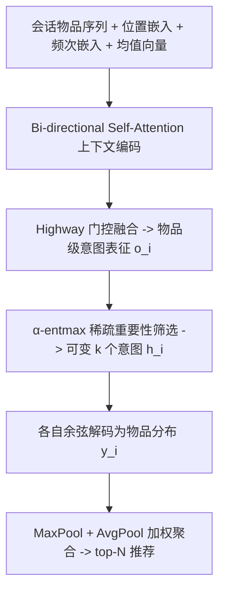
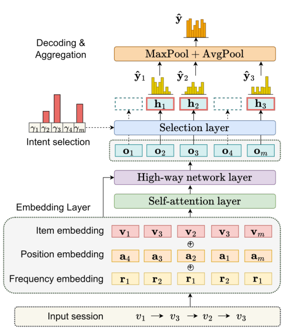

# Multi-intent-aware Session-based Recommendation (多意图感知的会话推荐)

- **会议/期刊**: SIGIR 2024 (short paper, 5 pages)
- **作者与机构**: Minjin Choi, Hye-young Kim, Hyunsouk Cho, Jongwuk Lee (成均馆大学 / 亚洲大学)
- **推荐链路定位**: 召回（匿名会话 Next-Item 预测）
- **研究方向**: 序列与会话推荐
- **论文原文**: [论文原文链接](https://arxiv.org/abs/2405.00986v1)
- **开源代码**: [开源代码仓库链接](https://github.com/jin530/MiaSRec)

## TL;DR (1分钟核心速览)

现有 SBR 模型把整个会话压成**单一表征**，并被最后一个点击主导，无法表达会话中并存的多个用户意图，长会话下掉点严重。MiaSRec 以「每物品为中心」生成 $|s|+1$个意图表征，用 α-entmax 稀疏打分**动态筛出**$k$ 个重要意图，再对各自解码的物品分布做 max/avg 双池化聚合。在 6 个基准、标准 iterative-revealing 全库排序协议下全面最优，长会话数据集 Tmall 上 R@20 相对最佳基线提升 **24.56%**，M@20 提升 6.27%。

## Background & Motivation (背景与核心矛盾)

- **主流范式**: SBR 用 RNN/GNN/Transformer 编码会话物品序列，池化或取末位得到一个会话向量，再与物品表内积召回；近期的多表征模型（ComiRec/Re4/Atten-Mixer/MSGIFSR、以及长历史兴趣建模 SINE）试图建模多兴趣。
- **前人局限**: (i) 单表征模型受**末位物品支配**（图 1 中用户最后点 "camera"，但全会话实为 travel 倾向），且会话越长、意图越杂，掉点越狠（Diginetica 上 CORE 长会话比短会话掉 13.2%）；(ii) 已有"多兴趣"方法要么只看**最后几个连续物品**（末位噪声即失效），要么**固定兴趣数 $K$**，对所有用户切同一刀，漏掉真实兴趣或塞入冗余兴趣。
- **核心洞察 (Key Insight)**: 会话中的每个物品都可作为一个"意图锚点"，会话内**重复出现的物品天然指示意图强度**；而意图的数量应随会话而变，是一个**可变基数的稀疏选择**问题，而非固定槽位分配。
- **本文切入点**: 物品级多表征 + α-entmax 稀疏选择实现"每会话自适应 $k$"的意图集合，并保留多条意图的独立解码结果。

## Method (核心方法设计)

### 1. 整体框架 (Overall Architecture)

输入会话 $s=(v_{t_1},...,v_{t_{|s|}})$，为每个物品构造 item + absolute position + frequency 三合一嵌入（并额外加一个全局均值向量$v_m$作为第$|s|+1$个 token）。经双向 self-attention 得上下文表征$c_i$，再以 highway 门控把原始物品嵌入与上下文融合成意图表征$o_i$。随后 α-entmax 打出稀疏重要性权重$\gamma$，仅保留$\gamma_i>0$的$o_i$作为意图集合$\{h_1,...,h_k\}$。每个$h_i$经 L2 归一化后与共享物品嵌入表内积得独立分布$\hat{y}_i$，最终 max/avg 双池化融合为$\hat{y}$，交叉熵（带温度$\tau$）训练。

<figure class="paper-figure" markdown="span">
  <figcaption>图2：MiaSRec 的模型架构。</figcaption>
</figure>

### 2. 关键设计拆解 (Key Designs)

1. **频次嵌入 + 逆序位置嵌入（让"重读"与"顺序"同时可见）**：痛点在于"同一物品被反复点击"所体现的意图强度被普通序列编码器抹平。做法是给第 $i$个位置赋予可学习向量$r_{f_i}$，$f_i$为该物品在会话内的出现次数（如$s=(v_1,v_3,v_2,v_3)$的频次为$(1,2,1,2)$），并与 item、位置嵌入相加：$x_i = v_{t_i} + a_i + r_{f_i}$。序列按**逆序**输入使末位物品固定占位 1，从而位置嵌入显式编码"距当前多远"。直觉：频次是意图的免费统计先验，无需额外监督信号。
2. **α-entmax 动态意图筛选（把"选几个"变成可学习问题）**：固定 $K$的兴趣模型会漏采/过采。MiaSRec 用稀疏变换求解$\alpha\text{-entmax}(z)=\arg\max_{p\in\Delta^l} p^\top z + H^\alpha_T(p)$，$\alpha=1.5$（$\alpha=1$退化为 softmax，$\alpha=2$为 sparsemax），以$\gamma=\alpha\text{-entmax}(w\cdot[o_1;...;o_{|s|};o_m]^\top)$生成权重并仅保留$\gamma_i>0$的意图。物理直觉：entmax 的**精确零**等价于硬性剪枝，噪声物品（图 1 的 "speaker"）被赋予 0 权重而直接退出计算，$k$随会话自适应变化，上限为$|s|+1$。
3. **双池化解码聚合与训练目标**：$k$条意图各自解码$\hat{y}_i=\tilde{h}_i\tilde{V}^\top$（复用共享物品表，不增参数），聚合式为$\hat{y}=\beta\,\text{MaxPool}(\hat{y}_1..\hat{y}_k)+(1-\beta)\,\text{AvgPool}(\cdot)$：max 保留各意图的**主峰**（提高多样性覆盖），avg 捕捉跨意图的**一致偏好**（稳住主答案）。损失为带温度的交叉熵$\mathcal{L}=-\sum_j y^{(j)}\log\frac{\exp(\hat{y}^{(j)}/\tau)}{\sum_i\exp(\hat{y}^{(i)}/\tau)}$；**训练无需负采样**（全物品 softmax），推理侧需对$k$个意图各做一次全库打分，开销约为单表征模型的$k$ 倍。

## Experimental Setup & Evaluation Protocol (实验设置与评估协议)

- **数据集与预处理**: 沿用 SBR 通用流程——丢弃**单物品会话**、丢弃全库出现次数 **< 5** 的物品（近似 5-core 过滤），按时间戳 **8:1:1 时序划分**训练/验证/测试。

| 数据集 | #Users | #Items | #Interactions | 稀疏度/平均长度 | 特征/场景说明 |
| :--- | :---: | :---: | :---: | :---: | :--- |
| Diginetica | — | 42,862 | 786,582 | AvgLen 4.12 | 电商，短会话基准 |
| Retailrocket | — | 51,428 | 871,637 | AvgLen 6.40 | 电商点击流 |
| Yoochoose | — | 19,690 | 1,434,349 | AvgLen 4.64 | 电商（RecSys Challenge） |
| Tmall | — | 37,367 | 427,797 | **AvgLen 10.62** | 电商，长会话 |
| Dressipi | — | 18,059 | 4,305,641 | AvgLen 6.47 | 时尚电商，交互最密 |
| LastFM | — | 38,616 | 3,510,163 | **AvgLen 8.16** | 音乐流媒体，长会话 |

（原文未报告去重用户数，仅给 #Interacts / #Sessions / #Items。）
- **数据划分与防穿越**: 全局**时序（chronological）按 8:1:1 切分**，测试集严格在训练时间之后，避免未来交互泄漏。
- **排名评测协议**: 采用 SBR 标准 **iterative revealing（逐步揭示）** 协议——从会话中依次暴露物品、预测下一个物品；对**全部物品全集打分（Full-Ranking，无负采样、无候选裁剪）**，报告 **Recall@20 / MRR@20**。
- **对比基线与超参**: 12 个基线，含序列类（SASRec）、GNN 类（SR-GNN、NISER+、SGNN-HN、DSAN、LESSR、CORE）与多表征类（SINE、ComiRec、Re4、Atten-Mixer、MSGIFSR）；统一在 **RecBole** 复现，$d=100$、max session length 50、Adam lr=0.001、batch=1024；MiaSRec 取$\alpha=1.5$，$\tau\in\{0.01,...,1\}$、dropout、$\beta\in[0,1]$步长 0.1 搜索；三次不同种子取均值，**paired t-test，$\rho<0.01$** 显著。

## Key Experimental Results (实验关键数据)

### 1. 主实验对比 (Main Results)

| Dataset | Metric | SR-GNN | NISER+ | DSAN | CORE | ComiRec | Re4 | Atten-Mixer | MSGIFSR | **MiaSRec** | Improv. |
| :--- | :---: | :---: | :---: | :---: | :---: | :---: | :---: | :---: | :---: | :---: | :---: |
| Diginetica | R@20 | 48.01 | 51.11 | 52.06 | 52.89 | 51.22 | 51.59 | 49.84 | 53.20 | **53.54** | +0.65% |
| Diginetica | M@20 | 16.60 | 18.21 | 18.25 | 18.53 | 18.35 | 18.47 | 17.07 | 18.37 | **19.47**† | +5.04% |
| Tmall | R@20 | 33.47 | 40.39 | 42.82 | 44.91 | 42.40 | 41.56 | 38.76 | 35.39 | **55.94**† | **+24.56%** |
| Tmall | M@20 | 24.75 | 29.48 | 30.85 | 31.59 | 28.43 | 28.56 | 28.52 | 22.19 | **33.57**† | +6.27% |
| Dressipi | R@20 | 36.10 | 38.19 | 37.77 | 38.14 | 39.60 | 39.15 | 37.75 | 38.43 | **42.26**† | +6.73% |
| Dressipi | M@20 | 14.51 | 15.34 | 15.13 | 15.54 | 16.07 | 15.92 | 15.24 | 15.90 | **16.70**† | +3.92% |
| LastFM | R@20 | 21.80 | 22.50 | 22.47 | 22.75 | 22.13 | 23.02 | 22.93 | 22.73 | **25.85**† | +12.32% |
| LastFM | M@20 | 8.70 | 8.79 | 7.93 | 7.83 | 7.83 | 8.50 | 8.74 | 8.20 | **9.95**† | +13.06% |

（† 表示相对最佳基线的 paired t-test $\rho<0.01$ 显著；表中省略 Retailrocket / Yoochoose，其 R@20 分别为 63.37 / 65.37。）

### 2. 消融实验 (Ablation Study)

| 变体 | Diginetica R@20 | Diginetica M@20 | Retailrocket R@20 | Yoochoose R@20 |
| :--- | :---: | :---: | :---: | :---: |
| **MiaSRec (full)** | **53.54** | **19.47** | **63.37** | **65.37** |
| w/o Position Embedding $a_i$ | 51.36 | 18.15 | 61.06 | 61.13 |
| w/o Frequency Embedding $r_{f_i}$ | 53.48 | 19.23 | 63.28 | 65.15 |
| 单一表征 mean ($o_m$) | 52.73 | 18.66 | 61.70 | 64.71 |
| 末位表征 last-1 ($o_{|s|}$) | 52.34 | 18.37 | 61.90 | 64.10 |
| 固定 last-3 | 53.08 | 19.20 | 62.07 | 64.77 |
| 固定 last-5 | 53.38 | 19.29 | 63.01 | 65.13 |

### 3. 关键实验发现 (Key Findings)

1. **收益与平均会话长度强正相关**：AvgLen 仅 4.64 的 Yoochoose 上 R@20 只涨 0.26%（65.20→65.37），而 AvgLen 10.62 的 Tmall 从 44.91 跳到 55.94（+24.56%）、LastFM 从 23.02 到 25.85（+12.32%）。这直接验证了"多意图在长会话中才真正展开"的动机，而非普适性涨点。
2. **位置嵌入是硬需求，频次嵌入是精修**：去掉 $a_i$使 Diginetica R@20 掉 2.18、Yoochoose 掉 4.24（65.37→61.13），而去掉$r_{f_i}$ 仅掉 0.06/0.22——说明**逆序位置**承担了主要序列信号，频次嵌入只对重复点击模式做小幅增益，作者"频次嵌入至关重要"的表述在数值上略显夸大。
3. **动态稀疏选择 > 任意固定基数启发式**：last-1 / last-3 / last-5 分别为 52.34 / 53.08 / 53.38，随 $K$ 增大单调逼近但仍低于自适应的 53.54；mean 单表征 52.73。说明"选对哪些意图"比"选多少个"更关键，α-entmax 的**零权重硬剪枝**是收益来源而非多表征本身。

## Highlights & Limitations (亮点、对比与审稿批判)

- **与代表作对比 (vs. Prior Work)**: 相比 **ComiRec / Re4 / SINE**（固定 $K$兴趣槽位、依赖长历史或胶囊路由），MiaSRec 让$k$ 由数据决定，且锚点是**会话内每个物品**而非全局兴趣向量；相比 **Atten-Mixer / MSGIFSR**（只从最后连续若干物品推断意图），它不把末位当先验，末位噪声可由 entmax 归零；相比 **CORE**（单表征 + 复杂读出不），它在读出头做多分布分解，属正交改进，可直接叠加。
- **可迁移亮点**: (i) **会话内频次嵌入**作为零成本的重复行为先验，可平移到 CTR 序列特征与 basket 推荐；(ii) **α-entmax 稀疏筛选**替代 top-$K$ 硬截断，为任何"可变数量专家/兴趣/路由"模块提供可微剪枝方案；(iii) **max+avg 双池化**融合多路打分，是廉价的多样性—准确性折中旋钮。
- **审稿级局限批判**: (i) 推理需对 $k$个意图各做一次全库打分，$k$最高可达$|s|+1$，在线延迟与显存约为单塔模型的$k$倍，论文未给任何复杂度/吞吐分析；(ii) 仅 5 页短文，6 个数据集全是离线 Full-Ranking，无工业 A/B 或冷启动/长尾分桶实验，$\alpha=1.5$、$\tau$、$\beta$ 三者的交互敏感性也未做网格展示；此外 Tmall 时间戳粒度为"天"，与"会话"语义存在偏差。

## Rating (四维评分)

- **方法创新性 (Novelty)**: ⭐⭐⭐ （多意图+稀疏筛选的组合扎实有效，但 self-attention + highway + entmax 均为成熟组件的巧妙拼装，缺少理论刻画）
- **评估协议与实验扎实度 (Protocol & Experiments)**: ⭐⭐⭐⭐ （6 数据集 × 12 基线、RecBole 统一复现、三次种子 + 配对 t 检验，消融与长度分桶齐备，唯缺采样排序对照与线上验证）
- **写作与数学规范度 (Clarity & Rigor)**: ⭐⭐⭐⭐ （四个模块公式链条清晰、$\alpha$-entmax 退化为 softmax/sparsemax 的说明到位，但频次嵌入的增益表述与数值不符，复杂度分析缺失）
- **工业落地与复现价值 (Industrial & Practical Value)**: ⭐⭐⭐ （代码已开源、可直接进 RecBole 流水线，但 $k$倍解码开销与$\beta/\alpha$ 调参成本使其在大流量场景需额外工程裁剪）

