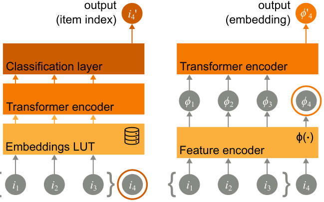
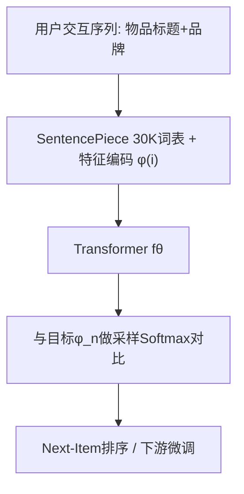

# Scaling Sequential Recommendation Models with Transformers (用 Transformer 扩展序列推荐模型)

- **会议/期刊**: SIGIR 2024
- **作者与机构**: Pablo Zivic, Hernan Vazquez, Jorge Sánchez（Mercado Libre Inc.）
- **推荐链路定位**: 召回/排序（Next-Item Prediction）
- **研究方向**: 序列与会话推荐 / 冷启动与动态目录
- **论文原文**: [https://arxiv.org/abs/2412.07585v1](https://arxiv.org/abs/2412.07585v1)
- **开源代码**: [https://github.com/mercadolibre/srt](https://github.com/mercadolibre/srt)

## TL;DR (1分钟核心速览)

本文针对ID嵌入使序列推荐模型参数量随目录规模$|I|$线性膨胀、进而混淆缩放分析与动态目录/冷启动的痛点，提出SRT：用物品标题/品牌特征编码$\phi(i)$替代可训练ID查表，并以采样Softmax对比损失训练Transformer。在Amazon全量APD上，SRT参数与$|I|$解耦，验证了类似LLM的缩放律；预训练+微调在Beauty/Sports上较从零训练NDCG@5再提升约12.5%/7.3%，并超过MINCE、CoSeRec等基线。

## Background & Motivation (背景与核心矛盾)

- **主流范式**: SASRec/BERT4Rec将物品视为原子token，用可训练ID嵌入矩阵做Transformer下一物品预测。
- **前人局限**: 大目录下$|I|\times D$嵌入参数迅速主导总参数量，使“数据量$T$、模型参数量$N$、目录规模$|I|$”三者纠缠；同时，固定ID表难支持物品动态增删，并放大冷启动。
- **核心洞察 (Key Insight)**: 语言模型词表通常仅约30K且稳定，而真实推荐目录可达百万至十亿级且持续变化；若物品表示由特征编码器即时计算，则总参数可独立于$|I|$。
- **本文切入点**: 将SASRec改造成目录无关的SRT，配合采样Softmax，系统研究$N$与$T$的缩放律，并验证预训练迁移。

<figure class="paper-figure" markdown="span">
  <figcaption>图2：传统基于 Transformer 的推荐模型（左）为目录中的所有物品学习向量嵌入，并通过表查找（LUT）访问它们。系统还可能包含一个分类层，用于预测目标物品的索引。相反，我们提出使用固定（且与任务无关）的特征提取器对目录中的物品进行编码（右），并使用 Transformer 模型的输出嵌入预测物品间相似度。我们使用序列的最后一个元素作为目标，并尝试匹配其标识符（分类）或输入嵌入（回归）。</figcaption>
</figure>

## Method (核心方法设计)

### 1. 整体框架 (Overall Architecture)

SRT把用户交互序列中的每个物品$i$用标题与品牌文本表示：SentencePiece分词到30K词表，经特征编码器$\phi:\mathcal{I}\to\mathbb{R}^D$生成$D$维向量；Transformer$f_\theta$读取$\phi(i_1),\dots,\phi(i_{n-1})$，输出与目标物品表示$\phi_n$做采样Softmax对比。由于可训练参数主要来自$\phi$与Transformer而非$|I|\times D$的ID表，目录增删不改变模型结构；训练后可在全量APD上预训练，再在Beauty/Sports上渐进解冻微调。

### 2. 关键设计拆解 (Key Designs)

1. **目录无关特征表示**：痛点来自ID嵌入LUT使参数随$|I|$增长。SRT改为$\phi(i)$在线编码物品文本，参数规模为$O(|V|D+|\phi|)$而非$O(|I|D)$；新物品只需重新编码，不必扩展嵌入表，因此天然适配动态目录与冷启动。
2. **采样Softmax对比损失**：相较SASRec单负样本BCE/BERT4Rec掩码预测，SRT-X对$X$个负样本显式归一化，强化目录多样性表征。核心式为  
$\ell(\theta;S)=-\log\frac{\exp(f_\theta(\tilde S)^\top\phi_n/\tau)}{\exp(f_\theta(\tilde S)^\top\phi_n/\tau)+\sum_{\phi\in\mathcal{N}(\tilde S)}\exp(f_\theta(\tilde S)^\top\phi/\tau)}$。  
负样本按物品热度分布采样，并对logits做logQ校正，以低开销缓解难负采样偏差。
3. **训练目标、负采样与推理效率**：总损失$\mathcal{L}(\theta;\mathcal{S})=\sum_{S\in\mathcal{S}}\ell(\theta;S)$，自回归预测每个序列元素；训练负采样为流行度采样，$X\in\{10,100,300,1K\}$。推理时对候选物品编码后做内积/ANN检索，新增物品无需更新ID表；微调采用逐层解冻+EWC（$\lambda=100$）防止灾难遗忘。

## Experimental Setup & Evaluation Protocol (实验设置与评估协议)

- **数据集与预处理**: 使用Amazon Product Data（APD）全量及Beauty/Sports子集；作者强调常规`5-core`过滤会丢弃大量长尾交互，故主实验尽量保留全量分布，并通过随机采样用户构造80K–8.2M交互的训练集。

| 数据集 | #Users | #Items | #Interactions | 密度/说明 |
| :--- | :---: | :---: | :---: | :--- |
| APD raw | 21.2M | 9.9M | 82.7M | 3.9e-5%；1996–2014全量 |
| Beauty raw | 22.4K | 937.9K | 2.3M | 1.1e-4%；未5-core |
| Beauty 5-core | 22.4K | 12.1K | 198.5K | 7.3e-4%；过滤<5 |
| Sports raw | 35.6K | 993.6K | 2.5M | 7.1e-5%；未5-core |
| Sports 5-core | 35.6K | 18.4K | 296.3K | 4.5e-4%；过滤<5 |

- **数据划分与防穿越**: 每个用户序列最后1个物品为test、倒数第2个为valid、前$n-2$个为train；通过增加活跃用户数扩展训练集，保留长尾与目录增长特性。
- **排名评测协议**: `Sampled Ranking`，每个正样本采样10K负样本（SASRec常用100），报告NDCG@5；非Full-Ranking。训练负采样按流行度，评测负样本随机采样。
- **对比基线与超参**: 标准子集对比SASRec、BERT4Rec、SASRec-CE；下游迁移对比MINCE、ICLRec、CoSeRec、CL4SRec。模型层数2–24、头数2–4、$d\le256$；Adam，学习率$1e-4$，50 epochs，one-cycle，梯度裁剪1，权重衰减$1e-5$；基于RecBole。原文未报告显著性检验。

## Key Experimental Results (实验关键数据)

### 1. 主实验对比 (Main Results)

表1 下游Beauty/Sports迁移结果（加粗为最优）：

| 方法 | Beauty NDCG@5 | Beauty HIT@5 | Sports NDCG@5 | Sports HIT@5 |
| :--- | :---: | :---: | :---: | :---: |
| MINCE | 0.0378 | 0.0523 | 0.0196 | 0.0274 |
| ICLRec | 0.0324 | 0.0493 | 0.0182 | 0.0283 |
| CoSeRec | 0.0361 | 0.0537 | 0.0196 | 0.0287 |
| CL4SRec | 0.0208 | 0.0396 | 0.0116 | 0.0219 |
| SRT-1K 从零训练 | 0.0360 | 0.0611 | 0.0192 | 0.0313 |
| SRT-1K 预训练+微调 | **0.0405** | **0.0645** | **0.0206** | **0.0344** |
| Improv. vs 最强基线 | +7.1% | +20.1% | +5.1% | +19.9% |

### 2. 消融实验 (Ablation Study)

表2 负样本数与ID/特征编码对照（NDCG@5）：

| 配置 | Beauty | Sports | 说明 |
| :--- | :---: | :---: | :--- |
| BERT4Rec | 0.0219 | 0.0143 | ID+掩码 |
| SASRec | 0.0241 | 0.0135 | ID+BCE |
| SASRec-CE | 0.0314 | 0.0170 | ID+全库CE |
| SRT-10 | 0.0235 | 0.0138 | 10负样本 |
| SRT-100 | 0.0318 | 0.0171 | 100负样本 |
| SRT-300 | 0.0340 | 0.0180 | 300负样本 |
| SRT-1K | **0.0366** | **0.0195** | 1K负样本 |

### 3. 关键实验发现 (Key Findings)

- **负样本容量主导收益**：SRT-10→SRT-1K使Beauty NDCG@5从0.0235升至0.0366（+55.7%），Sports从0.0138升至0.0195（+41.3%），说明采样Softmax的负样本规模是SRT超过SASRec/BERT4Rec的关键。
- **目录无关表示不牺牲精度**：SRT-1K从零训练在Beauty/Sports达0.0360/0.0192，较SASRec-CE的0.0314/0.0170提升14.6%/12.9%，但参数量不再随$|I|$线性增长。
- **缩放律与迁移均成立**：拟合得到$NDCG(N,T)\approx E-AN^{-\alpha}-BT^{-\beta}$，$\alpha\approx0.376$、$\beta\approx0.364$，$N$与$T$作用相近；FLOPs曲线呈S形并趋近上限约0.149。预训练+微调较从零训练再提升12.5%/7.3%，并超过MINCE/CoSeRec。

## Highlights & Limitations (亮点、对比与审稿批判)

- **与代表作对比 (vs. Prior Work)**: SASRec/BERT4Rec依赖固定ID表，模型复杂度受$|I|$污染；SRT用文本特征编码解耦目录规模，并用采样Softmax显式利用更多负样本。相较MINCE等文本增强方法，SRT结构更简单、可直接扩展到全量APD；相较CL4SRec式序列对比，其对比发生在“序列表示—物品表示”之间，更贴近下一物品排序。
- **可迁移亮点**: 用标题/品牌特征编码替代ID LUT，可直接用于动态目录与冷启动物品；流行度负采样+logQ校正在大规模采样Softmax中兼顾效率与偏差修正；预训练+逐层解冻+EWC为推荐模型迁移提供可复用流程。
- **审稿级局限批判**: 评测采用10K负样本采样排序而非全库排序，可能高估真实全库检索难度；缩放律仅在Amazon电商数据与特定Transformer配置上拟合，外推到其他域需谨慎。此外，文本特征依赖标题/品牌质量，预训练与全目录编码带来较高算力开销，且原文缺少显著性检验与线上A/B。

## Rating (四维评分)

- **方法创新性 (Novelty)**: ⭐⭐⭐⭐ （将ID嵌入替换为特征编码并系统验证序列推荐缩放律，机制朴素但问题切口与实证价值强）
- **评估协议与实验扎实度 (Protocol & Experiments)**: ⭐⭐⭐⭐ （全量APD+多模型规模+10K负采样较扎实，但非Full-Ranking且无显著性检验）
- **写作与数学规范度 (Clarity & Rigor)**: ⭐⭐⭐⭐ （损失、缩放拟合与实验设置清晰，部分拟合式与符号呈现可更严谨）
- **工业落地与复现价值 (Industrial & Practical Value)**: ⭐⭐⭐⭐ （代码开源，动态目录与冷启动友好；但预训练算力与文本特征依赖限制轻量部署）

