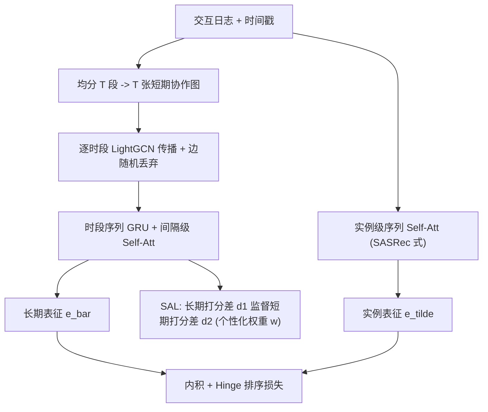

# SelfGNN: Self-Supervised Graph Neural Networks for Sequential Recommendation (自监督图神经网络序列推荐)

- **会议/期刊**: SIGIR 2024
- **作者与机构**: Yuxi Liu (北京大学深圳), Lianghao Xia, Chao Huang (香港大学)
- **推荐链路定位**: 召回（序列候选生成）
- **研究方向**: 序列与会话推荐 / 自监督对比学习与交互去噪
- **论文原文**: [https://arxiv.org/abs/2405.20878v1](https://arxiv.org/abs/2405.20878v1)
- **开源代码**: [https://github.com/HKUDS/SelfGNN](https://github.com/HKUDS/SelfGNN)

## TL;DR (1分钟核心速览)

现有序列推荐只编码单用户长序列，忽略不同用户在同一时段的短期协作关系；而以随机增广为主的图/序列自监督方法会把误点击等短期噪声当成有效信号放大。SelfGNN 将全局时间轴均分为 $T$ 个时段、各建一张短期协作图做 GCN，再用 GRU+Attention 融合时段特征、用 SASRec 式实例级注意力建模细粒度序列，最后用一个**个性化自增强学习 (SAL)** 任务按用户兴趣稳定性加权，让长期视角去矫正短期打分。在 `Leave-One-Out` + `1:999` 采样排序协议下，四个数据集 HR@10 相对最强基线提升 0.8%–6.3%。

## Background & Motivation (背景与核心矛盾)

- **主流范式**: 序列推荐以 SASRec/Bert4Rec 的自注意力或 GRU4Rec 的 RNN 编码单条用户序列；图路线以 LightGCN 在静态全局二部图上传播高阶协同信号；DGSR/SURGE/TGSRec 则引入动态图。
- **前人局限**: ① 长期序列模型只建模个体内的 item-item 转移，丢失"同一时段内不同用户行为互为佐证"的周期性协同；② 动态图方法把整张交互图当成同质信息，缺少间隔级与实例级双粒度长短期的统一，也缺乏鲁棒的训练范式；③ SGL/ICLRec/CoSeRec/CLSR 等 SSL 依赖随机掩码/裁剪/重排，反而往序列里注入新噪声。
- **核心洞察 (Key Insight)**: "噪声"是**用户相关**的——兴趣多变的用户 (图 1 的 $u_4$) 短期跳变可能真实，兴趣稳定的用户 ($u_2$) 的突然跨品类点击更可能是误点。因此去噪强度必须由"该用户长期兴趣的稳定性"个性化决定，而非全局统一阈值。
- **本文切入点**: 用可信的长期表征反向监督短期图表征，把去噪写成一个跨视图排序一致性损失。

## Method (核心方法设计)

### 1. 整体框架 (Overall Architecture)

输入为按全局时间戳均分成 $T$段的交互矩阵序列$\{\mathbf{A}_t\}_{t=1}^{T}$与用户原始行为序列。三路并进：(i) 对每个$\mathbf{A}_t$用 LightGCN 式传播得到时段$t$的用户/物品短期表征$\mathbf{e}^{(u)}_{t,i}$；(ii) 间隔级建模把同一节点的$\{\mathbf{e}^{(u)}_{t,i}\}_{t=1}^{T}$视为一条"时段序列"过 GRU 注入时序位置、再过多头自注意力聚合为长期表征$\bar{\mathbf{e}}^{(u)}_i$；(iii) 实例级建模用$L_a$层自注意力编码原始交互序列得$\tilde{\mathbf{e}}^{(u)}_i$。预测时$\hat{\mathbf{e}}^{(u)}_i=\bar{\mathbf{e}}^{(u)}_i+\tilde{\mathbf{e}}^{(u)}_i$与$\bar{\mathbf{e}}^{(v)}_j$ 内积排序，同时叠加 SAL 辅助损失。

### 2. 关键设计拆解 (Key Designs)

1. **时段切片协作图编码（把"谁和谁同时像"变成结构先验）**: 静态图无法区分"一年前相似"与"上周相似"。本文按 $(\text{t}_e-\text{t}_b)/T$等分时间轴，在第$t$段用$\mathbf{z}^{(u)}_{t,i}=\sigma(\mathbf{A}_{t,i*}\mathbf{E}^{(v)}_t)$做邻域聚合，第$l$层只累加不归一化地$\mathbf{e}^{(u)}_{t,i,l}=\mathbf{z}^{(u)}_{t,i,l}+\mathbf{e}^{(u)}_{t,i,l-1}$，最终拼接各层$\mathbf{e}^{(u)}_{t,i}=\mathbf{e}^{(u)}_{t,i,1}\|\cdots\|\mathbf{e}^{(u)}_{t,i,L}$，并对边做随机丢弃抑制过拟合。直觉：短期图的稀疏性天然把"偶然误点"隔离在单一时段，不会像全图多跳传播那样污染整条链路。
2. **间隔级 + 实例级双粒度长期建模（周期协同与时序转移互补）**: 单靠 item-item 注意力无法携带跨用户周期信号，单靠间隔级又丢掉细粒度。间隔级用 GRU 而非位置编码，因为段数 $T$ 仅 2–14，位置嵌入分辨力不足：
   $\mathbf{h}^{(u)}_{t,i}=\mathrm{GRU}(\mathbf{e}^{(u)}_{t,i},\mathbf{h}^{(u)}_{t-1,i}),\ \bar{\mathbf{H}}^{(u)}_i=\mathrm{SelfAtt}(\mathbf{S}^{int}_{i}),\ \bar{\mathbf{e}}^{(u)}_i=\sum_{t=1}^{T}\bar{\mathbf{H}}^{(u)}_{i,t}$实例级则对$\bar{\mathbf{e}}^{(v)}_{v_{i,m}}+\mathbf{p}_m$序列堆叠残差自注意力得$\tilde{\mathbf{e}}^{(u)}_i$。
3. **个性化自增强学习 SAL（去噪即跨视图排序对齐）**: 每步采样两条观测边 $(u_i,v_j),(u_{i'},v_{j'})$，分别算长期似然$\bar{s}_{i,j}=\sum_k\sigma(\bar{e}^{(u)}_{i,k}\bar{e}^{(v)}_{j,k})$与时段似然$s_{t,i,j}$，令
   $\mathcal{L}_{sal}=\sum_{t=1}^{T}\sum \max(0,1-d_1 d_2),\ d_1=w_{t,i}\bar{s}_{i,j}-w_{t,i'}\bar{s}_{i',j'},\ d_2=s_{t,i,j}-s_{t,i',j'}$其中$w_{t,i}=\mathrm{sigmoid}(\boldsymbol{\Gamma}_{t,i}\mathbf{W}_2+b_2)$、$\boldsymbol{\Gamma}_{t,i}=\sigma((\bar{\mathbf{e}}^{(u)}_i+\mathbf{e}^{(u)}_{t,i}+\bar{\mathbf{e}}^{(u)}_i\odot\mathbf{e}^{(u)}_{t,i})\mathbf{W}_1+\mathbf{b}_1)$表征该用户短期与长期的**一致性/稳定性**。关键实现细节：$\bar{s}$侧**停止梯度**，只回传到短期打分与权重$w$——长期视角充当"教师"，若$u_i$比$u_{i'}$稳定且长期更强，则$d_1>0$迫使$d_2$拉大，即强化该短期边、压弱另一条；用户越不稳定，$w$ 越小，参考强度自动削弱，避免误伤兴趣漂移。
4. **训练目标与开销**: $\mathcal{L}=\mathcal{L}_{rec}+\lambda_1\mathcal{L}_{sal}+\lambda_2\|\Theta\|_F^2$，主任务为 hinge 式成对排序$\sum\max(0,1-\hat{A}_{T+1,i,p_k}+\hat{A}_{T+1,i,n_k})$，负样本随机采样；SAL 免负采样、只做随机边对点积，开销$O(B\cdot N_{sal}\cdot d)$，图编码总代价$O(L\cdot|\mathcal{A}|\cdot d)$ 与单张全图相同（因各时段边数之和等于总边数），显著低于图对比学习。

## Experimental Setup & Evaluation Protocol (实验设置与评估协议)

- **数据集与预处理**: 全部采用 `5-core` 过滤（用户与物品至少 5 次交互）：

| 数据集 | #Users | #Items | #Interactions | 密度 | 场景 |
| :--- | :---: | :---: | :---: | :---: | :--- |
| Amazon-book | 11,199 | 30,821 | 375,916 | 1.1e-3 | 图书评论 |
| Gowalla | 48,653 | 52,621 | 1,807,125 | 7.1e-4 | 地理位置签到 |
| Movielens | 24,312 | 8,688 | 1,758,929 | 8.3e-3 | 电影评分 |
| Yelp | 19,751 | 38,391 | 1,467,157 | 1.9e-3 | 商户评论 |

- **数据划分与防穿越**: `Leave-One-Out`——每用户最后一条交互为测试、倒数第二条为验证、其余训练；随机抽 10,000 名用户作测试用户。
- **排名评测协议**: `Sampled Ranking`，每测试用户配 999 个随机未交互负样本（正负比 **1:999**），正负混合排序后算 HR@{10,20}、NDCG@{10,20}；**非 Full-Ranking**。
- **对比基线与超参**: 17 个基线覆盖 MF (BiasMF)、神经 CF (NCF)、序列 (GRU4Rec/SASRec/TiSASRec/Bert4Rec)、静态图 (NGCF/LightGCN/SRGNN/GCE-GNN)、动态图 (SURGE/DGCF/TGSRec) 与 SSL (SGL/ICLRec/CoSeRec/CoTRec/CLSR)；$d=64$，GNN 层$\{1,2,3\}$，注意力层$\{2,3,4\}$，$T\in[2,14]$，$\lambda_1\in\{10^{-4},\dots,10^{-7}\}$，$\lambda_2=10^{-2}$，dropout 0.5；SelfGNN 与最优基线各重训 5 次并报$p$值（均$<10^{-2}$，多数$<10^{-4}$）。

## Key Experimental Results (实验关键数据)

### 1. 主实验对比 (Main Results)

HR@10 / NDCG@10（Top-20 略，趋势一致；粗体为最优）：

| 模型 | Amazon | Gowalla | Movielens | Yelp |
| :--- | :---: | :---: | :---: | :---: |
| NCF | 0.306 / 0.165 | 0.606 / 0.418 | 0.198 / 0.107 | 0.313 / 0.169 |
| SASRec | 0.268 / 0.171 | 0.562 / 0.360 | 0.121 / 0.072 | 0.106 / 0.057 |
| Bert4Rec | 0.312 / 0.173 | 0.544 / 0.359 | 0.175 / 0.087 | 0.290 / 0.158 |
| LightGCN | 0.244 / 0.127 | 0.456 / 0.286 | 0.211 / 0.115 | 0.346 / 0.189 |
| SURGE | 0.362 / 0.215 | 0.479 / 0.259 | 0.237 / 0.124 | 0.278 / 0.144 |
| SGL | 0.336 / 0.184 | 0.413 / 0.259 | 0.223 / 0.120 | 0.320 / 0.170 |
| CoSeRec | 0.368 / 0.230 | 0.556 / 0.362 | 0.166 / 0.112 | 0.195 / 0.110 |
| CLSR | 0.332 / 0.189 | 0.529 / 0.296 | 0.061 / 0.036 | 0.261 / 0.134 |
| **SelfGNN** | **0.391 / 0.240** | **0.637 / 0.437** | **0.239 / 0.128** | **0.365 / 0.201** |
| Improv. | +6.25% / +4.35% | +5.12% / +4.55% | +0.84% / +3.23% | +5.49% / +6.35% |

### 2. 消融实验 (Ablation Study)

HR@10 / NDCG@10（Top-10）：

| 变体 | Amazon | Gowalla | Movielens | Yelp |
| :--- | :---: | :---: | :---: | :---: |
| w/o 短期图 (`-STG`，退化为全局图) | 0.347 / 0.206 | 0.525 / 0.353 | 0.165 / 0.088 | 0.313 / 0.171 |
| w/o 间隔级注意力 (`-GAT`→求和融合) | 0.277 / 0.164 | 0.541 / 0.339 | 0.185 / 0.097 | 0.248 / 0.134 |
| w/o 实例级序列 (`-ATL`) | 0.337 / 0.200 | 0.564 / 0.363 | 0.211 / 0.115 | 0.324 / 0.175 |
| w/o 协同图 (`-CF`) | 0.247 / 0.156 | 0.320 / 0.209 | 0.170 / 0.089 | 0.246 / 0.133 |
| w/o 个性化权重 (`-UW`) | 0.355 / 0.219 | 0.635 / 0.430 | 0.198 / 0.104 | 0.268 / 0.136 |
| w/o SAL (`-SAL`) | 0.364 / 0.218 | 0.631 / 0.428 | 0.211 / 0.110 | 0.328 / 0.173 |
| **SelfGNN** | **0.387 / 0.239** | **0.637 / 0.437** | **0.239 / 0.128** | **0.365 / 0.201** |

### 3. 关键实验发现 (Key Findings)

1. **协同图是命门，短期切片是增益**：去掉 CF 后 Gowalla HR@10 从 0.637 崩到 0.320（−49.8%），去短期图（`-STG`）仍掉 17.6%（→0.525），说明收益主要来自"协作 + 分时段"两者叠加，而非单纯图结构。
2. **个性化权重在兴趣漂移场景最关键**：`-UW` 在 Yelp 上 HR@10 由 0.365 跌至 0.268（−26.6%）、Movielens 0.239→0.198，而在签到行为高度重复的 Gowalla 仅 0.637→0.635；与"稳定用户多、噪声少则无需精细加权"的假设一致。
3. **抗噪与稀疏鲁棒性有量化边界**：随机替换 20% 交互为假物品后，SelfGNN 仍保留约 72%（Amazon HR@10）与 78%–79%（Movielens）的相对性能，而 SURGE 在 Amazon 20% 噪声下急剧掉点；个案分析中噪声物品 (6282, "Mystery") 打分被 SAL 从 0.8239 压到 0.3686，噪声物品与序列内其余物品平均余弦相似度由 0.715 降至 0.605（用户 6218），并能缓解 GNN 过平滑。

## Highlights & Limitations (亮点、对比与审稿批判)

- **与代表作对比**: 相较 SURGE / TGSRec 等动态图序列模型，本文不做全图动态传播而做"分时段静态图 + 间隔级融合"，并额外引入自监督信号；相较 SGL / CoSeRec / CLSR 的随机增广或代理对比，SAL **不制造新视图**，只用原始数据中更可信的长期打分做排序对齐，且权重按用户个性化，因而没有"增广即引入噪声"的反噬。
- **可迁移亮点**: ① "长期打分差监督短期打分差 + 长期侧 stop-gradient"是一个几乎零额外采样成本、可插拔的去噪正则，可直接挂到任意双表征召回模型；② 用 $\bar{\mathbf{e}}\odot\mathbf{e}_t$ 的逐维交互项构造稳定性权重，比全局温度/阈值更细粒度。
- **审稿级局限批判**: ① 时间切分是**全局均匀等分**，$T$为数据集级超参（Gowalla 最优$T=3$、Yelp$T=12$），对交互密度差异大的多业务混合场景不自适应，作者亦将其列为 future work；② 评测仅为 `1:999` 采样排序，未给 Full-Ranking 结果，且 Movielens 相对 SURGE 的 HR@10 提升仅 0.84%，显著性叙事主要依赖$p$值；③ 鲁棒性实验用"随机替换为随机物品"合成噪声，与真实误点击/临时意图的分布差异较大，SAL 的采样边对数$N_{sal}$ 敏感性也未报告。

## Rating (四维评分)

- **方法创新性 (Novelty)**: ⭐⭐⭐⭐ （"分时段协作图 + 双粒度长期 + 个性化跨视图排序去噪"组合新颖，且给出梯度层面的稳定性论证，但各组件本身较常规）
- **评估协议与实验扎实度 (Protocol & Experiments)**: ⭐⭐⭐⭐ （4 数据集 × 17 基线 × 5 次重训 + $p$ 值 + 噪声/稀疏/超参/个案五组分析完整，扣分在仅采样排序与合成噪声）
- **写作与数学规范度 (Clarity & Rigor)**: ⭐⭐⭐⭐ （符号统一、SAL 的 $d_1/d_2$梯度含义解释清楚并附复杂度分析，但$s_{t,i,j}$的$\sigma$逐维求和写法与式 (2) 的$\sigma$ 复用略含混）
- **工业落地与复现价值 (Industrial & Practical Value)**: ⭐⭐⭐⭐ （TensorFlow 代码开源；图编码总代价等同单张全图、SAL 仅为边对点积，工程友好；主要成本是 $T$张图的存储与按数据集重调$T$）

