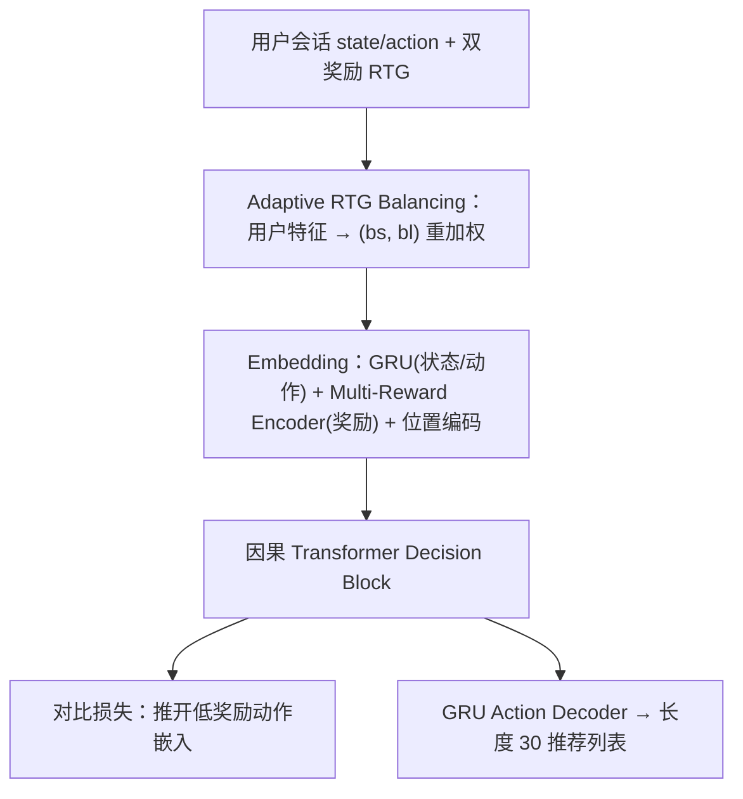
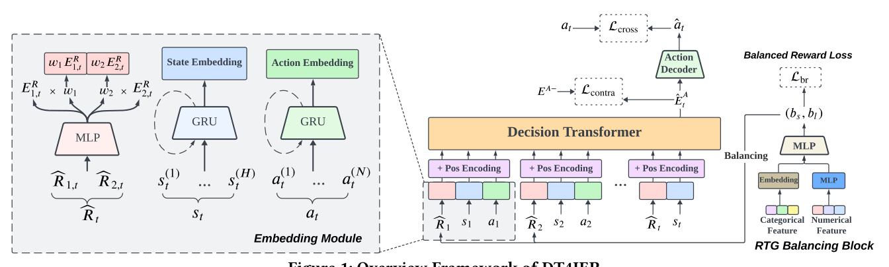
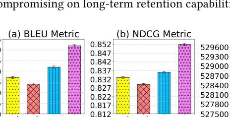

# Sequential Recommendation for Optimizing Both Immediate Feedback and Long-term Retention (同时优化即时反馈与长期留存的序列推荐)

- **会议/期刊**: SIGIR 2024 (47th ACM SIGIR)
- **作者与机构**: Ziru Liu, Zijian Zhang, Xiangyu Zhao, Kesen Zhao (City University of Hong Kong)；Shuchang Liu, Qingpeng Cai, Lantao Hu, Peng Jiang (快手科技)；Kun Gai
- **推荐链路定位**: 精排 / 端到端序列生成式打分（Session 级 action list 生成）
- **研究方向**: 序列与会话推荐 / 强化学习与动态探索推荐
- **论文原文**: [https://arxiv.org/abs/2404.03637v2](https://arxiv.org/abs/2404.03637v2)
- **开源代码**: [https://github.com/Applied-Machine-Learning-Lab/DT4IER](https://github.com/Applied-Machine-Learning-Lab/DT4IER)

## TL;DR (1分钟核心速览)

针对 RL 推荐中的致命三角（bootstrapping + off-policy + 函数逼近）不稳定、TD 折扣易短视、以及多奖励场景奖励设计困难三大痛点，本文提出 DT4IER：把 Decision Transformer 扩展为**双奖励（CTR 即时反馈 + 次日回流留存）**序列建模，用**用户特征驱动的自适应 RTG 重加权**解决长短目标冲突，用**离散化 + MLP 加权的高维奖励编码**保留奖励偏序，并加一项**对比损失**把低奖励动作在嵌入空间推开。在 Kuairand-Pure 上 NDCG 0.852（vs. DT4Rec 0.754，+13.0%）、HR 0.838，且在 ML-25M / RetailRocket 上 NDCG 分别提升 15.8% / 11.7%，SB-URS 留存指标同步不降。

## Background & Motivation (背景与核心矛盾)

- **主流范式**: 序列推荐以 SASRec/BERT4Rec 的左到右或双向 Transformer 优化单步 CTR 类指标；RL/MDP 派系则在会话粒度优化累积回报；近期 DT4Rec 把 RL 重写为 RTG 条件监督学习以直接优化留存。
- **前人局限 1**: 传统 TD-RL 的折扣累积回报与 bootstrapping 导致训练不稳（Deadly Triad），且折扣因子天然偏袒即时收益，长期留存被系统性低估。
- **前人局限 2**: 现有 MTL 方案（MMoE/PLE/RMTL-PLE）针对静态 item-wise 打分设计，门控专家无法刻画会话级用户状态的动态演化；DT4Rec 只单奖励（留存），完全不感知点击。
- **核心洞察 (Key Insight)**: 单看即时点击会奖励"标题党"，单看留存会牺牲当下体验；长短目标的权重本质应是**因人而异**的——高频回访用户与轻度用户的偏好平衡点不同，因此权重应由用户画像而非全局超参决定。
- **本文切入点**: 将 DT 的轨迹从 $(\hat{R}_t,s_t,a_t)$扩展为二维 RTG，并用用户特征预测的$b_s,b_l$ 为每个用户重写 RTG 序列，再做自回归动作预测。

## Method (核心方法设计)

### 1. 整体框架 (Overall Architecture)

输入一条用户会话轨迹 $\tau=(\hat{\boldsymbol{R}}_1,s_1,a_1,\dots,\hat{\boldsymbol{R}}_T,s_T)$，其中 session 以"天"为单位、state 为前序点击 item ID（零填充到$H=30$）、action 为长度$N=30$的推荐列表。前向流程为：① **Adaptive RTG Balancing Block** 用用户数值/类别特征生成$(b_s,b_l)$并把二维 RTG 按权重重标定；② **Embedding Module**——state/action 走 GRU 编码，奖励序列走提出的高维 multi-reward encoder，三者加位置（session）编码；③ **Transformer Decision Block**（2 层、8 头、$d=128$，因果掩码）输出动作嵌入$\tilde{E}_A$；④ **Action Decoder** 以 GRU + 教师强制解码出 top-30 item 序列；⑤ 训练用交叉熵 + 平衡奖励损失 + 对比损失联合优化。推理时只需给定 RTG 提示（实验中取 0.8 比例最优）即可单次前向生成整条列表，无需逐步 RL 采样。

<figure class="paper-figure" markdown="span">
  <figcaption>图1：DT4IER总体框架。</figcaption>
</figure>

### 2. 关键设计拆解 (Key Designs)

1. **用户自适应 RTG 平衡（Adaptive RTG Balancing）**：痛点是不存在全局最优的 $b_s:b_l$，且定权会诱发单目标塌缩。做法是把类别特征过 Embedding、数值特征过 MLP，拼接后经 softmax MLP 输出$[b_s,b_l]$（$b_s+b_l=1$），再用一个"拉高加权回报、同时惩罚长短回报失衡"的损失监督该权重：$\mathcal{L}_{br}=-\sum_{k}\big[(b_s\hat{R}_{s,k}+b_l\hat{R}_{l,k})-\gamma\,\|b_s\hat{R}_{s,k}-b_l\hat{R}_{l,k}\|_2^2\big]$，其中$\gamma=0.5$ 控制平衡惩罚强度。直觉上它等价于给每个用户学一个"最不坏"的帕累托折中点，且因 RTG 是奖励求和，约束上界可解析（原文式 (8)）。
2. **高维多奖励嵌入（Multi-reward Embedding）**：直接把二维奖励作标量嵌入会丢失奖励间的偏序与任务耦合。做法是先把连续奖励离散化分桶取元嵌入 $E^R_{s,t},E^R_{l,t}$，再用 MLP + softmax 得到任务权重$\boldsymbol{w}=[w_1,w_2]$，最后$\tilde{E}_R=\text{concat}(w_1E^R_{s,t},\,w_2E^R_{l,t})$。这相当于把 MTL 的"共享表示 + 任务权重"思想搬进奖励通道，使同一 RTG 值在不同用户上下文下产生不同表征。
3. **训练目标、负采样与推理效率**：动作空间是离散 item ID，故把 DT 原本的 $L_2$回归换成逐位置交叉熵$\mathcal{L}_{cross}$；再对"两项奖励均低于 0.6"的劣质样本作负例集$\Omega^-$，加$\mathcal{L}_{contra}=-\sum_{\tilde{E}_{A^-}\in\Omega^-}D(\tilde{E}_A,\tilde{E}_{A^-})$拉开嵌入距离。总损失$\mathcal{L}=\mathcal{L}_{cross}+\alpha\mathcal{L}_{contra}$（$\alpha=0.1$）。**免负采样检索、无 bootstrapping、无价值网络**，推理为一次 Transformer 前向 + 序列化解码。

## Experimental Setup & Evaluation Protocol (实验设置与评估协议)

- **数据集与预处理**（原文未给出用户/物品/交互量级统计，仅说明规模与稀疏性差异）：

| 数据集 | #Users | #Items | #Interactions | 稀疏度/密度 | 特征/场景说明 |
| :--- | :---: | :---: | :---: | :---: | :--- |
| Kuairand-Pure | 未报告 | 未报告 | 未报告 | 未报告 | 快手短视频，**随机曝光**的无偏日志，含点击与回访标签 |
| MovieLens-25M | 未报告 | 未报告 | 未报告 | 更稀疏 | 电影评分，规模更大、分布更稀 |
| RetailRocket | 未报告 | 已重编号 | 未报告 | 未报告 | 真实电商行为流，item ID 重索引以控显存 |

- **数据划分与防穿越 (Splitting Strategy)**: 采用**按"天"（session）的时序轨迹切分**：轨迹长 $T=20$，前序 session 作上下文、后续 session 作预测目标，属于时间序切分；但原文未报告显式留出验证/测试 session 数量，也未做冷启动划分。
- **排名评测协议 (Ranking Protocol)**: 非全库 Full-Ranking，而是**列表级生成式评测**——模型直接生成 $N=30$的推荐列表，与 ground-truth 列表比对，用 BLEU/ROUGE（列表重合度）、HR@K、NDCG@K 衡量精度，用 **SB-URS**（Similarity-Based User Return Score，按 8 个奖励分桶加权相似度）衡量留存，即$\text{SB-URS}=\sum_{c=0}^{7}sim_c\cdot(r_c-\tfrac12)\cdot N_c$。训练负例为固定阈值（双奖励 < 0.6）的困难样本，而非随机负采样。
- **对比基线与超参设置**: 6 个基线覆盖 MTL（MMoE、PLE、RMTL-PLE）与序列模型（BERT4Rec、SASRec、DT4Rec），MMoE/PLE 被改造为序列版本；$d=128$、2 层 8 头、batch 128、Adam，Kuairand 学习率 0.005，ML-25M/RetailRocket 为 0.02；显著性检验为双侧$t$-test，$p<0.05$。

## Key Experimental Results (实验关键数据)

### 1. 主实验对比 (Main Results)

| 数据集 | 指标 | MMoE | PLE | RMTL-PLE | BERT4Rec | SASRec | DT4Rec | **DT4IER** | Improv. |
| :--- | :--- | :---: | :---: | :---: | :---: | :---: | :---: | :---: | :---: |
| Kuairand-Pure | BLEU | 0.654 | 0.658 | 0.674 | 0.781 | 0.787 | 0.821 | **0.892** | +8.7% |
| | HR | 0.655 | 0.657 | 0.668 | 0.681 | 0.687 | 0.731 | **0.838** | +14.6% |
| | NDCG | 0.531 | 0.534 | 0.552 | 0.690 | 0.732 | 0.754 | **0.852** | +13.0% |
| | SB-URS | 411,278 | 412,359 | 432,402 | 507,831 | 512,490 | 526,032 | **529,741** | +0.7% |
| ML-25M | BLEU | 0.268 | 0.270 | 0.273 | 0.476 | 0.479 | 0.560 | **0.594** | +6.1% |
| | NDCG | 0.281 | 0.284 | 0.286 | 0.322 | 0.338 | 0.361 | **0.418** | +15.8% |
| | SB-URS | 114,231 | 115,087 | 115,842 | 135,928 | 141,823 | 151,302 | **153,135** | +1.2% |
| RetailRocket | BLEU | 0.268 | 0.273 | 0.294 | 0.455 | 0.457 | 0.572 | **0.628** | +9.8% |
| | NDCG | 0.411 | 0.415 | 0.431 | 0.450 | 0.461 | 0.487 | **0.544** | +11.7% |
| | SB-URS | 187,943 | 188,462 | 193,210 | 201,764 | 204,218 | 225,628 | **238,338** | +5.6% |

（`Improv.` 相对最强基线 DT4Rec；原文报告所有主指标均通过 $p<0.05$ 的显著性检验。）

### 2. 消融实验 (Ablation Study)

| 变体 | 移除组件 | BLEU | NDCG | SB-URS | 相对 DT4IER 的差距 |
| :--- | :--- | :---: | :---: | :---: | :---: |
| NAW | 自适应 RTG 平衡 | ↓1.50% | ↓1.90% | ↓0.08% | 三维齐降，长短期均受损 |
| NRE | 多奖励高维编码（换普通奖励嵌入） | ↓1.80% | ↓2.30% | ↓0.19% | **降幅最大**，任务关系无法建模 |
| NCL | 对比损失 | ↓1.02% | ↓1.60% | ↓0.03% | 精度降、留存基本持平 |
| DT4IER | — | 最优 | 最优 | 最优 | — |

<figure class="paper-figure" markdown="span">
  <figcaption>图2：消融实验结果。</figcaption>
</figure>

### 3. 关键实验发现 (Key Findings)

1. **MTL 结构本身不是瓶颈，"是否为序列动态建模"才是**：MMoE/PLE/RMTL-PLE 三者在 Kuairand-Pure 上 NDCG 仅 0.531→0.552，甚至低于 BERT4Rec 的 0.690，说明门控专家对会话级状态漂移几乎无效；而同为序列骨干的 DT4Rec→DT4IER 差距（0.754→0.852）来自奖励机制的改造而非骨干。
2. **奖励编码是最大单点贡献**：去掉多奖励编码器（NRE）导致 NDCG 掉 2.30%、SB-URS 掉 0.19%，均是三个消融中最大降幅，印证"二维奖励不能当标量嵌入"——奖励的偏序与任务耦合必须被显式参数化。
3. **精度提升不以留存为代价，但留存增益呈边际递减**：相对 DT4Rec，Kuairand-Pure 上 NDCG +13.0% 而 SB-URS 仅 +0.7%（RetailRocket 上 SB-URS +5.6% 相对更明显），说明双奖励主要在"精度侧"释放收益；同时 RTG 提示比例实验显示 BLEU/NDCG 在 0.4→0.8 单调上升、**0.8 处饱和**，即无需按理想的 $[1,1]$ 提示，说明过高 RTG 会引发分布外条件、反而不利。

## Highlights & Limitations (亮点、对比与审稿批判)

- **与代表作对比 (vs. Prior Work)**: 与 DT4Rec 的根本区别是从"单奖励留存条件"升级为"双奖励 + 用户自适应权重 + 奖励偏序编码"；与 MMoE/PLE 的区别在于不再做 item-wise 静态多目标共享，而是把多目标写进**自回归轨迹的 RTG 条件**，从而规避 bootstrapping 与折扣偏置；与 RMTL-PLE 的区别是损失权重由**模型内生预测**而非外部元学习调权。
- **可迁移亮点**: (1) 用用户特征预测多目标融合权重、并用"拉高加权和 + 惩罚失衡"的损失监督，可直接移植到 CTR/CVR/时长 三目标的精排融合；(2) 对连续奖励先离散化再 MLP 加权拼接的编码方式，适合任何需要保留数值偏序的条件化生成任务（如 RTG/温度/预算条件）。
- **审稿级局限批判**: (1) 对比损失只有负项 $\mathcal{L}_{contra}=-\sum D(\tilde{E}_A,\tilde{E}_{A^-})$，**缺少正例锚定**，理论上存在表征塌缩风险，且负例阈值 0.6 为硬编码、跨数据集缺乏敏感性分析；(2) 评测是"生成长度 30 列表 + BLEU/HR@K"的自回归重合度打分，既非全库 Full-Ranking，也未报告负例采样比与候选集构造，与主流 top-K 排序协议不可直接横比；同时动作空间固定为 30 个 item，线上百万级候选下的解码延迟与召回-精排一致性未做任何讨论，数据集统计的缺失也削弱了可复现性。

## Rating (四维评分)

- **方法创新性 (Novelty)**: ⭐⭐⭐⭐ （把 MTL 的共享-专家思想搬进 DT 的 RTG 通道，用户自适应奖励权重是有物理直觉的增量创新，但整体仍是 DT4Rec 的直接扩展）
- **评估协议与实验扎实度 (Protocol & Experiments)**: ⭐⭐⭐ （三数据集 + 6 基线 + 显著性检验 + 三项消融 + RTG 提示与案例研究较完整，但缺数据统计、划分细节与全库排序协议）
- **写作与数学规范度 (Clarity & Rigor)**: ⭐⭐⭐ （主流程清晰、关键公式齐备，但式 (8)(9) 的推导衔接略显跳跃，对比损失定义过简且缺少理论解释）
- **工业落地与复现价值 (Industrial & Practical Value)**: ⭐⭐⭐⭐ （代码开源、来自快手真实短视频场景，无 bootstrapping 训练稳定、单次前向生成列表，工程上易嵌入现有 session 级推荐管线）

