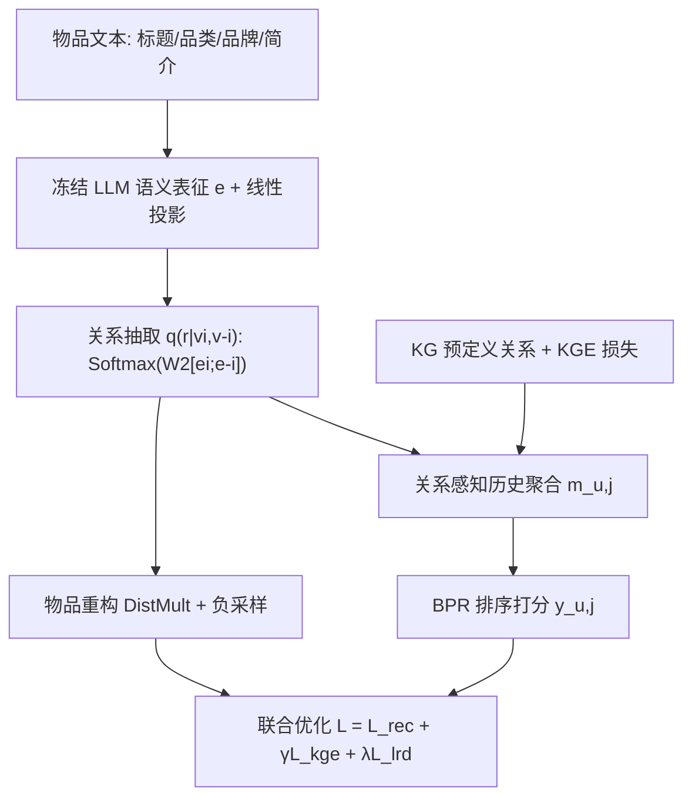
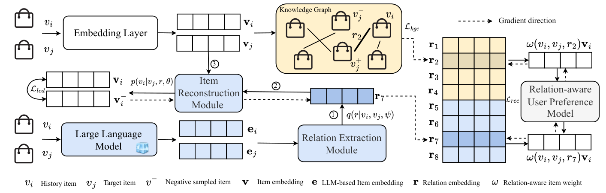

# Sequential Recommendation with Latent Relations based on Large Language Model (基于大语言模型潜在关系发现的序列推荐)

- **会议/期刊**: SIGIR 2024
- **作者与机构**: Shenghao Yang, Weizhi Ma, Peijie Sun, Qingyao Ai, Yiqun Liu, Mingchen Cai(美团), Min Zhang（清华大学 DCST/AIR）
- **推荐链路定位**: 精排（下一物品预测）/ 关系感知序列建模
- **研究方向**: 序列与会话推荐 / 大语言模型推荐
- **论文原文**: [https://arxiv.org/abs/2403.18348v1](https://arxiv.org/abs/2403.18348v1)
- **开源代码**: [https://github.com/ysh-1998/LRD](https://github.com/ysh-1998/LRD)（基于 ReChorus 实现）

## TL;DR (1分钟核心速览)

关系感知序列推荐（RCF/KDA）依赖知识图谱中**人工预定义关系**，同时受"边稀疏"（关系类型只有 2–4 种）与"点稀疏"（共现关系需大量交互才能采集）双重限制。本文提出 LRD：用 LLM 文本嵌入作为物品的语言知识表征，经 DVAE 框架（关系抽取 + 物品重构 + 熵正则）自监督发现离散潜在关系，并与推荐任务、KGE 任务联合优化，作为即插即用模块增强 RCF/KDA。在 `Leave-One-Out + 99 负采样` 协议下，KDA_LRD 在 Office 上 HR@5 提升 8.38%、NDCG@5 提升 8.83%（$p<0.01$）。

## Background & Motivation (背景与核心矛盾)

- **主流范式**: SASRec/BERT4Rec 类序列模型靠隐式 item-CF 信号建模；RCF、KDA 显式引入历史物品与目标物品的关系（"also buy"、"同品类"）做加权聚合，效果显著优于纯序列模型。
- **前人局限**: ① 关系类型由人手工枚举，覆盖不了真实世界中多样、多跳的任务型关联，模型泛化被锁死在 2–4 条边上；② 共现类关系依赖大量交互采集，Amazon 稀疏场景（密度 0.014%）下几乎采不到，形成顶点稀疏。
- **核心洞察 (Key Insight)**: 人类是靠"语言知识"描述两件物品间关系的；LLM 已具备这种类人世界知识，因此可以把"关系"从离散枚举变成**可学习的隐变量**——不需要标注，只需保证"用关系 $r$和物品$v_{-i}$能重构回$v_i$"。
- **本文切入点**: 把关系发现建成 DVAE 式自监督重构任务，先验均匀、后验可学习，再用推荐损失引导其只发现"对推荐有用"的关系。

## Method (核心方法设计)

### 1. 整体框架 (Overall Architecture)

输入用户序列 $S_u$与候选目标$v_j$。物品文本（标题/品类/品牌，MovieLens 另爬 IMDB 导演、演员、简介）经冻结的 GPT-3 `text-embedding-ada-002` 得到语言知识表征$e$，线性投影到$d=64$后送入**关系抽取模块**预测潜在关系分布$q(r|v_i,v_{-i})$；**物品重构模块**用 DistMult 打分以负采样近似重构$v_i$，从而反向约束关系抽取。推荐侧沿用 RCF/KDA 的关系感知加权聚合，只是关系集合从$\mathcal{R}_{def}$扩为$\mathcal{R}_{def}\cup\mathcal{R}_{latent}$；三个损失（BPR 推荐、KGE、LRD）联合优化，推理时对目标物品按关系加权拼接历史物品打分排序。

<figure class="paper-figure" markdown="span">
  <figcaption>图1：带LRD的关系感知序列推荐总体框架。LRD包含两个主要组件：一个关系抽取模型，基于由LLM获得的两个物品的语言知识表示来估计潜在关系；一个物品重建模型，基于估计的关系和另一个物品来重建物品。来自知识图的预定义关系和来自LRD的潜在关系都用于推荐中的关系物品建模。</figcaption>
</figure>

### 2. 关键设计拆解 (Key Designs)

1. **DVAE 式潜在关系发现（把"关系枚举"变成"隐变量边缘化"）**：无监督关系无法直接监督，故对伪似然 $\log\sum_{r}p(v_i,v_{-i}|r)p_u(r)$用变分后验$q(r|v_i,v_{-i},\psi)$ 做 Jensen 下界：
$\mathcal{L}(\theta,\psi)=\sum_{i=1}^{2}\sum_{r\in\mathcal{R}}q(r|v_i,v_{-i},\psi)\log p(v_i|v_{-i},r,\theta)+\alpha H[q]$。
直觉：只有关系抽取得"足够准且足够泛"，才能把它和另一物品一起重构出原物品，重构误差天然成为关系的监督信号；熵正则 $H$ 防止后验坍缩到单一关系，保证潜在关系被均匀使用。

2. **表征空间对齐的重构打分（关键工程 trick）**：重构时**不用** LLM 表征 $e_i$，而用 ID 嵌入$v_i$，打分取 DistMult$\phi(v_i,v_{-i},r)=v_i^{\top}\mathrm{diag}(r)v_{-i}$，并以负采样近似全库 softmax：$\log\sigma(\phi(v_i,v_{-i},r))+\log\sigma(-\phi(v_i^{-},v_{-i},r))$。原因是$r$最终要进入推荐侧同一个 DistMult 打分器$\omega(v_i,v_j,r)=\mathrm{softmax}_{v_i'\in\mathcal{V}\setminus S_u}\exp\phi(v_i',v_j,r)$，用 ID 空间重构才能让"发现的关系"与"推荐用的关系"共享同一个几何空间，避免两套嵌入割裂。

3. **联合优化与开销**：$\mathcal{L}=\mathcal{L}_{rec}+\gamma\mathcal{L}_{kge}+\lambda\mathcal{L}_{lrd}$，其中$\mathcal{L}_{lrd}$把物品对显式改写为"历史物品$v_i$–目标$v_j$"的序内对，使推荐监督反传进关系抽取。负采样为均匀随机负例；LLM 表征离线预计算（图 1 中标注冻结），线上新增开销仅为每对（历史, 目标）一次$|S_u|\times|\mathcal{R}|$ 的线性分类，与 KDA 的量级相当。

## Experimental Setup & Evaluation Protocol (实验设置与评估协议)

- **数据集与预处理**: 全部按 **5-core** 过滤（用户/物品交互数 ≥5）：

| 数据集 | #Users | #Items | #Interactions | 密度 | 预定义关系/三元组 |
| :--- | :---: | :---: | :---: | :---: | :--- |
| MovieLens-100k | 943 | 1,349 | 99,287 | 7.805% | 2 种（年份、类型）/ 886K |
| Amazon Office | 4,905 | 2,420 | 53,258 | 0.448% | 4 种（品类、品牌、also buy/view）/ 778K |
| Amazon Electronics | 192,403 | 63,001 | 1,682,498 | 0.014% | 4 种 / 2,148M |

- **数据划分与防穿越**: `Leave-One-Out`——最后 1 次交互作测试、倒数第 2 次作验证，其余训练；序列最大长度 20。
- **排名评测协议**: `Sampled Ranking`，目标物品与 **99 个随机负例**共同排序，报告 HR@5/10、NDCG@5/10，5 个随机种子取均值。
- **对比基线与超参**: 非关系基线 Caser / GRU4Rec / SASRec / TiSASRec，关系基线 RCF / KDA；嵌入维度 $d=64$、batch 256、Adam、早停（NDCG@5 十轮不升），$\gamma,\lambda\in\{0.1,1,5,10\}$，潜在关系数在$\{5,\dots,10\}$搜索；显著性用配对 t 检验（$^\dagger p\le0.05$，$^\ddagger p\le0.01$）。

## Key Experimental Results (实验关键数据)

### 1. 主实验对比 (Main Results)

| 模型 | ML HR@5 | ML N@5 | Office HR@5 | Office N@5 | Elec HR@5 | Elec N@5 |
| :--- | :---: | :---: | :---: | :---: | :---: | :---: |
| Caser | 0.5217 | 0.3571 | 0.3095 | 0.1993 | 0.4620 | 0.3435 |
| GRU4Rec | 0.5101 | 0.3451 | 0.3295 | 0.2164 | 0.4699 | 0.3487 |
| SASRec | 0.5186 | 0.3712 | 0.4027 | 0.2751 | 0.4805 | 0.3587 |
| TiSASRec | 0.5313 | 0.3812 | 0.4014 | 0.2745 | 0.5114 | 0.3860 |
| RCF | 0.5101 | 0.3635 | 0.4145 | 0.2911 | 0.5790 | 0.4475 |
| KDA | 0.5748 | 0.4182 | 0.4453 | 0.3127 | 0.6008 | 0.4665 |
| RCF$_{LRD}$| 0.5398$^\ddagger$| 0.3886$^\ddagger$| 0.4381$^\ddagger$| 0.3127$^\ddagger$| 0.5828$^\dagger$| 0.4510$^\dagger$ |
| **KDA$_{LRD}$** | **0.6066$^\ddagger$** | **0.4420$^\ddagger$** | **0.4826$^\ddagger$** | **0.3403$^\ddagger$** | **0.6111$^\ddagger$** | **0.4760$^\ddagger$** |
| Improv. (KDA) | +5.53% | +5.69% | +8.38% | +8.83% | +1.71% | +2.04% |

（KDA$_{LRD}$的 NDCG@10 同样最优：0.4867 / 0.3881 / 0.5143；RCF$_{LRD}$ 相对 RCF 在 MovieLens 提升 +5.82% HR@5。）

### 2. 消融实验 (Ablation Study)

| 变体 | MovieLens | Office | Electronics | 结论 |
| :--- | :---: | :---: | :---: | :--- |
| 完整 KDA$_{LRD}$/ RCF$_{LRD}$ | 最优 | 最优 | 最优 | — |
| w/o LRD（退化为 KDA/RCF） | ↓ | ↓ | ↓ | 潜在关系确实带来增益 |
| w/o LLM（ID 嵌入替 $e$） | ↓↓ | ↓↓ | ↓↓ | 语义知识是关系发现的关键 |
| w/o KGE（去掉三元组监督） | ↓↓ | ↓↓ | ↓↓ | 不能只靠潜在关系，需保留预定义关系建模 |

（原文仅以图 2 柱状图呈现，未给具体数值，故此处标注相对趋势。）

### 3. 关键实验发现 (Key Findings)

1. **增益与预定义关系的贫乏程度正相关**：MovieLens 仅 2 种预定义关系，RCF 甚至打不过 SASRec/TiSASRec（0.5101 vs 0.5313 HR@5）；而 RCF$_{LRD}$一跃至 0.5398（+5.82%）。Office 稀疏场景下 KDA$_{LRD}$ 的 NDCG@5 相对提升 8.83%，是三个数据集中最大的，说明 LRD 主要补的是"关系/物品双稀疏"造成的短板。
2. **潜在关系确实学到语义上可解释的新类别**：Office 上 KDA$_{LRD}$的关系嵌入相似度矩阵显示，预定义关系（#1–4）之间相似度高、与潜在关系（#5–12）**显著负相关或近零相关**（如关系 #1 对 #5–#12 在$-0.54\sim-0.85$）。人工检视发现 #5 对应"文档打印-归档"任务链（打印机 ↔ 文件夹）、#8 对应"打包运输"任务链（透明胶 ↔ 货架车），属于跨品类的多跳任务型关联，而非简单互补购买。
3. **超参敏感但规律一致**：潜在关系数最优值 MovieLens 为 6、Office 为 5，过少（关系表达不足）或过多（冗余关系稀释注意力）都会掉点；$\lambda$在$\{0.1,1,5,10\}$ 内呈先升后平的趋势，两个骨干（RCF/KDA）在同一数据集上的最优值基本一致，说明该模块可作为稳定的通用插件。

## Highlights & Limitations (亮点、对比与审稿批判)

- **与代表作对比 (vs. Prior Work)**: 相比 RCF（两层注意力只做关系强度的双层加权）与 KDA（再加傅里叶时序演化），LRD 改的是**关系集合本身的来源**——从 KG 枚举转为 LLM+DVAE 隐变量发现，与前两者正交且可叠加；相比 P5/TALLRec 一类让 LLM 直接生成或重排的做法，本文只借 LLM 作**离线语义编码器**，几乎不增加线上延迟，工程性价比更高。
- **可迁移亮点**: ① "重构拿 ID 嵌入、抽取拿语义嵌入"的空间对齐技巧，可迁移到任何需要把外部语义信号注入 ID 空间的模块（如跨域、冷启动物品增强）；② DVAE 的熵正则 + 均匀先验是防止离散码本坍缩的廉价手段，对语义 ID / 聚类式关系发现同样适用。
- **审稿级局限批判**: ① 评测只用 99 随机负采样的 `Sampled Ranking`，绝对指标偏高且对负采样分布敏感，缺 `Full-Ranking` 或流行度/难负例的鲁棒性验证，也未下探稀疏/长尾分桶；② 只验证了 RCF、KDA 两个骨干、潜在关系数仅 5–10 的小范围且最优值因数据集而异，超参迁移成本高；LLM 固定为 ada-002 且冻结，未讨论更强 LLM 或开源模型的收益与成本；③ 关系归一化 $\omega$在整个$\mathcal{V}\setminus S_u$ 上做 softmax，理论复杂度随物品数线性增长，论文未给出线上延迟实测与复杂度分析。

## Rating (四维评分)

- **方法创新性 (Novelty)**: ⭐⭐⭐⭐ （把关系发现重构为 DVAE 离散隐变量自监督问题，并以推荐损失反传引导，思路干净且与现有关系感知模型正交可插拔）
- **评估协议与实验扎实度 (Protocol & Experiments)**: ⭐⭐⭐ （三域数据集 + 配对 t 检验 + 关系嵌入/案例/超参分析较完整，但仅 99 负采样排序、消融无具体数值、缺少效率与长尾分桶实验）
- **写作与数学规范度 (Clarity & Rigor)**: ⭐⭐⭐⭐ （从伪似然到 ELBO、负采样近似的推导链条清晰，符号表规范；$q$与$p$ 的参数分工交代明确，但式 (12) 的全库归一化复杂度未讨论）
- **工业落地与复现价值 (Industrial & Practical Value)**: ⭐⭐⭐⭐ （LLM 表征完全离线预计算、代码开源在 ReChorus 上开箱可用，线上仅增加轻量线性关系分类，部署门槛低）

