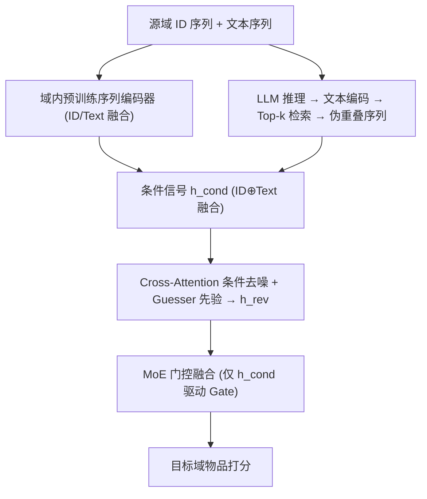

# From Clues to Generation: Language-Guided Conditional Diffusion for Cross-Domain Recommendation (从线索到生成：语言引导的条件扩散跨域推荐)

- **会议/期刊**: SIGIR 2026
- **作者与机构**: Ziang Lu, Lei Sang, Lin Mu, Yiwen Zhang（安徽大学）
- **推荐链路定位**: 召回/端到端生成式（跨域序列推荐）
- **研究方向**: 跨域与多场景推荐 / 生成式推荐与扩散模型
- **论文原文**: [https://arxiv.org/abs/2604.05365v1](https://arxiv.org/abs/2604.05365v1)
- **开源代码**: 暂未开源（仅引用 Baichuan2-7B-Chat 与 jina-embeddings-v2 权重）

## TL;DR (1分钟核心速览)

域间（inter-domain）推荐长期依赖重叠用户做知识迁移锚点，但真实场景中重叠用户稀疏，绝大多数用户仅单域行为，缺乏显式对齐信号。本文提出 LGCD：先用 LLM 从源域文本序列推理目标域兴趣词，再经文本编码器 + Top-$k$ 余弦检索落回真实物品集，构造"伪重叠"序列；再用条件扩散模型以源域 ID/文本双模态信号为条件（cross-attention 注入）生成目标域用户表征，并以 MoE 门控融合输出最终打分。在 Movie-Book / Food-Kitchen 两对 Amazon 数据集、1:999 采样排序协议下，HR@5 相对最优基线最高提升 **35.0%**，全部 16 项指标全面领先。

## Background & Motivation (背景与核心矛盾)

- **主流范式**：映射范式（EMCDR/SSCDR/CD-CDR 学习跨域投影）与统一表征范式（UniCDR/UCLR 对比学习共享空间），二者均以重叠用户为锚点；非重叠路线（DA-DAN/PLCR/LLMCDSR）主要挖域不变共性知识，而非个性化迁移。
- **前人局限**：①重叠用户仅占总体极少数，一旦缺失则无对齐信号，投影函数无从监督；②非重叠方法偏向"通用知识"迁移，对严格冷启动用户的细粒度偏好建模乏力。
- **核心洞察 (Key Insight)**：LLM 的开放世界语义推理可以把"源域行为"翻译成"目标域线索"，从而把海量单域用户转化为可用的伪锚点；而跨域冷启动本质上是一个**条件生成**问题——在源域模式条件下合成目标域用户表征。
- **本文切入点**：伪重叠锚点 + 条件扩散生成 + 解耦训练抑制伪数据语义噪声。

<figure class="paper-figure" markdown="span">
  <figcaption>图1：LGCD 的核心思想</figcaption>
</figure>

## Method (核心方法设计)

### 1. 整体框架 (Overall Architecture)

输入为用户 ID 模态序列与文本模态序列（title/brand/category），经域内预训练的 Transformer 序列编码器分别得到 $\mathbf{h}^{ID}$与$\mathbf{h}^{text}$并融合为$\mathbf{h}_{fusion}$（式 2，用以下一物品预测预训练）。对单域用户，LPG 模块调用 LLM 生成目标域伪兴趣文本，经文本编码器检索真实目标物品，随机插入源序列形成伪重叠轨迹。CDPG 以源域条件信号$\mathbf{h}_{cond}$驱动 cross-attention 去噪网络生成目标域表征，Guesser 网络提供推理期初始先验，最后 MoE 模块融合生成表征与条件信号得到$\mathbf{h}_{final}$ 并做全库打分。

<figure class="paper-figure" markdown="span">
  <figcaption>图2：LGCD 的整体框架，展示以域 A 为源域、域 B 为目标域的完整工作流程。ID模态输入包含重叠用户两个域的完整交互序列，而对于单域用户，仅包含其观测到的源域交互序列。(b) 该模块为单域用户合成目标域伪交互。(c) 该模块在条件信号监督下生成用户对目标域的偏好。(d) 该模块将条件信号与生成……</figcaption>
</figure>

### 2. 关键设计拆解 (Key Designs)

1. **LLM 伪重叠构造 (LPG，破解"无锚点")**：LLM 输出是开放词表自由文本，与离散物品集不对齐。做法是把生成文本 $\tilde{C}^B_i$送入预训练文本编码器，再与目标域真实物品文本池做余弦检索取 Top-$n_K$：$S^B_i=\mathrm{Top\text{-}k}\{\cos\langle\tilde{\mathbf{h}}^B_i,\mathbf{e}^B_j\rangle \mid \mathbf{e}^B_j\in\mathcal{E}^B_{text}\}$，$n_K=10$。直觉：LLM 只负责"语义方向"，检索负责"落盘合法性"，用召回把幻觉裁掉。

2. **解耦双路径 + 循环批采样 (抗语义噪声)**：伪物品缺乏真实时序共现，直接当 GT 会污染协同分布。故伪路径**屏蔽伪物品 ID 模态**（条件信号只用源域真实交互），并加对齐正则 $\mathcal{L}_{align}=\lVert \mathbf{h}_{rev}-\mathbf{h}_{cond}\rVert_2^2$约束生成不脱离条件流形；训练损失按用户类型拆分：$\mathcal{L}^{O}_{total}=\mathcal{L}_{diff}+\mathcal{L}_{guess}+\mathcal{L}_{rec}$，$\mathcal{L}^{A\cup B}_{total}=\mathcal{L}_{diff}+\mathcal{L}_{guess}+\mathcal{L}_{align}+\mathcal{L}_{rec}$。同时每个 mini-batch 强制注入固定数量真实重叠样本（cyclic batch），等价于对稀缺监督隐式加权。

3. **特征回归式条件扩散 + MoE 融合**：去噪网络不预测噪声而直接回归 $\mathbf{x}_0$（流形假设，避免高维序列的维度灾难）：$\mathcal{L}_{diff}=\mathbb{E}\lVert f_\theta(\sqrt{\bar{\alpha}_t}\mathbf{x}_0+\sqrt{1-\bar{\alpha}_t}\boldsymbol{\epsilon},\,t,\mathbf{h}_{cond})-\mathbf{x}_0\rVert_2^2$；反向从$t_{start}=\lambda T$起步，$\mathbf{h}_{init}=g(\mathbf{h}_{cond})$由 Guesser 线性网络给出，避免纯噪声重建的不稳定。MoE 门控**只由$\mathbf{h}_{cond}$驱动**：$\boldsymbol{\alpha}=\mathrm{Softmax}(\mathbf{W}_{gate}\mathbf{h}_{cond})$，$\mathbf{h}_{final}=\sum_{n}\alpha_n \mathrm{Expert}_n([\mathbf{h}_{cond}\oplus\mathbf{h}_{rev}])$，防止生成噪声误导专家选择。推理开销主要为$T=100$ 步反向 + 单次 ANN 打分，与标准 SASRec 同阶。

## Experimental Setup & Evaluation Protocol (实验设置与评估协议)

- **数据集与预处理**：Amazon 两对域。Movie-Book 取最近一月、`10-core` 过滤；Food-Kitchen 取近一年、`5-core` 过滤。

| 数据集 | #Users(单域/重叠) | #Items (A/B) | #Interactions (单域 A/B, 交叉) | Avg.$m$ | 说明 |
| :--- | :---: | :---: | :---: | :---: | :--- |
| Movie-Book | 6,819 / 50,242 / 2,666 | 12,875 / 93,860 | 12,185 / 124,889 / 6,652 | 9.01 | 影视→图书 |
| Food-Kitchen | 5,041 / 35,889 / 5,781 | 8,661 / 27,637 | 5,472 / 38,191 / 7,501 | 8.22 | 食品→厨具 |

- **划分与防穿越**：按"最后一个交互物品所属域"判定，并**过滤该域内所有历史交互**，保证历史序列与真值物品分属不同域——这是典型的跨域严格冷启动划分（LOO 变体）；剩下 80% 重叠序列 + 全部单域序列构成训练集。
- **排名评测协议**：`Sampled Ranking`，从参与域全库随机采 **999 负例** + 1 真值构成候选表，指标 HR@{5,10}、NDCG@{5,10}。
- **基线与超参**：单域（GRU4Rec/SASRec/DiffuRec/FEARec/UniSRec）、域内（Tri-CDR/MGCL/CTT）、非重叠（DA-DAN/LLMCDSR/PLCR）、域间（SSCDR/UniCDR/UCLR/CD-CDR）。$d=64$，Adam，lr=1e-3，批大小 128（单域）/64（重叠），$\beta_{min}=0.001,\beta_{max}=0.1$，4 头注意力，$T=100$，8 专家，显著性$p<0.001$。

## Key Experimental Results (实验关键数据)

### 1. 主实验对比 (Main Results)

| 方法 | Movie HR@5 | HR@10 | N@5 | N@10 | Book HR@5 | HR@10 | N@5 | N@10 | Food HR@5 | HR@10 | Kitchen HR@5 | HR@10 |
| :--- | :---: | :---: | :---: | :---: | :---: | :---: | :---: | :---: | :---: | :---: | :---: | :---: |
| SASRec | 0.0354 | 0.0579 | 0.0218 | 0.0291 | 0.0248 | 0.0438 | 0.0161 | 0.0221 | 0.1900 | 0.2900 | 0.2276 | 0.3250 |
| FEARec | 0.0289 | 0.0482 | 0.0169 | 0.0227 | 0.0289 | 0.0482 | 0.0169 | 0.0227 | 0.1733 | 0.2733 | 0.2402 | 0.3454 |
| UniSRec | 0.0161 | 0.0386 | 0.0091 | 0.0161 | 0.0305 | 0.0457 | 0.0218 | 0.0264 | 0.0733 | 0.1235 | 0.0675 | 0.1020 |
| MGCL | 0.0129 | 0.0289 | 0.0089 | 0.0140 | 0.0229 | 0.0381 | 0.0150 | 0.0199 | 0.2467 | 0.3367 | 0.2590 | 0.3140 |
| LLMCDSR | 0.0257 | 0.0418 | 0.0207 | 0.0259 | 0.0286 | 0.0438 | 0.0165 | 0.0215 | 0.2200 | 0.3600 | 0.2214 | 0.3155 |
| PLCR | 0.0322 | 0.0514 | 0.0202 | 0.0264 | 0.0381 | 0.0571 | 0.0271 | 0.0331 | 0.2600 | 0.3967 | 0.2308 | 0.3375 |
| UCLR | 0.0342 | 0.0509 | 0.0193 | 0.0270 | 0.0353 | 0.0632 | 0.0255 | 0.0387 | 0.2288 | 0.3310 | 0.2213 | 0.3323 |
| CD-CDR | 0.0361 | 0.0675 | 0.0225 | 0.0293 | 0.0412 | 0.0681 | 0.0305 | 0.0400 | 0.2467 | 0.3233 | 0.2559 | 0.3250 |
| **LGCD** | **0.0482** | **0.0772** | **0.0286** | **0.0381** | **0.0590** | **0.0914** | **0.0373** | **0.0477** | **0.2800** | **0.4000** | **0.3093** | **0.3893** |
| **Improv.** | +35.0% | +14.4% | +7.5% | +23.3% | +34.7% | +9.1% | +17.3% | +16.9% | +7.7% | +0.8% | +19.4% | +5.1% |

### 2. 消融实验 (Ablation Study)

| 变体 | Movie HR@5 / N@5 | Book HR@5 / N@5 | Food HR@5 / N@5 | Kitchen HR@5 / N@5 |
| :--- | :---: | :---: | :---: | :---: |
| w/o Diffusion | 0.0354 / 0.0210 | 0.0533 / 0.0288 | 0.2200 / 0.1368 | 0.2747 / 0.1911 |
| w/o Overlap Diffusion | 0.0289 / 0.0178 | 0.0533 / 0.0351 | 0.0900 / 0.0584 | 0.0549 / 0.0353 |
| w/o Pseudo Diffusion | 0.0322 / 0.0150 | 0.0514 / 0.0316 | 0.2667 / 0.1778 | 0.2543 / 0.1741 |
| w/o Alignment Loss | 0.0322 / 0.0194 | 0.0476 / 0.0334 | 0.2233 / 0.1430 | 0.2449 / 0.1583 |
| w/o Guesser Network | 0.0322 / 0.0209 | 0.0514 / 0.0316 | 0.2667 / 0.1798 | 0.2841 / 0.1925 |
| w/o MoE Fusion | 0.0129 / 0.0063 | 0.0343 / 0.0236 | 0.2665 / 0.1757 | 0.2575 / 0.1730 |
| w/o Overlap Cyclic | 0.0480 / 0.0309 | 0.0324 / 0.0205 | 0.2100 / 0.1305 | 0.2637 / 0.1833 |
| **LGCD** | **0.0482 / 0.0286** | **0.0590 / 0.0373** | **0.2800 / 0.1805** | **0.3093 / 0.2140** |

### 3. 关键实验发现 (Key Findings)

1. **真/伪重叠互补，缺一即崩**：仅用真实重叠（w/o Pseudo）或仅用伪重叠（w/o Overlap Diffusion）都显著掉点——Food 上仅伪重叠的 HR@5 从 0.2800 暴跌至 0.0900、Kitchen 从 0.3093 跌至 0.0549，说明真实锚点决定对齐"方向"，伪数据只负责扩展"覆盖"，二者不可替代。
2. **MoE 是最大单点增益，且胜过扩散本体**：去掉 MoE 后 Movie HR@5 由 0.0482 掉到 0.0129（相对 −73%），甚至低于 w/o Diffusion（0.0354），证明"如何融合生成特征与条件信号"比"是否生成"更关键；仅由 $\mathbf{h}_{cond}$ 驱动门控的设计有效隔离了残余噪声。
3. **伪数据必须被显式去噪**：去掉 $\mathcal{L}_{align}$后 Food/Kitchen 的 HR@5 分别下降 20.3%/20.8%，去循环批采样后 Book HR@5 从 0.0590 跌至 0.0324；此外$n_K$在 10 处最优、过大反降，$T$在 100 步后过平滑退化，$\lambda$ 需按域调（0.7/0.5/0.3），说明伪数据的"量"与"信噪比"需精细平衡。

## Highlights & Limitations (亮点、对比与审稿批判)

- **与代表作对比**：相较 PLCR（域提示学域不变共性）与 LLMCDSR（LLM+元学习训练混合序列推荐器），LGCD 不追求"共性知识"，而是**为每个单域用户合成个性化伪锚点**并生成其目标域表征；相较 CD-CDR/UCLR 等纯重叠依赖方法，它在重叠比例低至 0.2 时仍稳定领先（图 6），体现对锚点稀缺鲁棒。
- **可迁移亮点**：①"LLM 出语义方向 + 预训练文本编码器 Top-$k$ 检索落回物品集"是把开放生成落到闭集物品空间的通用范式，可直接迁移到生成式推荐的语义 ID 对齐；②用条件信号单独驱动 MoE 门控（生成特征只入 Expert 不入 Gate）是抑制生成噪声污染融合的简洁技巧。
- **审稿级局限批判**：①评估采用 1:999 采样排序而非 Full-Ranking，易高估冷启动绝对精度，且只报 HR/NDCG 未报 MRR/Recall；②LLM 伪标签离线一次性生成，Movie-Book 上 10-core 过滤后交互极稀疏（单域交互仅 1.2 万条），伪数据质量对 Baichuan2-7B 的先验高度敏感，跨语言/跨品类迁移成本高；③推理需 $T=100$ 步反向扩散并额外维护 Guesser 与 8 专家，线上时延与显存开销未做量化；④消融中 w/o Overlap Cyclic 在 Movie 的 NDCG@5（0.0309）反而高于完整模型（0.0286），该组件收益存在不稳定迹象，作者未解释。

## Rating (四维评分)

- **方法创新性 (Novelty)**: ⭐⭐⭐⭐ （首次把 LLM 伪重叠锚点与条件扩散生成统一到域间冷启动框架，双路径解耦 + 条件驱动 MoE 的门控设计有清晰物理直觉）
- **评估协议与实验扎实度 (Protocol & Experiments)**: ⭐⭐⭐ （两对域、14 个基线、7 组消融较完整，但仅采样排序、无 Full-Ranking 与线上验证，伪数据质量分析偏弱）
- **写作与数学规范度 (Clarity & Rigor)**: ⭐⭐⭐⭐ （扩散前向/反向与损失推导完整、超参敏感性分析充分，但部分符号复用如 $f^{A}_{fusion}$与$\mathbf{h}^{text}_j$ 的域归属易混淆）
- **工业落地与复现价值 (Industrial & Practical Value)**: ⭐⭐⭐ （依赖 7B LLM + 100 步扩散的离线伪数据流水线，未开源模型代码，落地需重估时延与 LLM 调用成本）

