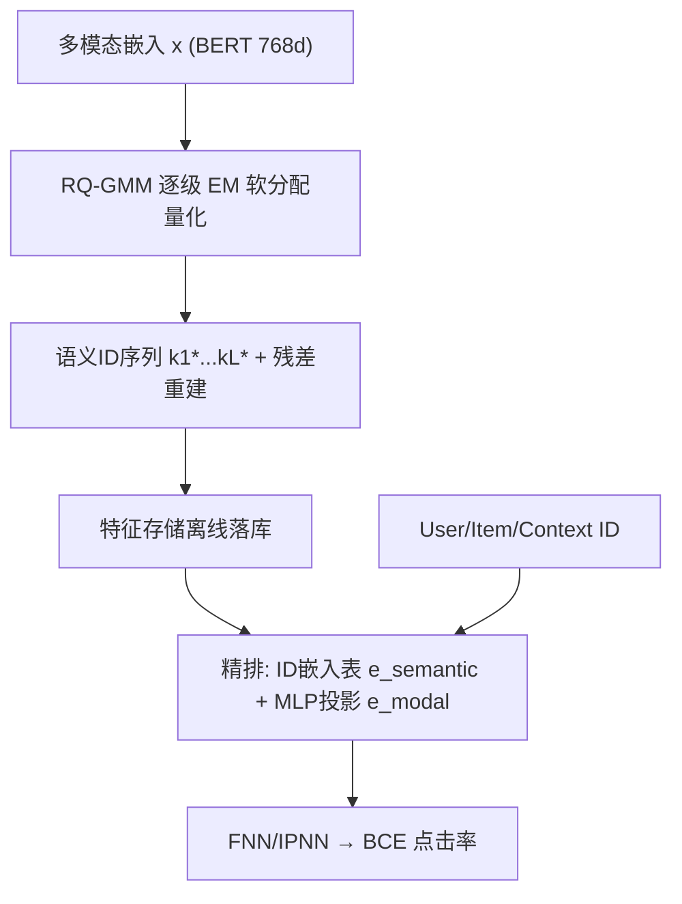

# RQ-GMM: Residual Quantized Gaussian Mixture Model for Multimodal Semantic Discretization in CTR Prediction (残差量化高斯混合模型：面向CTR预测的多模态语义离散化)

- **会议/期刊**: SIGIR 2026 (Under review, arXiv 2602.12593)
- **作者与机构**: Ziye Tong、Jiahao Liu、Weimin Zhang、Hongji Ruan、Derick Tang 等；腾讯 + 复旦大学 + 北京交通大学
- **推荐链路定位**: 精排（特征侧离线离散化 + 在线查表）
- **研究方向**: CTR/CVR 预估与特征交叉 / 生成式推荐与离散语义 ID
- **论文原文**: [https://arxiv.org/abs/2602.12593v1](https://arxiv.org/abs/2602.12593v1)
- **开源代码**: 暂未开源

## TL;DR (1分钟核心速览)

多模态预训练嵌入与 CTR 模型联合训练存在**目标错配**与**收敛速度不一致**（ID 类稀疏特征“one-epoch 现象” vs 多模态嵌入需长周期降噪）。本文沿用两阶段范式，但把第一阶段从“硬聚类/VAE 量化”换成**残差量化高斯混合模型**：每级码本向量携带均值 + 对角协方差 + 混合系数，用 EM 软后验自适应数据密度，输出 $L$ 级语义 ID 作为类别特征，与 MLP 投影的连续嵌入构成粗到细输入。Amazon 三品类（时间序 8:1:1、无采样全量 AUC）在 FNN/IPNN 上 AUC 全面最优，相对 RQ-KMeans 提升 0.96%–1.65%，码本利用率最高 89.5%；线上 7 天 A/B 广告主价值较 RQ-VAE +1.502%、较直接拼嵌入 +3.600%。

## Background & Motivation (背景与核心矛盾)

- **主流范式**: 将 CLIP/BERT 等多模态嵌入作为额外特征拼入精排模型（Route 2），而非在召回侧构造多模态索引（工程复杂、精排收益有限）。
- **前人局限一（训练动态）**: 预训练模型优化的是通用语义而非用户偏好，嵌入含大量推荐无关噪声；联合训练时高频 ID 特征一轮即收敛，多模态嵌入却需长周期，二者收敛速度差直接拉低整体效果。
- **前人局限二（离散化质量）**: VQ-VAE 码本坍缩严重；RQ-VAE 需逐级调平衡且欧氏硬分配忽略分布形状；RQ-KMeans 假设各向同性等方差球簇，硬分配在簇边界破坏语义连续性、无法表达不确定性。
- **核心洞察 (Key Insight)**: 多模态嵌入空间是**多峰、各向异性、密度不均**的混合分布，量化算子应建模“簇形状 + 密度 + 归属不确定性”，而非只找最近质心。
- **本文切入点**: 用 GMM 的软后验替换 argmin 硬分配，并把 GMM 嵌入残差量化的多级级联中，保持与 RQ-KMeans 同阶的存储/推理开销。

## Method (核心方法设计)

### 1. 整体框架 (Overall Architecture)

离线批处理流水线：BERT 768 维物品嵌入 $\mathbf{x}$输入 RQ-GMM，逐级 EM 拟合得到语义 ID 序列$[k_1^*,\dots,k_L^*]$并写入特征存储；线上精排把 ID 序列经各级嵌入表查表后拼接/求和得$\mathbf{e}_{semantic}$，与用户/物品/上下文 ID 嵌入及 MLP 投影的连续嵌入$\mathbf{e}_{modal}$ 一同送入 FNN/IPNN 骨干，以 BCE 训练。语义 ID 提供簇级稳定锚点，连续嵌入保留细粒度残差，形成粗到细互补；推理完全离线批量完成，在线仅查表，不改造 serving 架构。

### 2. 关键设计拆解 (Key Designs)

1. **GMM 概率量化与软分配（替代 argmin 硬聚类）**：痛点是硬分配丢弃簇形状与边界不确定性。第 $l$级将残差$\mathbf{r}^{(l-1)}$建模为$K$个对角高斯混合，用量子化时取后验最大分量、以其均值作为该级量化向量：$\gamma_k^{(l)}=\frac{\pi_k^{(l)}\mathcal{N}(\mathbf{r}^{(l-1)}|\boldsymbol{\mu}_k^{(l)},\boldsymbol{\Sigma}_k^{(l)})}{\sum_j \pi_j^{(l)}\mathcal{N}(\mathbf{r}^{(l-1)}|\boldsymbol{\mu}_j^{(l)},\boldsymbol{\Sigma}_j^{(l)})}$，$k^*=\arg\max_k \gamma_k^{(l)}$，$\mathbf{z}_q^{(l)}=\boldsymbol{\mu}_{k^*}^{(l)}$。对角协方差刻画各维尺度，混合系数$\pi_k$ 自动反映数据密度，避免 K-means 的等密度强制均分（这正是码本利用率提升的物理来源）。
2. **残差多级级联生成语义 ID**：单级量化分辨率不足，故 $\mathbf{r}^{(l)}=\mathbf{r}^{(l-1)}-\mathbf{z}_q^{(l)}$，最终$\mathbf{z}_q=\sum_{l=1}^{L}\mathbf{z}_q^{(l)}$、$ID(\mathbf{x})=[k_1^*,\dots,k_L^*]$。训练用 EM 逐级进行，E 步用软后验、残差传播用硬分配以与推理一致；M 步更新$\pi_k=\frac{1}{N}\sum_i\gamma_{ik}$、$\boldsymbol{\mu}_k=\frac{\sum_i\gamma_{ik}\mathbf{r}_i}{\sum_i\gamma_{ik}}$、$\sigma_{k,j}^2=\frac{\sum_i\gamma_{ik}(r_{i,j}-\mu_{k,j})^2}{\sum_i\gamma_{ik}}$。无 encoder-decoder，规避梯度传播与逐级损失平衡调参。
3. **训练目标、负采样与推理开销**：CTR 侧目标为标准 BCE：$\mathcal{L}=-\frac{1}{N}\sum_i[y_i\log\hat{y}_i+(1-y_i)\log(1-\hat{y}_i)]$，不引入额外对比/量化损失；负例即评分 1–3 的低分样本，无需负采样器。第一阶段复杂度$O(TL N K D)$，推理$O(LKD)$，空间$O(LKD)$，与 RQ-KMeans 同阶（多出对角协方差项，但 EM 收敛更快，实测训练时间相当）。

<figure class="paper-figure" markdown="span">
  <figcaption>图1：在专有工业数据集上，RQ-GMM 与 RQ-KMeans 随 EM/K-means 迭代的 RMSE 收敛曲线。</figcaption>
</figure>

## Experimental Setup & Evaluation Protocol (实验设置与评估协议)

- **数据集与预处理**: Amazon-Review 三品类，评分 1–3 记为 0、4–5 记为 1；原文未披露交互量级。

| 数据集 | #Users | #Items | #Interactions | 稀疏度/密度 | 特征/场景说明 |
| :--- | :---: | :---: | :---: | :---: | :--- |
| Appliances | 未披露 | 未披露 | 未披露 | 未披露 | BERT 768d 文本嵌入，家电品类 |
| Beauty | 未披露 | 未披露 | 未披露 | 未披露 | 同上，美妆品类 |
| Automotive | 未披露 | 未披露 | 未披露 | 未披露 | 同上，汽车品类 |
| 工业短视频（线上） | 数亿 DAU | — | 7 天 A/B | — | 广告主价值 AV 为核心指标 |

- **数据划分与防穿越**: 按时间**全局时间戳切分** 8:1:1（train/valid/test），严格避免未来交互泄漏。
- **排名评测协议**: 非候选采样排序，而是**全量曝光样本上的点击分类评估**（AUC / LogLoss），负例来自真实低评分交互而非随机采样，不存在采样负例造成的高估偏差；第一阶段另评重建 RMSE 与码本利用率（被使用码字占比）。
- **对比基线与超参**: 基线为 None / VQ-VAE（码本 256、latent 64、隐层 [256,128]）/ RQ-VAE（2 级 ×128）/ RQ-KMeans（2 级 ×128），骨干为 FNN 与 IPNN；CTR 嵌入维 $d=16$、MLP 隐层 (128,32,8)，Adam + batch 1024，lr/L2 在$\{10^{-6},\dots,10^{-3}\}$网格搜索，5 次随机种子重复 + 配对 t 检验（$p<0.05$）。

## Key Experimental Results (实验关键数据)

### 1. 主实验对比 (Main Results)

| 方法（w/ Emb 设定，AUC↑） | FNN Appl. | FNN Beauty | FNN Auto. | IPNN Appl. | IPNN Beauty | IPNN Auto. |
| :--- | :---: | :---: | :---: | :---: | :---: | :---: |
| 无多模态 (w/o Emb, None) | 0.643 | 0.594 | 0.613 | 0.650 | 0.604 | 0.622 |
| VQ-VAE | 0.654 | 0.604 | 0.623 | 0.665 | 0.613 | 0.634 |
| RQ-VAE | 0.659 | 0.612 | 0.629 | 0.673 | 0.624 | 0.640 |
| RQ-KMeans | 0.667 | 0.621 | 0.635 | 0.680 | 0.628 | 0.647 |
| **RQ-GMM** | **0.678** | **0.628** | **0.644** | **0.688** | **0.634** | **0.654** |
| Improv. vs RQ-KMeans | +1.65% | +1.13% | +1.42% | +1.18% | +0.96% | +1.08% |

LogLoss 同步最优（FNN w/ Emb: 0.481 / 0.513 / 0.506，RQ-KMeans 为 0.487 / 0.519 / 0.512）。离散化质量：RMSE 0.117 / 0.127 / 0.107（RQ-KMeans 0.121 / 0.132 / 0.119，RQ-VAE 0.173 / 0.292 / 0.205），码本利用率 89.5 / 80.3 / 86.7%（RQ-KMeans 86.7 / 77.3 / 83.4%，RQ-VAE 最低仅 50.9%）。

### 2. 消融实验 (Ablation Study)

| 配置（AUC，App./Beauty/Auto.） | FNN | IPNN |
| :--- | :---: | :---: |
| 无多模态特征 | 0.643 / 0.594 / 0.613 | 0.650 / 0.604 / 0.622 |
| 仅直接拼连续嵌入（None, w/ Emb） | 0.648 / 0.597 / 0.617 | 0.659 / 0.606 / 0.627 |
| RQ-VAE 语义 ID（w/o Emb） | 0.657 / 0.607 / 0.627 | 0.667 / 0.616 / 0.634 |
| RQ-GMM 语义 ID（w/o Emb） | 0.674 / 0.619 / 0.638 | 0.680 / 0.630 / 0.646 |
| RQ-GMM 语义 ID + 连续嵌入 | **0.678 / 0.628 / 0.644** | **0.688 / 0.634 / 0.654** |

### 3. 关键实验发现 (Key Findings)

1. **增益主要来自“离散化”而非“更多特征”**：直接拼 BERT 嵌入只换来 +0.5/+0.3/+0.4 AUC 点（0.643→0.648 等），而仅用 RQ-GMM 语义 ID 就达 +3.1/+2.5/+2.5 点，定量证实两阶段解耦才是化解目标错配与 one-epoch 现象的关键，而非多模态信息本身不足。
2. **概率建模直接转化为量化质量**：Beauty 上 RQ-VAE 利用率仅 50.9%（码本坍缩），GMM 的 $\pi_k$ 密度自适应把利用率提到 80.3%、RMSE 从 0.132→0.127；收敛曲线上 GMM 迭代更少、RMSE 更低且更平滑，说明软后验的优化动力学优于硬 K-means 分配，且这部分质量增益在下游 AUC 上被完整继承（+0.96%~+1.08%）。
3. **粗到细互补稳定存在但边际递减**：语义 ID + 连续嵌入相对仅语义 ID 在 FNN 上仍稳定 +0.4~+0.9 点（Beauty 0.619→0.628），跨 FNN/IPNN 骨干一致；线上 7 天 A/B 中相对直接拼嵌入 +3.600% AV、相对 RQ-VAE +1.502%、相对 RQ-KMeans +0.613%，即基线越强增益越小但始终显著（$p<0.05$）。

## Highlights & Limitations (亮点、对比与审稿批判)

- **与代表作对比 (vs. Prior Work)**: 与 RQ-VAE 的本质区别是**彻底去掉 encoder-decoder 与多级损失平衡**，改为纯 EM 无参训练；与 RQ-KMeans 的区别是把“等方差球簇 + 硬分配”换成“对角协方差 + 密度自适应 + 软后验”，在同等 $O(LKD)$ 推理/存储预算下换取更高码本利用率；与“直接拼嵌入”范式相比，核心是把多模态信号前置为类别锚点，解决训练动态不一致。
- **可迁移亮点**: ① 任何“预训练大模型嵌入 + 下游稀疏 ID 模型”的联合训练场景，都可先离线离散化为语义 ID 作为粗粒度锚点再配连续嵌入；② 量化器可直接在原始高维空间用 EM 拟合，无需自编码器，天然适合数十亿物品的批量离线作业与特征存储落库。
- **审稿级局限批判**: ① **缺少组件级消融**——未单独剥离对角协方差、软分配、$\pi_k$密度建模各自的贡献，也未考察级数$L$、码本$K$的敏感性，“概率建模更优”的因果归因仍偏弱；② 仅用 BERT 文本嵌入，未验证图像/音频或多模态联合码本，且三品类均为 Amazon 评论数据、量级与线上短视频差异大，泛化性证据主要依赖单一平台 A/B；此外$L$级 ID 使精排特征维度随$L$ 线性增长，超长 ID 序列在特征存储与在线查表上的成本未做量化分析。

## Rating (四维评分)

- **方法创新性 (Novelty)**: ⭐⭐⭐⭐ （把 GMM 软后验嵌入残差量化级联，思路简洁但直击码本坍缩与边界硬分配痛点，缺乏理论/谱分析支撑）
- **评估协议与实验扎实度 (Protocol & Experiments)**: ⭐⭐⭐⭐ （三数据集 × 双骨干 × 5 种子配对 t 检验 + 7 天线上 A/B，协议干净无采样偏差，但缺组件消融与超参敏感性）
- **写作与数学规范度 (Clarity & Rigor)**: ⭐⭐⭐⭐ （EM 公式、复杂度与“软后验/硬残差传播”一致性交代清楚，EM 收敛性无理论证明）
- **工业落地与复现价值 (Industrial & Practical Value)**: ⭐⭐⭐⭐⭐ （数亿 DAU 全量部署、离线批量 + 在线查表零改造 serving，同阶开销换 +1.502% AV，工程价值突出；代码未开源略减分）

