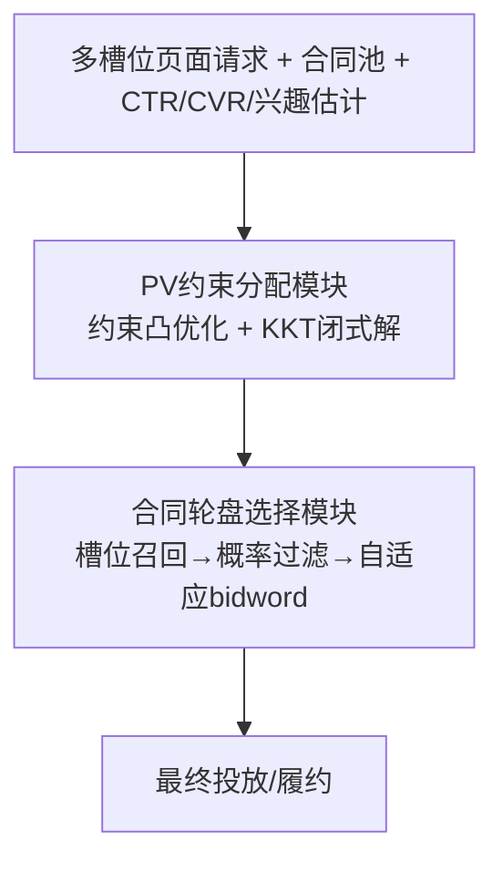
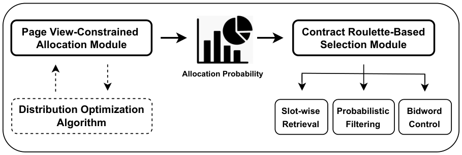

# Beyond Single Slot: Joint Optimization for Multi-Slot Guaranteed Display Advertising (超越单槽位：面向多槽位保量展示广告的联合优化)

- **会议/期刊**: SIGIR 2026 (Industry Track)
- **作者与机构**: Zhaoqi Zhang, Jiaming Deng, Miao Xie, Linyou Cai, Qianlong Xie, Xingxing Wang, Siqiang Luo, Gao Cong（南洋理工大学、美团、中国农业大学）
- **推荐链路定位**: 重排 / 投放分配（页面级多槽位）
- **研究方向**: 去偏公平与工业架构 / 多任务与列表级重排
- **论文原文**: [https://arxiv.org/abs/2605.21556v2](https://arxiv.org/abs/2605.21556v2)
- **开源代码**: 暂未开源
> 注：本文属工业级分配/曝光调控问题，与 `ctr_feature_interaction`（特征交叉网络）关联较弱，故按内容归入工业架构与列表级分配方向。

## TL;DR (1分钟核心速览)

保量展示广告（GD）长期假设单槽位独立优化，多槽位页面下缺乏跨槽协调、无合同曝光上限、且同一合同可在同页多槽重复曝光。本文把“合同—槽位”分配建模为页面浏览粒度的离线约束二分匹配，引入 **PV 上限约束**与**合同轮盘互斥机制**，用 KKT 闭式解 + 分布式对偶更新求解。在美团 70% 灰度线上 A/B 与 DID 评估中，ARPU 相对提升 28.99%（DID +28.17%）、商户 ROI DID +42.17%、履约率 +2.12%。

## Background & Motivation (背景与核心矛盾)

- **主流范式**: 现有 GD 方法延续单槽位建模，逐合同独立优化 CTR/CVR，线上以贪心逐槽位分配（如 AUAF、SHALE、FACC/CONFLUX 等控制框架）。
- **前人局限**: ① 槽位间不协同，热门槽位过载、长尾槽位闲置，整体投放效率低；② 只保底不封顶，高优先级合同可垄断优质曝光，缺乏公平；③ 请求级互斥无法覆盖同页多槽位，同一 POI 合同重复曝光。
- **核心洞察 (Key Insight)**: 多槽位的本质是页面视图上的一次**全局分配**，而非若干独立的槽位决策；在单一约束体系中同时调控供给（PV）、需求（合同）与兴趣，就能一次解决协调、公平与冗余。
- **本文切入点**: 将分配重构为离线二分匹配，用 PV 约束控槽位曝光上限，用轮盘机制保证“每个合同每页最多一槽”。

## Method (核心方法设计)

### 1. 整体框架 (Overall Architecture)

框架分两级：**PV约束分配模块**将广告请求、合同池、CTR/CVR 估计与用户兴趣 $c_{ij}$作为输入，把合同—槽位分配写成带平滑正则、优先级奖励、兴趣匹配三项的约束凸优化，经 KKT 得闭式解并用对偶变量分布式迭代逼近最优$x_{ij}$；**合同轮盘选择模块**接收分配概率后，依次做槽位召回、概率过滤与自适应 bidword 控制，最终回溯至投放引擎完成履约。两级共同把“单槽独立”变为“页面级协同”。

<figure class="paper-figure" markdown="span">
  <figcaption>图1：所提出框架的概览。</figcaption>
</figure>

### 2. 关键设计拆解 (Key Designs)

1. **PV约束的全局分配建模**：单槽优化把约束局限在合同侧，无法抑制“头部槽位过热”。本文在带公平正则的目标上新增逐请求 PV 上限约束 $s_i x_{ij}\le pv_i$：
$$\min_{x_{ij}}\ \frac{1}{2}\sum_{j}\sum_{i\in\Gamma(j)}\frac{s_i}{V_j\theta_j}(x_{ij}-\theta_j)^2-\sum_j w_j\sum_{i\in\Gamma(j)}s_i x_{ij}-\sum_j\lambda_j\sum_{i\in\Gamma(j)}s_i x_{ij}c_{ij}$$
由 KKT 得到可并行计算的闭式分配概率，对偶变量 $\alpha_j,\beta_i,\delta_{ij}$ 分别刻画合同需求、请求容量与槽位 PV 上限：
$$x_{ij}=\max\Big\{0,\ \theta_j\Big(1+\frac{w_j+\lambda_j c_{ij}-\alpha_j-\beta_i-\delta_{ij}}{V_j}\Big)\Big\}$$
其中 $\theta_j=d_j/\sum_{i\in\Gamma(j)}s_i$ 为目标投放比例。**物理直觉**：平滑项把实际分配率拉向目标比例以稳定履行，优先级项与兴趣项分别注入商业价值与用户相关性，PV 项则对每个槽位的曝光总量“封顶”，从而抑制优质槽位被单一合同侵占。

2. **合同轮盘选择机制**：请求级互斥不能保证同页只出一次同一合同。本文做三级筛选：① 槽位召回按交付紧迫度加权采样
$$P(a\mid s_i)=\frac{w(a)}{\sum_{a'\in A_{s_i}}w(a')}$$
既优先欠量合同，又天然保留长尾曝光；② Score 用 $CTR_a\cdot CVR_a$过滤，多槽重复的合同仅保留竞争位次最优的槽位$s^*(a)=\arg\min_{s_i} Rank_{s_i}(a)$；③ 自适应 bidword 保证每槽召回有效且页级语义连贯。这样每 POI 合同每页最多出现一次，冗余曝光显著下降。

3. **求解与推理开销**：无参数训练，warm-start 后对 $\alpha_j$用投影梯度$\alpha_j^{t+1}=\alpha_j^t-V_j(1-d_j(\alpha^t)/d_j)$更新，$\beta_i,\delta_{ij}$按容量/PV 违反量修正，所有$(i,j)$ 对角并行使大规模部署可行；在线仅需一次前向分配 + 轮盘采样，满足广告实时延迟。

## Experimental Setup & Evaluation Protocol (实验设置与评估协议)

- **数据集与场景**: 无公开离线数据集，全部来自美团生产流量。线上 35% 与 70% 按 POI 分桶的两轮灰度，考核商户 ROI、支付 ROI、CTR、支付 CVR、ARPU、履约率六项。

| 灰度 | 基线期 | 实验期 | 评估方式 |
| :--- | :--- | :--- | :--- |
| 35% | 2025-03-29 ~ 04-02 | 2025-04-03 ~ 04-07 | A/A 稳定性 + A/B 单日跨组 + DID |
| 70% | 2025-03-27 ~ 04-01 | 2025-04-09 ~ 04-14 | 同上 |

- **数据划分与防穿越**: 以产线时间窗的 **基线期/实验期** 做前后对照，DID 控制时间趋势；分桶按 POI 比例随机，配合 A/A 检验组间稳定性。
- **排名评测协议**: 不做离线 Full-Ranking，而是 **线上真实流量 A/B + DID** 的因果净效应估计（非同分布离线排序评估）。
- **对比基线**: 美团线上现行单槽位生产基线（类 AUAF 控制框架）；无显著性与 p 值报告，亦无超参 $\lambda_j,V_j$ 网格搜索说明。

## Key Experimental Results (实验关键数据)

### 1. 线上灰度对照 (Main Results)

| 灰度 | 指标 | A/A(实验组) | A/A(对照组) | A/B 效应 | DID 净效应 |
| :--- | :--- | :---: | :---: | :---: | :---: |
| 35% | 商户 ROI | -33.98% | -38.63% | -31.73% | **+4.65%** |
| 35% | 支付 ROI | 79.58% | 38.52% | 54.96% | **+41.06%** |
| 35% | CTR | 17.78% | 0.58% | 26.33% | **+17.20%** |
| 35% | 支付 CVR | 25.62% | -5.85% | 32.23% | **+31.47%** |
| 35% | ARPU | 0.71% | 31.48% | -5.95% | -30.77% |
| 35% | 履约率 | 0.22% | 1.32% | -10.39% | -11.50% |
| 70% | 商户 ROI | 25.06% | -17.11% | -41.82% | **+42.17%** |
| 70% | 支付 ROI | -4.75% | -33.87% | 64.76% | **+29.13%** |
| 70% | CTR | 12.10% | 4.42% | 0.99% | **+7.67%** |
| 70% | 支付 CVR | 13.35% | -10.01% | 4.57% | **+23.35%** |
| 70% | ARPU | 49.87% | 21.70% | **+28.99%** | **+28.17%** |
| 70% | 履约率 | -2.90% | -5.03% | -3.95% | **+2.12%** |

### 2. 消融实验 (Ablation Study)

原文为工业部署短文，未提供离线/组件级消融。仅能通过两档灰度与指标分解间接归因：

| 待验证模块 | 可观测代理证据 | 推断贡献 |
| :--- | :--- | :--- |
| PV 约束 + 页面级匹配 | 70% 下 ARPU A/B +28.99% | 槽位级流量均衡与变现提升 |
| 合同轮盘互斥 | 履约率 DID 由 35% 的 -11.50% 转为 70% 的 +2.12% | 减少重复曝光与过度投放，提升履约 |
| 兴趣/优先级联合项 | 支付 CVR 与支付 ROI 同步上行 | 相关性匹配带来更高转化 |

### 3. 关键实验发现 (Key Findings)

1. **页面级协同是主要收益来源**：70% 灰度下 ARPU A/B 提升 28.99%、DID 净效应仍达 28.17%，说明跨槽位统筹调度能在单位用户上同时提升曝光效率与变现率，而非仅靠流量扩张。
2. **收益沿投放漏斗逐层放大**：70% 下商户 ROI DID +42.17%、支付 ROI +29.13%、CTR +7.67%、CVR +23.35%，从曝光到支付全链路改善，佐证轮盘召回带来的相关性与多样性收益。
3. **履约稳健性依赖灰度规模**：履约率 DID 由 35% 的 -11.50% 逆转为 70% 的 +2.12%，表明小流量下对偶变量收敛尚未稳定，规模扩大后 PV 约束与互斥机制的约束收益才得以释放。

## Highlights & Limitations (亮点、对比与审稿批判)

- **与代表作对比**: AUAF 在最优控制中加入单槽位互斥，但仍按槽独立推进；SHALE 用离线二次规划满足曝光目标却缺乏槽级细粒度控制；CONFLUX/FACC 侧重多目标近线控制。本文的根本差异是把分配整体上移到**页面浏览粒度**，用统一约束 + 闭式 KKT 求解替换逐槽贪心。
- **可迁移亮点**: ① PV 上限约束可迁移到推荐列表/信息流的“单次曝光配额”控制，抑制头部槽位垄断；② 轮盘的加权随机召回 + 位次最优去重，是低成本实现页级互斥与长尾扶持的通用技巧。
- **审稿级局限批判**: ① 仅线上 A/B+DID，缺少离线基准、组件消融与显著性检验（无 p 值/置信区间），难以归因单个模块；② 对偶求解的收敛速度、超参 $\lambda_j,V_j,w_j$ 敏感度与高峰期时延未报告；③ 公平性与用户体验仅为间接指标（CVR/CTR），缺少长期生态与用户侧负反馈评估，且代码未开源、复现门槛高。

## Rating (四维评分)

- **方法创新性 (Novelty)**: ⭐⭐⭐ （PV 约束 + 轮盘互斥为工程层增量创新，约束形式与 KKT 闭式解未见新的理论突破）
- **评估协议与实验扎实度 (Protocol & Experiments)**: ⭐⭐⭐ （两档灰度 A/B+DID 真实流量验证可信，但缺少离线基准、消融与显著性检验）
- **写作与数学规范度 (Clarity & Rigor)**: ⭐⭐⭐ （约束与 KKT 推导完整，但公式排版存在符号丢失、对偶更新细节论述较简）
- **工业落地与复现价值 (Industrial & Practical Value)**: ⭐⭐⭐⭐⭐ （美团全量部署、ARPU+28.99% 的实盘增益，对 GD 多槽分配与列表级互斥极有借鉴价值）

