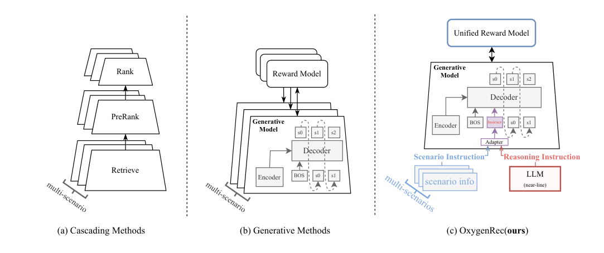
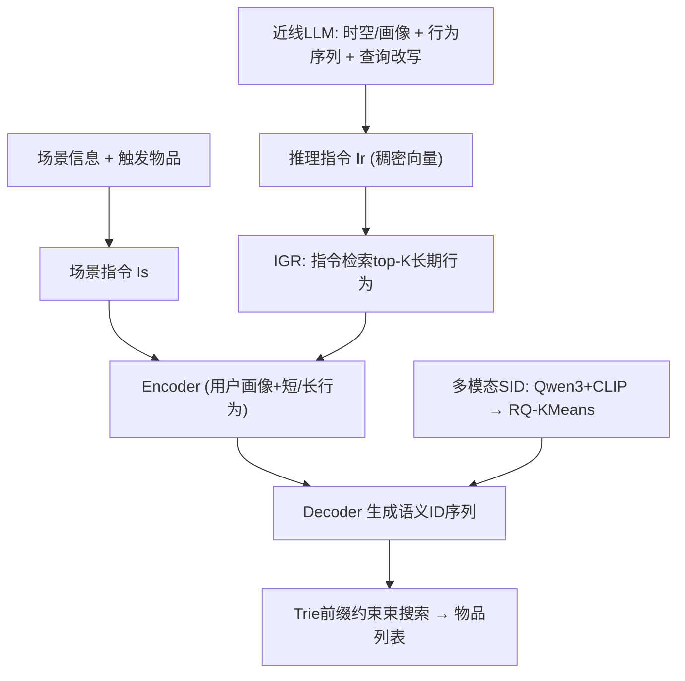
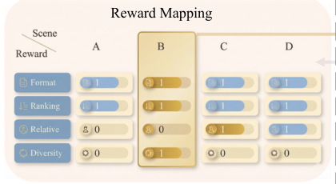

# OxygenREC: An Instruction-Following Generative Framework for E-commerce Recommendation (面向电商推荐的指令遵循生成式框架)

- **会议/期刊**: SIGIR 2026（arXiv 2512.22386v2, Technical Report）
- **作者与机构**: Xuegang Hao, Ming Zhang, Pinghua Gong 等，京东（JD.com）
- **推荐链路定位**: 端到端生成式召回/推荐（生成式列表产出）
- **研究方向**: 生成式推荐与离散语义ID / 大语言模型推荐 (LLM4Rec)
- **论文原文**: [https://arxiv.org/abs/2512.22386v2](https://arxiv.org/abs/2512.22386v2)
- **开源代码**: 暂未开源（仅 xLLM 推理框架已开源，模型与数据未公开）

## TL;DR (1分钟核心速览)

现有生成式推荐（GR）仅靠行为共现做**归纳式匹配**，无法处理需要世界知识演绎的复杂意图；直接上 LLM 又扛不住线上延迟；且每个场景独立训练部署导致成本爆炸。OxygenREC 用"快慢思考"把近线 LLM 推理解析为**上下文推理指令**，由高效 encoder-decoder 实时生成语义 ID；再以 IGR+Q2I、统一奖励映射与 SA-GCPO 实现"一次训练、全场景部署"。京东 6 大场景线上 A/B 中 HR@1 相对独立 SFT 基线最高提升约 15 倍（15.39% vs 6.39%），订单量与 GMV 均显著正向。

## Background & Motivation (背景与核心矛盾)

- **主流范式**: 工业界仍是"召回→粗排→精排"级联多阶段优化；GR（TIGER/OneRec 系）将其改造为端到端 SID 序列生成，缓解了阶段间目标不一致与误差累积。
- **前人局限（归纳瓶颈）**: ① *数据缺口*——(成都, 冬至, 年轻父母) 这类稀疏上下文组合在日志中无样本，模型只能退化为"羽绒服"而非"婴儿睡袋"；② *逻辑缺口*——反复对比 Mate70 与 iPhone16 Pro 被误读为双机强兴趣，实则"都不满意"，需要外部知识演绎才能推出影像旗舰真需求。
- **前人局限（工程瓶颈）**: 直接用 LLM 做推荐，在线延迟不可接受；而多场景上 STAR/PEPNet 类判别式方案依赖场景塔/门控，GR 领域尚无系统的多场景统一方案。
- **核心洞察 (Key Insight)**: 演绎推理只需发生在**请求前的近线阶段**，其产物可被压缩成一条稠密指令向量；在线"快思考"只需做条件生成，不必调用 LLM。
- **本文切入点**: 用"双指令（场景指令 $I_s$+ 推理指令$I_r$）"把世界知识与业务域控解耦，分别注入同一骨干。

<figure class="paper-figure" markdown="span">
  <figcaption>图1：推荐架构：(a) 级联方法：跨多个阶段的分段优化。(b) 生成式方法：统一模型，但受限于基于世界知识的推理能力较差与多场景可扩展性有限。(c) OxygenREC（本文）：通过 Fast-Slow Thinking 实现演绎推理与多场景适配的统一。</figcaption>
</figure>

## Method (核心方法设计)

### 1. 整体框架 (Overall Architecture)

输入层把三路信号映射进统一空间：用户画像/长短行为序列进入 encoder；物品经 Qwen3+CLIP 融合编码后由 RQ-KMeans 量化为 3 层、每层 8192 词表的语义 ID；场景信息与近线 LLM 生成的推理指令拼成复合 prompt 送入 decoder。预训练以加权 NTP + Q2I 对齐联合优化，其中 IGR 用指令在长期行为中检索 top-$K$ 相关项以净化上下文；后训练用统一排序模型作奖励服务，SA-GCPO 跨场景联合对齐。推理时 Trie 前缀约束束搜索（beam 256–512）保证 100% 落在场景候选池内，指令 embedding 由 Redis 直接按 user-id 取出，**零在线 LLM 调用**。

<figure class="paper-figure" markdown="span">
  <figcaption>图2：OxygenREC 的整体架构。(a) 指令遵循框架：一种基于 Transformer 的编码器–解码器主干，依据特定指令生成语义物品序列。(b) 多模态量化表示：通过对经对比学习训练的嵌入进行残差量化，将物品词元化为多模态语义 ID，从而实现紧凑且富有表达力的物品表示。(c) 上下文推理指令：一条近线 LLM 流水线，分析用户行为与上下文以合成此类指令，弥合归纳模式与 d 之间的差距</figcaption>
</figure>

### 2. 关键设计拆解 (Key Designs)

1. **快慢思考与多模态语义 ID**：痛点是 LLM 世界知识贵且慢。慢思考在近线做三路并行推理（时空画像 STP、查询改写 LLMQR、意图+理由生成），产物带"时间–地点–人群"三级索引缓存；快思考骨干只吃指令向量。物品侧放弃重型多模态底座（MiniCPM-V），改为 Qwen3 文本塔 + CLIP 视觉塔 + Q-Former/MLP 融合，再用 RQ-KMeans 残差量化——该"轻底座重融合"设计带来 HitRate@1 相对提升 >30% 与 32× 编码加速。
2. **IGR + Q2I 语义对齐**：指令与历史物品本不在同一空间，无法检索。用 adapter 把场景指令 $\phi_{scn}(I_s)$与指令文本$g(I_r^{text})$拼成 query，物品用同一$\psi_i$投影，训练时以**真实目标物品**$t$ 锚定 query：
$\mathcal{L}_{Q2I}=-\frac{1}{B}\sum_i \mathbf{q}_i^{\top}\mathbf{t}_i+\lambda_r(-\log[\mathrm{Var}(Q)\mathrm{Var}(T)])+\lambda_d\frac{1}{B^2-B}\sum_{i\neq j}(\mathbf{q}_i^{\top}\mathbf{q}_j)^2$方差正则 + 去相关项抑制维度坍缩；因$t$与历史项共享$\psi_i$，推理时无需标签即可用$q$ 检索历史。长历史分支梯度不回传，进一步省算力。
3. **多场景对齐与 SA-GCPO**：把场景转成指令，奖励映射服务（格式/相对/排序/多样性）把异构业务目标归一为统一标量。GRPO 的硬截断在多任务奖励下梯度不连续，SA-GCPO 改用平滑门控并对正负优势样本施加非对称温度：
$f_{i,t}(\rho)=\sigma(\tau_{i,t}(\rho-1))\cdot 4/\tau_{i,t},\quad \tau_{i,t}=\tau_{pos}\ \text{if}\ \Gamma_{adv}>0\ \text{else}\ \tau_{neg}$关键改动是**用真实用户反馈分$R_i<R_g^*$而非常规优势符号**来定义正负样本（$\Gamma_{adv}$ 置零），缓解多任务下的 reward hacking。

**训练目标与推理开销**：$\mathcal{L}=\mathcal{L}_{NTP}+\lambda\mathcal{L}_{Q2I}$，其中 NTP 按行为价值加权（Purchase > Cart > Click）。无负采样（全库 beam 生成）。工程侧 128×H800 达 40% MFU，稀疏算子占比 15%→5%，定制 attention kernel 较 FlexAttention 快 1.7×。

## Experimental Setup & Evaluation Protocol (实验设置与评估协议)

- **数据集与预处理**: 京东 App 全量工业日志（搜索 + 首页 + 频道 + I2I 相关推荐 + 购物车），十亿级 SKU 池；SID 训练用 Swing 算法挖掘的 I2I 共现对与 Q2I 关联。论文未公开统计量，下表为场景/信号概览：

| 场景 | 场景信息 | 触发物品 | 推理指令来源 |
| :--- | :---: | :---: | :--- |
| Search | ✓ | $z_{def}$ | 改写后的 query |
| Homepage | ✓ | $z_{def}$ | 默认可学习 emb. |
| Channel Feeds | ✓ | $z_{entry}$ | 默认可学习 emb. |
| Item-to-Item | ✓ | $z_{main}$ | 默认可学习 emb. |

- **数据划分与防穿越**: 按用户请求时序做**时间切分**（离线训练/在线评测自然隔离），指令均在请求前近线生成，无标签泄漏。
- **排名评测协议**: **Full-Ranking / 束搜索全库生成**——HR@K 要求生成的 SID 序列在 3 层码本上逐位严格匹配 ground-truth；Recall@K 按用户当日全部正反馈计算覆盖率。无负采样。辅以 SID 质量指标（码本覆盖率、簇纯度、P99/P999 碰撞、负载均衡）。
- **对比基线与超参**: 基线包括 OneRec-style 多模态底座、纯文本/纯视觉编码器、GRPO、GSPO 及场景独立 SFT；骨干从 0.1B 扫到 3.0B（MoE），消融在采样子集上进行。

## Key Experimental Results (实验关键数据)

### 1. 主实验对比 (Main Results)

统一指令遵循模型 vs. 场景独立 SFT（京东 6 大核心场景，Full-Ranking）：

| 指标 | 模型 | S1 | S2 | S3 | S4 | S5 | S6 |
| :--- | :--- | :---: | :---: | :---: | :---: | :---: | :---: |
| HR@1 | Independent SFT | 6.39 | 8.17 | 1.12 | 1.83 | 7.22 | 5.29 |
| HR@1 | **Unified (Ours)** | **15.39** | **20.75** | **17.24** | **6.34** | **10.54** | **25.75** |
| HR@10 | Independent SFT | 23.29 | 29.05 | 5.22 | 8.44 | 29.84 | 19.38 |
| HR@10 | **Unified (Ours)** | **46.73** | **55.02** | **53.57** | **29.89** | **37.90** | **62.62** |

骨干规模与 RL 方法对比（0.7B MoE 起，合成数据占比 33%）：

| 配置 | HR@1 | HR@10 | Recall@30 |
| :--- | :---: | :---: | :---: |
| 0.1B 骨干 | 3.99 | 13.17 | 15.11 |
| 1.5B 骨干 | 4.92 | 16.61 | 19.01 |
| **3.0B 骨干** | **5.02** | **16.99** | **19.53** |
| + GRPO | 23.85 | 62.15 | – |
| + GSPO | 24.13 | 62.88 | – |
| **+ SA-GCPO** | **25.58** | **65.95** | – |

### 2. 消融实验 (Ablation Study)

| 消融配置 | HR@1 | HR@10 | Recall@10 | Recall@30 |
| :--- | :---: | :---: | :---: | :---: |
| 无指令 (Baseline) | 2.78 | 10.38 | 8.18 | 13.01 |
| 替换 BOS | 3.30 | 12.08 | 9.12 | 14.38 |
| 指令插于 BOS 右 | 3.53 | 12.68 | 9.58 | 14.91 |
| 仅 Scenario ID | 3.30 | 12.17 | 9.22 | 14.50 |
| 仅 Trigger Item ID | 3.22 | 11.60 | 9.13 | 13.98 |
| **融合 (Scenario+Trigger)** | **3.60** | **12.82** | **9.68** | **15.08** |
| w/o IGR & Q2I | 3.76 | 12.20 | 9.87 | 15.53 |
| + IGR only | 4.02 | 12.91 | 10.25 | 15.95 |
| **+ IGR + Q2I** | **4.19** | **13.38** | **10.52** | **16.23** |

SID 版本演进（V1 文本 2048 码本 → V4 多源对齐 8192×3）：簇纯度 Cate-L1 86.30%→**92.80%**，P999 碰撞 419→**35**，负载均衡 P90 212.84%→**118.09%**。

### 3. 关键实验发现 (Key Findings)

1. **统一训练远胜"一场景一模型"**：S3 场景 HR@1 从 1.12% 飙到 17.24%（15 倍），说明低资源场景能从首页等大场景借力，负迁移在本指令框架下被显著抑制；这与判别式多场景模型必须靠专门塔结构防负迁移形成鲜明反差。
2. **指令位置与融合方式不可随意**：插在 BOS 右侧比替换 BOS 高 0.23pp HR@1，说明需先初始化状态再条件化；Scenario 与 Trigger 融合为 1 个 token 比拼接 2 个 token 更高（3.60 vs 3.53），且推理时用默认值遮蔽 Trigger 会让 S3/S4 的 HR@1 腰斩（20.75%→10.71%），证实 decoder 真在用指令而非忽略。
3. **RL 稳定性来自软门控而非更大模型**：0.7B 骨干经 SA-GCPO 后 HR@10 达 65.95%，比 GSPO/GRPO 高 3pp 以上；且 $\tau_{pos}>\tau_{neg}$（1.0 vs 0.95）时最优，验证"加速负样本梯度衰减"的设计直觉。

## Highlights & Limitations (亮点、对比与审稿批判)

- **与代表作对比**: 相较 OneRec 系（仅归纳式 SID 生成、单场景 SFT+RL），本文引入近线演绎推理指令与统一奖励映射；相较 STAR/PEPNet 等判别式多场景模型，本文不靠场景塔/门控，而靠**指令 token 控场景**，天然适配生成式范式；相较直接用 LLM 推荐，本文把 LLM 完全推到近线，彻底规避在线延迟。
- **可迁移亮点**: ① "近线 LLM 生成意图向量 + 在线检索该向量" 的模式可复用到任何低延迟场景（如短视频、广告）；② Q2I 用 ground-truth 目标锚定 query 空间、再借共享投影器检索历史，是无需标注的通用对齐技巧。
- **审稿级局限批判**: ① 全部结论基于京东内部数据与自建指标，**无公开数据集、无开源代码**，SID 质量指标与 HR 提升的可复现性存疑；② 系统链路极重（近线 LLM 集群 + Redis + 定制 kernel + 128 卡训练），中小团队难以复制；③ 指令生成依赖 Qwen3-0.6B/32B、DeepSeek-R1 等多模型流水线，其 95.33%/72% 的人工可用率意味着仍有约 1/4 意图指令不可靠，论文未量化该噪声对线上指标的敏感度。

## Rating (四维评分)

- **方法创新性 (Novelty)**: ⭐⭐⭐⭐ （快慢思考解耦演绎/实时、双指令控场景的思路清晰且工业味足，但各组件单看均为已知技术的组合）
- **评估协议与实验扎实度 (Protocol & Experiments)**: ⭐⭐⭐ （消融层次完整、线上 A/B 有说服力，但缺公开基准与显著性检验，数据集统计缺失）
- **写作与数学规范度 (Clarity & Rigor)**: ⭐⭐⭐ （公式表述完整，但 37 页报告结构松散、表格排版错乱、Table 8 数字需读者自行重排）
- **工业落地与复现价值 (Industrial & Practical Value)**: ⭐⭐⭐⭐ （真实亿级流量落地、40% MFU 与 xGR 推理优化经验极具参考价值，可惜模型与代码未开源）

