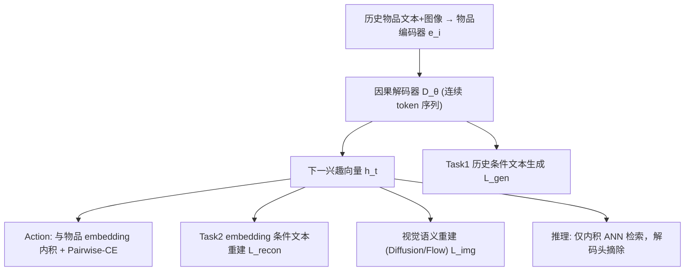
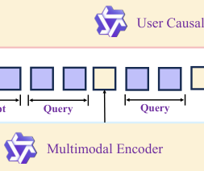

# KARMA: Knowledge-Action Regularized Multimodal Alignment for Personalized Search at Taobao（面向淘宝个性化搜索的知识–行动正则化多模态对齐）

- **会议/期刊**: SIGIR 2026（Melbourne）
- **作者与机构**: Zhi Sun, Wenming Zhang, Yi Wei, Liren Yu, Zhixuan Zhang, Dan Ou, Haihong Tang（阿里巴巴 淘宝&天猫集团）
- **推荐链路定位**: 召回 / 粗排 / 精排 三阶段共用同一兴趣表征（端到端训练、单塔推理）
- **研究方向**: 大语言模型推荐 (LLM4Rec) / 多模态推荐
- **论文原文**: [arXiv:2603.22779v2](https://arxiv.org/abs/2603.22779v2)
- **开源代码**: 暂未开源

## TL;DR (1分钟核心速览)

工业个性化搜索若把 LLM 直接微调做 next-item 判别式任务，历史物品被压缩成连续 embedding token 后，模型会走 ID 捷径并诱发**语义坍缩**（注意力退化成"条形码"式 attention sink）。KARMA 提出把"语义可解码性"当作**只在训练期存在**的正则项：一边用 pairwise 排序对齐行为（Action），一边用历史条件生成与 embedding 条件重建两条解码路径（Knowledge）约束表征空间；推理时解码头全部摘除，零额外延迟。淘宝日志上相对 action-only 基线 HR@200 +22.57、HR@1000 +21.19，线上 14 天 A/B 带来 GMV +0.9%。

## Background & Motivation (背景与核心矛盾)

- **主流范式**: 个性化搜索排序主要靠后验行为反馈（CTR）优化，模型天然偏爱 item ID、共现统计等**记忆型特征**，语义泛化能力被压制。
- **前人局限**: ① 头部流量表现好，长尾 query 与冷启动物品上排序质量骤降；② 引入 LLM 语义知识时，若冻结 LLM 表征过于粗糙，若放开微调又会摧毁预训练语义空间——即 **Knowledge–Action Gap**。
- **核心洞察 (Key Insight)**: 工业延迟约束下必须把历史物品（文本+图像）压成单个 embedding，这一"连续 token 接口"是坍缩的根源：纯判别目标下模型把 $e_i$ 当作不透明标识符，用少量高危特征区分正负样本即可，注意力图因此出现**条形码式 attention sink**，语义保真度（JS@50）甚至低于未训练的冻结编码器。
- **本文切入点**: 不把"生成/重建"当作辅助能力或推理路径，而是当作**约束解空间的 train-only 正则项**，强制兴趣向量 $h_t$ 反向可解码出目标物品语义。

## Method (核心方法设计)

### 1. 整体框架 (Overall Architecture)

输入为用户历史正反馈序列 $H_t=\{(q_1,i_1),\dots,(q_{t-1},i_{t-1})\}$，物品编码器$E_\phi$（Qwen3-1.7B 文本 / Qwen3-VL-2B 多模态）将每个物品压成单 token$e_i\in\mathbb{R}^d$，经轻量 query embedding 注入当前查询后送入 decoder-only 用户解码器$D_\theta$（Qwen3-0.6B），取最后隐状态作为下一兴趣向量$h_t=S_{t-1}[-1]$，与候选物品 embedding 做内积打分。训练采用两阶段：先语义预热（从孤立$e_i$解码物品语义，把连续 token 拉回 LLM 词表分布），再联合优化$\mathcal{L}_{\text{KARMA}}$；重建/生成头仅在训练期挂载，推理只走 embedding 路径。

<figure class="paper-figure" markdown="span">
  <figcaption>图1：KARMA 架构：一种仅训练时使用、弥合知识–行动差距的正则化器。</figcaption>
</figure>

### 2. 关键设计拆解 (Key Designs)

1. **Task 2：embedding 条件语义重建（主抗坍缩约束）**：痛点在于 History 条件的生成只约束了解码器，$h_t$这个真正的检索瓶颈仍可自由退化为 ID 通道。故直接以$h_t$ 为唯一条件解码目标物品文本：
$\mathcal{L}_{\text{recon}}=-\sum_{l=1}^{L}\log p_\theta(w_l\mid w_{<l},h_t)$这条显式信息瓶颈使"把$e_i$当标识符"的捷径解变得次优——想解码出词，$h_t$ 必须保留可恢复的语义。实验上它是增益主力（HR@200 +19.19）。

2. **Task 1：历史条件语义生成（锚定原生分布）**：连续 token 相对离散词表是分布外输入，易引发灾难性遗忘。以 $\mathcal{L}_{\text{gen}}=-\sum_l \log p_\theta(w_l\mid w_{<l},H_t)$ 把优化锚回 LLM 原生的 next-token 目标，稳定训练并抑制接口丢弃语义。单独使用时增益有限（+4.81 HR@200）且 JS@50 反降 -0.87，说明它只"稳住"而非"约束瓶颈"，与 Task 2 互补。

3. **视觉可解码性与"模态–均值"边界**：对目标物品的冻结视觉特征 $v_{i_t}$，用条件扩散/流匹配头$g_\psi$做重建$\mathcal{L}_{\text{img}}=\mathbb{E}_\tau[\ell_{\text{diff}}(g_\psi;v_{i_t},c_t,\tau)]$，$c_t$可为历史状态或$h_t$。值得注意的是作者明确否定了"用扩散生成检索向量"：扩散是 mode-seeking（采样高保真样本），而检索 embedding 需要 mean-seeking（聚合多个可能意图的稳定质心），实测 AR+MSE（+4.21 HR@200）远优于 DDPM（+0.80）与 EDM（-2.95）。

4. **训练目标、负采样与推理开销**：$\mathcal{L}_{\text{KARMA}}=\mathcal{L}_{\text{act}}+\lambda_{\text{dec}}\mathcal{L}_{\text{dec}}$，其中$\mathcal{L}_{\text{act}}=\sum_t\sum_{j\in\mathcal{N}_t}-\log\sigma(\mathbf{h}_t^{\top}\mathbf{e}_{i_t}-\mathbf{h}_t^{\top}\mathbf{e}_j)$，负样本$\mathcal{N}_t$ 由**曝光未点击硬负样本 + in-batch 负样本**构成；作者指出该 pairwise 形式比温度化 InfoNCE 在异构负样本难度下更稳定。推理阶段解码头全部关闭，serving 路径与 action-only 基线**完全一致**。

## Experimental Setup & Evaluation Protocol (实验设置与评估协议)

- **数据集与预处理**: 淘宝搜索匿名化日志，按时间顺序构造样本，每条含正反馈历史、下一点击物品、以及曝光未点击的硬负样本。原文**未披露**用户/物品/交互量级与稀疏度统计（下表如实标注）：

| 数据集 | #Users | #Items | #Interactions | 稀疏度/密度 | 特征/场景说明 |
| :--- | :---: | :---: | :---: | :---: | :--- |
| Taobao Search Logs | 未披露 | 未披露 | 未披露 | 未披露 | 电商搜索；query + 物品文本 + 物品图像；工业全量流量采样 |

- **数据划分与防穿越 (Splitting Strategy)**: **全局时间戳切分**（chronological split），历史严格早于标签时刻 $t$，无未来交互泄漏。
- **排名评测协议 (Ranking Protocol)**: **非严格 Full-Ranking**。召回/粗排指标 HR@K（K=200/500/1000/5000）基于 ANN 检索候选 + 曝光未点击硬负样本的打分排序；精排用 gAUC。另设轻量语义探针 **JS@50**（top-50 检索结果与真实物品的 term 级 Jaccard 重叠），专门用于在 action 指标"看起来正常"时检测捷径学习。
- **对比基线与超参设置**: 主对比对象为 **action-only Pairwise-CE** 基线（同结构、同数据、去掉全部解码正则），并做 Task 1 / Task 2 / 多模态 / 不同生成器的逐项消融；用户解码器 Qwen3-0.6B、物品编码器 Qwen3-1.7B 或 Qwen3-VL-2B。原文未报告外部 SOTA 基线与显著性检验（$p$ 值）。

## Key Experimental Results (实验关键数据)

### 1. 主实验对比 (Main Results)

原文主表以 action-only 为唯一基线，报告**相对增益**（Δ）；下表同时给出多模态生成器对比（相对最强 text-only KARMA）：

| 方法 / 变体 | ΔgAUC | ΔHR@200 | ΔHR@1000 | ΔJS@50 |
| :--- | :---: | :---: | :---: | :---: |
| Action-only (Pairwise-CE) | 0 | 0 | 0 | 0 |
| + Task 1: History→Text ($\mathcal{L}_{\text{gen}}$) | +0.43 | +4.81 | +3.46 | -0.87 |
| + Task 2: $h_t$→Text ($\mathcal{L}_{\text{recon}}$) | +0.43 | +19.19 | +19.31 | +2.65 |
| **KARMA (Task1 + Task2)** | **+0.97** | **+22.57** | **+21.19** | +2.26 |
| + 视觉语义重建 (增量) | **+1.38** | **+10.83** | **+8.41** | +0.40 |
| AR + MSE（生成器对照） | +0.63 | +4.21 | +1.70 | +0.85 |
| AR + DDPM | +0.17 | +0.80 | -1.01 | +0.37 |
| AR + EDM | -0.12 | -2.95 | -3.30 | -0.33 |
| AR + Flow-Matching | +0.02 | -0.83 | -2.68 | +0.26 |

线上 A/B（14 天，精排+粗排）: 精排 **CTR AUC +0.25**、粗排 **HR@500 +1.86**、召回 **HR@5000 +2.51**、**GMV +0.9%**。

### 2. 消融实验 (Ablation Study)

| 消融配置 | 结果（相对 action-only） | 结论 |
| :--- | :--- | :--- |
| w/o Task 1 | HR@200 仅 +19.19，JS@50 +2.65 | 抗坍缩主力仍是 Task 2 |
| w/o Task 2 | HR@200 仅 +4.81，JS@50 **-0.87** | 缺瓶颈约束时语义反而退化 |
| w/o 多模态重建 | gAUC +0.97 vs 全量 +2.35 | 视觉重建提供互补 grounding |
| w/o 语义预热（staged） | 连续 token 分布外，训练不稳 | 两阶段调度是收敛前提 |
| 扩散替代判别目标 | HR@200 -2.95 ~ +0.80 | mode-seeking ≠ mean-seeking |

### 3. 关键实验发现 (Key Findings)

1. **增益几乎全部来自"瓶颈正则"而非"再多一个生成任务"**：Task 2 单独带来 HR@200 +19.19，Task 1 单独仅 +4.81；两者之和 +22.57 已接近饱和（1.19 < 1+1），说明它们约束的是解码器与 $h_t$ 两个不同失效面而非同一通道。
2. **action 指标会掩盖坍缩，JS@50 是必要的第二把尺**：Task 1 使 gAUC/HR 全线上涨，JS@50 却下降 0.87——若只看排序指标会误判模型"学到了语义"，实际上它仍在用 ID 捷径。多模态重建则同时拉高 action 与语义（+2.35 gAUC、JS@50 +0.40）。
3. **检索表征的本质是均值而非众数**：扩散/流匹配作为正则项有效、作为 $h_t$ 生成器全线失败（EDM 甚至 -2.95 HR@200），而最朴素的 AR+MSE 反而最优，为"生成式检索"热潮提供了一个明确的适用边界。

## Highlights & Limitations (亮点、对比与审稿批判)

- **与代表作对比 (vs. Prior Work)**: 相对 TIGER 类**生成式检索**（用语义 ID 自回归生成候选），KARMA 反其道而行——生成能力只在训练期做正则，服务路径仍是双塔内积召回，因此延迟不变；相对 SGL/SimGCL 类**对比式去噪**，它不构造视图增广，而是用"可解码性"这一信息瓶颈约束替代对比损失；相对常规 **LLM4Rec 微调**（如放开全参做 next-item 判别），它明确诊断并修复了连续 token 接口下的 attention sink。
- **可迁移亮点**: ① "train-only 解码头 + 推理摘除"这一范式可零成本套用到任何双塔召回/粗排的表征学习；② JS@50 这类**语义探针指标**值得作为排序指标的固定伴随项，专门捕获"指标好看但学了捷径"。
- **审稿级局限批判**: ① **评估单薄**——仅一个工业私有数据集，无公开 benchmark、无外部 SOTA 基线、无显著性检验，且 HR@K 依赖"曝光未点击硬负样本 + ANN 候选"的采样排序而非全库 Full-Ranking，结论外部效度有限；② **关键超参与统计缺失**——$\lambda_{\text{dec}}$、$\lambda_{\text{img}}$、预热步数均未做敏感性分析，数据集规模与稀疏度也未披露；③ **因果论证偏弱**——attention sink 的可视化被作者自己定位为"诊断信号而非因果证明"，且未给出语义坍缩的定量定义；④ 视觉重建依赖扩散头的训练开销，工业侧"零推理延迟"成立但"零训练成本"不成立。

## Rating (四维评分)

- **方法创新性 (Novelty)**: ⭐⭐⭐⭐ （把"语义可解码性"重新定义为 train-only 正则而非生成能力，并用 mode-seeking/mean-seeking 给出扩散不适用于检索向量的清晰边界，观点锐利）
- **评估协议与实验扎实度 (Protocol & Experiments)**: ⭐⭐⭐ （消融链条完整且线上 A/B 有 GMV 佐证，但仅单一工业数据集、无外部基线、无显著性检验、数据统计缺失）
- **写作与数学规范度 (Clarity & Rigor)**: ⭐⭐⭐⭐ （公式极简且每条目标都对应一个明确失效模式，负采样与两阶段调度交代清楚；不足是缺少复杂度与超参敏感性分析）
- **工业落地与复现价值 (Industrial & Practical Value)**: ⭐⭐⭐⭐⭐ （推理路径与基线完全一致、零额外延迟，召回/粗排/精排三阶段通吃并已上线 14 天 A/B +0.9% GMV，工程可复制性极高）

