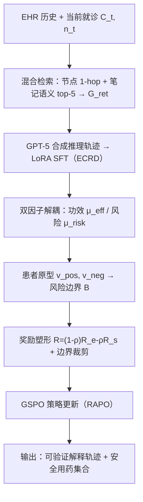

# RES-MR: Risk-Aware Reasoning for Explainable and Safe Medication Recommendation（风险感知推理：可解释且安全的用药推荐）

- **会议/期刊**: SIGIR 2026（49th ACM SIGIR）
- **作者与机构**: Cong Wang, Jin Li, Shoujin Wang, Yishuo Li, Huilin Gu, Wenpeng Lu（齐鲁工业大学（山东省科学院）算力互联网与信息安全教育部重点实验室；悉尼科技大学）
- **推荐链路定位**: 端到端生成式（先显式生成推理轨迹，再生成用药集合）
- **研究方向**: 大语言模型推荐 (LLM4Rec) / 去偏公平与可信推荐
- **论文原文**: [https://arxiv.org/abs/2610.14474v1](https://arxiv.org/abs/2610.14474v1)
- **开源代码**: [https://github.com/wangcong2001/RES-MR](https://github.com/wangcong2001/RES-MR)

## TL;DR (1分钟核心速览)

现有用药推荐模型是“直映射黑箱”，且用**全局静态 DDI 惩罚**一刀切约束安全性，无法匹配患者的个体化风险耐受度；RES-MR 用“知识图谱混合检索 + 教师 LLM 推理轨迹 SFT 蒸馏”换取可验证的解释链，再用“双因子解耦 + 患者原型校准的个体化风险边界 + 自适应奖励裁剪”做 RL 安全对齐。在 MIMIC-III/IV、eICU 三个全标签空间数据集上，MIMIC-III 的 Jaccard 达 **28.03%**（相对 SOTA FLAME **+7.8%**），DDI 压至 **10.31%**，RIS 降至 **12.67%**，同时 BLEURT 解释质量从 0.4052 升至 0.4538。

## Background & Motivation (背景与核心矛盾)

- **主流范式**: 纵向建模路线用 RNN/Transformer 聚合历史就诊，图路线（SafeDrug/MoleRec）引入 DDI 图或分子子结构显式约束安全，近期 LLM 路线（LAMO/KELLM/FLAME）把用药推荐改写为生成任务。
- **前人局限 ①（不可验证）**: 判别式 GNN 与生成式 LLM 都走“直接映射”，注意力/方面特征只给出**事后归因**（哪些特征起了作用），却不给出**诊断逻辑链**（如何从症状推到药物）；一旦出现“哮喘患者开 β 受体阻滞剂”这类错误，医生无法定位是疾病理解错还是禁忌症被忽略。
- **前人局限 ②（患者无关的安全）**: SafeDrug/MoleRec 在损失里加统一 DDI 惩罚，等价于假设所有患者共享同一风险容忍度；实际上年轻体健的高血压患者可耐受激进方案，而多合并症虚弱老人必须保守。结果是“对健壮者过度保守、对脆弱者过度冒险”。
- **核心洞察 (Key Insight)**: 个体化风险不应由**固定超参**定义，而应由患者**自身历史被监督用药**在风险因子空间中的经验分布反推——历史处方本身就是临床医生对“该患者可接受风险水平”的隐式标注。
- **本文切入点**: 用两阶段（SFT 蒸馏推理 → RL 对齐安全）把“解释”与“风险”分别参数化，用患者级风险边界 $B$ 将安全约束从全局常量变成样本相关量。

<figure class="paper-figure" markdown="span">
  <figcaption>图 1：说明现有方法两个局限性的示例。(a) 大多数 RNN/GNN/LLM 方法遵循“直接映射”范式，通常输出药物（例如用于哮喘的 β 受体阻滞剂）而不提供明确依据，导致信任问题。(b) 面向安全的方法使用静态全局约束，施加一刀切的风险容忍度，因而可能危及脆弱患者或过度限制稳健患者。(c) RES-MR 利用检索增强推理和个性化边界生成可验证解释和安全用药推荐。</figcaption>
</figure>

## Method (核心方法设计)

### 1. 整体框架 (Overall Architecture)

输入为患者历史就诊 $v_{1:t-1}$、当前就诊结构化上下文$C_t=(\mathbf{d}_t,\mathbf{p}_t,\mathbf{a}_t)$与临床笔记$n_t$。**Stage 1（ECRD）**：以诊断/手术实体在 PrimeKG 上做 1-hop 节点检索、以笔记向量做 top-5 语义检索，合并为证据$\mathcal{G}_{\text{ret}}$；再用 GPT-5 以$(C_t,n_t,\mathcal{G}_{\text{ret}},m_t)$为提示合成“逐步诊断推理 + 用药”轨迹，LoRA 微调学生 LLM。**Stage 2（RAPO）**：预训练双因子解耦模块把药物嵌入拆成功效/风险两支，冻结后聚合出正/负原型$\mathbf{v}_{\text{pos}},\mathbf{v}_{\text{neg}}$，进而从患者历史处方分位数校准个体风险边界$B$，用边界违反量做奖励塑形与按组统计量裁剪，最后用 GSPO（序列级重要性比、长度归一化）更新策略。推理时仅做一次检索 + 一次自回归生成，输出$\hat{\mathcal{T}}^{\text{reason}}_t$与$\hat{m}_t$。

<figure class="paper-figure" markdown="span">
  <figcaption>图 2：RES-MR 的整体框架及训练/推理流程。阶段 1：给定患者 EHR，混合检索从知识图谱中检索患者特定证据；教师 LLM 合成推理轨迹，以对 LLM 进行监督微调（SFT），赋予其强推理能力以提供显式解释。阶段 2：我们进一步用强化学习（RL）优化 LLM。预训练的双因素解耦提取药物疗效和风险因素，以构建患者特定原型，这些原型在 RL 训练期间指导策略更新。</figcaption>
</figure>

### 2. 关键设计拆解 (Key Designs)

1. **可解释临床推理蒸馏 (ECRD)**：痛点是直映射模型无法提供可核对逻辑。做法是把“检索证据 → 逐步推理 → 药物集合”整体序列化为 $y$，最小化
$\mathcal{L}_{\text{SFT}}=-\mathbb{E}_{(x,y)\sim\mathcal{D}}\big[\sum_{j=1}^{|y|}\log\pi_\theta(y_j\,|\,x,y_{<j})\big]$，其中$x=(v_{1:t-1},C_t,n_t,\mathcal{G}_{\text{ret}})$。
直觉：把药物名锚定在“检索到的适应症/禁忌症三元组”之后生成，等于强制模型先复述临床事实再决策，从而把幻觉空间压缩到证据子图上；同时蒸馏出的轨迹比 CoT 多轮采样短，推理开销不增。

2. **双因子解耦与个体化风险边界 (Dual-Factor Disentanglement + Risk Boundary)**：痛点是“风险”在原始嵌入里与疗效纠缠，无法量化。先经共享编码器 + 两支适配器得到 $\mathbf{h}_{\text{eff}},\mathbf{h}_{\text{risk}}$，再用互斥块压制共享信息：
$\mathbf{h}'_{\text{eff}}=\mathbf{h}_{\text{eff}}-\alpha\,\sigma(W_g[\mathbf{h}_{\text{eff}};\mathbf{h}_{\text{risk}}])\odot\mathrm{MLP}(\mathbf{h}_{\text{risk}})$（风险支对称处理），随后变分投影$\mathbf{z}_k=\boldsymbol{\mu}_k+\boldsymbol{\epsilon}\odot\boldsymbol{\sigma}_k$，并用 KG 关系对齐（功效支拉近 `Indication` 概念、风险支拉近 `Contraindication` 概念），辅以正交约束$\|\mathrm{Cov}(\boldsymbol{\mu}_{\text{eff}},\boldsymbol{\mu}_{\text{risk}})\|_F^2$ 与 KL 正则。原型与边界为
$\mathbf{v}_{\text{pos}}=\frac{1}{|\mathcal{M}_{\text{pos}}|}\sum_{m\in\mathcal{M}_{\text{pos}}}\boldsymbol{\mu}_{\text{eff}}(m)$，$\quad B=\inf\{b:\frac{1}{|\mathcal{M}_{\text{hist}}|}\sum_{m\in\mathcal{M}_{\text{hist}}}\mathbb{I}[s(\boldsymbol{\mu}_{\text{risk}}(m),\mathbf{v}_{\text{neg}})\le b]\ge\delta\}$。
直觉：$\delta$分位数把“医生过去给这位患者开过的药有多接近禁忌原型”当作耐受度经验估计，$\delta$ 越大边界越宽松，天然实现“一人一阈值”。

3. **自适应奖励塑形、裁剪与 GSPO 训练**：痛点是纯 Jaccard 奖励会诱发 reward hacking（为准确率牺牲安全）。奖励设计为 $R=(1-\rho_t)R_e-\rho_tR_s$，其中$R_e=\lambda_j\frac{|\hat{m}\cap m^*|}{|\hat{m}\cup m^*|}+\lambda_e\frac{1}{|\hat{m}|}\sum_{d\in\hat{m}}\max(0,s(\boldsymbol{\mu}_{\text{eff}}(d),\mathbf{v}_{\text{pos}}))$，$R_s=\lambda_d\mathrm{DDI}(\hat{m})+\lambda_r\frac{1}{|\hat{m}|}\sum_{d\in\hat{m}}\max(0,s(\boldsymbol{\mu}_{\text{risk}}(d),\mathbf{v}_{\text{neg}})-B)$。门控$\rho_t=\sigma(\bar{J}_t-\tau_t)$随滑动 Jaccard 提升而收紧，保证“先学会治病、再学会避险”。裁剪依据$\Delta_t=B-\max_{d}s(\boldsymbol{\mu}_{\text{risk}}(d),\mathbf{v}_{\text{neg}})$：$\Delta_t>0$时$R_{\text{total}}=\mathrm{clip}(R,\mu_R-\sigma_R,\mu_R+2\sigma_R)$，$\Delta_t\le0$时$\mathrm{clip}(R,\mu_R-2\sigma_R,\mu_R+\sigma_R)$。负采样不需要——RL 用组内$G=4$条采样轨迹的相对优势$\hat{A}_i$ 替代，训练端无额外负采样开销，但推理需一次完整生成（约 13.3 s/例）。

## Experimental Setup & Evaluation Protocol (实验设置与评估协议)

- **数据集与预处理**: 保留**全量**诊断/手术/用药标签空间（不做截断），并只保留有临床笔记的住院记录；诊断与手术统一映射到 ICD-9 描述、药物统一到 DrugBank ID，DDI 矩阵由 DrugBank 抽取。

| 数据集 | #Visits / #Patients | Dis./Proc./Med. 空间 | 平均就诊数 | 平均每诊药物数 |
| :--- | :---: | :---: | :---: | :---: |
| MIMIC-III | 12,433 / 4,785 | 4,316 / 1,330 / 593 | 5.68 | 14.78 |
| MIMIC-IV | 156,315 / 46,811 | 19,812 / 10,859 / 743 | 11.07 | 14.24 |
| eICU | 18,636 / 8,544 | 1,562 / 937 / 152 | 2.18 | 10.35 |

- **数据划分与防穿越 (Splitting Strategy)**: **患者级比例划分 4:1:1**（train/val/test），同一患者的所有就诊不会跨集合，避免同患者信息泄漏；测试只评估每位患者**最后一次就诊**的用药集合。
- **排名评测协议 (Ranking Protocol)**: 非 top-k 截断排序，而是**全标签空间集合生成**——模型在 593（MIMIC-III）/743（MIMIC-IV）/152（eICU）个药物上直接输出集合，与真实集合做 Jaccard/F1，因此实质上等价于 `Full-Ranking (全库)` 评估，不存在采样负例导致的乐观偏差；同时报告 DDI rate、作者提出的 RIS（个体化边界违反度）、BLEURT（与参考解释的语义对齐）及调和均值 $F_{AS}$、$F_{AE}$。
- **对比基线与超参设置**: 三类基线——通用纵向模型（LEAP/COGNet/RAREMed/ARMR/LAMO）、安全模型（SafeDrug/MoleRec/ARC/KELLM/FLAME）、可解释模型（ExpDrug/Reason4Rec/EXP3RT）；所有 LLM 方法统一用 **Llama-3.1-Aloe-Beta-8B** 作骨干以控制容量差异，另给出 Llama-3.2-3B 版本。LoRA $r=8,\alpha=16$，解耦模块隐维 128/共享维 512，$\delta=0.9$，$\lambda_{\{j,e,d,r\}}\in\{1,3,5,7,10\}$，GSPO$G=4,\epsilon=0.2$；5 次随机种子重复，成对$t$检验$p<0.05$。

## Key Experimental Results (实验关键数据)

### 1. 主实验对比 (Main Results)

MIMIC-III（主战场，完整训练）：

| 方法 | Jaccard↑ | F1↑ | DDI↓ | RIS↓ | BLEURT↑ | $F_{AS}$↑ |$F_{AE}$↑ |
| :--- | :---: | :---: | :---: | :---: | :---: | :---: | :---: |
| LEAP | 0.1934 | 0.3285 | 0.1341 | 0.1433 | – | 0.4005 | – |
| COGNet | 0.2381 | 0.3628 | 0.1466 | 0.1473 | – | 0.4444 | – |
| LAMO | 0.2512 | 0.3707 | 0.1124 | 0.1427 | – | 0.4585 | – |
| SafeDrug | 0.2210 | 0.3469 | 0.1054 | 0.1484 | – | 0.4285 | – |
| MoleRec | 0.2454 | 0.3770 | 0.1044 | 0.1401 | – | 0.4595 | – |
| ARC | 0.2377 | 0.3610 | 0.1167 | 0.1454 | – | 0.4453 | – |
| FLAME (SOTA) | 0.2601 | 0.3880 | 0.1291 | 0.1374 | – | 0.4717 | – |
| ExpDrug | 0.2326 | 0.3610 | 0.1047 | 0.1397 | – | 0.4436 | – |
| Reason4Rec | 0.1529 | 0.2519 | 0.1512 | 0.1311 | 0.4052 | 0.3276 | 0.2700 |
| EXP3RT | 0.2150 | 0.3402 | 0.1589 | 0.1531 | 0.3752 | 0.4178 | 0.3191 |
| RES-MR-3B | 0.2407 | 0.3681 | 0.1041 | 0.1342 | 0.4390 | 0.4524 | 0.3595 |
| **RES-MR-8B** | **0.2803*** | **0.4179*** | **0.1031*** | **0.1267*** | **0.4538*** | **0.5007*** | **0.3946*** |
| Improv.% (vs FLAME) | **+7.8%** | **+7.7%** | −20.1% | −7.8% | – | **+6.1%** | – |

跨数据集泛化（RES-MR 仅在 MIMIC-III 上 SFT + 目标域 1 epoch RAPO，其余基线全量训练）：

| 数据集 | 指标 | FLAME | MoleRec | RES-MR-8B |
| :--- | :---: | :---: | :---: | :---: |
| MIMIC-IV | Jaccard / F1 | 0.2401 / 0.3644 | 0.2311 / 0.3607 | **0.2525 / 0.3842** (+5.2%) |
| eICU | Jaccard / F1 | 0.2397 / 0.3690 | 0.2276 / 0.3532 | **0.2593 / 0.3908** (+8.2%) |
| eICU | DDI↓ / RIS↓ | 0.1146 / 0.1311 | 0.1065 / 0.1386 | **0.1009 / 0.1247** |

### 2. 消融实验 (Ablation Study)

MIMIC-III 上逐组件移除（完整模型 0.2803 / 0.1031 / 0.4538）：

| 变体 | Jaccard↑ | DDI↓ | BLEURT↑ | $\Delta$Jaccard |
| :--- | :---: | :---: | :---: | :---: |
| w/o Reasoning（仅学标签） | 0.2414 | 0.1474 | – | −13.9% |
| w/o Retrieval（去 KG 证据） | 0.2244 | 0.1626 | 0.4117 | −19.9% |
| w/o RAPO（仅 SFT） | 0.2668 | 0.1505 | 0.4408 | −4.8% |
| w/o Disentangle（用原始嵌入） | 0.2631 | 0.1211 | 0.4410 | −6.1% |
| w/o Dense Reward（去功效/风险项） | 0.2714 | 0.1103 | 0.4483 | −3.2% |
| w/o Sparse Reward（去 Jaccard/DDI 项） | 0.2631 | 0.1386 | 0.4396 | −6.1% |
| w/o Trade-off（静态加权代替动态门控） | 0.2703 | 0.1324 | 0.4387 | −3.6% |
| w/o Clipping（去奖励裁剪） | 0.2688 | 0.1086 | 0.4337 | −4.1% |
| **RES-MR-8B** | **0.2803** | **0.1031** | **0.4538** | – |

### 3. 关键实验发现 (Key Findings)

1. **检索证据是不可替代的地基**：去掉 KG 混合检索后 Jaccard 从 0.2803 暴跌至 0.2244（−19.9%），DDI 从 0.1031 升到 0.1626（+57.7%），且 BLEURT 掉到 0.4117——说明解释性与安全性共享同一来源（事实锚定），而非两个独立增益。
2. **RL 阶段专治“个体化安全”而非“准确率”**：w/o RAPO 只损失 4.8% 的 Jaccard，但 DDI 从 0.1031 暴涨至 0.1505（+46%），反超所有 SFT-only 与多数图基线，证明 SFT 无法内化患者级风险边界；同时 w/o Clipping 的 DDI 仍较低（0.1086）但 Jaccard 掉到 0.2688，说明裁剪主要保护“不因避险而塌缩”的探索能力。
3. **解耦质量决定原型的判别力**：去掉双因子解耦后 Jaccard 降 6.1%、DDI 升 17.5%，因为原始 LLM 嵌入中疗效与风险方向高度纠缠，聚合出的 $\mathbf{v}_{\text{pos}}/\mathbf{v}_{\text{neg}}$无法区分“对症”与“有害”；相比之下$\lambda_e$过大（图 3b）会让模型偏向“功能相似”替代药，Jaccard 反降，说明功效奖励必须与精确匹配项$\lambda_j$ 平衡。

## Highlights & Limitations (亮点、对比与审稿批判)

- **与代表作对比 (vs. Prior Work)**: 与 SafeDrug/MoleRec 的差别在于**安全约束的粒度**——它们把 DDI 当全局损失惩罚，本文把它降格为奖励中的一项，并用患者历史分位数 $B$ 取代固定阈值；与 KELLM/FLAME 的差别在于**是否显式生成推理链**，FLAME 用 step-wise GRPO 优化药物列表但无解释输出，本文把解释与药物绑在同一条序列上联合优化；与 Reason4Rec/EXP3RT 的差别在于**推理目标不同**：通用领域推理对齐的是用户偏好，本文对齐的是临床因果与禁忌约束，因此 Reason4Rec 在本任务上 Jaccard 仅 0.1529。
- **可迁移亮点**: ①“用历史行为的分位数反推容忍度”这一招可直接搬到推荐系统的曝光公平/内容安全——把 $\mathbf{v}_{\text{neg}}$换成违规内容原型，$B$ 即为用户历史违规暴露的经验阈值；②按组均值 ± 标准差、并依“是否越界”分支出不对称裁剪区间，是抑制 reward hacking 的轻量、无需额外判别器的工程技巧。
- **审稿级局限批判**: ①**RIS 指标存在自证循环**——它正是用本文解耦出的 $\boldsymbol{\mu}_{\text{risk}}$与本文校准的$B$定义的，用 RIS 证明风险边界有效在逻辑上偏弱，缺少外部临床标注（如真实不良事件发生率）的独立验证；②**教师信号质量无人类校验**：全部推理轨迹由 GPT-5 合成，若教师本身产生药理幻觉，SFT 会将其固化，论文仅用 BLEURT 与 50 例人工偏好对比评估，样本量偏小；③**落地成本**：8×A100 上约 125 GPU 小时的训练 + Neo4j 图检索 + 13.3 s/例推理，对需要秒级响应的门诊 CDSS 仍偏重，且$\delta$、$\lambda_{\{j,e,d,r\}}$共 5 个敏感超参（图 3 显示$\lambda_d,\lambda_r$ 过大会导致 Jaccard 塌缩）需逐院重调。

## Rating (四维评分)

- **方法创新性 (Novelty)**: ⭐⭐⭐⭐ （“历史处方分位数 → 个体风险边界”与双因子解耦原型结合，是把安全约束样本化的新颖构造；但 SFT+RL 两阶段与互斥解耦本身属已有模块的重新组合）
- **评估协议与实验扎实度 (Protocol & Experiments)**: ⭐⭐⭐⭐ （三数据集、全标签空间无采样评估、5 种子 + 显著性检验、消融覆盖 8 个组件、含人类与 GPT 双评估；扣分在 RIS 的自证性与人工评估仅 50 例）
- **写作与数学规范度 (Clarity & Rigor)**: ⭐⭐⭐⭐ （奖励塑形、门控、非对称裁剪的公式链条完整且能一一对应到痛点；但解耦模块的对齐损失与正交/KL 项的权重选择缺少敏感性分析，符号稍密）
- **工业落地与复现价值 (Industrial & Practical Value)**: ⭐⭐⭐ （代码已开源、推理速度优于 Reason4Rec/EXP3RT 等长推理基线；但 8×A100 训练成本、KG 检索依赖与多超参敏感性限制了直接部署）

