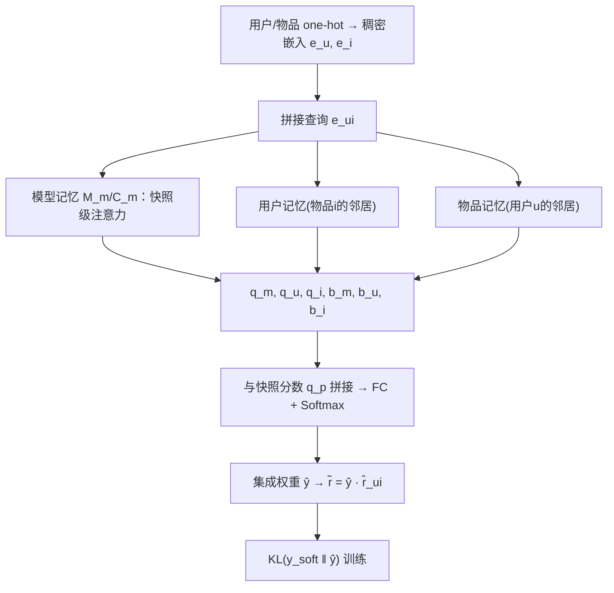
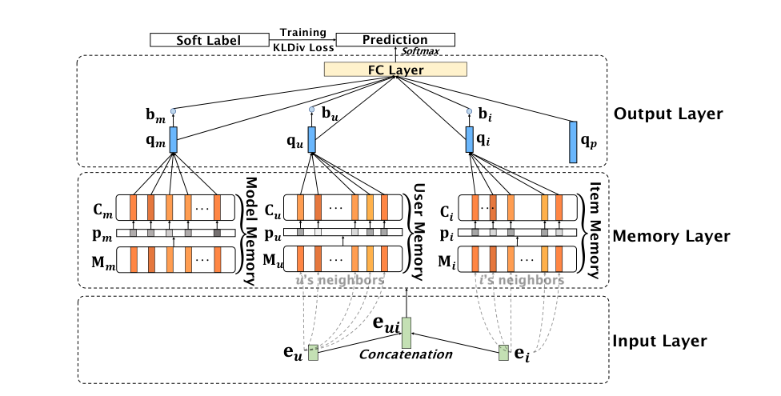

# NeuSE: A Neural Snapshot Ensemble Method for Collaborative Filtering (面向协同过滤的神经快照集成方法)

- **会议/期刊**: ACM TKDD (2021)
- **作者与机构**: Dongsheng Li, Haodong Liu, Chao Chen, Yingying Zhao, Stephen M. Chu, Bo Yang（复旦大学、电子科技大学、上海交通大学、IBM Research China）
- **推荐链路定位**: 精排打分（模型后处理 / 通用集成包装器）
- **研究方向**: 协同过滤 / 特征交互与集成
- **论文原文**: [论文原文链接](https://arxiv.org/abs/2104.07269v1)
- **开源代码**: 暂未开源

## TL;DR (1分钟核心速览)

CF 模型的全局损失只是所有 user-item 对的"平均最优"，稀疏用户欠拟合、活跃用户过拟合，而 LLORMA 类集成需训练几十个基模型、代价高昂且算法绑定。本文沿单条 SGD 轨迹按固定间隔保留中间快照模型，用 **模型/用户/物品三层记忆网络** 为每个 $(u,i)$ 对生成自适应集成权重，并以按 epoch 距离构造的软标签 KL 损失训练。在 ML-100K / Book-Crossing / Amazon / Netflix 上对 UserKNN、ItemKNN、RSVD、FM(SGD/MCMC)、I-AutoRec、NeuMF 全面提升，最高相对提升 15.9%。

## Background & Motivation (背景与核心矛盾)

- **主流范式**: CF 通过最小化全库经验风险学习 $U^*,V^*=\arg\min_{U,V}\mathcal{L}(R|U,V)$；因用户与物品参数共存，问题非凸，SGD/ALS/MCMC 只能落到某个局部最优点。
- **前人局限**: ① 全局最优点仅是折中——case study 显示稀疏用户（<50 评分）在 epoch≈175 已过拟合、活跃用户（>500）仍欠拟合；② AdaGrad 只能更快逼近同一局部最优，最优 RMSE 与 vanilla SGD 几乎相同，无法探索其他局部最优；Bayesian 方法受先验选择与可扩展性限制；LLORMA 等集成方法仅适配 MF，且需训练大量基模型。
- **核心洞察 (Key Insight)**: 训练轨迹上的每个中间模型都可能对某一部分 user-item 对最优（约 90% 评分的最优快照与用户整体最优快照不一致）；图 2 进一步表明，随意取所有快照做简单平均 **反而劣于单模型**（Set 1），而恰当挑选（Set 2）才有约 0.3% 增益——问题不是"要不要集成"，而是"如何为每对 $(u,i)$ 挑权重"。

<figure class="paper-figure" markdown="span">
  ![图1. 使用 RSVD 方法 \[25\] 时，不同评分数量用户在评分预测任务上的测试 RMSE 趋势，即“&lt;50”表示评分数少于50的用户，依此类推。图(a)中我们使用普通 SGD 训练模型，图(b)中使用带 adagrad \[7\] 的 SGD 训练模型。](../../../../assets/papers/2104.07269v1/figure_1.png)<figcaption>图1. 使用 RSVD 方法 [25] 时，不同评分数量用户在评分预测任务上的测试 RMSE 趋势，即“&lt;50”表示评分数少于50的用户，依此类推。图(a)中我们使用普通 SGD 训练模型，图(b)中使用带 adagrad [7] 的 SGD 训练模型。</figcaption>
</figure>

- **本文切入点**: 零额外训练成本地复用轨迹快照，把快照选择交给一个可学习、且带 user/item 邻域记忆的自适应加权器。

## Method (核心方法设计)

### 1. 整体框架 (Overall Architecture)

基模型正常训练，每 $\Delta T$个 epoch 落盘一次参数作为快照（KNN 则用不同近邻数$k$构造快照），共$N_m$个；每个快照对目标$(u,i)$输出一个分数，组成向量$\hat{\mathbf{r}}_{ui}$。集成器以用户/物品 one-hot 嵌入拼接作为查询$\mathbf{e}_{ui}$，分别与模型记忆、用户记忆（键为物品$i$的交互用户邻域$\mathcal{N}(i)$）、物品记忆（键为用户$u$的交互物品邻域$\mathcal{N}(u)$）做注意力，得到$\mathbf{q}_m,\mathbf{q}_u,\mathbf{q}_i$与三个偏置项，连同$\hat{\mathbf{r}}_{ui}$送入 FC+Softmax 得权重$\hat{\mathbf{y}}$，最后加权求和输出预测；训练用软标签 KL 散度，推理只需$N_m$ 次快照前向 + 一次轻量集成网络前向。

<figure class="paper-figure" markdown="span">
  <figcaption>图3. 所提出的用于快照集成且含一个记忆层的多记忆网络架构。</figcaption>
</figure>

### 2. 关键设计拆解 (Key Designs)

1. **三重记忆注意力加权（把"选模型"变成查询问题）**: 简单 MLP（HSE）只能学到快照的全局重要性，无法刻画"某用户在某物品上更信某个快照"。模型记忆内外矩阵 $\mathbf{M}_m,\mathbf{C}_m\in\mathbb{R}^{D\times N_m}$，内矩阵度量快照$s$与当前查询的兼容度、外矩阵作为快照表征：$p^{M}_{uis}=\mathbf{m}_s^{\top}\mathbf{e}_{ui}$，$w^{M}_{uis}=\mathrm{softmax}_s(p^{M}_{uis})$，$\mathbf{q}_m=\sum_{s}w^{M}_{uis}\mathbf{c}_s$。用户/物品记忆结构相同但键换为邻域实体（$p^{U}_{uiv}=\mathbf{m}_v^{\top}\mathbf{e}_{ui},\ v\in\mathcal{N}(i)$），相当于用相似用户/相似物品的长期记忆补足单用户交互稀疏；三层输出还被线性投影为$b_m,b_u,b_i$ 三个偏置，显式吸收 MF/FM 式的偏置先验。
2. **软标签训练（让"次优快照"也被合理计价）**: 硬标签（最优快照为 1、其余为 0）在单个用户样本极少时极易过拟合，而 epoch 相邻的快照误差本就接近。定义 $x_s=(|e_s-e_o|+1)^{-\alpha}$，软标签$y_s=\exp(x_s)/\sum_{k}\exp(x_k)$，损失$\mathcal{L}=\sum_{s=1}^{N_m}y_s(\log y_s-\log\hat{y}_s)$；即按"距离最优 epoch 的远近"平滑目标分布，等价于对快照做方差缩减。
3. **训练目标、负采样与推理开销**: 集成器本身用 Adam（lr=0.01, batch=128, dropout=0.5, $d=16$, 2-hop）单独训练，基 CF 模型超参完全不变，故方法与任何非凸迭代 CF 正交可叠加。每 epoch 复杂度$O(DHN_R)$；推理为$\tilde{r}_{ui}=\hat{\mathbf{y}}^{\top}\hat{\mathbf{r}}_{ui}$，只增加一个$N_m+3D+3$ 维输入的浅层网络，训练总时长与训练单个 RSVD/FM 相当，甚至低于 NeuMF。

## Experimental Setup & Evaluation Protocol (实验设置与评估协议)

| 数据集 | #Users | #Items | #Interactions | 密度 | 特征/场景说明 |
| :--- | :---: | :---: | :---: | :---: | :--- |
| MovieLens 100K | 943 | 1,682 | 100,000 | 6.30% | 评分 1–5，显式+隐式双用 |
| Book-Crossing | 2,946 | 17,384 | 272,679 | 0.53% | 评分 1–10，强稀疏 |
| Amazon Musical Instruments | 80,004 | 13,836 | 500,176 | 0.05% | 极稀疏、用户多物品少 |
| Netflix Prize | 480,189 | 17,770 | 100,480,507 | — | 大规模验证效率与精度 |

- **数据划分与防穿越**: `Leave-One-Out` + 按时间戳排序切分，每用户最近一次交互作 test、倒数第二次作 validation、其余训练；以 validation 选最优模型。
- **排名评测协议**: 评分预测用 RMSE；Top-N 采用 **Sampled Ranking**，每个测试正样本随机配 99 个负样本（1:99）并在同一实验中固定，报告 HR@20 与 NDCG@20。未做 Full-Ranking 与显著性检验。
- **对比基线与超参**: 集成策略对比 Single（验证集最优单快照）、Average、HSE（MLP 元学习器）、SE（cyclic LR 快照集成，仅适用 SGD 模型）；CF 骨架覆盖 memory-based（UserKNN/ItemKNN）、MF（RSVD，FM-SGD，FM-MCMC）、神经（I-AutoRec、NeuMF）。快照间隔 $\Delta T=10$（NeuMF 为 5，至 200 epoch），嵌入维度 16，ReLU，2-hop。

## Key Experimental Results (实验关键数据)

### 1. 主实验对比 (Main Results)

| 骨架（数据集 / 指标） | Single | Average | HSE | SE | **NeuSE** | Improv. |
| :--- | :---: | :---: | :---: | :---: | :---: | :---: |
| UserKNN (ML-100K, NDCG) | 0.0822 | 0.0801 | 0.0827 | — | **0.0857** | +3.6% vs HSE |
| UserKNN (Amazon, NDCG) | 0.0481 | 0.0473 | 0.0446 | — | **0.0517** | **+15.9% vs HSE** |
| ItemKNN (Book, NDCG) | 0.0791 | 0.0725 | 0.0738 | — | **0.0837** | +15.4% vs Avg |
| RSVD (ML-100K, RMSE) | 1.1305 | 1.1171 | 1.1327 | 1.1130 | **1.0973** | +1.4% vs SE |
| FM-SGD (ML-100K, NDCG) | 0.2779 | 0.2631 | 0.2791 | 0.2759 | **0.2893** | +3.7% vs HSE |
| FM-MCMC (Book, NDCG) | 0.1285 | 0.1273 | 0.1274 | — | **0.1324** | +3.9% vs Single |
| I-AutoRec (Amazon, NDCG) | 0.2359 | 0.2381 | 0.2379 | 0.2367 | **0.2427** | +1.9% vs Avg |
| NeuMF (Book, NDCG) | 0.1948 | 0.1943 | 0.1963 | 0.1952 | **0.2031** | +4.1% vs SE |
| FM-SGD (Netflix, NDCG) | 0.4830 | 0.4827 | 0.4833 | 0.4879 | **0.4918** | +0.8% vs SE |

### 2. 消融/敏感性实验 (Ablation & Sensitivity)

| 变体或配置 | 原文报告的关键变化 |
| :--- | :--- |
| 软标签 → 硬标签 | RSVD / FM / NeuMF 分别退化约 0.5% / 0.2% / 1.4%，硬标签更易过拟合 |
| 记忆层数 1-hop / 2-hop / 3-hop | 2-hop 最优；1-hop 无法跨层传递邻域信息，3-hop 参数多而过拟合 |
| 嵌入维度 16 / 32 / 64 | $d=16$ 最优，32、64 出现明显过拟合 → 增益来自"选模型"而非"加容量" |
| 快照数 5 → 10（$\Delta T=10$） | 7–9 个略优；取 10 个因混入差模型轻微下降，但退化幅度很小 |
| 激活函数 Sigmoid / Tanh / ReLU | 3-hop 下 Tanh 最差，ReLU 平均最优（缓解梯度消失） |
| 效率 | 每 epoch $O(DHN_R)$；2-hop 总训练时间与单个 RSVD/FM 相当，远低于 NeuMF |

### 3. 关键实验发现 (Key Findings)

1. **"全局次优"是跨算法、跨数据集的普遍病**: 3 个数据集 × 7 类骨架（含 MCMC 贝叶斯训练与无训练的 KNN）几乎全部获得提升，说明该问题不依赖具体 CF 形式；最大增益出现在最稀疏、用户最多的 Amazon 上（UserKNN NDCG 0.0446→0.0517），即稀疏度越高、快照多样性收益越大。
2. **集成不等于平均**: Average 在 6 个骨架中仅 3 个超过 Single（如 ItemKNN 在 Book 上 NDCG 0.0725 < Single 0.0791），HSE 因只学全局权重而常与 Average 持平；NeuSE 靠 user-item 级权重把差模型压低，才在 ItemKNN/Book 上拿到 15.4% 的相对提升。
3. **增益来自"重加权"而非"加参数"**: 软标签单独贡献 0.2–1.4%，2-hop 优于 1/3-hop，且最佳嵌入仅 16 维；再叠加 7–9 个快照即可稳定工作，说明方法在轻量预算内即可部署，无需精细的快照挑选策略。

## Highlights & Limitations (亮点、对比与审稿批判)

- **与代表作对比**: 对比 LLORMA（为 MF 定制、需训练数十个局部模型）与 SE（cyclic LR 制造多局部最优，仅适用 SGD 且对 MF 无效），NeuSE 是 **模型无关的零额外训练包装器**，同时把"集成权重"从全局（HSE、Average）细化到单个 $(u,i)$ 对，并用邻域记忆解决冷用户权重估计不可靠的问题。
- **可迁移亮点**: ① 把任意非凸迭代训练轨迹视为"免费模型池"，用轻量元网络做样本级加权，可直接搬到深度 CTR/序列模型；② 用"距离最优 epoch 的幂函数"构造软标签，替代会过拟合的 one-hot 目标挑选，是通用的 checkpoint 融合技巧。
- **审稿级局限批判**: ① 需保存 $N_m$个快照参数，内存随快照数线性增长（文中亦承认高于 NeuMF）；② 强依赖"存在可区分的训练轨迹"，对凸/闭式解模型与 MostPop 类方法失效，且$\Delta T$ 与快照数仍属手工超参；③ 评估仅 RMSE/HR/NDCG@20 + 固定 1:99 采样负例，缺少 Full-Ranking 与显著性检验，对排序质量的结论可能偏乐观。

## Rating (四维评分)

- **方法创新性 (Novelty)**: ⭐⭐⭐⭐ （"快照复用 + user-item 级记忆注意力 + 软标签"组合新颖，但快照集成与记忆网络均为已有组件的巧妙拼装，缺少理论收敛/方差分析）
- **评估协议与实验扎实度 (Protocol & Experiments)**: ⭐⭐⭐⭐ （4 数据集 × 7 骨架 × 4 集成策略覆盖全面，含 Netflix 大规模验证；扣分在仅采样排序、无显著性检验与置信区间）
- **写作与数学规范度 (Clarity & Rigor)**: ⭐⭐⭐⭐ （三组 case study 动机推导清晰、公式规整、复杂度分析到位；用户/物品记忆符号与邻域定义略重复）
- **工业落地与复现价值 (Industrial & Practical Value)**: ⭐⭐⭐⭐ （训练开销与单模型相当、推理只多一层浅网络，易作为插件接入现有 CF 流水线；但快照存储成本与无开源代码影响复现）

