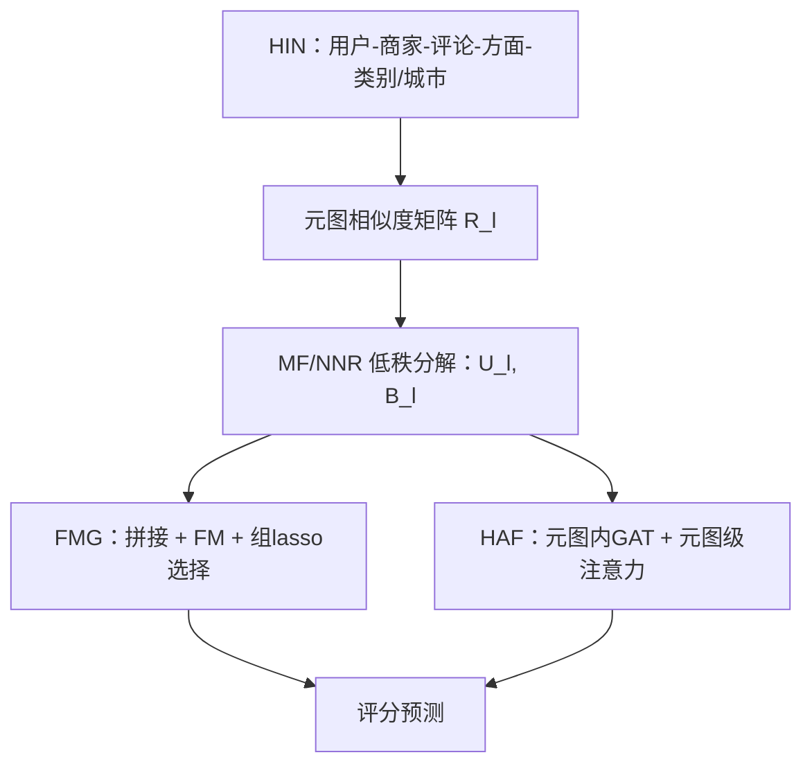

# Side Information Fusion for Recommender Systems over Heterogeneous Information Network (异构信息网络上融合辅助信息的推荐系统)

- **会议/期刊**: TKDD 2021（Accepted TKDD 2020）
- **作者与机构**: Huan Zhao, Quanming Yao, Yangqiu Song, James T. Kwok, Dik Lun Lee；4Paradigm / HKUST / Tsinghua
- **推荐链路定位**: 精排 / 评分预测（pointwise rating prediction）
- **研究方向**: 图神经网络与知识图谱推荐 / CTR-CVR 预估与特征交叉
- **论文原文**: [https://arxiv.org/abs/1801.02411v4](https://arxiv.org/abs/1801.02411v4)
- **开源代码**: [https://github.com/HKUST-KnowComp/FMG](https://github.com/HKUST-KnowComp/FMG)

## TL;DR (1分钟核心速览)

针对异构信息网络中辅助信息被分开处理、元路径难表达多分支语义、相似度融合丢失跨元图交互三大痛点，本文提出元图相似度 + “MF+FM” 框架（FMG）与端到端层次注意力融合（HAF）。在 4 个数据集、80/10/10 随机划分、RMSE 评分预测下，HAF(MG) 相对最强外部基线在 Yelp-200K 降 15.5%，Amazon-200K 降 11.6%。

## Background & Motivation (背景与核心矛盾)

- **主流范式**: 以 CF/矩阵分解为底座，将社交、评论、类别、位置等辅助信息分别建模；HIN 路线则用元路径计算用户-物品相似度，再做 MF 或加权融合。
- **前人局限**: ① 不同辅助信息分开处理，跨类型相关性丢失；② 元路径无法表达“同一方面且同一商家”等多分支语义；③ 加权点积集成忽略跨元路径特征交互，且过多元路径引入噪声。
- **核心洞察 (Key Insight)**: 元图是单源单汇 DAG，可用“矩阵乘 + Hadamard 积”统一表达多分支语义；每组元图相似度应先低秩分解为隐向量，再做非线性融合与组级选择。
- **本文切入点**: 用元图替代元路径，提出两阶段 “MF+FM” 与端到端 HAF 两条融合路径。

## Method (核心方法设计)

### 1. 整体框架 (Overall Architecture)

输入为按网络模式构建的 HIN（用户、商家、评论、方面、类别、城市/州/品牌等）；对每个元图，用 commuting matrix（矩阵乘 + Hadamard 积）得到用户-商家相似度，再经 MF/NNR 低秩分解为每组用户/物品隐向量。FMG 将 $L$ 组隐向量拼接，用 FM 建模跨元图二阶交互，并以组 lasso/LSP 选择有用元图；HAF 则把每个相似度矩阵视为二部图，先多头 GAT 聚合元图内邻居，再做元图级注意力融合，端到端输出内积评分。训练用 MSE，FMG 用 nmAPG/SVRG 优化。

### 2. 关键设计拆解 (Key Designs)

1. **元图相似度（替代元路径）**：元路径只能走单链，遇到 $M_9$这类“同方面或同商家”的分支语义会丢失信息。本文将元图视为单源单汇 DAG，对分支先用 Hadamard 积求交，再沿 DAG 做矩阵乘：$\mathbf{C}_{M_9}=\mathbf{W}_{UR}((\mathbf{W}_{RB}\mathbf{W}_{RB}^\top)\odot(\mathbf{W}_{RA}\mathbf{W}_{RA}^\top))\mathbf{W}_{UR}^\top\mathbf{W}_{UB}$，并将非零相似度二值化为$\mathbf{R}_l$。直觉是：分支积保留“同时满足”语义，矩阵乘保留路径可达性。

2. **“MF+FM”与组 lasso 元图选择**：相似度矩阵极稀疏且元图未必都有用。先对每个 $\mathbf{R}_l$做低秩恢复：$\min_{\mathbf{X}}\frac12\|\mathcal{P}_\Omega(\mathbf{X}-\mathbf{R}_l)\|_F^2+\mu\|\mathbf{X}\|_*$，取$\mathbf{U}=\mathbf{P}\mathbf{\Sigma}^{1/2}$、$\mathbf{B}=\mathbf{Q}\mathbf{\Sigma}^{1/2}$为隐特征；拼接后 FM 预测$\hat{y}=b+\sum_i w_i x_i+\sum_{i<j}\langle\mathbf{v}_i,\mathbf{v}_j\rangle x_i x_j$。组 lasso 按元图分块：$\phi(\mathbf{w})=\sum_l\eta_l\|\mathbf{w}_l\|_2$、$\phi(\mathbf{V})=\sum_l\eta_l\|\mathbf{V}_l\|_F$；非凸 LSP 用$\kappa(\alpha)=\log(1+|\alpha|)$ 获得更强稀疏性。其有效性来自：FM 捕捉跨元图二阶交互，组正则删除噪声元图并降低稠密特征开销。

3. **HAF 端到端层次注意力**：将每个元图相似度矩阵视为用户-物品二部图，类型特定编码后做多头 GAT 节点级注意力，再用元图级注意力 $g_l=\mathrm{softmax}(p_l)$融合$\mathbf{u}_i=\sum_l g_l\mathbf{u}_i^l$，最终$\hat{y}=\mathbf{u}_i^\top\mathbf{b}_j$。相比两阶段，HAF 让“特征提取 + 融合”联合优化，注意力可自适应分配不同元图权重。

**训练目标、负采样与推理效率**：总损失为 $\mathcal{L}=\frac1N\sum_n(y_n-\hat{y}_n)^2+\hat{\lambda}\hat{\psi}(\mathbf{w})+\bar{\lambda}\bar{\psi}(\mathbf{V})$。评分预测只对观测评分回归，**无负采样、无候选集排序**；FMG 每次迭代约$O(NKd)$，HAF 复杂度随边数与头数线性增长，推理为内积或 FM 前向。

## Experimental Setup & Evaluation Protocol (实验设置与评估协议)

- **数据集与预处理**: 非 5-core 过滤；Amazon/Yelp 各取约 20 万评分构建 HIN。Yelp 含社交、类别、星级、州/城市、评论方面；Amazon 含类别、品牌、评论方面，方面由 Gensim 主题模型抽取（10 个主题）。

| 数据集 | #Users | #Items | #Interactions | 密度 | 特征/场景说明 |
| :--- | :---: | :---: | :---: | :---: | :--- |
| Amazon-200K | 59,297 | 20,216 | 183,807 | 0.015% | 电商：评论、类别、品牌、方面 |
| Yelp-200K | 36,105 | 22,496 | 191,506 | 0.024% | 本地生活：社交、评论、类别、城市/州、星级 |
| CIKM-Yelp | — | — | — | 0.086% | 加权 HIN，沿用 SemRec 设置 |
| CIKM-Douban | — | — | — | 0.630% | 图书/影视评分，沿用 SemRec 设置 |

- **数据划分与防穿越 (Splitting Strategy)**: 随机 80% 训练 / 10% 验证 / 10% 测试，重复 5 次取平均 RMSE；CIKM 数据集沿用 SemRec 的训练量设置。
- **排名评测协议 (Ranking Protocol)**: **评分预测而非 Full-Ranking**；仅对测试集观测评分计算 RMSE，不做全库未交互排序，也无采样负例。
- **对比基线与超参设置**: RegSVD、FMR、HeteRec、SemRec；FMG/HAF 变体。隐向量维度 $F=K=10$；HAF 隐藏/输出 32、4 头、学习率$10^{-4}$、dropout 0.1、200 epochs；显著性用 pairwise t-test（95%）。

## Key Experimental Results (实验关键数据)

### 1. 主实验对比 (Main Results)

RMSE↓，粗体为各列最优。

| 方法 | Amazon-200K | Yelp-200K | CIKM-Yelp | CIKM-Douban |
| :--- | :---: | :---: | :---: | :---: |
| RegSVD | 2.9656 | 2.5141 | 1.5323 | 0.7673 |
| FMR | 1.3462 | 1.7637 | 1.4342 | 0.7524 |
| HeteRec | 2.5368 | 2.3475 | 1.4891 | 0.7671 |
| SemRec | — | 1.4603 | 1.1559 | 0.7216 |
| FMG | 1.1953 | 1.2583 | 1.1167 | 0.7023 |
| FMG(LSP) | 1.1980 | 1.2593 | 1.1255 | 0.7035 |
| HAF(MP) | 1.1953 | 1.2470 | 1.1170 | 0.7035 |
| HAF(MG) | **1.1905** | **1.2335** | **1.1139** | **0.6975** |

相对最强外部基线：Amazon-200K 较 FMR 降 **11.57%**；Yelp-200K 较 SemRec 降 **15.52%**；CIKM-Yelp 较 SemRec 降 **3.63%**；CIKM-Douban 降 **3.34%**。

### 2. 消融实验 (Ablation Study)

原文以变体对比呈现消融，核心结论如下：

| 组件/变体 | Amazon-200K | Yelp-200K | 说明 |
| :--- | :---: | :---: | :--- |
| HAF(MP)：仅元路径 | 1.1953 | 1.2470 | 去掉元图多分支语义 |
| HAF(MG)：元图完整 | **1.1905** | **1.2335** | 元图替代元路径 |
| FMG：凸组 lasso | 1.1953 | 1.2583 | Amazon-50K 最优 NNZ=0.52 |
| FMG(LSP)：非凸组 lasso | 1.1980 | 1.2593 | 同数据 NNZ=0.25 |
| FMG → HAF(MG) | 1.1953→1.1905 | 1.2583→1.2335 | 两阶段 → 端到端 |

### 3. 关键实验发现 (Key Findings)

1. **越稀疏，辅助信息收益越大**：Amazon-200K 密度仅 0.015%，FMG 较 RegSVD 的 RMSE 从 2.9656 降至 1.1953（约 59.7%）；而较稠密的 CIKM-Douban 上同比较仅约 8.5%。
2. **元图语义带来稳定但幅度有限的增益**：HAF(MG) 较 HAF(MP) 在 Amazon/Yelp/CIKM-Yelp/Douban 分别再降 0.40%/1.08%/0.28%/0.85%，说明多分支语义有效，但元路径仍是强基线。
3. **LSP 以更少元图换可比精度**：Amazon-50K 上 FMG 最优 NNZ=0.52，FMG(LSP) 最优 NNZ=0.25，即用约一半特征达到相近 RMSE，验证组级选择可降噪并压缩在线特征。

## Highlights & Limitations (亮点、对比与审稿批判)

- **与代表作对比 (vs. Prior Work)**: HeteRec 仅用元路径相似度做加权点积集成，忽略跨元路径交互；SemRec 在加权 HIN 上按元路径建模，仍受元路径语义限制；HAF(MP) 类似 HAN 的层次注意力但只用元路径，本文 HAF(MG) 扩展到跨类型用户-物品与元图语义。
- **可迁移亮点**: ① 元图 commuting matrix 的“Hadamard 求交 + 矩阵乘传播”可直接用于多视图相似度构造；② 按元图分块的组 lasso/LSP 适合任何多源特征选择场景。
- **审稿级局限批判**: ① 仅验证评分预测 RMSE，未覆盖 Top-N Full-Ranking、冷启动与线上 A/B，排序价值仍待证；② 元图与主题数依赖领域知识，HAF 依赖 DGL/GPU，且 CIKM 上增益较小，超参 $\lambda$ 敏感。

## Rating (四维评分)

- **方法创新性 (Novelty)**: ⭐⭐⭐⭐ （系统化引入元图 + MF/FM/HAF 融合，元图相似度计算有明确增量；FM 与注意力组件本身非全新）
- **评估协议与实验扎实度 (Protocol & Experiments)**: ⭐⭐⭐⭐ （4 数据集、5 次随机划分、95% t-test 较扎实；但仅 RMSE 评分预测，缺少 Top-N 与全库排序协议）
- **写作与数学规范度 (Clarity & Rigor)**: ⭐⭐⭐⭐ （框架、公式、复杂度与优化算法完整；符号较密，元图选择与 LSP 推导需一定背景）
- **工业落地与复现价值 (Industrial & Practical Value)**: ⭐⭐⭐⭐ （FMG 代码开源，组 lasso 选元图对多源特征工程有直接价值；HAF 训练与元图构造成本限制大规模部署）

