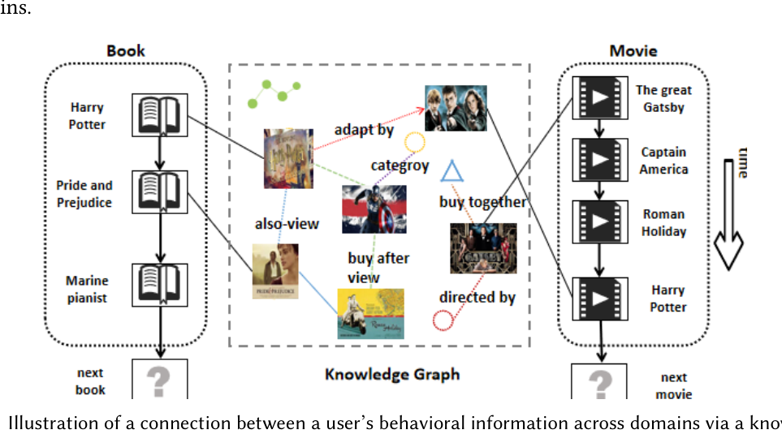
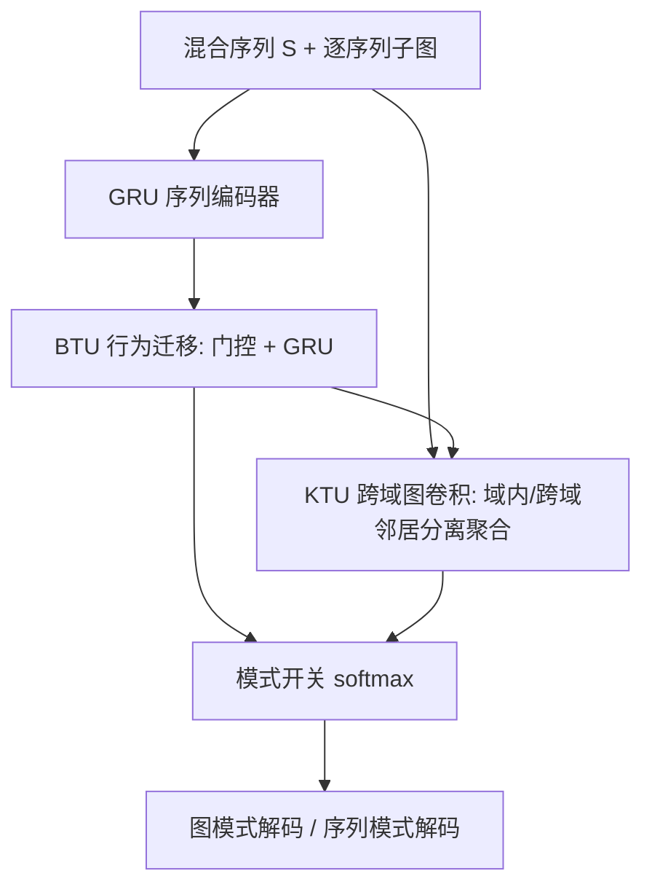
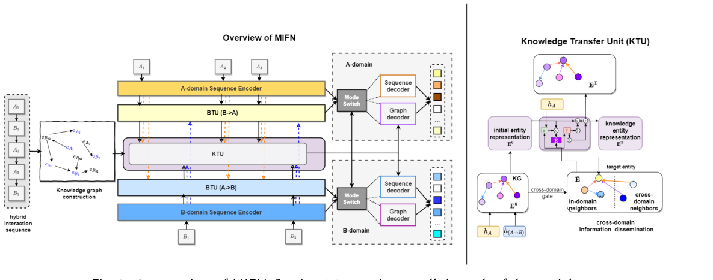

# Mixed Information Flow for Cross-domain Sequential Recommendations (跨域序列推荐中的混合信息流)

- **会议/期刊**: ACM TKDD (Transactions on Knowledge Discovery from Data)
- **作者与机构**: Muyang Ma, Pengjie Ren, Zhumin Chen, Zhaochun Ren, Lifan Zhao, Jun Ma (山东大学), Maarten de Rijke (阿姆斯特丹大学 / Ahold Delhaize)
- **推荐链路定位**: 召回 (序列 next-item 打分)
- **研究方向**: 跨域与多场景推荐 / 图神经网络与知识图谱推荐
- **论文原文**: [https://arxiv.org/abs/2012.00485v3](https://arxiv.org/abs/2012.00485v3)
- **开源代码**: [https://github.com/mamuyang/MIFN](https://github.com/mamuyang/MIFN)

## TL;DR (1分钟核心速览)

跨域序列推荐（CDSR）此前只迁移**用户行为**（如 π-Net 的门控共享隐状态），无法捕捉「哈利波特」与「加勒比海盗」同属"奇幻"这类仅靠共现看不出的细粒度关联。本文提出 MIFN，同时建模**行为信息流**（BTU）与**知识信息流**（KTU，跨域图卷积 + 门控实体传播），并用模式开关决定"何时用知识、用哪部分知识"。在 Amazon 四域上按逐用户 80/10/10 划分、全库排序，Movie 域 Recall@10 由 15.28% 提升至 16.34%（+6.9%，$p<0.05$）。

## Background & Motivation (背景与核心矛盾)

- **主流范式**: CDSR 用 GRU 编码各域子序列，再以门控（π-Net）或跨接网络（Conet）在隐空间共享用户偏好；单域知识增强则用 KG 记忆网络（KSR）或会话图（SRGNN）。
- **前人局限**: ① 纯行为迁移只能利用**共现**，当两域物品无共同用户/共现边时（冷门书与电影）无法建立连接；② 单域 KG 方法（KSR）假设物品在同一域内，跨域时 KG 中 A 域实体数远多于 B 域（如 1000:10），直接聚合会被稠密域淹没。
- **核心洞察 (Key Insight)**: 商品 KG 中已存在跨域关系（`Adapted_from`、`Is_the_same_category`、`Also_buy`），可作为"语义桥梁"把 A 域序列的意图显式传播到 B 域物品实体上。
- **本文切入点**: 用两条并行信息流 + 一个二分类模式开关，让模型按当前偏好自适应选择"序列模式"或"图模式"输出。

<figure class="paper-figure" markdown="span">
  <figcaption>图1. 用户跨域行为信息通过知识图谱建立连接的示意图。不同颜色的连线表示不同的连接。</figcaption>
</figure>

## Method (核心方法设计)

### 1. 整体框架 (Overall Architecture)

给定混合序列 $S=[A_1,B_1,B_2,\dots,A_i,\dots,B_j]$与 KG$\langle E,R\rangle$，先用 GRU 分别编码出$H_A,H_B$；BTU 以门控循环把 A 域行为表示逐时刻搬到 B 域得$h_{(A\to B)}$；KTU 在**逐序列抽取的子图**（最多$H=2$跳、$N=200$实体）上做跨域图卷积，得到迁移后的实体表示$h^T_{e_k}$；最后由模式开关加权两个解码器：图模式在实体表示上 softmax，序列模式在$[h_B;h_{(A\to B)}]$ 上 softmax。整体多域联合端到端训练。

<figure class="paper-figure" markdown="span">
  <figcaption>图2. MIFN 概览。第3.3节给出了该模型的逐步说明。</figcaption>
</figure>

### 2. 关键设计拆解 (Key Designs)

1. **BTU：门控行为流**——痛点是 A 域隐状态与 B 域隐状态维度语义不对齐，不能直接相加。做法是用 B 域当前步 $h_{B_j}$ 作为"查询"计算遗忘门，控制 A 域信息保留量：
$f_{A_i}=\sigma(W_{fA}h_{A_i}+W_{fB}h_{B_j}+W_f h_{A_{i-1}\to B}+b_f)$，$h_{A_i\to B}=f_{A_i}\odot\tilde{h}_{A_i}+(1-f_{A_i})\odot h_{A_{i-1}\to B}$，再经 GRU 得到$h_{(A\to B)_i}$。直觉：$h_{B_j}$ 进入门控等价于"以目标域上下文为条件"筛选源域行为，避免无关行为污染。

2. **KTU：跨域图卷积 + 跨域门控**——痛点是普通 GCN 对所有邻居一视同仁，会抹平域间差异。本文将邻居拆为域内 $N_i(k)$与跨域$N_c(k)$ 两组分别聚合：
$\tilde{h}^{l+1}_{e_k}=\sigma\big[f_0(\tilde{h}^l_{e_k})+\frac{1}{|N_i(k)|}\sum_{p\in N_i(k)}f_i(\alpha_p\tilde{h}^l_p)+\frac{1}{|N_c(k)|}\sum_{q\in N_c(k)}f_c(\beta_q\tilde{h}^l_q+c_q\tilde{h}^l_q)\big]$，
其中 $\alpha_p$以序列表示$h_A$为查询、$\beta_q$以**迁移后**行为表示$h_{(A\to B)}$为查询，$c_q=\sum_{p\in N_i(k)}e_p\cdot e_q$刻画跨域实体与域内邻居的语义一致性。再以门$c=\sigma(W_c[h_A;h_{(A\to B)};h_{E_0}]+b_c)$分配$h^A_{e_k}=c\odot(\alpha_{A_k}h^0_{e_{A_k}})$、$h^B_{e_k}=(1-c)\odot(\beta_{B_k}h^0_{e_{B_k}})$，显式校正两域实体数量失衡。

3. **训练目标与推理开销**：主损失为双域负对数似然 $\mathcal{L}_R=\mathcal{L}^A_R+\mathcal{L}^B_R$（每步对全库候选做 softmax，即**免负采样**）；另有模式损失$\mathcal{L}_M$用示性函数$\mathbb{I}(\cdot)$监督"物品不在物品集时必须走图模式"。但消融显示$\mathcal{L}=\mathcal{L}_R+\mathcal{L}_M$反而**掉点**，最终 MIFN 仅用$\mathcal{L}_R$：因为$\mathcal{L}_R$已隐含模式监督，额外$\mathcal{L}_M$引入过强的图模式偏置。推理时每序列需现场抽子图（$H$ 跳、上限 200 实体），是主要在线开销。

## Experimental Setup & Evaluation Protocol (实验设置与评估协议)

- **数据集与预处理**: Amazon 四域构成两组互补对；保留双域均有交互、交互数 >10 的用户与频次 >10 的物品，按时间排序后切为月（Movie-Book）/年（Food-Kitchen）粒度子序列，要求每段每域至少 3 个物品。

| 数据集 | #Users | #Items | #Train | #Test | 稀疏度/密度 | 特征/场景说明 |
| :--- | :---: | :---: | :---: | :---: | :---: | :--- |
| Movie | — | 36,845 | 44,732 | 19,861 | 平均序列长 11.98 | 电影观看记录 |
| Book | — | 63,937 | 44,732 | 19,861 | 平均序列长 11.98 | 图书阅读记录 |
| Food | — | 29,207 | 25,766 | 17,280 | 平均序列长 9.91 | 食品购买 |
| Kitchen | — | 34,886 | 25,766 | 17,280 | 平均序列长 9.91 | 厨房用品购买 |

KG 统计：Movie/Book 65,418 与 315,770 实体，3.91M 与 40.05M 三元组；Food/Kitchen 50,273 与 82,552 实体，3.82M 与 7.84M 三元组。

- **数据划分与防穿越 (Splitting Strategy)**: 逐用户随机 **80%/10%/10%** 划分为 train/valid/test，取每段序列中**各域最后一个交互物品**作为该域 ground truth（非严格 LOO，非全局时间戳切分）。
- **排名评测协议 (Ranking Protocol)**: **Full-Ranking（全库未交互排序）**，两个解码器均对域内全部物品做 softmax，无负采样、无候选截断；指标 MRR@{5,10,20} 与 Recall@{5,10,20}，显著性用 $t$-test（$p<0.05$）。
- **对比基线与超参设置**: 五类基线——传统（POP / ItemKNN / BPR-MF）、跨域（NCF-MLP++ / Conet）、序列（GRU4REC / HRNN / NARM / STAMP）、跨域序列（π-Net）、知识感知（SRGNN / KSR）。嵌入与隐层维度 256，跳数 $H=2$，子图实体上限$N=200$，Xavier 初始化 + Adam。

## Key Experimental Results (实验关键数据)

### 1. 主实验对比 (Main Results)

四域 MRR@10 / Recall@10（%），加粗为最优：

| 方法 | Movie MRR | Movie R@10 | Book MRR | Book R@10 | Food MRR | Food R@10 | Kitchen MRR | Kitchen R@10 |
| :--- | :---: | :---: | :---: | :---: | :---: | :---: | :---: | :---: |
| ItemKNN | 1.27 | 3.84 | 1.64 | 5.10 | 1.98 | 6.70 | 1.44 | 4.77 |
| NCF-MLP++ | 1.86 | 4.61 | 1.98 | 4.84 | 2.24 | 5.19 | 1.03 | 3.00 |
| GRU4REC | 12.86 | 14.11 | 13.92 | 15.02 | 8.23 | 10.38 | 8.39 | 8.93 |
| NARM | 13.85 | 14.53 | 15.26 | 15.66 | 9.54 | 11.86 | 8.44 | 8.91 |
| SRGNN | 11.84 | 13.18 | 15.14 | 15.61 | 7.49 | 10.02 | 7.26 | 8.36 |
| π-Net | 14.52 | 15.10 | 15.76 | 16.02 | 9.67 | 10.46 | 8.60 | 9.12 |
| KSR | 14.23 | 15.28 | 15.87 | 16.72 | 9.91 | 11.78 | 9.07 | 9.62 |
| MIFN-KTU | 14.25 | 15.26 | 14.90 | 15.80 | 9.65 | 11.16 | 8.33 | 9.17 |
| **MIFN** | **14.87** | **16.34** | **16.16** | **17.03** | **10.16** | **12.25** | **9.21** | **10.01** |
| Improv.% (vs 最优基线) | +2.4 | +6.9 | +1.8 | +1.9 | +2.5 | +3.3 | +1.5 | +4.1 |

### 2. 消融实验 (Ablation Study)

| 变体 | Movie MRR@10 | Movie R@10 | Book MRR@10 | Book R@10 | Kitchen MRR@10 | Kitchen R@10 |
| :--- | :---: | :---: | :---: | :---: | :---: | :---: |
| MIFN-KTU（仅行为流） | 14.25 | 15.26 | 14.90 | 15.80 | 8.33 | 9.17 |
| MIFN+$\mathcal{L}_M$（加模式损失） | 14.75 | 15.96 | 15.97 | 16.96 | 9.17 | 9.89 |
| MIFN（BTU+KTU，仅 $\mathcal{L}_R$） | **14.87** | **16.34** | **16.16** | **17.03** | **9.21** | **10.01** |

KG 覆盖率敏感性（Movie MRR@20 / Kitchen Recall@20）：30% → 16.99 / 22.41；50% → 20.83 / 42.47；70% → 23.45 / 51.60；90% → 35.09 / 74.17；100% → 67.69 / 95.45。

### 3. 关键实验发现 (Key Findings)

1. **知识流是主要增益来源**：去掉 KTU 后 Book 域 MRR@10 从 16.16% 掉到 14.90%（−7.8%），甚至低于仅用单域 KG 的 KSR（15.87%），说明增益不是"用了 KG"而是"跨域传播 KG"；反之加上 KTU 后四域全面超越 KSR（+1.5%~+2.5%）。
2. **行为流与知识流互补且不可替代**：π-Net（仅行为）在 Food 域 Recall@20 只有 12.54%，MIFN 达 13.27%；而 MIFN-KTU 又低于 π-Net（12.53%），表明两路必须共存——单靠 KG 门控会因实体失衡损失行为信号。
3. **子图质量是性能天花板**：覆盖率从 30% 升至 100% 时 Kitchen Recall@20 从 22.41% 飙到 95.45%，且 90%→100% 区间出现非线性跃升；但现有 Algorithm 1 在真实数据上仅覆盖 14%（Movie-Book）与 12%（Food-Kitchen）的 ground truth，意味着**当前结果被 KG 抽取器严重压制**，这也是案例研究中失败样本（图 4）的根因。

## Highlights & Limitations (亮点、对比与审稿批判)

- **与代表作对比 (vs. Prior Work)**: 相较 π-Net，本文把"共享隐状态"升级为"共享语义实体"，跨域对齐从隐空间搬到可解释的 KG 路径；相较 KSR，本文的图卷积显式区分域内/跨域邻居并用 $c$ 门校正域间实体数量失衡，解决了单域 KG 方法直接搬到跨域即失效的问题；相较 SRGNN，避免了仅用相邻转移边导致的表示贫化。
- **可迁移亮点**: ① "以目标域表示作查询、源域表示作键值"的门控迁移范式，可直接用于多场景 CTR 的域间特征迁移；② 用 $c_q$ 相似度项把跨域实体与域内邻居对齐，是一种轻量的跨图实体消歧技巧。
- **审稿级局限批判**: ① 每序列现场抽子图（$H$跳、$N=200$）在工业级 QPS 下不可行，且子图覆盖率仅 12%–14%，性能上限被构造算法锁死；② 仅支持双域、单跳数$H=2$固定，缺少多域扩展与跳数敏感性分析；③ 80/10/10 随机划分存在**未来交互泄漏**风险（非全局时间切分），且"取序列最后一项"与训练时的随机划分口径不完全一致；④ 式 (15) 声称$\mathcal{L}=\mathcal{L}_R+\mathcal{L}_M$，但实验最优模型只用$\mathcal{L}_R$，正文与公式自相矛盾。

## Rating (四维评分)

- **方法创新性 (Novelty)**: ⭐⭐⭐⭐ （首次把"知识流"引入 CDSR，跨域图卷积的域内/跨域分离聚合与 $c$ 门有明确动机，但整体仍是 GRU + GCN + 门控的组合式创新）
- **评估协议与实验扎实度 (Protocol & Experiments)**: ⭐⭐⭐ （四域 + 五类基线 + 显著性检验较完整，但随机划分有泄漏风险，缺少与"KG 覆盖率"对齐的公平基线，也未做跳数/实体上限敏感性分析）
- **写作与数学规范度 (Clarity & Rigor)**: ⭐⭐⭐⭐ （BTU/KTU/模式开关三模块公式与符号表清晰，Algorithm 1 步骤完整；扣分在于 $\mathcal{L}_M$ 的表述前后矛盾、模式开关缺少校准分析）
- **工业落地与复现价值 (Industrial & Practical Value)**: ⭐⭐⭐ （代码与数据全开源、TensorFlow 实现可复现；但逐序列子图抽取的在线延迟与仅双域限制，使大规模部署需重做 KG 预索引）

