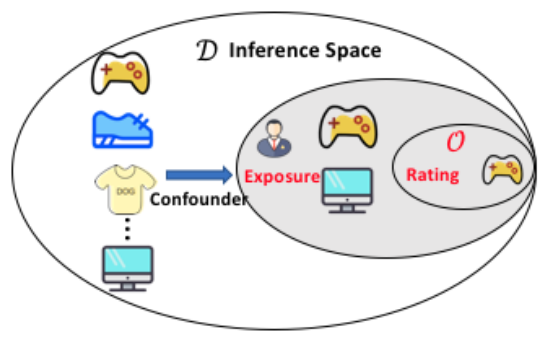
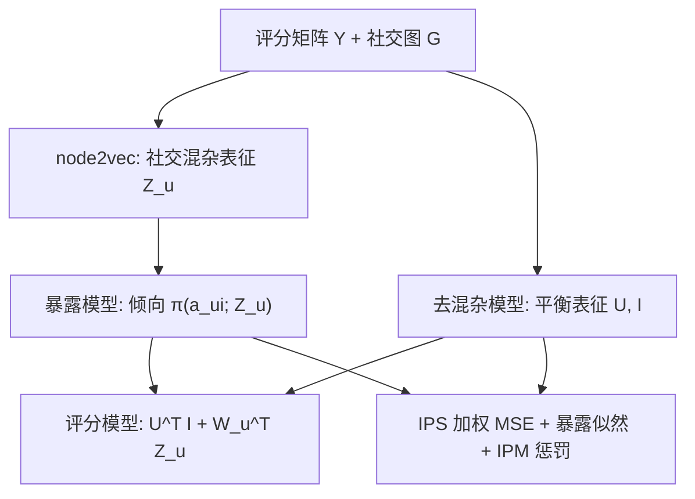
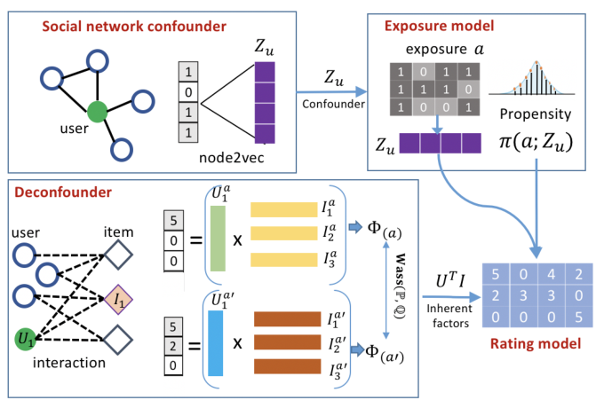

# Be Causal: De-biasing Social Network Confounding in Recommendation (因果视角下的社交网络混杂去偏推荐)

- **会议/期刊**: ACM TKDD (arXiv:2105.07775v2, 2021 预印)
- **作者与机构**: Qian Li, Xiangmeng Wang, Guandong Xu（University of Technology Sydney）
- **推荐链路定位**: 精排（显式评分预测）
- **研究方向**: 去偏公平与可信推荐 / 社交与群组推荐
- **论文原文**: [https://arxiv.org/abs/2105.07775v2](https://arxiv.org/abs/2105.07775v2)
- **开源代码**: 暂未开源（原文承诺录用后放出）

## TL;DR (1分钟核心速览)

针对推荐中 MNAR 导致的选择偏差，本文不再依赖启发式重加权或"校准到 MAR"的倾向估计，而是从因果推断出发把社交网络识别为**同时影响"是否被暴露"与"评几分"的混杂因子**，提出 DENC：node2vec 学混杂表征 $Z_u$、以其为协变量建暴露倾向模型、用 Wasserstein 距离对齐不同暴露分配下的表征分布实现平衡表征去混杂，最后以 IPS 加权 MSE 回归评分。在 Epinions/Ciao/MovieLens-1M 上 MAE 相对最强基线 D-WMF 分别降低 27.7%/11.4%/19.1%。

## Background & Motivation (背景与核心矛盾)

- **主流范式**: 显式反馈推荐普遍假设数据 MAR，或沿"暴露视角"用 ExpoMF、IPW/SNIPS 等倾向得分对观测评分重加权，把 MNAR 数据"伪装"成随机缺失数据。
- **前人局限**: ① 这些方法只从评分矩阵的 user/item 隐向量解释缺失，无法**从因果上分离不同的缺失成因**；② 性能对倾向估计器的选择极其敏感、难以调参，且本质仍是"重加权模仿 MCAR"的启发式操作。
- **核心洞察 (Key Insight)**: 训练空间是已被暴露的评分集 $\mathcal{O}$，推断空间却要求对全暴露空间$\mathcal{D}$ 打分，二者分布差异才是偏差根源；而社交网络正是这一差异的共同原因——好友既决定你看什么片，也影响你打几分。
- **本文切入点**: 构建因果图把评分分解为「固有因子 + 混杂因子 + 暴露」三项决定因素，分别建模并各自去偏，而非笼统重加权。

<figure class="paper-figure" markdown="span">
  <figcaption>图 2：传统推荐模型的训练空间是观测到的评分空间 O，而推断空间是整个暴露空间 D。O 与 D 之间的数据分布差异导致传统推荐模型中的选择偏差。</figcaption>
</figure>

## Method (核心方法设计)

### 1. 整体框架 (Overall Architecture)

输入评分矩阵 $Y$与社交图$G$：先用 node2vec 把用户邻域结构压成混杂表征$Z_u$；暴露模型以$Z_u$为协变量估计倾向$\pi(a_{ui};Z_u)$；去混杂模型通过对齐"两种暴露分配下"的 user/item 表征分布，逼出与暴露无关的固有因子$U,I$；评分模型以$U^{\top}I+W_u^{\top}Z_u$ 合成预测；训练目标为 IPS 加权 MSE + 暴露似然 + 图嵌入似然 + 分布对齐惩罚。推理阶段只需内积与线性项，无额外开销。

<figure class="paper-figure" markdown="span">
  <figcaption>图 4：我们的 DENC 方法由四个组件组成：社交网络混杂因子、暴露模型、去混杂模型和评分模型。</figcaption>
</figure>

### 2. 关键设计拆解 (Key Designs)

1. **社交混杂表征 + 暴露分配建模**：前人倾向估计只吃评分隐向量，遗漏社交这一共同原因。本文先用 node2vec 邻域保似然 $\mathcal{L}_z=-\sum_{u\in G}\log P(N_s(u)\mid Z_u)$学$Z_u$，再把"被暴露"写作以$Z_u$ 为协变量的 logistic 处理分配，并区分"暴露且有评分"与"暴露但未评分"两种情形：

$$\pi(a_{ui};Z_u,\Theta)=\mathbb{I}_{y\in\mathcal{O}}\left[1+e^{-(2a_{ui}-1)(Z_u^{\top}W_0+b_0)}\right]^{-1}$$

直觉：$Z_u$已吸收"朋友都看过/都评价过"带来的暴露优势，剩余暴露变异近似随机，故不必再人为构造 MCAR 参照集。未观测侧的$W_{ui}=P(a_{ui}=1\mid y_{ui}\notin\mathcal{O})$取均匀假设以闭合似然$\mathcal{L}_a=-\sum_{u,i}\log P(a_{ui};Z_u,\Theta)$。

2. **平衡表征去混杂（核心创新）**：若固有因子 $U,I$仍泄露暴露信息，模型在$\mathcal{O}$上训好也无法泛化到$\mathcal{D}$。作者构造两组$W_{ui}$设定对应的表征$\Phi(a),\Phi(\hat{a})$，要求二者分布不可辨，用 1-Lipschitz IPM（即 Wasserstein-1）度量并作为惩罚：

$$\mathcal{L}_d=\inf_{\gamma\in\Pi(\mathbb{P},\mathbb{Q})}\mathbb{E}_{(v,f(v))\sim\gamma}\|f(v)-v\|$$

物理直觉：表征一旦对暴露分配"不敏感"，便只能承载用户偏好与物品固有属性，混杂效应被全部挤入 $Z_u$，从而显式可控。

3. **训练目标、负采样与推理效率**：评分回归用线性结构 $\hat{y}_{ui}=U^{\top}I+W_u^{\top}Z_u+\epsilon_{ui}$，损失采用 IPS 压低高频观测、抬升稀有观测：

$$\mathcal{L}_y=\frac{1}{|\mathcal{O}|}\sum_{(u,i)\in\mathcal{O}}\frac{(y_{ui}-\hat{y}_{ui})^2}{\pi(a_{ui};Z_u)},\qquad \mathcal{L}=\mathcal{L}_y+\lambda_a\mathcal{L}_a+\lambda_z\mathcal{L}_z+\lambda_d\mathcal{L}_d+\mathcal{R}(\Omega)$$

无需负采样（显式评分回归）；node2vec 离线预训练、去混杂用 mini-batch 内 $l$正/$l$负暴露对近似 Sinkhorn 梯度，线上仅$O(d)$ 内积。

## Experimental Setup & Evaluation Protocol (实验设置与评估协议)

- **数据集与预处理**: 原文**不做 5-core 过滤**，刻意保留稀疏物品以保证 MNAR 真实性；MovieLens-1M 为半合成集，人为注入社交边并以 $\Delta(Z_u)\in\{-0.35,0,0.35\}$ 控制混杂强度。

| 数据集 | #Users | #Items | #Interactions | 稀疏度 | 特征/场景说明 |
| :--- | :---: | :---: | :---: | :---: | :--- |
| Epinions | 22,164 | 296,277 | 922,267 | 0.0140% (SR 0.0724%) | 真实社交 + 1–5 星评分，极稀疏 |
| Ciao | 7,317 | 104,975 | 283,319 | 0.0368% (SR 0.2087%) | 真实社交 + 评分 |
| MovieLens-1M | 6,040 | 3,706 | 1,000,209 | 4.4683% | 半合成，注入社交边，可控混杂 |

- **数据划分与防穿越 (Splitting Strategy)**: 比例划分 80/20 训练/测试，再从训练集取 20% 作验证；CausE 因需额外去偏集单独采样 10%。
- **排名评测协议 (Ranking Protocol)**: 主指标为回归型 **MAE / RMSE**，在全部观测评分上计算（非采样排序）；另报 Precision@K / Recall@K（评分 $\ge 3.5$视为相关，$K=10\sim40$）作为辅助，未做全库负采样排序。
- **对比基线与超参设置**: 三组基线——传统（PMF、NRT）、社交推荐（SocialMF、SoReg、SREE、GraphRec、DeepFM+）、倾向去偏（CausE、D-WMF）。嵌入维度在 $\{8,\dots,256\}$网格搜索，$\lambda$搜$\{10^{-3},10^{-4},10^{-5}\}$，SGD 优化，2000 epoch + early stopping，未报告显著性检验。

## Key Experimental Results (实验关键数据)

### 1. 主实验对比 (Main Results)

| 数据集 / 指标 | PMF | NRT | SocialMF | GraphRec | DeepFM+ | CausE | D-WMF | **DENC** | Improv. |
| :--- | :---: | :---: | :---: | :---: | :---: | :---: | :---: | :---: | :---: |
| Epinions MAE | 0.9505 | 0.9294 | 0.8722 | 0.7309 | 0.5782 | 0.5321 | 0.3710 | **0.2684** | −27.7% |
| Epinions RMSE | 1.2169 | 1.1934 | 1.1655 | 0.9394 | 0.6728 | 0.7352 | 0.6299 | **0.5826** | −7.5% |
| Ciao MAE | 0.8868 | 0.8444 | 0.7614 | 0.6972 | 0.3641 | 0.4209 | 0.2808 | **0.2487** | −11.4% |
| Ciao RMSE | 1.1501 | 1.1495 | 1.0151 | 0.9021 | 0.5886 | 0.8850 | 0.5822 | **0.5592** | −4.0% |
| ML-1M ($\Delta{=}0$) MAE | 0.8086 | 0.8801 | 0.8182 | 0.7539 | 0.5281 | 0.4221 | 0.3562 | **0.2883** | −19.1% |
| ML-1M ($\Delta{=}0$) RMSE | 1.0034 | 1.1518 | 1.0382 | 0.9454 | 0.6477 | 0.8333 | 0.6152 | **0.5560** | −9.6% |

### 2. 消融实验 (Ablation Study)

原文**未给出组件级消融表**（无 w/o exposure model、w/o $\mathcal{L}_d$ 的定量对照），仅提供超参敏感性与社交边缺失鲁棒性实验，整理如下：

| 变体设置 | 观测现象（Epinions / Ciao / ML-1M） | 归因 |
| :--- | :--- | :--- |
| $k_d: 8\to 15$（固有因子维度） | MAE/RMSE 下降至最优，$k_d>15$ 后回升（明显凹曲线） | 固有因子维度决定去偏容量，过大过拟合 |
| $k_a: 0\to 50$（混杂维度） | 曲线平缓下滑，$k_a\approx45$ 最优 | 辅助社交信息冗余度高，对维度不敏感 |
| 社交边缺失 20%/50%/80% | MAE、RMSE、P@20、R@20 四项单调退化 | 混杂控制的收益受网络覆盖率硬约束 |
| ML-1M $\Delta(Z_u)$:$-0.35/0/0.35$| MAE$0.2972/0.2883/0.2836$ | 对混杂强度近乎不敏感 |

### 3. 关键实验发现 (Key Findings)

1. **越稀疏、收益越大**：Epinions（密度仅 0.0140%，约 Ciao 的 1/2.6）上 MAE 从 0.3710 降至 0.2684（−27.7%），远大于 Ciao 的 −11.4%，说明当观测极稀疏、暴露机制主导缺失时，混杂建模比单纯重加权更有效。
2. **对混杂强度鲁棒而非"拟合某个混杂水平"**：注入强度 $\Delta(Z_u)$ 从 −0.35 变到 0.35 时 DENC 的 MAE 波动不足 5%（0.2972→0.2836），而 DeepFM+ 在 0.5786→0.3672 间剧烈跳变，侧面验证平衡表征确实剥离了混杂相关的信息通路。
3. **社交图是"必要条件"而非"装饰"**：随机遮挡 80% 社交边后四项指标一致退化，且 $k_d$（固有因子维度）敏感度显著高于$k_a$，说明去偏效果主要由"固有因子与暴露解耦"贡献，而混杂表征提供的是可用的上限空间。

## Highlights & Limitations (亮点、对比与审稿批判)

- **与代表作对比 (vs. Prior Work)**: 相比 ExpoMF / D-WMF / CausE 等倾向重加权方法——它们靠 IPW/SNIPS 把观测数据"校准成 MAR"且强依赖倾向估计器质量；DENC 不做分布校准，而是**在因果图上把混杂从固有因子中显式分离**。相比 SoReg / SocialMF / GraphRec——它们把社交图当作相似度正则或聚合通道，本文则把社交图重新定位为**混杂变量**，用途完全不同。
- **可迁移亮点**: ① "对齐不同处理分配下的表征分布（IPM/Wasserstein）"是通用的去偏正则，可移植到曝光偏差、位置偏差、跨场景偏差；② 用图嵌入替代人工先验作倾向协变量，缓解倾向估计调参难题。
- **审稿级局限批判**: ① 仅验证显式评分回归（MAE/RMSE），Top-N 排序只在 $K$曲线层面报告，未做全库 Full-Ranking，与真实召回/精排链路存在差距；② 未提供组件级消融与显著性检验，"$\mathcal{L}_d$究竟贡献多少"缺少定量证据；③ 评分函数为线性$U^{\top}I+W_u^{\top}Z_u$、$W_{ui}$ 取均匀假设，表达能力受限；node2vec 离线冻结，社交边缺失 80% 时性能明显退化，工业稀疏社交场景风险较高。

## Rating (四维评分)

- **方法创新性 (Novelty)**: ⭐⭐⭐⭐ （首个把社交网络明确指认为 MNAR 混杂因子并给出"暴露—混杂—固有"三分解的因果框架，平衡表征去混杂思路清晰）
- **评估协议与实验扎实度 (Protocol & Experiments)**: ⭐⭐⭐ （三数据集 + 可控混杂强度设计有想法，但仅回归指标、无显著性检验、缺组件级消融，排序评估薄弱）
- **写作与数学规范度 (Clarity & Rigor)**: ⭐⭐⭐ （因果图与损失推导完整，但 $W_u$与$W_0$符号复用、$a_{ui}=1$ 处笔误、IPM 梯度细节外推附录，影响可读性）
- **工业落地与复现价值 (Industrial & Practical Value)**: ⭐⭐ （推理仅内积开销小，但依赖社交图完整性、代码未开源、仅评分预测场景，离真实推荐系统全链路尚有距离）

