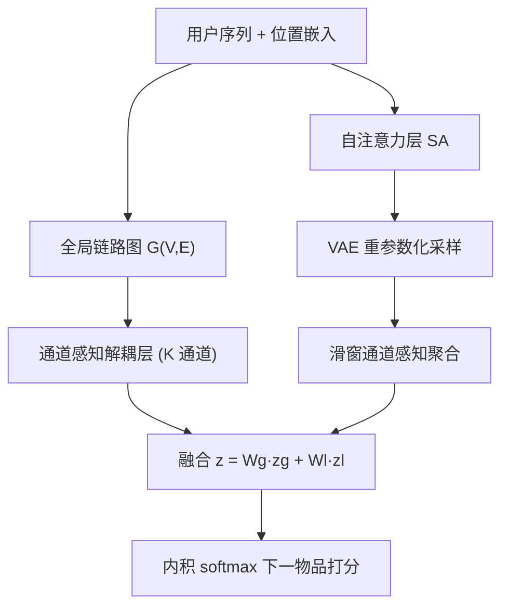
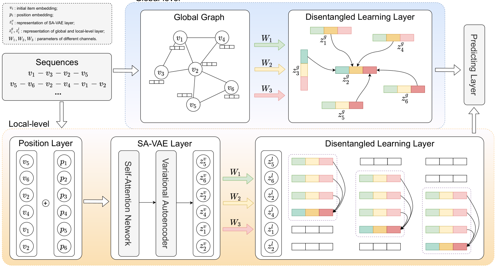

# Edge-Enhanced Global Disentangled Graph Neural Network for Sequential Recommendation (边增强全局解耦图神经网络序列推荐)

- **会议/期刊**: TKDD 2023 (arXiv 2021, 曾投 ICDE 2022)
- **作者与机构**: Yunyi Li, Pengpeng Zhao, Jiajie Xu (苏州大学)；Guanfeng Liu (麦考瑞大学)；Yanchi Liu (罗格斯大学)；Victor S. Sheng (德州理工)；Xiaofang Zhou (HKUST)
- **推荐链路定位**: 精排 / 下一物品预测 (端到端序列打分)
- **研究方向**: 序列与会话推荐 / 图神经网络与知识图谱推荐
- **论文原文**: [论文原文链接](https://arxiv.org/abs/2111.10539v2)
- **开源代码**: 暂未开源

## TL;DR (1分钟核心速览)

现有序列推荐只按时间顺序建模物品共现，却把「为什么这两件物品会被连续点击」的多元潜在因子（颜色、品类、搭配）压成一个无差别转移向量，导致对噪声边敏感且不可解释。本文提出 EGD-GNN：把全部序列的相邻物品对建成全局无向链路图，用**通道感知解耦层**将每条边拆成 $K$ 个因子通道做邻居聚合；局部侧用 SA-VAE + 通道感知滑窗捕捉意图漂移。在 Leave-One-Out + 100 负采样的协议下，ML-1M/Beauty/Games 的 NDCG@5 分别相对提升 8.21% / 4.16% / 8.17%。

## Background & Motivation (背景与核心矛盾)

- **主流范式**: MC/FPMC 建模短程转移，GRU4Rec/Caser 用 RNN/CNN 抽取局部序列模式，SASRec/BERT4Rec 用自注意力捕获长程依赖；解耦方向则由 MacridVAE、DSS 在用户-物品或子序列层面切分意图。
- **前人局限 ①**: 上述模型把 $v_i\!\to\!v_j$ 的转移视作单一语义，无法区分「同色」「同品类」「可作外套」等不同连接动机，一个热门物品的边会被过度归因，噪声传播到整个表征。
- **前人局限 ②**: DSS 把整条序列编码为一种意图，MacridVAE/DGCF 面向 user-item 二分图，二者都未在**物品-物品边**这一最细粒度上做因子分解，序列长度短时（Beauty 均长 5.63）几乎无法区分意图。
- **核心洞察**: 作者观察到边上的相似度是对称的（$v_i$对$v_j$的影响等价反向），因此可用**无向图 + 共享通道参数**承载因子；且因子的独立性能由$\beta$-VAE 的 KL 分解中的 Total Correlation 项在统计层面强制。
- **本文切入点**: 用同一套通道感知算子，同时服务全局图聚合（学物品表征）与局部滑窗聚合（学意图转移），两层表征相加后打分。

## Method (核心方法设计)

### 1. 整体框架 (Overall Architecture)

输入为用户历史序列，物品初始嵌入叠加位置嵌入后分两路：**全局路**在全体训练序列构建的无向链路图 $\mathcal{G}=\langle\mathcal{V},\mathcal{E}\rangle$上执行通道感知邻居聚合，得到因子化物品表征$\mathbf{z}^g$；**局部路**先经单头自注意力 + 变分自编码器（SA-VAE）得到分布化序列表征，再以长度$L$的滑窗对前序物品做同款通道聚合，得到意图表征$\mathbf{z}^l$。二者线性融合$\mathbf{z}=\mathbf{W}_g\mathbf{z}^g+\mathbf{W}_l\mathbf{z}^l$，以内积 softmax 对全物品打分，用 ELBO（交叉熵重构 +$\beta$KL）端到端训练。

<figure class="paper-figure" markdown="span">
  <figcaption>图3. 所提出模型的整体架构。序列表示与由全局级解耦表示学习层学习到的全局表示 zg、以及由 SA-VAE 层和局部级解耦学习层学习到的局部表示 zl 相结合。</figcaption>
</figure>

### 2. 关键设计拆解 (Key Designs)

1. **通道感知解耦聚合 (Channel-aware Disentangled Layer)**：为区分边的多重动机，把嵌入切成 $K$段，通道$k$ 的边权由该子空间相似度在通道维上做 softmax 归一（保证各因子总宽度守恒）：

$$\alpha_{i,j}^{(k)}=\frac{\exp\big((\sigma(\mathbf{W}_k^\top\mathbf{h}_i))^\top\sigma(\mathbf{W}_k^\top\mathbf{h}_j)\big)}{\sum_{k'=1}^{K}\exp\big((\sigma(\mathbf{W}_{k'}^\top\mathbf{h}_i))^\top\sigma(\mathbf{W}_{k'}^\top\mathbf{h}_j)\big)}$$

   随后 $\mathbf{z}_i^{g(k)}=\sigma(\mathbf{W}_k^\top\mathbf{h}_i)+\sum_{j\in\mathcal{N}_{v_i}}\alpha_{i,j}^{(k)}\sigma(\mathbf{W}_k^\top\mathbf{h}_j)$，再做 L2 归一。物理直觉：同色物品只经"颜色"通道传递大权重，跨通道被抑制，从而把「噪声边」自动降权。

2. **局部滑窗意图漂移建模 (Sliding-Window Intent Transition)**：序列内物品几乎不重复，故不用图而用滑窗；对目标位 $i$仅聚合其前$L$个物品，通道参数$\mathbf{W}_k$ 与全局层**共享**（正则化 + 语义对齐）：

$$\mathbf{z}_i^{l(k)}=\sigma(\mathbf{W}_k^\top\mathbf{z}_i^{v})+\sum_{L-i\le j<i}\alpha_{i,j}^{(k)}\sigma(\mathbf{W}_k^\top\mathbf{z}_j^{v})$$

   窗口滑动使因子权重随时间演化，刻画"先看颜色、后看品类"的意图切换。

3. **训练目标与复杂度**：损失为 $\beta$-VAE 的 ELBO，$\mathcal{L}=\mathbb{E}_{q(\mathbf{z}|S_u)}[\log p(S_u|\mathbf{z})]-\beta\,\mathrm{KL}(q(\mathbf{z}|S_u)\|p(\mathbf{z}))$；其 KL 项可分解为互信息 + Total Correlation + 维度级 KL，加大$\beta$即加压 TC 项迫使各维独立。训练采用序列内 next-item 交叉熵（负样本来自批内其他位置，非显式采样）；推理时对全库内积排序，无需负采样。时间/空间复杂度为$O(E+K(N^2+LT)d_{in}d_{ch})$，瓶颈是$N^2$ 邻接存储。

## Experimental Setup & Evaluation Protocol (实验设置与评估协议)

- **数据集与预处理**: Amazon 两域采用 `5-core` 过滤，ML-1M 原版；原表 "Density" 列实为**稀疏度**（Beauty 99.98%）：

| 数据集 | #Users | #Items | #Interactions | 稀疏度 | 场景说明 |
| :--- | :---: | :---: | :---: | :---: | :--- |
| ML-1M | 6,040 | 3,416 | 999,611 | 95.15% | 电影评分，均长 163.5 |
| Beauty | 52,204 | 57,289 | 394,908 | 99.98% | 美妆电商，均长 5.63 |
| Games | 31,013 | 23,715 | 287,107 | 99.96% | 电子游戏，均长 7.26 |

- **数据划分与防穿越**: 标准 `Leave-One-Out`——按时间戳排序后，末位为测试、倒数第二位为验证、其余训练；训练阶段把长度 $n$的序列拆成$n-1$ 条子序列（前缀预测末位），严格避免未来信息泄漏。
- **排名评测协议**: `Sampled Ranking`，测试时为每个正样本随机采 **100 个负样本**（1:100），报告 N@5/R@5/N@10/R@10，**未做 Full-Ranking**，故数值偏高、跨论文对比需谨慎。
- **对比基线与超参**: POP、BPR、FPMC、TransRec、Caser、SASRec、DSS（作者复现，代码未公开）、VSAN 共 8 个基线；嵌入维 $d_{in}=100$、通道维$d_{ch}=20$、batch 128、lr 0.002、dropout 0.5、单头注意力、序列截断 200(ML-1M)/50(Amazon)，随机种子 5 次取均值；未报告显著性检验。

## Key Experimental Results (实验关键数据)

### 1. 主实验对比 (Main Results)

| 数据集 | 指标 | BPR | FPMC | Caser | SASRec | DSS | VSAN | **EGD-GNN** | Improv.% |
| :--- | :---: | :---: | :---: | :---: | :---: | :---: | :---: | :---: | :---: |
| ML-1M | N@5 | 0.1856 | 0.2726 | 0.2175 | 0.3922 | 0.2119 | 0.4224 | **0.4571** | +8.21% |
| ML-1M | R@5 | 0.2972 | 0.4081 | 0.3389 | 0.5450 | 0.3202 | 0.5851 | **0.6161** | +5.30% |
| ML-1M | N@10 | 0.2440 | 0.3284 | 0.2709 | 0.4419 | 0.2562 | 0.4593 | **0.5012** | +9.12% |
| ML-1M | R@10 | 0.4738 | 0.5806 | 0.5045 | 0.6982 | 0.4573 | 0.7054 | **0.7517** | +6.56% |
| Beauty | N@5 | 0.0915 | 0.1429 | 0.1928 | 0.2166 | 0.2139 | 0.2285 | **0.2380** | +4.16% |
| Beauty | R@5 | 0.1299 | 0.2220 | 0.2787 | 0.3013 | 0.3155 | **0.3332** | 0.3158 | −5.22% |
| Beauty | N@10 | 0.1448 | 0.1839 | 0.2295 | 0.2495 | 0.2527 | 0.2575 | **0.2710** | +5.24% |
| Beauty | R@10 | 0.2425 | 0.3492 | 0.3923 | 0.4030 | 0.4351 | **0.4279** | 0.4180 | −2.31% |
| Games | N@5 | 0.2195 | 0.2004 | 0.2671 | 0.3978 | 0.2589 | 0.3956 | **0.4303** | +8.17% |
| Games | R@5 | 0.3204 | 0.3250 | 0.3821 | 0.5377 | 0.3714 | 0.5491 | **0.5599** | +1.97% |
| Games | N@10 | 0.2606 | 0.2583 | 0.3123 | 0.4388 | 0.3052 | 0.4288 | **0.4668** | +6.38% |
| Games | R@10 | 0.4459 | 0.4462 | 0.5217 | 0.6641 | 0.5152 | 0.6672 | **0.6723** | +0.76% |

### 2. 消融实验 (Ablation Study)

| 变体 | ML-1M N@10 | ML-1M R@10 | Beauty N@10 | Beauty R@10 | Games N@10 | Games R@10 |
| :--- | :---: | :---: | :---: | :---: | :---: | :---: |
| Global only | 0.4641 | 0.7142 | 0.2562 | 0.4043 | 0.4445 | 0.6518 |
| Local only | 0.4772 | 0.7377 | 0.2437 | 0.4089 | 0.3988 | 0.6242 |
| SA-VAE only | 0.2900 | 0.5311 | 0.2274 | 0.3990 | 0.3370 | 0.5630 |
| SliWin only | 0.4628 | 0.7065 | 0.2420 | 0.4065 | 0.3665 | 0.6050 |
| **EGD-GNN** | **0.5012** | **0.7517** | **0.2710** | **0.4180** | **0.4668** | **0.6723** |

$\beta$敏感性：ML-1M 最优$\beta=0.1$（N@10 0.5012，$\beta=0$时退化至 0.4875）；Games 亦在$\beta=0.1$（0.4668）；Beauty 需$\beta=1$（0.2710，$\beta=0.1$ 仅 0.2587）。

### 3. 关键实验发现 (Key Findings)

1. **通道感知聚合是真正的发动机，VAE 是辅料**：单独保留 SA-VAE 时 ML-1M N@10 从 0.5012 崩到 0.2900（−42%），而 SliWin-only 仍达 0.4628，说明增益主要来自因子化边聚合而非变分推断；但 $\beta$消融显示$\beta=0$ 时性能必然下降，二者互补而非冗余。
2. **数据密度决定层级偏好**：稀疏电商域 Global-only 显著优于 Local-only（Games N@10 0.4445 vs 0.3988，+11.5%），因 5.63 均长序列信息量不足而全局共现边更可靠；稠密 ML-1M 反之（0.4772 vs 0.4641），长序列的时序漂移更值钱。
3. **并非全面碾压**：Beauty 上 VSAN 的 R@5/R@10 反超 5.22%/2.31%，说明在极短序列 + 强随机性场景，纯统计式变分建模对召回广度更有优势；本文增益集中在 NDCG（排序头部），即"把对的物品排更前"而非"覆盖更多"。

## Highlights & Limitations (亮点、对比与审稿批判)

- **与代表作对比**: vs **DSS**（整序列自监督解耦）：本文下沉到物品对粒度，边级因子可解释且不需 seq2seq 构造子序列，DSS 在 ML-1M/Games 上甚至不如 SASRec（0.2119 vs 0.3922），暴露其意图单一化缺陷；vs **VSAN**（SA+VAE 无解耦）：本文仅多出通道分解与全局图即稳定领先 NDCG；vs **DGCF**（user-item 图解耦）：本文关注 item-item 转移边，且额外引入 $\beta$-VAE 的统计独立约束形成双重解耦。
- **可迁移亮点**: ① 通道 softmax 在 $K$维上归一，天然保证「各因子总边权守恒」，可直接移植到 session 图或 KG 关系聚合以避免某因子主导；② 全局层与局部滑窗**共享$\mathbf{W}_k$** 的设计，让同一组因子解释跨序列共现与序列内漂移，是一种廉价的正则化。
- **审稿级局限批判**: ① 空间复杂度 $O(N^2)$的邻接矩阵与逐通道邻居聚合，在百万级物品上不可行，论文未给出采样邻居或稀疏实现，与声称的工业价值不符；② 评测仅用 1:100 采样排序且未做显著性检验，Beauty 上 R@5 落后 VSAN 却被"outperforms over all datasets"的表述掩盖；③ 无向图假设丢弃了转移方向（$A\!\to\!B$与$B\!\to\!A$语义常不同），对"互补品"推荐是结构性缺陷；④ 超参$K$需按数据集在 5–35 间调（ML-1M 峰值晚于 Amazon），缺少自适应确定$K$ 的机制。

## Rating (四维评分)

- **方法创新性 (Novelty)**: ⭐⭐⭐⭐ （首次把解耦学习下沉到 item-item 边粒度，通道 softmax 归一 + 全局/局部参数共享的设计简洁且有清晰物理直觉，但仍是 $\beta$-VAE + GAT 的组合式创新）
- **评估协议与实验扎实度 (Protocol & Experiments)**: ⭐⭐⭐ （三数据集 + 8 基线 + 双层消融与 $\beta$/$K$/$L$ 敏感性较完整，但仅 100 负采样、无全库排序与显著性检验，Beauty 上部分指标实际落后未如实讨论）
- **写作与数学规范度 (Clarity & Rigor)**: ⭐⭐⭐⭐ （通道机制、ELBO 与 KL 三分解推导清楚，符号表完备，复杂度分析给出闭式；但公式 (16) 中滑窗索引与 (7) 的符号复用易混淆，表 II "Density" 列标注错误）
- **工业落地与复现价值 (Industrial & Practical Value)**: ⭐⭐ （未开源，$O(N^2)$邻接与$K$ 通道聚合的推理开销在真实物品库上难以承受，需额外做邻居采样改造；但"边因子分解"的思路对可解释推荐与噪声边降权有直接借鉴意义）

