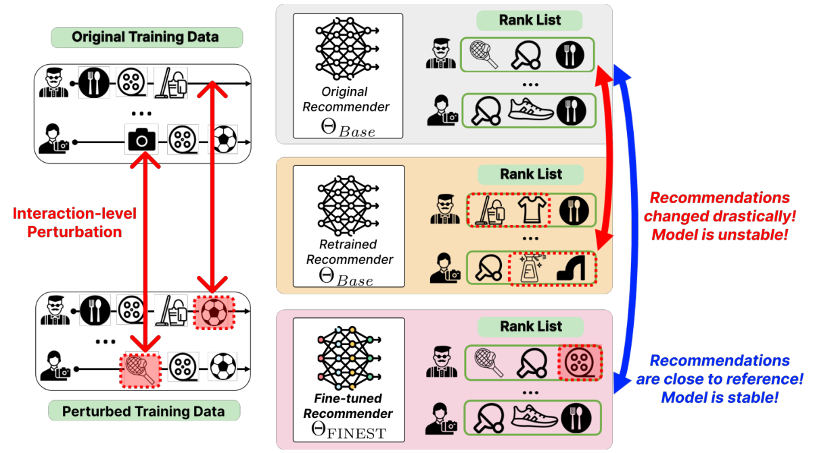
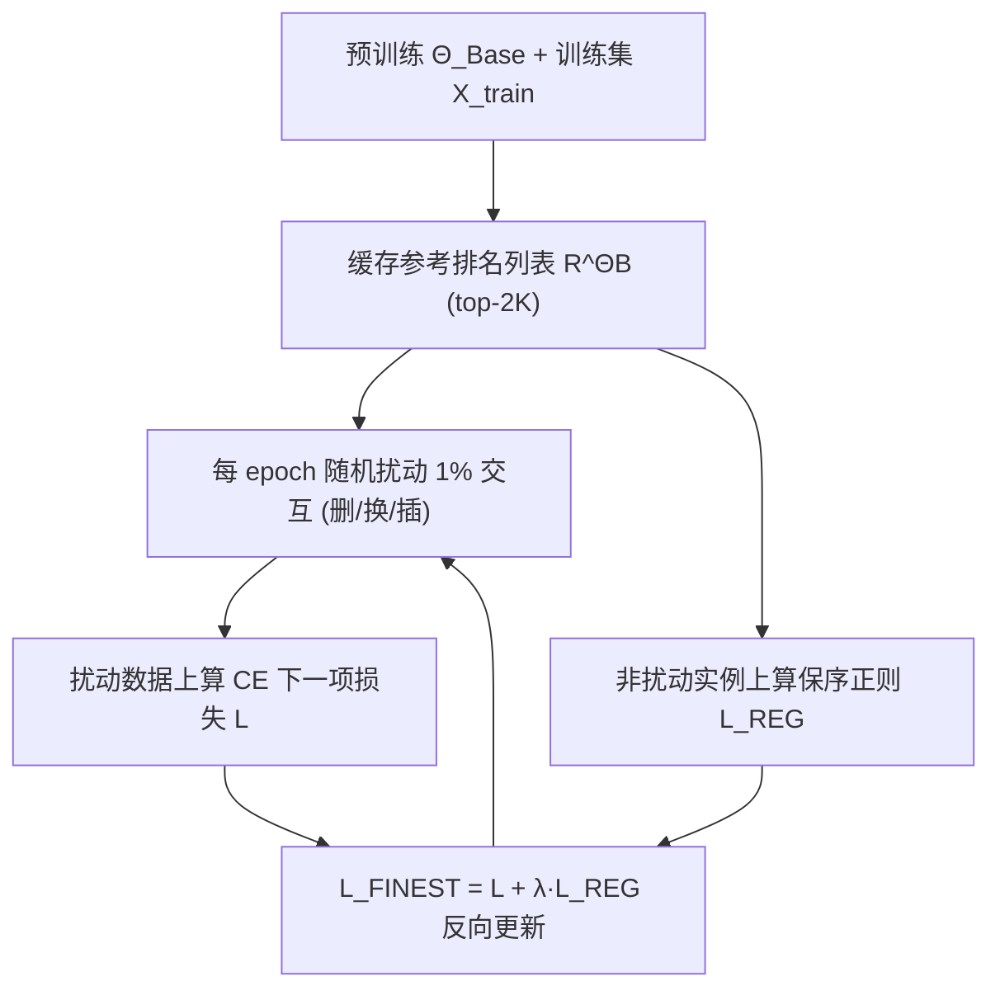

# FINEST: Stabilizing Recommendations by Rank-Preserving Fine-Tuning (基于保序微调的推荐稳定性增强)

- **会议/期刊**: FAccTRec Workshop @ ACM RecSys（arXiv 2402.03481, 2024-02）
- **作者与机构**: Sejoon Oh (Georgia Tech)、Berk Ustun、Julian McAuley (UCSD)、Srijan Kumar (Georgia Tech)
- **推荐链路定位**: 精排（序列下一项预测）模型的训练后微调，输出 top-K 排名列表
- **研究方向**: 去偏公平与可信推荐（鲁棒性/稳定性） / 序列与会话推荐
- **论文原文**: [arXiv:2402.03481](https://arxiv.org/abs/2402.03481v1)
- **开源代码**: 暂未开源

## TL;DR (1分钟核心速览)

序列推荐模型对训练集中极少量交互扰动（0.1%）极为敏感，单个用户的增删改即可让**全体用户**的排名列表大幅漂移，而现有鲁棒训练方法只盯住"正确答案那一个物品"的名次。本文提出 FINEST：先冻结一个已训练好的基座模型为每个训练样本生成**参考排名列表**，再在每个 epoch 随机扰动 1% 交互做伪扰动模拟，并施加 **top-2K 保序正则**（约束参考 top-K 相对次序与"竞争项"分数），与下一项 CE 联合微调。在 LastFM/Foursquare/Reddit 上，CASPER 删除扰动下 RBO 最高 +24%、Top-10 Jaccard 最高 +136%，同时 MRR/Recall@10 反升。

## Background & Motivation (背景与核心矛盾)

- **主流范式**: 序列推荐（TiSASRec/BERT4Rec/LSTM）以交叉熵拟合下一项，评测只看 MRR/Recall@10 这类"单点名次"指标。
- **前人局限**: 其一，APT/CAT/ACAE 等鲁棒训练只保证**真值物品**在扰动下的名次稳定，列表中其余物品的相对次序仍可任意翻转；其二，对比学习/排序蒸馏类方法（如 Yue 等的 data-free 蒸馏）以随机负样本作"竞争者"，若随机负样本在参考列表中本就排名极低，则完全无法阻止真正的竞争项挤进 top-K。
- **核心洞察 (Key Insight)**: 稳定性是一种**列表级 (list-level) 性质**——Hao 等 (CASPER) 已表明交互级扰动经"交互依赖图"级联传播后可击穿整个列表；因此锚点不应是标签，而应是模型自身在扰动前输出的完整 top-K 序列（自蒸馏式锚定）。
- **本文切入点**: 没有外部"真参考列表"，就用预训练模型自己造一个；扰动空间不可枚举，就用每 epoch 变化的随机伪扰动做 Monte-Carlo 覆盖，配合可微的保序正则。

<figure class="paper-figure" markdown="span">
  <figcaption>图 1. 序列推荐模型可能因训练数据中用户交互的微小扰动而输出截然不同的排名列表。此处，我们展示一个用户交互训练数据集（“原始”）以及一个包含微小扰动的副本（“扰动后”，扰动以红色高亮）。使用各数据集训练的推荐系统将为终端用户输出不同的排名列表（右上和右中）。我们提出的方法 FINEST（右下）将稳定输出，以确保使用“扰动数据集”训练时返回与……一样的排名列表。</figcaption>
</figure>

## Method (核心方法设计)

### 1. 整体框架 (Overall Architecture)

给定已充分训练的 $\Theta_{\text{Base}}$，Step 1 对全部训练实例$X_n\in X_{\text{train}}$前向推理，缓存其参考排名列表$R^{\Theta_B}_{X_n}$（取 top-$2K$作为后续采样池）。随后$T$个 epoch 的循环中：随机采样比例$R$（默认 1%）的交互，以等概率执行删除 / 把物品替换为**最不流行物品** / 在其时间戳前插入最不流行物品，得到$X_{\text{pert}}$；在被扰动数据上算下一项 CE，同时在**未被扰动的实例**上算保序正则，二者联合反传更新$\Theta_{\text{FINEST}}$。测试阶段模型原样使用，不感知测试期扰动类型。整体为"锚定—仿真—约束"三段的模型无关微调插件。

### 2. 关键设计拆解 (Key Designs)

1. **保序正则（Rank-Preserving Regularization）**：既然全库 $|\mathcal{I}|$量级的次序约束不可计算，就只在参考 top-$2K$上做局部保序。设参考列表前$2K$项为$\{i_1,\dots,i_{2K}\}$（注意取自$\Theta_B$ 而非当前微调模型），则

$$\mathcal{L}_{\text{REG}}(X_n)=\sum_{k=1}^{K-1}\max\big(\Theta_F(i_{k+1})-\Theta_F(i_k)+\lambda_1,0\big)+\sum_{k=1}^{K}\max\big(\Theta_F(i_{k+K})-\Theta_F(i_k)+\lambda_2,0\big)$$

   第一项是 **ordering-preserving**：用 hinge margin $\lambda_1$强制参考 top-K 内部相邻项的分差次序不倒挂；第二项是 **score-preserving**：把参考第$K{+}1\sim 2K$名这批"竞争项"压到参考 top-K 之下，margin$\lambda_2$ 提供安全间隔，从而保证 top-K 集合本身不被替换。相较随机负样本蒸馏，这里的"竞争者"是**真实的近边界项**，故对 top-K 边界漂移最敏感、最有效。
2. **动态伪扰动模拟（Perturbation Simulation）**：一次性扰动会被模型记住，故每个 epoch 重新采样不同交互子集与扰动算子，等价于对扰动分布做随机平滑；插入/替换统一选**最不流行物品**，因为作者复用 CASPER 的结论——冷门物品造成 RLS 下降最严重，属于最坏情形近似（min-max 的廉价替代）。
3. **训练目标、负采样与推理开销**：总损失 $\mathcal{L}_{\text{FINEST}}=\mathcal{L}+\lambda\mathcal{L}_{\text{REG}}$，$\mathcal{L}$为全库 softmax 交叉熵（免负采样，$|\mathcal{I}|$归一化）；$\mathcal{L}_{\text{REG}}$只统计$X_{\text{train}}\setminus X_{\text{pert}}$（扰动实例无参考列表可用）。超参$\lambda=1.0$、$\lambda_1=\lambda_2=0.1$、$2K=200$、50 epoch。时间/空间复杂度对交互数与物品数近线性；推理期零额外开销，仅在训练期多一次 top-2K 打分与正则反传。

## Experimental Setup & Evaluation Protocol (实验设置与评估协议)

- **数据集与预处理**（过滤交互数 < 10 的用户）：

| 数据集 | #Users | #Items | #Interactions | 稀疏度/密度 | 特征/场景说明 |
| :--- | :---: | :---: | :---: | :---: | :--- |
| LastFM | 980 | 1,000 | 1,293,103 | 密度 1.32 | 音乐播放历史 (user, music, ts) |
| Foursquare | 2,106 | 5,597 | 192,602 | 密度 0.016 | POI 签到 (user, location, ts) |
| Reddit | 4,675 | 953 | 134,489 | 密度 0.030 | 子版块发帖历史 |

- **数据划分与防穿越**: 逐用户 `比例划分`（按时间取前 90% 作训练/验证、末 10% 作测试），严格时间序，无未来交互泄漏。
- **排名评测协议**: 训练/测试打分均为 `Full-Ranking`（未采样全库排序，TiSASRec 因原论文按 sampled 指标优化故绝对 MRR 偏低）。稳定性指标为 **RLS**：$\text{RLS}=\frac{1}{|X_{\text{test}}|}\sum_{X_n}\text{sim}(R^{\Theta}_{X_n},R^{\Theta'}_{X_n})$，sim 取 **RBO**（$p=0.9$，位置加权，主指标）与 **Top-10 Jaccard**（集合重叠）；并报告 MRR、Recall@10。测试期施加 0.1% 扰动（Random / Earliest-Random / Latest-Random / CASPER-IDAG 级联攻击）。
- **对比基线与超参**: 6 个微调基线（Original 不微调、Random、Earliest-Random、Latest-Random、APT、ACAE）× 3 个目标模型（TiSASRec、BERT4Rec、LSTM）；Embedding $d=128$、序列长 50、lr 0.001、训练 100 epoch + 微调 50 epoch；3 次随机种子取均值，单尾$t$-test，$p<0.05$。

## Key Experimental Results (实验关键数据)

### 1. 主实验对比 (Main Results)

CASPER 级联删除扰动下（最强攻击），RLS 指标 RBO / Top-10 Jaccard：

| 方法 | LastFM-TiSASRec | LastFM-BERT4Rec | Foursquare-TiSASRec | Foursquare-BERT4Rec |
| :--- | :---: | :---: | :---: | :---: |
| Original (无微调) | 0.694 / 0.200 | 0.754 / 0.316 | 0.779 / 0.284 | 0.796 / 0.357 |
| Random | 0.702 / 0.215 | 0.773 / 0.366 | 0.769 / 0.266 | 0.815 / 0.415 |
| Earliest-Random | 0.702 / 0.212 | 0.774 / 0.364 | 0.774 / 0.266 | 0.815 / 0.414 |
| Latest-Random | 0.703 / 0.220 | 0.777 / 0.367 | 0.762 / 0.263 | 0.816 / 0.417 |
| APT | 0.701 / 0.212 | 0.775 / 0.363 | 0.790 / 0.325 | 0.809 / 0.400 |
| ACAE | 0.699 / 0.210 | 0.773 / 0.365 | 0.787 / 0.303 | 0.807 / 0.388 |
| **FINEST** | **0.873 / 0.519** | **0.832 / 0.476** | **0.937 / 0.650** | **0.879 / 0.506** |
| Improv. (vs 最优基线) | +24.1% / +136% | +7.5% / +30% | +18.6% / +100% | +7.7% / +21% |

随机删除扰动下同趋势：LastFM-TiSASRec 0.753/0.275 → **0.921/0.659**（+21%/+119%），LSTM 0.769/0.269 → **0.904/0.590**（+15%/+97%）。精度侧（表 4，无扰动）不降反升：LastFM-BERT4Rec MRR 0.158→0.168、Recall@10 0.318→0.343；Foursquare-BERT4Rec 0.162→0.175、0.267→0.283（均 $p<0.05$）。

### 2. 消融实验 (Ablation Study)

BERT4Rec + LastFM + CASPER 删除扰动：

| 变体 | RBO | Jaccard | MRR | Recall@10 |
| :--- | :---: | :---: | :---: | :---: |
| Original（不微调） | 0.7538 | 0.3157 | 0.1580 | 0.3181 |
| w/o 扰动模拟 | 0.8124 | 0.4349 | 0.1634 | 0.3324 |
| w/o top-K 正则 | 0.7734 | 0.3662 | 0.1665 | 0.3366 |
| w/o 第一项（ordering） | 0.8268 | 0.4658 | 0.1663 | 0.3379 |
| w/o 第二项（score） | 0.7955 | 0.4245 | 0.1713 | 0.3513 |
| **FINEST（完整）** | **0.8324** | **0.4757** | 0.1682 | 0.3434 |

### 3. 关键实验发现 (Key Findings)

1. **增益随基座脆弱度放大**：最不稳的 TiSASRec 在 Foursquare 上 Jaccard 从 0.284 拉到 0.650（+129%），而已较稳的 BERT4Rec 仅 +21%——说明 FINEST 修的是"列表整体漂移"这一共性缺陷，而非某个模型的特定弱点。
2. **正则比扰动模拟更关键**：去掉 top-K 正则 RBO 掉到 0.7734（接近不微调），而只去扰动模拟仍有 0.8124；正则内部又以 **score-preserving（第二项）** 贡献更大（去之 0.7955 vs 去 order 项 0.8268），即"把近边界竞争项压下去"比"内部相邻不倒挂"更决定 top-K 集合是否被替换。
3. **稳定性与公平性联动改善**：在 LastFM 低精度用户组（MRR 最低 20%），无 FINEST 时其稳定性差距高达 143%，加 FINEST 后收窄至 62%，直接缓解了扰动敏感性造成的 "rich get richer" 群体不公；同时 1% 扰动模拟带来隐式数据增广，使其在 Steam (7.8M 交互) 上 RBO 0.763→0.853 且耗时仅 9.7 小时。

## Highlights & Limitations (亮点、对比与审稿批判)

- **与代表作对比 (vs. Prior Work)**: 相比 CASPER（只做攻击诊断、不改模型）、APT/CAT（只稳真值物品名次）、ACAE（对参数加梯度噪声），FINEST 是首个**模型无关、免重训、面向整条 top-K 列表**的序列推荐稳定化微调；相比 data-free 蒸馏用随机负样本当竞争者，其竞争者取自参考列表 $K{+}1\sim2K$ 的真实近邻，故 top-K 边界保持力显著更强。
- **可迁移亮点**: ①"用自身预测缓存做锚点 + 每 epoch 重采样扰动"的轻量自蒸馏范式，可平移到召回双塔、CTR 精排的线上重训抖动抑制；②把稳定性差距作为群体公平性度量（低精度用户组对比），是可信推荐评测的廉价增量指标。
- **审稿级局限批判**: ①参考列表来自待稳定模型自身，若基座本身有偏或精度不足，正则会**固化原有排名偏差**并抑制合理的兴趣演化（作者亦承认冷启动用户本不该被稳定）；②评测仅覆盖 3 个小数据集（MovieLens-10M/Steam 只在文中简述），且只有删除类扰动做完整表格，插入/替换/混合仅以图形式给出，缺少对 $\lambda_1,\lambda_2$与采样率$R$ 的系统敏感性分析；③每 epoch 需缓存全训练集 top-2K 打分，千万级交互下显存与 I/O 开销未量化。

## Rating (四维评分)

- **方法创新性 (Novelty)**: ⭐⭐⭐⭐ （把"稳定性"形式化为列表级保序约束，并用真实近邻竞争者替代随机负样本，思路清晰但属自蒸馏框架内的精巧工程改良）
- **评估协议与实验扎实度 (Protocol & Experiments)**: ⭐⭐⭐⭐ （3 数据集×3 模型×6 基线×4 扰动，Full-Ranking + 显著性检验齐全；但大规模数据集与扰动类型覆盖不完整）
- **写作与数学规范度 (Clarity & Rigor)**: ⭐⭐⭐⭐ （两段式 hinge 正则动机—公式—直觉链条完整，伪扰动与参考列表边界条件交代清楚；缺少复杂度与收敛性形式化分析）
- **工业落地与复现价值 (Industrial & Practical Value)**: ⭐⭐⭐⭐ （推理零开销、可直接套用在已部署模型上，仅需离线跑 50 epoch 微调；但无开源代码且显存开销未公开）

