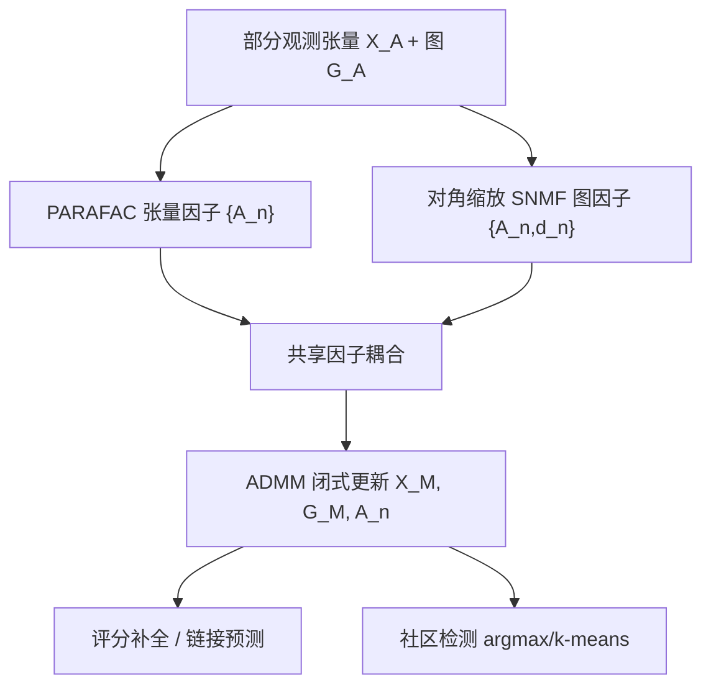
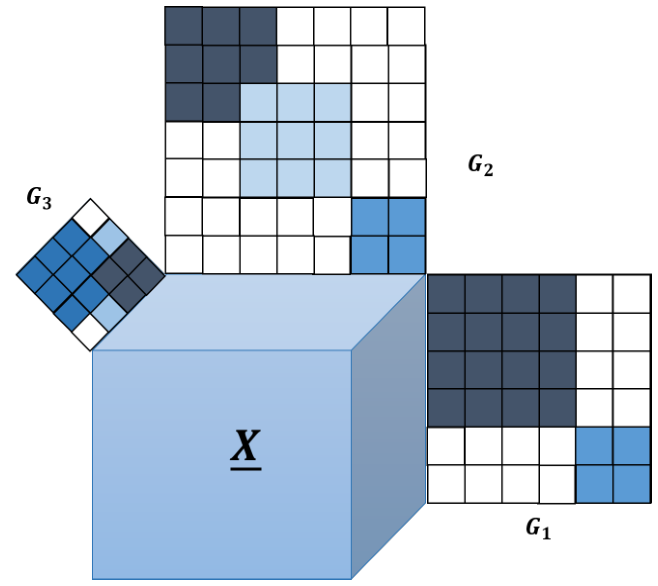

# Coupled Graphs and Tensor Factorization for Recommender Systems and Community Detection (耦合图与张量分解用于推荐系统与社区检测)

- **会议/期刊**: IEEE TKDE（arXiv 2018，v2 2019）
- **作者与机构**: Vassilis N. Ioannidis, Ahmed S. Zamzam, Georgios B. Giannakis, Nicholas D. Sidiropoulos；University of Minnesota / University of Virginia
- **推荐链路定位**: 召回（张量补全/评分预测，非排序链路）
- **研究方向**: 协同过滤与双塔召回 / 图神经网络与知识图谱推荐
- **论文原文**: [https://arxiv.org/abs/1809.08353v2](https://arxiv.org/abs/1809.08353v2)
- **开源代码**: [https://github.com/bioannidis/Coupled](https://github.com/bioannidis/Coupled)

## TL;DR (1分钟核心速览)

针对多关系评分张量稀疏且图侧信息本身也缺失的场景，本文提出 CGTF：用 PARAFAC 分解评分张量，同时用对角缩放 SNMF 将每模态图邻接矩阵与同一因子矩阵耦合，并用 ADMM 闭式更新补全张量与图。在 Activities/Digg 的随机缺失补全协议下，40% 缺失时 NMSE 0.46，较最优基线 0.98 降低 53.1%；50% 缺失时 0.68，降低 29.2%。

## Background & Motivation (背景与核心矛盾)

- **主流范式**: 多关系推荐常把用户-物品-上下文建成高阶张量，用 PARAFAC/NTF 低秩补全缺失评分；图侧信息则用 CMTF 或 SNMF 单独处理。
- **前人局限**: CMTF 把侧信息写成 $\mathbf{A}_n\mathbf{B}_n^\top$，无法表达对称图邻接矩阵的社区块结构，且通常假设侧矩阵完整；PARAFAC/NTF 完全不用图，SNMF 只用图不用张量，二者在缺失切片/缺失链接时都退化。
- **核心洞察 (Key Insight)**: 图邻接矩阵本身可由对称非负低秩模型生成，行最大即社区；让张量与图共享同一 $\mathbf{A}_n$，就能用张量补图、用图补张量。
- **本文切入点**: 把图结构作为 SNMF 耦合项加入 PARAFAC 目标，设计闭式 ADMM 同时补全 $\mathbf{X}$与$\mathbf{G}$，并把因子用于社区检测。

## Method (核心方法设计)

### 1. 整体框架 (Overall Architecture)

输入是部分观测的三阶张量 $\mathbf{X}_A$（用户-地点-活动/用户-故事-时间）与每模态图邻接矩阵$\{\mathbf{G}_{n,A}\}$。CGTF 用 PARAFAC 低秩因子$\{\mathbf{A}_n\}$同时重建张量与图：张量项拟合多关系评分，图项用对角缩放 SNMF 拟合社区结构。ADMM 通过辅助变量把非凸双线性图项与非遗束解耦，逐块闭式更新因子、缺失张量切片和缺失图链接；收敛后用$\mathbf{A}_n$ 的行最大或 k-means 得到社区。

<figure class="paper-figure" markdown="span">
  <figcaption>图 2：参与 CGTF 模型的张量和图的示意图。热图表明 {Gn}3</figcaption>
</figure>
图 2：CGTF 将评分张量与各模态图邻接矩阵通过共享因子耦合（原文图 2）。

### 2. 关键设计拆解 (Key Designs)

1. **图结构侧信息耦合（diagonal-scaled SNMF）**：CMTF 的 $\mathbf{A}_n\mathbf{B}_n^\top$既不对称，也不保证社区块结构；本文改为$\mathbf{G}_n=\mathbf{A}_n\operatorname{diag}(\mathbf{d}_n)\mathbf{A}_n^\top+\mathbf{V}_n$。$\mathbf{d}_n$调节图项与张量项的相对权重，$\mathbf{A}_n$ 行最大即节点社区，缺失行列可由共享因子补全。

2. **ADMM 闭式求解**：目标为
   $\min\|\mathbf{X}-\sum_{r=1}^R\mathbf{a}_{1r}\circ\mathbf{a}_{2r}\circ\mathbf{a}_{3r}\|_F^2+\mu\sum_{n=1}^3\|\mathbf{G}_n-\mathbf{A}_n\operatorname{diag}(\mathbf{d}_n)\mathbf{A}_n^\top\|_F^2$由于图项双线性非凸，直接块坐标下降需内层 NMF。引入$\bar{\mathbf{A}}_n$、$\tilde{\mathbf{A}}_n,\tilde{\mathbf{d}}_n$拆分后，$\mathbf{A}_1$ 更新可写成
   $\hat{\mathbf{A}}_1=(\mathbf{X}_1^\top\mathbf{M}_1+\mu\mathbf{G}_1\bar{\mathbf{A}}_1\mathbf{D}_1+\rho_{\bar A_1}\bar{\mathbf{A}}_1+\rho_{\tilde A_1}\tilde{\mathbf{A}}_1-\mathbf{Y}_{\bar A_1}-\mathbf{Y}_{\tilde A_1})(\mathbf{M}_1^\top\mathbf{M}_1+\mu\mathbf{D}_1\bar{\mathbf{A}}_1^\top\bar{\mathbf{A}}_1\mathbf{D}_1+(\rho_{\bar A_1}+\rho_{\tilde A_1})\mathbf{I}_R)^{-1}$，
   其中 $\mathbf{M}_1=\mathbf{A}_3\odot\mathbf{A}_2$，$\mathbf{D}_1=\operatorname{diag}(\mathbf{d}_1)$。闭式解避免每步解 NMF，并可在对偶变量有界时证明 KKT 收敛。

3. **训练目标、负采样与推理**：总损失即上述观测位置的最小二乘拟合，无 BPR/InfoNCE 负采样；$\mu$控制图与张量权衡。推理为因子外积与图重构，社区检测为$\hat{\alpha}_{n,i}=\arg\max_r[\mathbf{C}_n]_{i,r}$，$\mathbf{C}_n=\mathbf{A}_n\operatorname{diag}(\sqrt{\mathbf{d}_n})$；当社区数不等于$R$时用 k-means。每轮成本约$O(I_1I_2I_3R+\sum_n I_n^2R)$，实际运行接近 PARAFAC。

## Experimental Setup & Evaluation Protocol (实验设置与评估协议)

- **数据集与预处理**: 无 `5-core` 过滤；无用户/物品冷启动划分；仅按缺失率随机遮盖，属于转导式补全。

| 数据集 | #Users | #Items | #Interactions | 稀疏度/密度 | 特征/场景说明 |
| :--- | :---: | :---: | :---: | :---: | :--- |
| Activities | 164 | 168 | 137,760 可能条目（二值） | 实验注入 40%/50% 缺失 | 用户-地点-活动；28 用户无社交图，32 地点无特征 |
| Digg | 175 | 800 | 2,800,000 可能条目（计数） | 40% 张量 + 30% 图缺失 | 用户-故事-时间；用户社交图 + 故事关键词图 |
| Synthetic | 350 | 350 | 3,675,000 条目 | 350×350×30，$R=4$ | PARAFAC 生成，SNR 5–35 dB |

- **数据划分与防穿越 (Splitting Strategy)**: 随机缺失注入，非 `Leave-One-Out`、非比例划分、非全局时间戳切分；训练与测试共享同一张量，不存在时间穿越，但也不是严格新用户/新物品泛化。
- **排名评测协议 (Ranking Protocol)**: 非无偏 `Full-Ranking`，也无 `Sampled Ranking`；指标为 NMSE、ROC、NMI、coverage-conductance。无负采样，无排序候选集。
- **对比基线与超参设置**: 补全基线 NTF、PARAFAC、CMTF；社区检测基线 SNMF、NewmanF、SP、Potts、AFG。秩 $R=4/5/10$，$\rho=100$，$\mu=1.1$（合成）/$10^{-4}$（Activities）；未报告显著性检验。

## Key Experimental Results (实验关键数据)

### 1. 主实验对比 (Main Results)

原文仅表 1 给出 NMSE 数值；ROC 与 coverage 为图 7–12 曲线，未给数值表，故下表保留可核查的全部补全基线。

| 方法 | 图侧信息建模 | 40% 缺失 NMSE | 50% 缺失 NMSE |
| :--- | :--- | :---: | :---: |
| NTF | 无 | 0.995 | 0.990 |
| PARAFAC | 无 | 1.016 | 0.960 |
| CMTF | $\mathbf{A}_n\mathbf{B}_n^\top$ | 0.980 | 0.990 |
| **CGTF** | **$\mathbf{A}_n\operatorname{diag}(\mathbf{d}_n)\mathbf{A}_n^\top$** | **0.460** | **0.680** |
| **Improv.** | — | **53.1%** | **29.2%** |

### 2. 消融实验 (Ablation Study)

原文未报告逐组件 `w/o` 数值消融；下表按主表模型变体与图 7–图 9 归纳可核查的组件证据。

| 消融/敏感性 | 设置 | 结果 |
| :--- | :--- | :--- |
| 去图项 | PARAFAC/NTF | 40% NMSE 1.016/0.995，远差于 CGTF 0.46 |
| 错误耦合形式 | CMTF 用 $\mathbf{A}_n\mathbf{B}_n^\top$ | 40% 0.98、50% 0.99，高缺失时未优于无图 PARAFAC |
| 初始化 | 随机 vs SNMF | 图 7 显示随机初始化在高缺失下 ROC 差距扩大 |
| 图缺失 | G1 仅 10% 链接可观测 | SNMF 的 NMI 失效，CGTF 仍可借张量恢复社区 |

### 3. 关键实验发现 (Key Findings)

1. 40% 缺失时 CGTF 0.46，较 CMTF 0.98 降低 53.1%，说明把图邻接矩阵按 SNMF 建模而非 $\mathbf{A}_n\mathbf{B}_n^\top$ 是主要增益来源；图项不是简单正则，而是补全缺失行列的第二观测源。
2. 50% 缺失时增益收窄至 29.2%（0.68 vs 0.96），且 CMTF 0.99 反而不如无图 PARAFAC 0.96，表明错误图耦合形式在高缺失率时会注入偏差；$\mu$ 与图观测率需联合调节。
3. 图 1 仅 10% 链接可观测时，SNMF 的 NMI 明显失效，CGTF 仍能借张量恢复社区；图 7 进一步显示随机初始化与 SNMF 初始化的 ROC 差距在高缺失下扩大，说明初始化与对角载荷 $\mathbf{d}_n$ 对非凸 ADMM 收敛至关重要。

## Highlights & Limitations (亮点、对比与审稿批判)

- **与代表作对比 (vs. Prior Work)**: CMTF 只做矩阵-张量耦合，把图写成 $\mathbf{A}_n\mathbf{B}_n^\top$，不保证对称与社区结构；SNMF 只利用图、无法借张量补链接；PARAFAC/NTF 完全不用图。CGTF 的关键差异是把图邻接矩阵作为对角缩放 SNMF 与张量共享因子，并允许图与张量同时缺失。
- **可迁移亮点**: 对角缩放 $\operatorname{diag}(\mathbf{d}_n)$ 可作为任意“图正则/多源耦合”中调节模态权重的轻量技巧；ADMM 拆分辅助变量把非凸双线性项转为闭式更新，适合其他张量-图联合补全任务。
- **审稿级局限批判**: 评估不符合现代推荐系统标准：无 `Full-Ranking`、无负采样、无时间切分，且 Activities/Digg 规模很小、缺失为随机注入而非 MNAR，结论对真实曝光偏差未必成立；ADMM 的 $\mu,\rho$ 敏感，收敛仅保证到 KKT 点，社区检测指标又仅以曲线呈现，复现与公平比较仍受限。

## Rating (四维评分)

- **方法创新性 (Novelty)**: ⭐⭐⭐⭐ （把图邻接矩阵写成对角缩放 SNMF 并与 PARAFAC 共享因子，较 CMTF 的 $\mathbf{A}_n\mathbf{B}_n^\top$ 更贴合图结构，且给出闭式 ADMM 与 KKT 收敛分析）
- **评估协议与实验扎实度 (Protocol & Experiments)**: ⭐⭐⭐ （有合成+两个真实数据集与多基线，但无标准推荐排序协议、数据规模小、无显著性检验，数值表仅 NMSE 完整）
- **写作与数学规范度 (Clarity & Rigor)**: ⭐⭐⭐⭐ （目标函数、ADMM 更新与收敛证明较完整，符号密集但对偶拆分逻辑清楚；部分实验仅给图不给数值）
- **工业落地与复现价值 (Industrial & Practical Value)**: ⭐⭐⭐ （代码已开源，闭式更新运行接近 PARAFAC，但方法面向小规模张量补全，扩展到大规模工业召回仍需稀疏化与分布式 ADMM）

