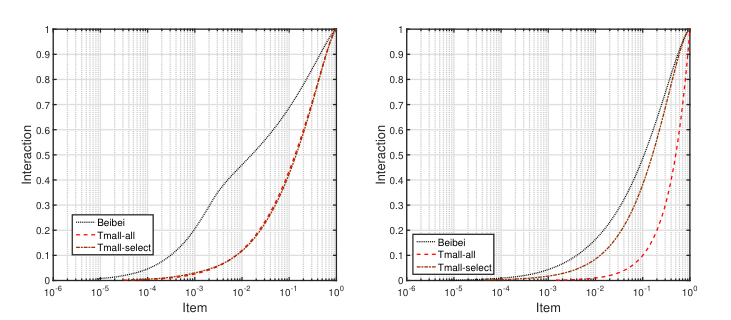
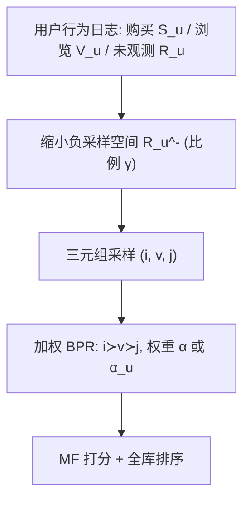
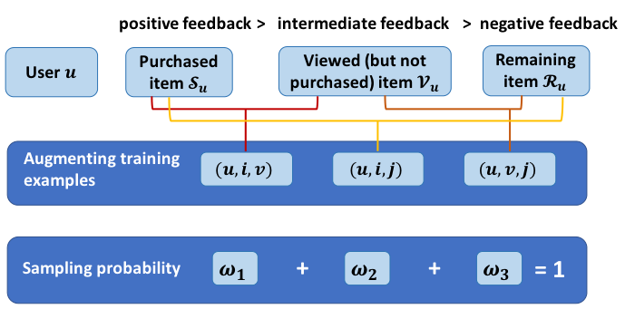

# Sampler Design for Bayesian Personalized Ranking by Leveraging View Data (借助浏览数据设计 BPR 采样器)

- **会议/期刊**: IEEE TKDE（arXiv 预印本 2018-09-21，作者投稿版）
- **作者与机构**: Jingtao Ding, Guanghui Yu, Xiangnan He, Yong Li, Depeng Jin（清华大学电子工程系 BNRist；新加坡国立大学）
- **推荐链路定位**: 召回（候选生成阶段的 pairwise 隐式反馈学习）
- **研究方向**: 协同过滤与双塔召回（矩阵分解 + 负采样理论）
- **论文原文**: [https://arxiv.org/abs/1809.08162v1](https://arxiv.org/abs/1809.08162v1)
- **开源代码**: 暂未开源

## TL;DR (1分钟核心速览)

本文质疑 BPR 的两个默认假设：负样本必须从全物品空间均匀采样、以及负样本只分"正/负"两类。作者先在 Beibei 上证明把负采样空间压缩到 $1/32$反而 **+2.36% HR**；随后把电商"浏览未购买"视为介于购买与未观测之间的**中间反馈**，提出三元组$(i,v,j)$采样与加权 BPR 损失，并用会话级浏览-购买比$A_u$生成用户自适应权重$\alpha_u$。在 Leave-One-Out + 全库排序协议下，HR@100 相对 vanilla BPR 提升 **35.64%（Beibei）/ 17.09%（Tmall-selected）**，NDCG 提升 38.43% / 15.71%。

## Background & Motivation (背景与核心矛盾)

- **主流范式**: 隐式反馈 one-class 场景下，BPR 用 $(u,i,j)$三元组做 pairwise 排序，负样本$j$ 从全物品空间均匀采样；改进路线是 DNS（动态难负样本）与多通道反馈 BPR（MC-BPR）。
- **前人局限 ①**: 全空间采样在物品数上万时效率低，且在**流行度偏斜数据**上会反复抽到热门物品，让冷门物品梯度步数不足（Rendle 已指出过采样热门负样本更差）。
- **前人局限 ②**: 浏览/加购等辅助行为或走 CMF 多关系路线（每种行为一套隐因子，无法比较偏好强弱），或只把浏览当"正"或"负"单一语义塞进采样概率，无法同时表达**双面语义**。
- **核心洞察 (Key Insight)**: 用户通常"先看后买"，因此浏览过未购买的物品预测分应满足 $\hat{r}_{ui} > \hat{r}_{uv} > \hat{r}_{uj}$——浏览器既比未观测强、又比购买弱，天然是一条可排序的中间锚点。
- **本文切入点**: 用一组三项排序关系替代单一正负对，把"负采样"问题转化为"采样空间压缩 + 多关系加权损失"问题。

<figure class="paper-figure" markdown="span">
  <figcaption>图 1. Beibei 和 Tmall 数据集的流行度偏度。</figcaption>
</figure>

## Method (核心方法设计)

### 1. 整体框架 (Overall Architecture)

模型本体仍是标准 MF（$\hat{r}_{ui}=\boldsymbol{p}_u^{\top}\boldsymbol{q}_i$，$K=32$），全部创新集中在**采样器与损失层**：训练前先为每个用户预生成一个固定的缩小负候选集$R_u^{-}$（比例$\gamma$）；每次 SGD 迭代从"已购集$S_u$/ 浏览集$V_u$/ 未观测集$R_u$"中抽一个三元组$(i,v,j)$，用三项加权 BPR 损失联合约束$i \succ v \succ j$，权重$\alpha$可为全局常数或由用户浏览-购买比$A_u$参数化为$\alpha_u$。推理时对全部未交互物品打分排序，无额外开销。

### 2. 关键设计拆解 (Key Designs)

1. **压缩负采样空间（不是全空间才好）**：针对全空间采样低效，为每个用户一次性均匀抽 $\gamma N$个未交互物品并**固定**为$R_u^{-}$，后续迭代只在此子集采样。物理直觉：固定候选集让偏斜数据中的冷门物品获得更多梯度步，等价于隐式地做了"去热度重加权"，在强偏斜 Beibei 上甚至优于全空间。
2. **三元加权排序损失 BPR+viewloss（双面语义联合学习）**：针对 BPR+viewprob 需靠 $\omega_1/\omega_3$ 概率间接决定浏览是"正"还是"负"、单样本只能承载一种语义的缺陷，改为一次迭代内同时约束三条关系：

$$\mathcal{L}=-\ln\sigma(\hat{r}_{ui}-\hat{r}_{uj})-\alpha\ln\sigma(\hat{r}_{ui}-\hat{r}_{uv})-(1-\alpha)\ln\sigma(\hat{r}_{uv}-\hat{r}_{uj})$$

$\alpha$直接调节"浏览≈负反馈"与"浏览≈弱正反馈"的相对强度；$\alpha=1$退化为把浏览等同未观测（实验证明会掉点），$\alpha\to0$ 则把浏览等同购买。
3. **用户自适应权重 $\alpha_u$与训练开销**：针对不同用户"货比三家"程度不同，先按时间戳阈值$d=3600$s 切分会话，统计会话级浏览/购买比$A_u=\frac{1}{|S|}\sum_s V_{u,s}/P_{u,s}$，再映射为

$$\alpha_u=\frac{A_u^{\beta}}{A_u^{\beta}+1}$$

$\beta<1$起到平滑作用（Beibei 最优$\beta=0.5$）：浏览越多却买得越少，浏览的"负信号"越强。梯度仍为$O(K)$/次，总复杂度$O(TK)$，与 BPR 同级，另加一次$O(|V|)$ 的预采样。

<figure class="paper-figure" markdown="span">
  <figcaption>图 2. 考虑用户已查看物品的有偏采样过程。</figcaption>
</figure>

## Experimental Setup & Evaluation Protocol (实验设置与评估协议)

- **数据集与预处理**: 合并同用户同物品的重复购买（保留最早时间戳）；**删除已购物品的浏览记录以防信息穿越**；过滤购买数 <12 的用户与 <16 的物品。Tmall-selected 只保留 2014-10-01 之前交互，剔除双十一大促造成的浏览异常。

| 数据集 | #Users | #Items | #Interactions | 稀疏度(购买/浏览) | 特征/场景说明 |
| :--- | :---: | :---: | :---: | :---: | :--- |
| Beibei | 158,907 | 119,012 | 2,654,467 购 / 23,668,454 览 | 99.99% / 99.87% | 母婴电商，极强流行度偏斜（top-1% 物品占 50% 购买） |
| Tmall-all | 28,059 | 32,339 | 352,768 购 / 1,585,225 览 | 99.96% / 99.83% | 含双十一，浏览信号异常 |
| Tmall-selected | 12,921 | 22,570 | 160,840 购 / 531,640 览 | 99.94% / 99.82% | 大促前子集，可复现基准 |

- **数据划分与防穿越**: `Leave-One-Out`——每个用户**最后一次购买**留作测试，另随机取一次购买作验证集，验证损失上升即早停。
- **排名评测协议**: 对用户全部未购买物品打分排序，截断 $k=100$计算 HR@100 / NDCG@100（本质为 `Full-Ranking`，非小规模负采样排序），报告全用户平均。因子数固定$K=32$。
- **对比基线与超参**: Popularity（按购买热度）、vanilla BPR（均匀采样）、BPR-DNS（采样 $X$个候选取最高分难负样本）；缩小空间实验对每个$\gamma$重复 5 次报均值±方差；超参$[\omega_1,\omega_2,\omega_3]$、$\alpha$、$\beta$ 按验证集 HR 网格搜索。

## Key Experimental Results (实验关键数据)

### 1. 主实验对比 (Main Results)

| 方法 | Beibei HR | ΔHR | Beibei NDCG | ΔNDCG | Tmall-sel. HR | ΔHR | Tmall-sel. NDCG | ΔNDCG |
| :--- | :---: | :---: | :---: | :---: | :---: | :---: | :---: | :---: |
| Popularity | ≈BPR 水平 | – | – | – | – | – | – | – |
| BPR (baseline) | 0.1086 | – | 0.0242 | – | 0.0755 | – | 0.0191 | – |
| BPR-DNS | 未超越本文 | – | – | – | – | – | – | – |
| BPR+viewprob | 0.1422 | +30.93% | 0.0321 | +32.64% | 0.0807 | +6.89% | 0.0199 | +4.19% |
| BPR+viewloss | 0.1436 | +32.23% | 0.0327 | +35.12% | 0.0884 | +17.09% | 0.0221 | +15.71% |
| **BPR+viewβloss** | **0.1473** | **+35.64%** | **0.0335** | **+38.43%** | – (无会话时间戳) | – | – | – |

### 2. 消融实验 (Ablation Study)

| 配置 | 含义 | Beibei HR | Tmall-sel. HR | 结论 |
| :--- | :--- | :---: | :---: | :--- |
| BPR | 全空间均匀采样 | 0.1086 | 0.0755 | 参照 |
| BPR + 缩小空间 $\gamma=2^{-5}$ | 仅改采样空间 | 0.1116 (+2.36%) | ≈0.0300 (−1.33%) | 压缩空间本身即可获益/至少无损 |
| BPR + 缩小空间 $\gamma=2^{-10}$ | 每用户仅 116 候选 | 0.1105 (+1.39%) | 0.0295 (−2.06%) | 极小空间仍稳 |
| BPR+viewprob ($\omega$ 调优) | 仅偏置采样 | 0.1422 | 0.0807 | 浏览信号有效 |
| BPR+viewloss ($\alpha$=0.7/0.1) | 三元联合损失 | 0.1436 | 0.0884 | 双面语义优于单面 |
| BPR+viewloss, $\alpha=1$ | 浏览=未观测 | 明显掉点 | 明显掉点 | 浏览需保留弱正语义 |
| BPR+viewβloss ($\beta$=0.5) | 加用户自适应权重 | **0.1473** | – | 个性化权重再增益 |

### 3. 关键实验发现 (Key Findings)

1. **全空间采样确属浪费**：Beibei 上把负采样空间压到 $2^{-5}$（3,719 候选）HR 反而 +2.36%，压到 116 个候选仍 +1.39%；Tmall-all 上$\gamma>2^{-6}$ 时性能仅损 ≤1.33%。原因是固定小候选集让热门偏斜数据中的长尾物品获得更多梯度步，说明 BPR 的瓶颈在"采样分布"而非"候选规模"。
2. **"三项关系"优于"单对+概率"**：同样利用浏览数据，BPR+viewloss 相对 BPR+viewprob 在 Tmall-selected 上 HR 再提 10.20%、NDCG 再提 11.52%，印证了单次迭代同时编码 $i\succ v$与$v\succ j$ 才能避免浏览语义被单面化。
3. **浏览语义强度是数据相关的，必须可调**：Beibei 最优 $\alpha\in[0.7,0.8]$（浏览更接近负反馈）、$\omega_3/\omega_1\approx1$；Tmall-selected 最优$\alpha=0.1$、$\omega_3/\omega_1>1$（浏览更接近正反馈），且对$\alpha$明显敏感——用一个全局固定$\alpha$ 的模型会在跨数据集迁移时失效。此外 Beibei 上 Popularity 竟与 BPR 打平，直接暴露了该数据集的强流行度偏斜。

## Highlights & Limitations (亮点、对比与审稿批判)

- **与代表作对比 (vs. Prior Work)**: 与 BPR-DNS（扩大候选池挑难负样本）方向相反，本文主张**缩小**候选池并改变样本语义结构；与 MC-BPR 同样给不同行为分配偏好等级，但 MC-BPR 仍以"单对采样+概率加权"实现，本文在一次更新中显式联合三条排序关系；与 CMF/MFPR 的多关系隐因子不同，本文共享同一隐空间以保持偏好可比性。
- **可迁移亮点**: ①"固定缩小负候选集"是几乎零成本的训练加速/正则技巧，可直接插入任意 pairwise 召回训练；②把弱行为（曝光、点击、加购）当作排序链上的中间锚点、并用会话级行为比生成用户自适应权重，可平滑迁移到短视频完播、广告浅层转化等场景。
- **审稿级局限批判**: ① 模型本体仅 MF，未验证在神经/图召回（如 NCF、LightGCN）上是否同样成立，也未与后续更强的采样器做对比；② 缩小空间实验仅在 3 个物品量级较小的电商集上做，缺少百万级物品的工业验证与真实训练加速比数据；③ Tmall 因时间戳仅到天级无法构造会话，$\alpha_u$只在单数据集验证，$\beta$、$d=3600$s 属数据集特调；④ 主实验只报 HR/NDCG@100、单因字数$K=32$，无显著性检验，且摘要中的 37.03%/16.40% 与表内 38.43%/17.09% 略有出入。

## Rating (四维评分)

- **方法创新性 (Novelty)**: ⭐⭐⭐⭐ （把"浏览=中间反馈"形式化为三项排序链与用户自适应权重，思路简洁但缺乏理论/谱分析支撑）
- **评估协议与实验扎实度 (Protocol & Experiments)**: ⭐⭐⭐ （Leave-One-Out + 全库排序协议干净、重复 5 次报方差，但基线仅 BPR/DNS/Popularity，无显著性检验）
- **写作与数学规范度 (Clarity & Rigor)**: ⭐⭐⭐⭐ （三项损失与梯度推导完整、超参敏感性分析充分，符号表规范；$\alpha_u$ 的会话切分细节略依赖经验）
- **工业落地与复现价值 (Industrial & Practical Value)**: ⭐⭐⭐⭐ （改动只在采样与损失层，$O(TK)$ 复杂度与 BPR 同级、易上线；但代码未开源且缺少大规模工业验证）

