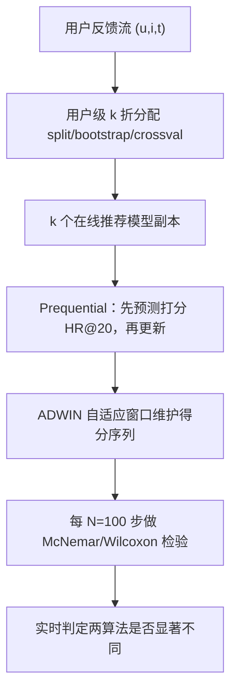
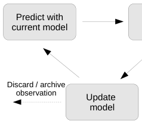

# Statistically Robust Evaluation of Stream-Based Recommender Systems (流式推荐系统的统计鲁棒评估)

- **会议/期刊**: IEEE TKDE (TKDE 2021)
- **作者与机构**: João Vinagre, Alípio Mário Jorge, Conceição Rocha, João Gama；LIAAD-INESC TEC 与波尔图大学等
- **推荐链路定位**: 全链路在线评估（面向流式召回/排序模型的通用评测，不限定模型结构）
- **研究方向**: 去偏公平、可信隐私与工业架构（评测基准与在线统计验证）
- **论文原文**: [论文原文链接](https://repositorio.inesctec.pt/server/api/core/bitstreams/d8eb293a-e6d7-4994-a954-424871621ce5/content)
- **开源代码**: 暂未开源

## TL;DR (1分钟核心速览)

流式推荐缺少可在线、可统计验证的成对评估协议：固定滑窗敏感、McNemar 易过拒、Wilcoxon 又需多折。本文把预序评估、用户级 k 折 split/bootstrap/crossval 与 ADWIN 自适应窗口结合，在 4 个隐式反馈流上以 HR@20 连续检验两算法差异；结果显示 Wilcoxon+bootstrap 在 I 类错误校准与 II 类检出力间最稳健。

## Background & Motivation (背景与核心矛盾)

- **主流范式**: 批式推荐用 holdout/交叉验证；流式推荐用 prequential（先预测打分、再更新模型）在真实到达顺序上评估，但统计验证仍多借用批式协议。
- **前人局限**: 固定滑窗大小对显著性结果影响极大，过大低估差异、过小高估差异；McNemar 虽可实例级在线使用，却常过拒原假设；Wilcoxon 需多折 trial，不能直接用于单流。
- **另一矛盾**: 推荐中同一用户交互高度相关，分类流式 k 折默认“样本可随机分折”的独立性假设在推荐中不成立；按观测分折会泄漏用户偏好。
- **核心洞察 (Key Insight)**: 若按“用户”而非单条交互分折，可把用户内相关隔离到折间；再用 ADWIN 自动调节窗口，就能在任意时刻做近似独立的在线成对检验。
- **本文切入点**: 将 Bifet 等面向分类流的 k 折分布式验证迁移到 Top-N 推荐，并用 ADWIN 实现 parameter-free 的连续统计检验。

## Method (核心方法设计)

### 1. 整体框架 (Overall Architecture)

输入是按时间到达的 $(u,i,t)$隐式反馈流。框架先为用户随机分配$k$个模型副本中的训练/测试折，每个副本用 ISGD 等增量算法维护；每条$(u,i)$先由当前模型对物品排序并计算 HR@20，再用于更新模型。两路算法的得分序列各自经 ADWIN 维护自适应窗口，每$N=100$ 步在最短公共窗口上做 McNemar/Wilcoxon 检验，输出是否拒绝“两算法无差异”的原假设。

<figure class="paper-figure" markdown="span">
  <figcaption>图1. 预序评估</figcaption>
</figure>
图 1：预序评估的先预测、再评分、后更新流程。

### 2. 关键设计拆解 (Key Designs)

1. **用户级 k 折分布式验证**：流式反馈中同一用户样本强相关，直接按观测分折会破坏独立性。本文将用户映射到折 $u\mapsto\{1,\dots,k\}$：split 中每用户只进 1 折，bootstrap 按$\mathrm{Poisson}(1)$抽样，crossval 让每折覆盖约$(k-1)/k$用户；预序评估让每个$(u,i)$ 只在所属折上“先测后训”，从而把用户间相关性隔离到折间。

2. **ADWIN 自适应窗口与在线检验**：固定窗口过大低估差异、过小高估差异。本文对两算法得分序列分别运行 ADWIN，检测分布漂移并自动缩短窗口；成对检验取 $w=\min(w_A,w_B)$保证样本对齐，McNemar 用$M=(n_{10}-n_{01})^2/(n_{10}+n_{01})$做实例级检验，Wilcoxon 用$W=\sum_{i=1}^{k}\operatorname{sign}(x_{A,i}-x_{B,i})R_i$ 做折级检验。

3. **评估目标、检验流程与计算开销**：无模型损失与负采样，目标是控制原假设 $H_0$的拒绝率：I 类错误应$\le\alpha=0.01$，II 类错误越低越好。每 100 个样本触发一次检验；McNemar 拼接各折序列，Wilcoxon 以 10 折为 trial。split 仅需约 1 个模型量级计算，bootstrap 居中，crossval 需$k$ 个近全量副本，开销最高。

## Experimental Setup & Evaluation Protocol (实验设置与评估协议)

- **数据集与预处理**: ML1M 仅保留评分 5 的二值正反馈；YMUSIC 过滤评分低于 90 后随机采样 2000 用户；PLC-PL/PLC-STR 按时间戳排序成流。

| 数据集 | #Users | #Items | #Interactions | 密度 | 特征/场景说明 |
| :--- | :---: | :---: | :---: | :---: | :--- |
| PLC-PL | 10,392 | 26,117 | 111,942 | 0.041% | 音乐歌单添加流 |
| PLC-STR | 7,580 | 30,092 | 588,851 | 0.258% | 音乐流媒体播放日志 |
| ML1M | 6,014 | 3,232 | 226,310 | 1.164% | 电影评分二值化流 |
| YMUSIC | 2,000 | 60,215 | 152,183 | 0.126% | Yahoo! Music 高评分流 |

- **数据划分与防穿越 (Splitting Strategy)**: 不使用随机 holdout，而用 `Prequential` 流式划分：每条交互先预测评分、后更新模型；再用用户级 `k=10` 折做 split/bootstrap/crossval 分布式验证；冷启动用户首次出现时跳过评分，仅训练。
- **排名评测协议 (Ranking Protocol)**: 在线 `Top-N` 评估，模型对物品排序取 Top-20，命中真实正例则 `HR@20=1`，否则为 0；属 `Full-Ranking` 截断评估，不做负采样候选集；训练仅用隐式正反馈，无负采样。
- **对比基线与超参设置**: 对比对象为验证策略与统计检验的组合：one-fold/split/bootstrap/crossval × McNemar/Wilcoxon × 离线批式/ADWIN 在线；主模型用 ISGD，显著性水平 $\alpha=0.01$，每 100 个样本检验一次，100 个随机种子、50 对运行；案例研究用 ISGD vs MostPopular、HR@1。

## Key Experimental Results (实验关键数据)

### 1. 主实验对比 (Main Results)

下表为“同一算法仅改随机种子”时的 I 类错误拒绝率，理想值应 $\le0.01$；加粗为接近校准值的配置。

| 验证策略 | Wilcoxon 离线 | Wilcoxon+ADWIN | McNemar 离线 | McNemar+ADWIN |
| :--- | :---: | :---: | :---: | :---: |
| One-fold | — | — | 0.121 | 0.097 |
| Split | 0.004 | **0.010** | 0.044 | 0.021 |
| Bootstrap | 0.003 | **0.007** | 0.088 | 0.070 |
| Crossval | 0.002 | 0.016 | 0.150 | 0.144 |

注：本文不以 accuracy 提升衡量，而以拒绝率相对 $\alpha=0.01$ 的校准误差衡量。

### 2. 消融实验 (Ablation Study)

下表对比移除/替换核心组件后的表现：I 类错误越接近 0.01 越好，II 类检出率（$p=0.001$ 正扰动）越高越好。

| 变体 | Type I 拒绝率 | Type II 检出率 |
| :--- | :---: | :---: |
| One-fold + McNemar ADWIN | 0.097 | 0.912 |
| Split + Wilcoxon ADWIN | **0.010** | 0.589 |
| Bootstrap + Wilcoxon ADWIN | 0.007 | **0.927** |
| Crossval + Wilcoxon ADWIN | 0.016 | 0.908 |
| Bootstrap + McNemar ADWIN | 0.070 | 0.990 |
| Crossval + McNemar ADWIN | 0.144 | **0.995** |

### 3. 关键实验发现 (Key Findings)

1. **McNemar 的 I 类错误严重超发**：one-fold 达 0.121、crossval 离线/ADWIN 达 0.150/0.144，远高于 $\alpha=0.01$；Wilcoxon 全程约 0.002–0.016，split+ADWIN 恰为 0.010，说明折级检验在流式下更可信。
2. **分布策略决定检出力与稀疏代价**：$p=0.001$时 split+Wilcoxon 仅 0.589，bootstrap 0.927、crossval 0.908；$p=0.0001$时 split 仅 0.073、bootstrap 0.631，split 因每折仅约$1/k$ 用户而稀疏、收敛慢。
3. **ADWIN 在线检验不逊于离线批式**：高扰动下 McNemar bootstrap 在线 0.990 vs 离线 1.000，Wilcoxon bootstrap 0.927；且无需预设窗口。案例中拼接数据后 MostPopular 跌至近 0、ISGD 恢复，bootstrap 最快检测到性能反转。

## Highlights & Limitations (亮点、对比与审稿批判)

- **与代表作对比 (vs. Prior Work)**: Bifet 等只做分类流 k 折，未做推荐与连续统计；Vinagre 等用固定窗口 McNemar，窗口敏感且过拒；Matuszyk 等用离线 Friedman，无法实时判定。本文首次把用户级 k 折、ADWIN 与 Wilcoxon 串成可 anytime 的推荐评估框架。
- **可迁移亮点**: 用户级分折可直接迁移到在线 A/B、超参自动切换与 ensemble 权重调整；ADWIN 最短公共窗口策略也适合监控非平稳推荐指标。
- **审稿级局限批判**: 仅支持单流两算法成对比较，不能替代多算法 Friedman 检验；主指标为二值 HR@20，未覆盖 NDCG/MRR 等排序指标；$k$ 个模型副本带来内存与算力开销，且用户间独立性仍只是近似成立；无开源代码，复现成本偏高。

## Rating (四维评分)

- **方法创新性 (Novelty)**: ⭐⭐⭐⭐ （首个系统化流式推荐在线统计评估框架，用户级分折+ADWIN 组合有巧思，但 McNemar/Wilcoxon 本身为经典检验）
- **评估协议与实验扎实度 (Protocol & Experiments)**: ⭐⭐⭐⭐ （4 数据集、100 种子、50 对运行、I/II 类错误与案例研究完整；但缺排序指标与非二值指标验证）
- **写作与数学规范度 (Clarity & Rigor)**: ⭐⭐⭐⭐ （预序流程、检验统计量与折分布定义清楚；部分候选集与密度细节未完全展开）
- **工业落地与复现价值 (Industrial & Practical Value)**: ⭐⭐⭐⭐ （可直接用于线上 A/B 与自动切流，split 成本低；crossval 开销大且无开源代码）

