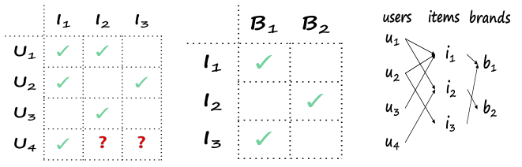
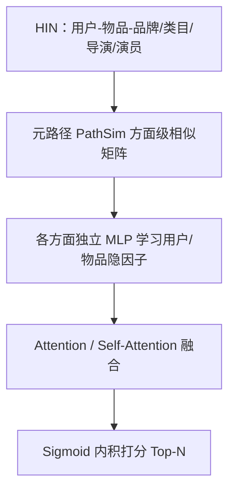
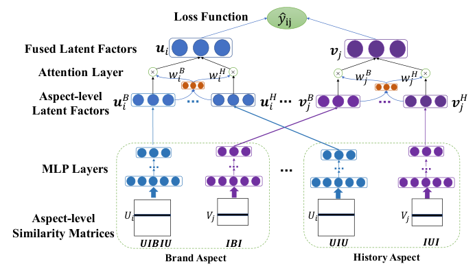

# Deep Collaborative Filtering with Multi-Aspect Information in Heterogeneous Networks (异构网络中多方面信息的深度协同过滤)

- **会议/期刊**: IEEE TKDE (arXiv 2019)
- **作者与机构**: Chuan Shi, Xiaotian Han, Li Song, Xiao Wang, Senzhang Wang, Junping Du, Philip S. Yu；北京邮电大学、南京航空航天大学、UIC 等
- **推荐链路定位**: 召回
- **研究方向**: 图神经网络与知识图谱推荐 / 协同过滤
- **论文原文**: [https://arxiv.org/abs/1909.06627v1](https://arxiv.org/abs/1909.06627v1)
- **开源代码**: 暂未开源

## TL;DR (1分钟核心速览)

针对隐因子模型仅用购买历史、浅层投影且多视角信息融合不足的问题，本文提出 NeuACF/NeuACF++：将推荐系统建模为异质信息网络 HIN，以元路径 PathSim 相似度矩阵为输入，用 MLP 分别学习用户/物品的方面级隐因子，再以注意力或自注意力融合。在 ML100K/ML1M/Amazon 的 Leave-One-Out + 99 负采样协议下，HR@10/NDCG@10 全面超越 MF、BPR、NeuMF、FMG 等基线。

## Background & Motivation (背景与核心矛盾)

- **主流范式**: 协同过滤以 MF/BPR/NeuMF 为主，将用户-物品交互压缩为统一隐因子；HIN 推荐则用元路径引入品牌、类目、导演、演员等辅助语义。
- **前人局限**: 统一隐因子只表达“购买历史”一个方面，品牌偏好与类目偏好被混在一起；MF 的浅层内积难以拟合方面级非线性关系，已有 HIN 方法又多用于评分预测且缺乏方面融合机制。
- **核心洞察 (Key Insight)**: 用户偏好和物品属性天然来自多个方面，不同方面对推荐的重要性不等；元路径相似度可分别刻画这些方面，注意力可自动学习方面权重。
- **本文切入点**: 把每个元路径对应的相似矩阵视为一个“方面视图”，用深度 MLP 独立学习方面隐因子，再做注意力融合。

<figure class="paper-figure" markdown="span">
  <figcaption>图 1：用户与物品之间方面级交互的示例。</figcaption>
</figure>

## Method (核心方法设计)

### 1. 整体框架 (Overall Architecture)

NeuACF 先根据用户-物品-品牌/类目/导演/演员等关系构建 HIN，并为每个方面选取用户侧与物品侧元路径，计算 PathSim 相似度矩阵；随后对每个方面独立使用 MLP 将高维相似向量投影为低维方面隐因子；最后用注意力或自注意力汇聚为统一用户/物品表示，并以 Sigmoid 内积完成 Top-N 打分。训练采用 point-wise 逻辑损失与负采样，相似矩阵可离线预计算。

<figure class="paper-figure" markdown="span">
  <figcaption>图 3：NeuACF 模型中的深度神经网络。</figcaption>
</figure>

### 2. 关键设计拆解 (Key Designs)

1. **方面级相似度 + MLP 隐因子学习**：痛点在于交互矩阵只反映购买历史，且线性投影不足。对方面 $A$的用户相似矩阵行$\mathbf{S}_i^{A}$，用多层感知机映射：
   $\mathbf{H}^{(l)}=\mathrm{ReLU}(\mathbf{W}^{(l)\top}\mathbf{H}^{(l-1)}+\mathbf{b}^{(l)}),\quad \mathbf{u}_i^{A}=\mathbf{H}^{(L)}$。
   直觉是：相似向量保留“与谁相似”的方面语义，MLP 再学习方面内的非线性用户表征；物品侧同理。

2. **注意力/自注意力方面融合**：平均或拼接无法区分方面重要性。NeuACF 用两层网络打分并 Softmax：
   $s_i^{A}=\mathbf{W}_2^\top \mathrm{ReLU}(\mathbf{W}_1^\top \mathbf{u}_i^{A}+\mathbf{b}_1)+\mathbf{b}_2,\quad
   w_i^{A}=\frac{\exp(s_i^{A})}{\sum_{B=1}^{L}\exp(s_i^{B})},\quad
   \mathbf{u}_i=\sum_{A=1}^{L}w_i^{A}\mathbf{u}_i^{A}$。
   NeuACF++ 进一步令方面间亲和矩阵 $M_i^{A,B}=(\mathbf{u}_i^{A})^\top\mathbf{u}_i^{B}$（$A=B$ 时 mask），
   $\mathbf{g}_i^{A}=\sum_{B}\mathrm{softmax}_B(M_i^{A,B})\mathbf{u}_i^{B}$，再求和得$\mathbf{u}_i$。自注意力能同时建模方面间相关性，避免仅按单方面打分。

3. **训练目标、负采样与推理效率**：预测为 $\hat{y}_{ij}=\sigma(\mathbf{u}_i^\top\mathbf{v}_j)$，总损失
   $\mathcal{L}=-\sum_{i,j\in\mathcal{Y}\cup\mathcal{Y}^-}\left(y_{ij}\log\hat{y}_{ij}+(1-y_{ij})\log(1-\hat{y}_{ij})\right)$。
   训练每个正样本采样 10 个负样本；推理时对候选物品打分排序。复杂度约 $O(STL(hn_1H+Hhn_2))$，主要开销在 MLP 矩阵乘与方面数$L$，相似矩阵离线计算可摊销。

## Experimental Setup & Evaluation Protocol (实验设置与评估协议)

- **数据集与预处理**:

| 数据集 | #Users | #Items | #Interactions | 稀疏度/密度 | 特征/场景说明 |
| :--- | :---: | :---: | :---: | :---: | :--- |
| ML100K | 943 | 1,682 | 100,000 | 6.304% | 电影；补充导演、演员 |
| ML1M | 6,040 | 3,706 | 1,000,209 | 4.468% | 电影；补充导演、演员 |
| Amazon | 3,532 | 3,105 | 57,104 | 0.521% | Electronics；品牌、类目、共浏览 |

Amazon 过滤购买少于 10 件物品的用户；MovieLens 使用原始版本并从 IMDb 爬取导演/演员。

- **数据划分与防穿越**: `Leave-One-Out`，每个用户最新评分物品作为测试集，其余训练。
- **排名评测协议**: `Sampled Ranking`，测试阶段为 1 个正样本 + 随机 99 个未交互负样本，所有方法共享同一负样本集；报告 HR@5/10/15/20 与 NDCG@5/10/15/20。
- **对比基线与超参**: ItemPop、ItemKNN、MF、eALS、BPR、DMF、NeuMF、SVDhin、HeteRS、FMG；统一 3 层 MLP、每层 600 隐单元、隐因子维度 64、Adam、lr=0.0005、batch=1024。原文称提升显著，但未报告 $p$ 值。

## Key Experimental Results (实验关键数据)

### 1. 主实验对比 (Main Results)

| 方法 | ML100K HR@10 | ML100K NDCG@10 | ML1M HR@10 | ML1M NDCG@10 | Amazon HR@10 | Amazon NDCG@10 |
| :--- | :---: | :---: | :---: | :---: | :---: | :---: |
| MF | 0.6437 | 0.3605 | 0.6896 | 0.4040 | 0.4278 | 0.2471 |
| eALS | 0.6638 | 0.3819 | 0.7055 | 0.4220 | 0.4287 | 0.2441 |
| BPR | 0.6914 | 0.3933 | 0.7161 | 0.4321 | 0.4657 | 0.2693 |
| NeuMF | 0.6766 | 0.3945 | 0.7177 | 0.4415 | 0.4309 | 0.2524 |
| SVDhin | 0.6554 | 0.3988 | 0.6456 | 0.3665 | 0.4123 | 0.2346 |
| HeteRS | 0.5337 | 0.3338 | 0.5758 | 0.3461 | 0.4207 | 0.2267 |
| FMG | 0.6373 | 0.3588 | 0.6528 | 0.3767 | 0.4539 | 0.2595 |
| NeuACF | 0.6846 | 0.4068 | 0.7202 | 0.4453 | 0.4686 | 0.2683 |
| **NeuACF++** | **0.6915** | **0.4092** | **0.7222** | **0.4454** | **0.4933** | **0.2792** |
| **Improv. vs 最强基线** | **+0.01%** | **+2.61%** | **+0.63%** | **+0.88%** | **+5.93%** | **+3.68%** |

### 2. 消融实验 (Ablation Study)

| 变体 | ML100K HR@10 | ML100K NDCG@10 | ML1M HR@10 | ML1M NDCG@10 | Amazon HR@10 | Amazon NDCG@10 |
| :--- | :---: | :---: | :---: | :---: | :---: | :---: |
| w/o self-attention (NeuACF) | 0.6846 | 0.4068 | 0.7202 | 0.4453 | 0.4686 | 0.2683 |
| Full (NeuACF++) | 0.6915 | 0.4092 | 0.7222 | 0.4454 | 0.4933 | 0.2792 |
| $\Delta$ | +0.0069 | +0.0024 | +0.0020 | +0.0001 | +0.0247 | +0.0109 |

### 3. 关键实验发现 (Key Findings)

1. **稀疏域多视角收益最大**：Amazon 上 NeuACF++ HR@10 达 0.4933，较 BPR 的 0.4657 提升 5.93%，NDCG@10 提升 3.68%；说明品牌/类目/共浏览等辅助方面在稀疏数据中补足了交互信号。
2. **排序质量提升而非仅命中率**：ML100K 上 HR@10 与 BPR 几乎持平（0.6915 vs 0.6914），但 NDCG@10 较最强基线 SVDhin 的 0.3988 提升 2.61%，表明方面级隐因子把正确物品推到了更前位置。
3. **自注意力融合优于普通注意力**：Amazon 上 NeuACF++ 较 NeuACF 的 HR@10 提升 2.47 个百分点、NDCG@10 提升 1.09 个百分点；ML1M 几乎不变，说明融合收益依赖方面异质性与数据稀疏度。

## Highlights & Limitations (亮点、对比与审稿批判)

- **与代表作对比 (vs. Prior Work)**: 相比 DMF/NeuMF，本文不是只压缩交互矩阵，而是显式学习多个方面隐因子；相比 FMG/HeteRS，本文用深度 MLP 替代浅层 MF/邻近度模型，并用注意力自动确定方面权重。
- **可迁移亮点**: PathSim 相似矩阵可离线预计算，适合作为召回侧多视图特征；方面独立 MLP + 注意力融合可迁移到多模态/多场景推荐；自注意力亲和矩阵可用于方面间关系建模。
- **审稿级局限批判**: 新增元路径需重新预计算并重训模型，超大 HIN 上 PathSim 仍有离线开销；评估仅采用 1+99 采样排序，未做 Full-Ranking、显著性检验或线上 A/B，工业收益需谨慎外推。

## Rating (四维评分)

- **方法创新性 (Novelty)**: ⭐⭐⭐⭐ （方面级元路径相似度 + 深度 MLP + 自注意力融合的组合较新颖，但 2019 年视角下仍属 HIN 推荐的深度化扩展）
- **评估协议与实验扎实度 (Protocol & Experiments)**: ⭐⭐⭐ （三数据集、Leave-One-Out 与统一负样本较规范，但仅 Sampled Ranking、无显著性检验与全库排序）
- **写作与数学规范度 (Clarity & Rigor)**: ⭐⭐⭐⭐ （公式、网络结构与复杂度分析清晰；部分符号与图表细节略简）
- **工业落地与复现价值 (Industrial & Practical Value)**: ⭐⭐⭐ （无开源代码；相似矩阵离线预计算和新增方面重训带来工程成本，但多视图融合思路可直接复用）

