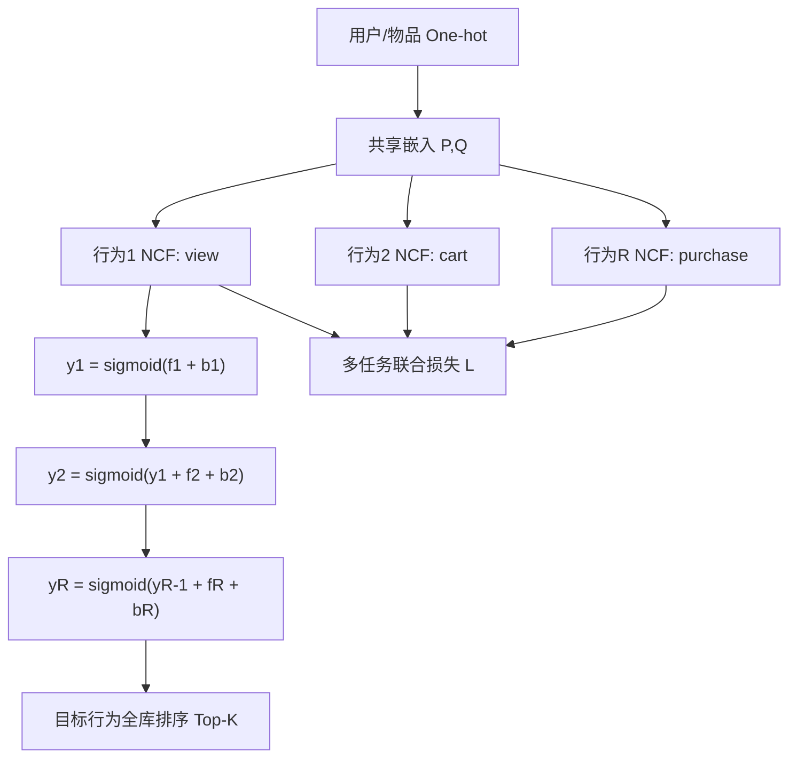
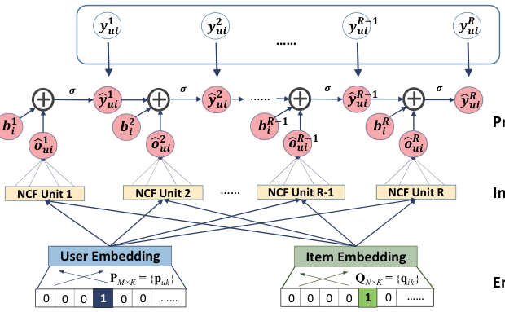

# Learning to Recommend with Multiple Cascading Behaviors (多级联行为推荐学习)

- **会议/期刊**: IEEE TKDE
- **作者与机构**: Chen Gao, Xiangnan He, Dahua Gan, Xiangning Chen, Fuli Feng, Yong Li, Tat-Seng Chua, Lina Yao, Yang Song, Depeng Jin；清华、USTC、CMU、NUS、UNSW 等
- **推荐链路定位**: 召回/粗排（Top-K 协同召回）
- **研究方向**: 多任务学习与列表级重排 / 协同过滤
- **论文原文**: [https://arxiv.org/abs/1809.08161v4](https://arxiv.org/abs/1809.08161v4)
- **开源代码**: 暂未开源（论文提及实现入口为 [https://github.com/fiblab](https://github.com/fiblab)，未见具体仓库路径）

## TL;DR (1分钟核心速览)

针对单行为 CF 忽视点击/加购等辅助信号、CMF 与 MC-BPR 又忽略行为序关系与交互函数差异的问题，NMTR 以共享用户/物品嵌入、分行为 NCF 交互函数、级联预测和多任务联合损失建模多行为数据。在两电商数据集 Leave-One-Out 全库排序下，NMTR-NeuMF 较最强多行为基线 MC-NeuMF 的 HR@100 提升 6.08%/30.76%，并显著缓解稀疏用户问题。

## Background & Motivation (背景与核心矛盾)

- **主流范式**: 单行为隐式 CF 以 BPR/NCF 优化购买或评分；多行为方案分两支：CMF 共享一侧嵌入、分解多个行为矩阵；MC-BPR/MC-NCF 通过多通道负采样把辅助行为注入训练。
- **前人局限**: 其一，CMF 强制同一用户在不同行为下学习不同嵌入，违背“用户潜在兴趣应稳定、仅交互函数随行为变化”的表征直觉；其二，MF 固定内积难以刻画复杂多类型交互，且这些方法基本忽略“浏览→加购→购买”的序关系语义。
- **核心洞察 (Key Insight)**: 多行为并非独立任务，而是存在全序级联：低层行为数据量大、易采集，可约束高层目标行为预测，尤其利于目标行为稀疏用户。
- **本文切入点**: 把嵌入学习与交互函数解耦：用户/物品共享一套嵌入，每个行为学习独立 NCF 交互函数，再将各行为预测按序级联，并以多任务学习联合优化。

## Method (核心方法设计)

### 1. 整体框架 (Overall Architecture)

输入用户/物品 one-hot ID，经共享嵌入层得到 $\mathbf{p}_u,\mathbf{q}_i$；上层为每个行为配置独立 NCF 交互函数，按行为由低到高级联连接预测，最后以多任务联合对数损失同时训练所有行为。推理时仅用目标行为（购买）的输出对全库未交互物品打分排序。整体架构见图 1。

<figure class="paper-figure" markdown="span">
  <figcaption>图 1：我们提出的 NMTR 模型示意图。</figcaption>
</figure>

### 2. 关键设计拆解 (Key Designs)

1. **共享嵌入 + 分行为交互函数**：CMF 让同一用户在不同行为下拥有不同向量，表征不统一。NMTR 只保留一套 $\mathbf{p}_u,\mathbf{q}_i$，为第$r$类行为单独学习$f^r_\Theta$，预测为$\hat{y}^r_{ui}=\sigma(f^r_\Theta(\mathbf{p}_u,\mathbf{q}_i))$。这样“兴趣表征”稳定，“行为差异”由交互函数吸收，也避免固定内积的表达瓶颈。

2. **级联预测**：为编码“必须先浏览才可能购买”的序关系，高层行为预测以低层预测为输入：$\hat{y}^R_{ui}=\sigma(\hat{y}^{R-1}_{ui}+f^R_\Theta(\mathbf{p}_u,\mathbf{q}_i)+b^R_i)$，逐层递推。物品偏置$b^r_i$ 吸收“易点击难购买”等行为差异；低层行为数据量大，相当于给高层目标任务提供辅助正则，稀疏用户因此受益。

3. **多任务联合损失、负采样与推理**：总损失为 $\mathcal{L}=-\sum_{r=1}^{R}\lambda_r(\sum_{(u,i)\in\mathcal{Y}^+_r}\log\hat{y}^r_{ui}+\sum_{(u,i)\in\mathcal{Y}^-_r}\log(1-\hat{y}^r_{ui}))$，其中$\sum_r\lambda_r=1$控制各行为权重。训练时先采样至少有任一行为的$(u,i)$，再对每个已观测行为从该用户同行为未交互物品中采样负例，负采样比默认 4；用 SGD/Adagrad 端到端训练。推理仅需目标行为前向打分，训练开销可接受（Beibei 每 epoch 约 204.4s，MC-NeuMF 为 472.4s）。

## Experimental Setup & Evaluation Protocol (实验设置与评估协议)

- **数据集与预处理**: 合并重复 user-item 交互并保留最早一条；仅保留具有多于一种行为的用户。统计如下：

| 数据集 | #Users | #Items | Purchase | Cart | View | 密度(总) |
| :--- | :---: | :---: | :---: | :---: | :---: | :---: |
| Beibei | 21,716 | 7,977 | 295,622 | 642,622 | 2,412,586 | 1.93% |
| Tmall | 15,670 | 9,076 | 136,648 | – | 813,396 | 0.67% |

- **数据划分与防穿越 (Splitting Strategy)**: 采用 `Leave-One-Out`：每个用户留一个未交互物品作测试，其余为训练；验证集从训练中随机留一实例调参。
- **排名评测协议 (Ranking Protocol)**: 无偏 `Full-Ranking`，对每个用户所有训练中未交互物品排序；报告 HR@K、NDCG@K，主表 K=50/80/100/200，重点看 K=100。
- **对比基线与超参设置**: 单行为 BPR、GMF、MLP、NeuMF；多行为 CMF、MC-BPR、MC-GMF、MC-MLP、MC-NeuMF。嵌入维度 64，负采样比 4，隐藏层 1–5 调优，Adagrad/Adam 学习率网格搜索，L2 正则；改进以 one-sample paired t-test 检验，$p<0.05$。

## Key Experimental Results (实验关键数据)

### 1. 主实验对比 (Main Results)

| 方法 | Beibei HR@100 | Beibei NDCG@100 | Tmall HR@100 | Tmall NDCG@100 |
| :--- | :---: | :---: | :---: | :---: |
| BPR | 0.2002 | 0.0463 | 0.1058 | 0.0263 |
| NeuMF | 0.2929 | 0.0714 | 0.1013 | 0.0333 |
| CMF | 0.2829 | 0.0663 | 0.1085 | 0.0287 |
| MC-BPR | 0.2659 | 0.0647 | 0.1072 | 0.0282 |
| MC-GMF | 0.2975 | 0.0690 | 0.0846 | 0.0264 |
| MC-MLP | 0.2810 | 0.0684 | 0.0868 | 0.0228 |
| MC-NeuMF | 0.3010 | 0.0719 | 0.0894 | 0.0320 |
| NMTR-GMF | 0.3119 | 0.0741 | **0.1196** | 0.0314 |
| NMTR-MLP | 0.3188 | **0.0762** | 0.0982 | 0.0290 |
| NMTR-NeuMF | **0.3193** | 0.0760 | 0.1169 | **0.0366** |

相对最强多行为基线 MC-NeuMF，NMTR-NeuMF 在 Beibei 的 HR@100/NDCG@100 提升 6.08%/5.70%，在 Tmall 提升 30.76%/14.37%；若按全表最强基线，Tmall 的 NMTR-GMF HR@100 较 CMF 提升约 10.23%。

### 2. 消融实验 (Ablation Study)

| 数据集 | 训练方式 | GMF HR/NDCG | MLP HR/NDCG | NeuMF HR/NDCG |
| :--- | :--- | :---: | :---: | :---: |
| Beibei | 多任务联合 | 0.3119/0.0741 | 0.3188/0.0762 | 0.3193/0.0760 |
| Beibei | 顺序训练 | 0.2730/0.0672 | 0.2663/0.0692 | 0.2704/0.0658 |
| Tmall | 多任务联合 | 0.1196/0.0314 | 0.0982/0.0290 | 0.1169/0.0366 |
| Tmall | 顺序训练 | 0.0913/0.0290 | 0.0856/0.0226 | 0.0946/0.0304 |

### 3. 关键实验发现 (Key Findings)

1. **多任务联合训练是核心增益来源**：将 MTL 换成按行为顺序训练后，NMTR-NeuMF 在 Beibei 从 0.3193/0.0760 降至 0.2704/0.0658，Tmall 从 0.1169/0.0366 降至 0.0946/0.0304。说明低层行为不能只做“预训练”，而应通过联合梯度互相增强共享嵌入。
2. **辅助行为质量比数量更关键**：Beibei 上加入 view 比加入 cart 更有效（NMTR-NeuMF HR@100：0.3147 vs 0.2882），因为 cart 与 purchase 信号过近、增量信息少；仅保留 50% view 仍达 0.3107，而 50% cart 降至 0.2778，说明缺失的 cart 更易被模型误当负例。
3. **稀疏用户获益最明显**：从购买数 >20 到 5–8 的用户组，NMTR-NeuMF 的 NDCG@100 下降 27.56%，低于 MC-BPR 的 40.09% 与 MC-NeuMF 的 38.62%；在最稀疏组仍达 HR@100=0.027、NDCG@100=0.07，较最佳基线高 11.23%/15.35%。

## Highlights & Limitations (亮点、对比与审稿批判)

- **与代表作对比 (vs. Prior Work)**: CMF 通过“共享物品嵌入、分用户嵌入”区分行为，NMTR 反转为“共享用户/物品嵌入、分交互函数”，更符合表征学习直觉；MC-BPR/MC-NCF 主要改负采样规则，NMTR 则改模型结构与训练范式；相比单行为 NCF，NMTR 将 NCF 扩展为级联多任务框架。
- **可迁移亮点**: “共享底层嵌入 + 每任务独立交互头 + 有序级联”可迁移到点击/加购/支付、曝光/点击/转化等多级漏斗；损失权重 $\lambda_r$ 为不同行为重要性提供可调接口。
- **审稿级局限批判**: 其一，方法假设行为构成全序，现实中的分享、收藏、加购可能只满足偏序，需人工排序或学习序关系；其二，性能仍受基础 CF 单元限制（NMTR-MLP 明显弱于 GMF/NeuMF），且仅离线评估，缺少在线 A/B 与工业延迟验证。

## Rating (四维评分)

- **方法创新性 (Novelty)**: ⭐⭐⭐⭐ （共享嵌入、分行为交互函数与级联多任务组合简洁有效，但单点算子新意有限）
- **评估协议与实验扎实度 (Protocol & Experiments)**: ⭐⭐⭐⭐ （两真实数据集、Leave-One-Out 全库排序、9 个基线、t 检验与稀疏分桶较完整；缺在线验证）
- **写作与数学规范度 (Clarity & Rigor)**: ⭐⭐⭐⭐ （公式与训练流程清晰，级联假设与损失权重解释充分；全序假设略强）
- **工业落地与复现价值 (Industrial & Practical Value)**: ⭐⭐⭐ （结构易插拔、训练开销可接受，但依赖行为全序与离线调参，代码入口不够明确）

