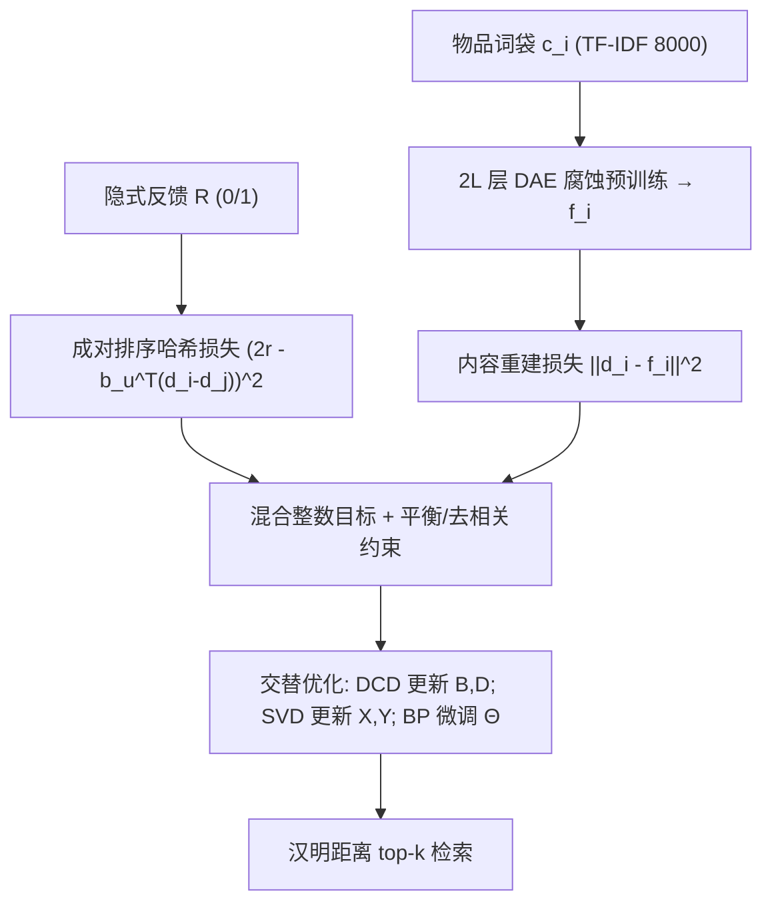
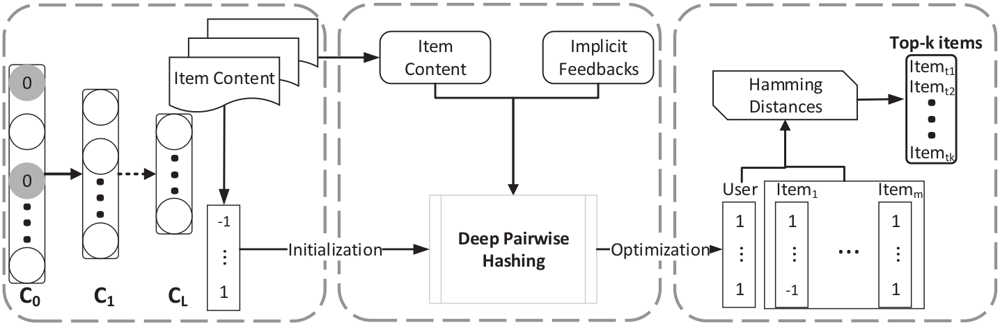

# Deep Pairwise Hashing for Cold-start Recommendation (面向冷启动推荐的深度成对哈希)

- **会议/期刊**: IEEE TKDE (arXiv 2011.00944, 2020 投稿)
- **作者与机构**: Yan Zhang, Ivor W. Tsang, Hongzhi Yin, Guowu Yang, Defu Lian, Jingjing Li (电子科技大学 / UTS / 昆士兰大学 / 中科大)
- **推荐链路定位**: 召回（汉明空间近邻检索）
- **研究方向**: 冷启动与长尾推荐 / 协同过滤与双塔召回
- **论文原文**: [https://arxiv.org/abs/2011.00944v1](https://arxiv.org/abs/2011.00944v1)
- **开源代码**: 暂未开源

## TL;DR (1分钟核心速览)

针对隐式反馈推荐中“实时打分太慢 + 新物品无交互”的双重痛点，本文提出 DPH：先用 2L 层去噪自编码器（DAE）从物品文本内容预训练出**鲁棒**的连续表征并符号化初始化为二值码，再把「成对排序最小二乘损失 + 内容重建损失 + 平衡/去相关离散约束」联合优化，用交替优化 + 逐位离散坐标下降（DCD）直接求解 $B,D\in\{\pm1\}^{r\times n}$而不做“先实数再量化”的信息损失。评估采用 **1000 负样本采样排序**（Accuracy@k、MRR）与 10%/20%/30%/40% 随机稀疏切分 + 冷启动物品（$\le 5$ 交互）子集；在 Yelp 冷启动 10% 设置下 MRR 达 0.0074，较哈希基线 DDL 提升 **23.3%**，在线打分较实数向量法快 **3.7×（Amazon）/ 6.3×（Yelp）**，存储压缩 32–64 倍。

## Background & Motivation (背景与核心矛盾)

- **主流范式**: 内容感知推荐（CTR / CDL / VBPR）用主题模型或深度网络把物品文本/图像映射为**实值**隐向量，再与 CF 内积打分；哈希推荐（DCF / DPR / DDL）则把隐向量压成二值码，用汉明距离替代内积。
- **前人局限**:
  1. 实值向量在线检索复杂度 $O(md + m\log k)$，且每维需 32/64 bit，物品库膨胀后响应与存储不可承受；
  2. 两阶段哈希（如 ITQ 类）在量化阶段丢弃向量模长、造成不可逆信息损失；而单阶段哈希学习（DCF/DPR）只吃交互矩阵，**无内容侧信息**，冷启动物品与 99.9% 稀疏场景下彻底失效；
  3. DDL 虽引入内容，但采用**评分重建**目标 + DBN，与 top-k 排序目标不一致，且 DBN 对噪声内容不鲁棒。
- **核心洞察 (Key Insight)**: 汉明空间偏好 $\hat p_{ui}=\frac12+\frac{1}{2r}b_u^\top d_i$ 与实数空间内积偏好同构，因此“排序目标 + 离散约束”可以在**同一个混合整数问题**里直接求解，无需量化折损；同时内容噪声正是冷启动物品的主要退化来源，去噪重建能学到更稳的隐层。
- **本文切入点**: 以 DAE 内容预训练解决冷启动表征，以成对排序离散哈希解决精度与效率的取舍。

## Method (核心方法设计)

### 1. 整体框架 (Overall Architecture)

DPH 分三段闭环：(i) **预训练**——对物品词袋 $c_i$（8000 维 TF-IDF 词表）随机置零腐蚀后送入结构$[8000,200,30]$的 2L 层 DAE，取中间层$f_i=\mathrm{DAE}(c_{L,i},\Theta)$作为鲁棒连续表征，并以其符号初始化物品哈希码；(ii) **联合建模**——把成对排序哈希损失、内容重建损失、以及平衡/去相关约束写成一个混合整数规划，引入辅助实矩阵$X,Y$软化约束，交替更新$B\to D\to X\to Y\to\Theta$，其中$B,D$用逐位 DCD 保持严格$\pm1$；(iii) **推理**——用汉明排序或汉明球查找返回 top-k。

<figure class="paper-figure" markdown="span">
  <figcaption>图 2. DPH 框架：首先通过左侧预训练步骤，利用物品内容数据与去噪自编码器获得物品的连续嵌入；然后将所得物品嵌入与隐式反馈结合，以基于排序的目标构建所提出的 DPH 模型；最后开发交替优化方法求解该目标，并在汉明空间中使用学习到的哈希码进行推荐。</figcaption>
</figure>

### 2. 关键设计拆解 (Key Designs)

1. **汉明偏好 + 成对最小二乘排序损失**：痛点是把 AUC 直接最大化是 NP-hard，而评分损失又与 top-k 目标错位。作者用与 AUC 一致的 least-square surrogate：$b_{uk}=-\mathrm{sgn}\big(K(\hat b_{uk},b_{uk})\big)$，其外层对象为$\min_{B,D}\sum_{(u,i,j)\in S} z_u\big(2r-b_u^\top(d_i-d_j)\big)^2$，其中$z_u=1/(|U||I_u^+||I_u^-|)$做用户级归一化。由于$\hat p_{ui}-\hat p_{uj}=\frac{1}{2r}b_u^\top(d_i-d_j)$，该式等价于$1-\hat p_{uij}$的平方，因此**逐对错误被线性地惩罚在内积差距上**；选最小二乘而非 logistic 的关键收益是：对$b_{uk}\in\{\pm1\}$ 可解析得到闭式更新位，无需采样负例即可高效优化。
2. **DAE 内容蒸馏 + 直接离散约束（拒绝两阶段量化）**：冷启动物品没有任何交互梯度，必须靠内容“借”表征。目标项 $\lambda\sum_{i=1}^{m}\lVert d_i-\mathrm{DAE}(c_{L,i},\Theta)\rVert_F^2$把**哈希码本身**而非中间实数拉向 DAE 输出（tanh 输出层与$\pm1\) 同值域），配合 $B\mathbf{1}_n=0,\;BB^\top=nI_r$（物品侧同理$D\mathbf{1}_m=0,\;DD^\top=mI_r$）强制每位信息熵最大、位间不冗余。物理直觉：重建目标让隐层只保留可复原的语义主干，腐蚀训练等价于对短文本的 dropout，从而把噪声从码字里挤出去。
3. **训练目标、负采样与推理开销**：总损失即上式加两项松弛 $\;-2\alpha\mathrm{tr}(B^\top X)-2\beta\mathrm{tr}(D^\top Y)$，$\alpha=10^{-5},\beta=10^{-3},\lambda=20$；负例来自**全量未交互集合**（$j\in I_u^-$，非采样），靠$z_u$权重与 DCD 的按位闭式更新把每轮内循环压到 2–3 次迭代，外循环约 50 轮收敛。推理侧汉明排序$O(md)$ 且纯位运算（可 popcount 并行），存储 1 bit/维 vs 32/64 bit/维，并支持汉明球哈希查找使复杂度与物品数无关。

## Experimental Setup & Evaluation Protocol (实验设置与评估协议)

| 数据集 | #Users | #Items | #Interactions | 稀疏度 | 特征/场景说明 |
| :--- | :---: | :---: | :---: | :---: | :--- |
| Amazon (Clothing, Shoes & Jewelry) | 39,387 | 23,033 | 278,653 | 99.97% | 描述/类目文本，去标点/停用词 + Porter 词干，TF-IDF top-8000 词袋 |
| Yelp (Phoenix, Round 9) | 122,097 | 11,854 | 353,772 | 99.98% | 商户评论文本，同上构造词袋 |

- **数据划分与防穿越**: 显式评分统一二值化为隐式反馈；在原始交互上**随机抽取 10%/20%/30%/40% 作为 $D_{train}$**，剩余为$D_{test}$；冷启动实验额外剔除交互数$\le5$的物品作训练禁区，测试只在$D^{c}_{test}$（冷启动物品）上进行；随机抽样独立重复 5 次取均值。
- **排名评测协议**: `Sampled Ranking`——对每个测试正例随机抽 **1000 个负例**（共 1001 候选）排序，报告 Accuracy@k（$k\in\{5,\dots,30\}$）与 MRR；**未做 Full-Ranking**。
- **对比基线与超参**: 实数内容感知 {CTR, CDL, VBPR}、哈希 {DCF, DPR, DDL} 共 6 个基线；哈希维度 $r=30$（与 DAE/CDL 隐层 30 对齐，保证公平），DAE/SDAE/DBN 隐层均为$[8000,200,30]$，网格搜索$\alpha,\beta,\lambda\in[10^{-5},10^{5}]$；未报告显著性检验（仅标注 best/second-best）。

## Key Experimental Results (实验关键数据)

### 1. 主实验对比 (Main Results)

MRR（冷启动 = 10% 稀疏 + 冷启物品子集；稀疏 = 全物品）：

| 方法 | 类型 | Amazon-CS | Yelp-CS | Amazon-10% | Amazon-20% | Yelp-10% | Yelp-20% |
| :--- | :--- | :---: | :---: | :---: | :---: | :---: | :---: |
| CTR | 实数+内容 | **0.0082** | 0.0059 | 0.0102 | 0.0168 | 0.0194 | 0.0355 |
| CDL | 实数+内容 | 0.0071 | 0.0022 | 0.0311 | 0.0481 | **0.0360** | **0.0558** |
| VBPR | 实数+视觉 | 0.0042 | 0.0067 | 0.0176 | 0.0158 | 0.0206 | 0.0126 |
| DCF | 哈希 | – | – | 0.0102 | 0.0103 | 0.0195 | 0.0221 |
| DPR | 哈希 | – | – | 0.0200 | 0.0317 | 0.1581* | 0.1161* |
| DDL | 哈希+内容 | 0.0077 | 0.0060 | **0.0490** | 0.0263 | 0.0275 | 0.0151 |
| **DPH** | 哈希+内容+排序 | 0.0079 | **0.0074** | 0.0460 | **0.0500** | 0.0279 | 0.0296 |
| **Improv.** | – | −3.7% | **+10.4%** | −6.1% | **+4.0%** | −22.5% | −47.0% |

\* DPR 在 Yelp 上的 MRR 比同表其他方法高一个量级且随稀疏度剧烈波动（0.1581→0.1161），原文未加解释，疑为采样/收敛异常。

在线效率（表 6，单次打分 ×10⁻⁴ 秒）：Amazon 实数 **4.0491** vs 哈希 **1.0971**（3.7×）；Yelp **12.5975** vs **1.9878**（6.3×）；合成数据上物品数从 20 万增至 1.02 亿时哈希曲线近水平，实数曲线快速上翘；存储侧 1 亿物品时哈希仅需 1/32–1/64 内存。

### 2. 消融实验 (Ablation Study)

原文仅以 Accuracy@k 曲线（图 7，30% 稀疏）给出，无数值表；据其文字，性能序关系为：

| 变体 | 目标函数 | 内容编码器 | Amazon-30% | Yelp-30% |
| :--- | :--- | :--- | :---: | :---: |
| DPH | pairwise 排序 | DAE | 最优 | 最优 |
| DPH-B-R (= DDL) | 评分重建 | DBN | 次优 | 次优 |
| DPH-B | pairwise 排序 | DBN | 较差 | 较差 |
| DPH-R | 评分重建 | DAE | 最差 | 最差 |

### 3. 关键实验发现 (Key Findings)

1. **冷启动收益主要来自 DAE 内容预训练而非排序目标**：Yelp-CS 上 DPH 0.0074 高于同为哈希+内容的 DDL 0.0060（+23.3%）与最好的实数基线 VBPR 0.0067（+10.4%）；但 Amazon-CS 上仍略低于 CTR（0.0079 vs 0.0082，−3.7%），说明 $r=30$ 位二值码在短文本、类目同质化强的 Amazon 上存在信息位宽瓶颈。
2. **哈希的“精度小亏”换来了数量级的效率**：实数法在 Yelp 单次打分 12.60×10⁻⁴ s、DPH 仅 1.99×10⁻⁴ s（6.3×），且合成实验显示物品规模涨 500 倍时哈希耗时基本不增；这与 Accuracy@k 上仅 0.001–0.005 的绝对差距相比是显著划算的折中。
3. **排序目标与 DAE 存在强耦合、不可单独替换**：单独替换任一项（DPH-R 或 DPH-B）都劣于 DDL，只有二者同时替换（DPH）才反超，说明最小二乘排序损失的 $2r$ 尺度项需要 DAE 的 tanh 有界输出与之匹配；此外训练稀疏度从 10%→40% 时 DPH 单调上升而 DDL 波动下滑，鲁棒性差异明显（图 5）。

## Highlights & Limitations (亮点、对比与审稿批判)

- **与代表作对比 (vs. Prior Work)**: 相比 DCF/DPR，DPH 多了内容通道，因而唯一能在冷启物品上出分；相比 CDL/CTR 的贝叶斯实值建模，DPH 用**单阶段离散优化**替代“实数→量化”，避免了两阶段哈希（ITQ 类）的量化损失；相比其前身 DDL，把评分重建换成 pairwise 排序、把 DBN 换成 DAE，并改用隐式反馈（更贴近真实场景）。
- **可迁移亮点**: ① “DAE 腐蚀预训练 → 符号初始化 → 离散微调”三跳范式可直接迁移到 Semantic ID / RQ-VAE 冷启动物品的码本初始化；② 用 $z_u=1/(|U||I_u^+||I_u^-|)$ 做用户级损失归一化，可缓解热门用户主导梯度的问题，适合任何 pairwise 召回训练。
- **审稿级局限批判**: ① **评估协议偏弱**——Accuracy@k 采用 1000 负例采样而非 Full-Ranking，绝对数值低至 0.005–0.04，且未报告任何显著性检验；摘要称“三个数据集”实则只跑 Amazon/Yelp 两个；② **消融仅给曲线不给数字**，且实验揭示组件间是“负交互”（单换变差、双换变好），削弱了“两个创新各自有效”的因果论断；③ $B,D$的逐位 DCD 需三层循环（用户×位×内迭代），训练开销随$n\cdot r$线性放大，论文只讨论推理效率、完全缺失训练时间与收敛性分析；④ 无开源代码，DAE 层宽与$\lambda$ 的敏感性未做扫描。

## Rating (四维评分)

- **方法创新性 (Novelty)**: ⭐⭐⭐ （把 DAE 内容鲁棒表征、pairwise 排序与单阶段离散哈希三者缝合，工程组合价值明确，但各部件均为已有技术，理论贡献限于混合整数目标的闭式 DCD 更新）
- **评估协议与实验扎实度 (Protocol & Experiments)**: ⭐⭐ （仅 2 个数据集 + 1000 负例采样排序、无显著性检验、消融只给曲线、摘要与实验数据集数量不一致，DPR 的 Yelp 异常值未加排查）
- **写作与数学规范度 (Clarity & Rigor)**: ⭐⭐⭐ （从 AUC 到最小二乘再到式 (9)(15) 的推导链条清晰、约束松弛与 SVD 闭式解交代完整，但正文存在 $2r/2d$ 符号混用与个别公式排版错误）
- **工业落地与复现价值 (Industrial & Practical Value)**: ⭐⭐⭐⭐ （汉明打分 3.7–6.3× 加速与 32–64× 存储压缩对大库召回极有吸引力，DAE 预训练可离线完成，唯缺开源代码与训练成本披露）

