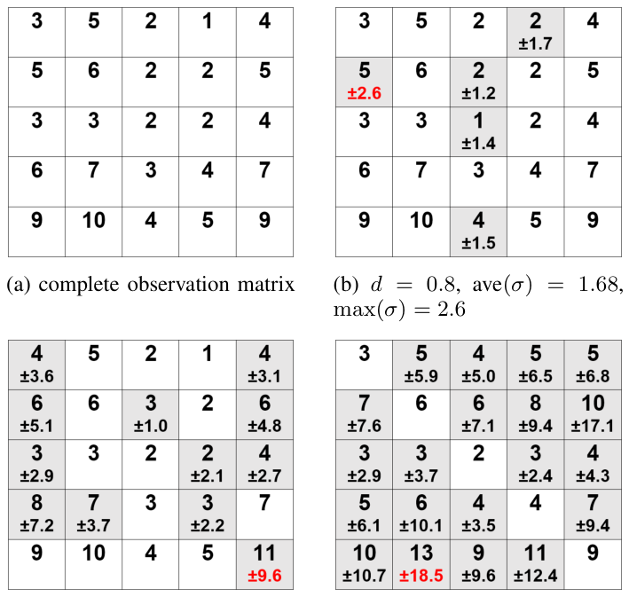
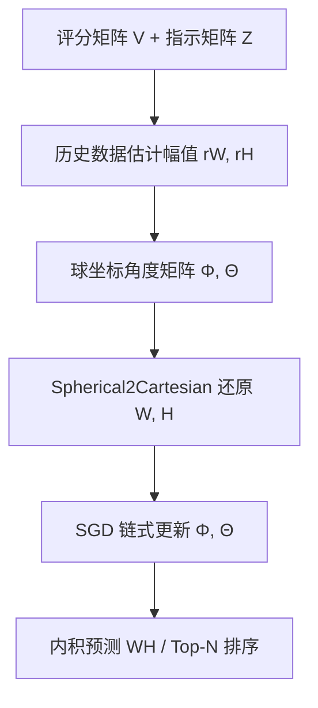

# Magnitude Bounded Matrix Factorisation for Recommender Systems (面向推荐系统的幅值约束矩阵分解)

- **会议/期刊**: IEEE Transactions on Neural Networks and Learning Systems (TNNLS)
- **作者与机构**: Shuai Jiang, Kan Li, Richard Yi Da Xu；北京理工大学、悉尼科技大学
- **推荐链路定位**: 召回（评分预测/排序）
- **研究方向**: 协同过滤与双塔召回
- **论文原文**: [https://arxiv.org/abs/1807.05515v1](https://arxiv.org/abs/1807.05515v1)
- **开源代码**: [https://github.com/shawn-jiang/MBMF](https://github.com/shawn-jiang/MBMF)

## TL;DR (1分钟核心速览)

针对稀疏评分矩阵中低频用户/物品预测波动大，BMF/BMC-ADMM逐元素投影且只支持单一边界，Bounded-SVD惩罚系数敏感等痛点，本文提出MBMF：以每个用户/物品特征向量幅值为个体化边界，经笛卡尔→球坐标重参数化把约束优化转为无约束SGD。在Jester/BookCrossing/AliMob评分预测与阈值F1评测中多数指标领先，且$O(NMK)$复杂度支持大规模稀疏矩阵。

## Background & Motivation (背景与核心矛盾)

- **主流范式**: 低秩矩阵分解用用户/物品隐向量内积补全缺失评分，是协同过滤的经典召回/评分范式。
- **前人局限**: BMF与BMC-ADMM需逐元素检查并投影到固定边界，计算重且所有条目共享一对边界；Bounded-SVD依赖指数惩罚，系数过大/过小都会导致过约束或约束失效。
- **核心洞察 (Key Insight)**: 内积满足$\hat{V}_{ij}=|W_{i:}||H_{:j}|\cos\alpha_{ij}$，因此内积天然被两向量幅值乘积界定；控制每个实体的向量模长即可获得逐条目边界，无需逐元素投影。
- **本文切入点**: 把幅值约束嵌入球坐标半径，使约束优化等价转化为对角度矩阵的无约束优化。

<figure class="paper-figure" markdown="span">
  <figcaption>图 1：不同矩阵密度下非负矩阵分解（NMF）的预测。灰色阴影中的数字为 1,000 次重复后的平均恢复条目，± 旁给出标准差。密度记为 d，ave(σ) 与 max(σ) 分别表示恢复条目的平均标准差和最大标准差。</figcaption>
</figure>
图 1：稀疏度上升导致NMF恢复条目方差增大，是本文的动机示意。

## Method (核心方法设计)

### 1. 整体框架 (Overall Architecture)

MBMF输入评分矩阵$\mathbf{V}$与指示矩阵$\mathbf{Z}$，先用历史评分估计每个用户/物品的幅值$r_i^W,r_j^H$，将特征向量限制在固定半径超球面上。模型不直接优化$W,H$，而优化球坐标角矩阵$\Phi,\Theta$；经Spherical2Cartesian还原$W,H$后做内积预测，训练用重建误差SGD，推理只需一次矩阵乘/排序。核心闭环是“历史幅值估计→球坐标参数化→无约束SGD→还原打分”。

### 2. 关键设计拆解 (Key Designs)

1. **个体化幅值边界（Individual Magnitude Bound）**：痛点源于固定边界对稀疏实体约束不足。MBMF令$|W_{i:}|=r_i^W$、$|H_{:j}|=r_j^H$，则$-r_i^Wr_j^H\le\hat{V}_{ij}\le r_i^Wr_j^H$，形成秩一范围矩阵$R=r^W(r^H)^T$。不同用户/物品可设不同半径，稀疏实体用小半径抑制预测爆炸，物理直觉是“用实体自身历史稳定性约束其表征能量”。

2. **球坐标重参数化（Spherical2Cartesian）**：欧氏空间中的幅值等式约束对应超球面，难以直接SGD。引入$K-1$个角度后，$W_{i:}=r_i^W s(\Phi_{i:})\odot c(\Phi_{i:})$，$H_{:j}=r_j^H s(\Theta_{:j})\odot c(\Theta_{:j})$，约束被“吸收”进半径，原问题转为$\min_{\Phi,\Theta}\|\mathbf{Z}\odot(\mathbf{V}-WH)\|_F^2$。这样既精确满足边界，又避免了投影/惩罚的高开销。

3. **训练目标、幅值估计与推理效率**：总损失为$\mathcal{L}=\|\mathbf{Z}\odot(\mathbf{V}-WH)\|_F^2$，对$\Phi,\Theta$链式求导后SGD更新，单轮复杂度$O(NMK)$，与普通MF同阶；无负采样，属评分重建。历史幅值采用全局-个体收缩：$r_i^W=\omega_i\sqrt{E(V'_{i:})+\sigma(V'_{i:})}+(1-\omega_i)\sqrt{E(V')+\sigma(V')}$，$\omega_i$随历史记录量从0到1增长，冷启动用户回退全局统计。推理阶段仅需计算$WH$并排序，开销低。

## Experimental Setup & Evaluation Protocol (实验设置与评估协议)

- **数据集与预处理**: 未采用`5-core`，仅删除无效记录；BookCrossing与AliMob极稀疏，AliMob将点击/收藏/加购/支付按$1/2/3/5$加权成兴趣点。

| 数据集 | #Users | #Items | #Interactions | 稀疏度/密度 | 特征/场景说明 |
| :--- | :---: | :---: | :---: | :---: | :--- |
| Synthetic | 500 | 500 | 50,000 | 0.2 | 取值[0,10]，控制稀疏度实验 |
| Jester | 73,421 | 100 | ≈4.14M | 0.5634 | 连续评分[-10,10]，中心对称边界 |
| BookCrossing | 92,184 | 270,169 | ≈1.0M | 0.00004 | 图书评分[1,10]，极端稀疏 |
| AliMob | 10,000 | 8,916 | ≈0.90M | 0.0101 | 电商行为加权兴趣点[1,6853] |

- **数据划分与防穿越 (Splitting Strategy)**: 每个数据集随机一分为二：历史数据/当前数据；当前数据不允许空行/空列；每折从当前数据随机抽10%作验证，5折；$K\in\{10,20,50\}$。非`Leave-One-Out`、非全局时间戳切分。
- **排名评测协议 (Ranking Protocol)**: 非`Full-Ranking`；采用评分预测RMSE/MAE，并以每个用户平均评分为阈值计算F1；无采样负排序、无负采样训练。
- **对比基线与超参设置**: 对比MF、NMF、CCD++、BMF、BMC-ADMM、Bounded-SVD；最大500轮，连续10轮目标降幅$<10^{-5}$早停；BMC-ADMM的$\lambda=1$，Bounded-SVD的$\eta=0.05$；原文未报告显著性检验。

## Key Experimental Results (实验关键数据)

### 1. 主实验对比 (Main Results)

表1：真实数据集平均结果（K=10/20/50平均；RMSE/MAE越低越好，F1越高越好）

| 方法 | Jester RMSE | Jester MAE | Jester F1 | Book RMSE | Book MAE | Book F1 | Ali RMSE | Ali MAE | Ali F1 |
| :--- | ---: | ---: | ---: | ---: | ---: | ---: | ---: | ---: | ---: |
| MF | 5.0710 | 3.9820 | 62.38 | 1.5940 | 1.1910 | 83.80 | 90.784 | 31.592 | 38.66 |
| NMF | 147.20 | 8.1190 | 57.35 | 1.6390 | 1.1380 | 84.36 | 131098 | 1622.8 | 34.99 |
| CCD++ | 5.4710 | 4.1620 | 60.31 | 1.3150 | 0.8722 | **87.08** | 59.785 | 24.633 | 38.84 |
| BMF | 5.4340 | 4.3060 | 58.79 | 1.3090 | 0.8848 | 86.21 | 461.99 | 432.81 | 32.01 |
| BMC-ADMM | 4.8730 | 3.8310 | 57.72 | 3.1000 | 2.7450 | 76.04 | 435.16 | 240.73 | 19.65 |
| Bounded-SVD | 6.2780 | 4.8150 | 59.01 | 1.5260 | 1.1200 | 84.14 | **42.652** | 16.073 | 42.31 |
| MBMF-n | **4.6410** | **3.7450** | **65.63** | 1.2620 | 0.8521 | 86.32 | 42.814 | 18.935 | 39.69 |
| MBMF-c | 4.6760 | 3.8030 | 64.24 | **1.1810** | **0.7825** | 85.61 | 43.608 | **14.378** | **43.51** |

提升幅度（相对最强基线）：Jester RMSE -4.8%、MAE -2.2%、F1 +5.2%；Book RMSE -9.8%、MAE -10.3%；Ali MAE -10.5%、F1 +2.8%。

### 2. 消融实验 (Ablation Study)

原文无标准`w/o`组件消融；下表用约束机制/变体替代分析（Avg）。

| 变体/约束机制 | Jester RMSE | Book RMSE | Ali MAE |
| :--- | ---: | ---: | ---: |
| w/o 幅值约束（MF） | 5.0710 | 1.5940 | 31.592 |
| 非负无边界（NMF） | 147.20 | 1.6390 | 1622.8 |
| 硬投影单边界（BMF） | 5.4340 | 1.3090 | 432.81 |
| ADMM投影（BMC-ADMM） | 4.8730 | 3.1000 | 240.73 |
| 惩罚边界（Bounded-SVD） | 6.2780 | 1.5260 | 16.073 |
| 仅上界/非中心（MBMF-n） | 4.6410 | 1.2620 | 18.935 |
| 完整中心化（MBMF-c） | 4.6760 | **1.1810** | **14.378** |

### 3. 关键实验发现 (Key Findings)

1. **幅值约束显著降方差**：Synthetic上四个有界算法均优于MF/NMF，MBMF-n的平均/最大标准差在所有K下最低，说明无需像NMF那样重复多次求均值。
2. **真实数据多数指标领先**：Jester上MBMF-n RMSE 4.6410（较BMC-ADMM -4.8%）、F1 65.63（较MF +5.2%）；BookCrossing上MBMF-c RMSE 1.1810（较BMF -9.8%）；AliMob上MBMF-c MAE 14.378（较Bounded-SVD -10.5%）、F1 43.51。
3. **效率与K稳定性突出**：复杂度$O(NMK)$；200k×500k、密度0.0002时MBMF耗时12,251s，BMC-ADMM为442,250s（约36倍），BMF/Bounded-SVD无法合理收敛；且K从10到50性能波动小，降低调参成本。

## Highlights & Limitations (亮点、对比与审稿批判)

- **与代表作对比 (vs. Prior Work)**: BMF用硬投影且只支持单一边界、收敛性不足；BMC-ADMM借ADMM保证收敛，但每轮投影检查与部分SVD仍昂贵；Bounded-SVD靠惩罚项，系数敏感且不保证所有条目入界。MBMF用球坐标重参数化“消除”约束，支持个体化边界且保持MF级复杂度。
- **可迁移亮点**: 球坐标重参数化可直接用于“模长约束”的双塔/图嵌入；历史幅值的全局-个体收缩可用于稀疏用户/物品先验；逐实体范围矩阵思想可迁移到评分校准与冷启动正则。
- **审稿级局限批判**: 幅值等式约束偏强，作者也承认未来应放松为不等式；幅值依赖历史/元信息，冷用户只能回退全局统计。评估缺少标准Top-N `Full-Ranking`/`Leave-One-Out`、显著性检验与标准消融，且数据集较老，线上A/B价值仍待验证。

## Rating (四维评分)

- **方法创新性 (Novelty)**: ⭐⭐⭐⭐ （用球坐标把逐条目幅值约束转为无约束优化，思路简洁且区别于投影/惩罚路线）
- **评估协议与实验扎实度 (Protocol & Experiments)**: ⭐⭐⭐ （多数据集+合成方差实验+5折与K敏感性较完整，但缺Top-N全库排序、显著性与标准消融）
- **写作与数学规范度 (Clarity & Rigor)**: ⭐⭐⭐⭐ （内积边界、球坐标变换、链式求导与复杂度推导清晰；符号较密）
- **工业落地与复现价值 (Industrial & Practical Value)**: ⭐⭐⭐⭐ （开源代码、$O(NMK)$与大规模稀疏实验有说服力；幅值估计与等式约束需工程调参）

