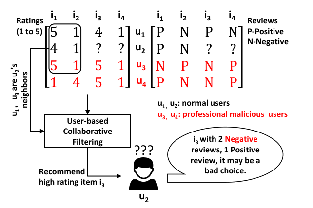
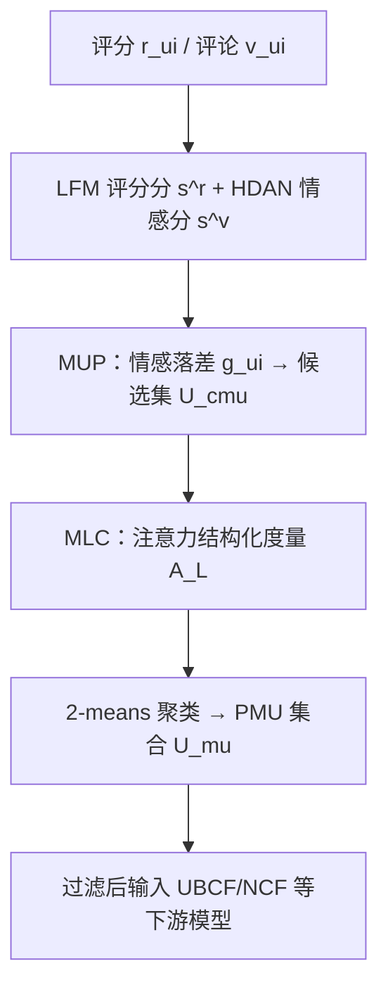
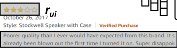

# Detect Professional Malicious User with Metric Learning in Recommender Systems (基于度量学习的推荐系统职业恶意用户检测)

- **会议/期刊**: IEEE Transactions on Knowledge and Data Engineering (TKDE)
- **作者与机构**: Yuanbo Xu, Yongjian Yang, En Wang, Fuzhen Zhuang, Hui Xiong（吉林大学 / 中科院计算所 / Rutgers 大学）
- **推荐链路定位**: 数据预处理与数据净化（召回前的交互去噪），不改变下游推荐模型结构
- **研究方向**: 去偏公平、可信隐私与工业架构 / 自监督对比学习与交互去噪
- **论文原文**: [https://arxiv.org/abs/2205.09673v1](https://arxiv.org/abs/2205.09673v1)
- **开源代码**: 暂未开源

## TL;DR (1分钟核心速览)

电商"职业恶意用户"(PMU) 交替使用"高评分+负评论""低评分+正评论"的掩蔽策略，使基于负反馈比例的统计离群点检测与依赖标签的刷单检测同时失效。本文提出无监督多模态模型 MMD：先用 HDAN 把评论映射为 1–5 情感分，与 LFM 预测评分构成"情感落差"画像筛出候选 PMU 集合；再用带注意力的结构化度量学习学到 Mahalanobis 距离并做 2-means 聚类。在 Amazon/Yelp/Taobao/Jingdong 上 F-score 达 0.944/0.987/0.963/0.974，作为预处理使下游 HR@5 平均提升 28.7%。

## Background & Motivation (背景与核心矛盾)

- **主流范式**: 工业界普遍用统计离群点检测（统计负反馈比例）或刷单/Shilling Attack 检测（Hy-sad、Semi-sad、CNN-sad）识别恶意用户，前者只看评分分布，后者多为有监督模型。
- **前人局限**: ①PMU 严格满足 $|R^{fa}_u|/|R_u|\le\theta_{fa}$与$|V^{ne}_u|/|V_u|\le\theta_{ne}$，从不"同时"给出低分与负评，因此其评分分布与正常用户$u_1$ 完全同构，统计离群点直接失效；②评分与评论被割裂建模，无法捕捉"分-评不一致"这一独有信号。
- **核心洞察 (Key Insight)**: 无论怎么掩蔽，PMU 对同一物品给出的评分分位与评论文本情感分之间必然存在显著且持续的"情感落差"，而正常用户的落差应很小。
- **本文切入点**: 把检测转成"无标签 + 多模态 + 度量空间可分"问题，先以落差画像构造伪标签，再学一个度量把两类用户拉开。
<figure class="paper-figure" markdown="span">
  <figcaption>图 1. 说明职业恶意用户如何迷惑普通用户并破坏在线电子商务公平性的示例。在该示例中，u3 和 u4 是职业恶意用户，他们对 i3 给出高评分（5），同时也对 i3 给出负面评论（N）。因此，普通用户 u2 被职业恶意用户 u3、u4 的虚假负面反馈所迷惑，对推荐项 i3 产生困惑。更重要的是，u3 的评分分布与普通用户 u1 的评分分布相同，因此传统统计离群点检测无法为推荐检测出这类职业恶意用户。</figcaption>
</figure>

## Method (核心方法设计)

### 1. 整体框架 (Overall Architecture)

MMD 分三阶段串行：one-hot 用户/物品经 LFM 得到隐向量 $p_u,q_i$与评分分$s^r_{ui}$；同时 HDAN 把评论文本编码为情感分$s^v_{ui}$（同值域 1–5）。二者进入职业恶意用户画像模块 MUP，逐条计算情感落差$g_{ui}$并按比例阈值过滤，得到候选集$U_{cmu}$与用户画像$\hat{g}_u$；再拼成画像向量$z_u=p_u\oplus\hat{g}_u$，用注意力度量学习 MLC 以$U_{cmu}$作弱监督学度量矩阵$A_L$；最后在该度量空间中以$U_{cmu}$为初始质心做 2-means，输出 PMU 集合$U_{mu}$并作为下游推荐模型的过滤阶段。总复杂度$O(n\log n)+O(nd^2)+O(p\log p+k^2)$。

<figure class="paper-figure" markdown="span">
  <figcaption>图 3. 职业恶意用户检测模型（MMD）示意图。MMD 包含两个重要模块：职业恶意用户画像（MUP）和注意力度量学习（MLC），二者均包含在灰色矩形框内。</figcaption>
</figure>

### 2. 关键设计拆解 (Key Designs)

1. **情感落差画像 MUP（把多模态不一致变成可算的标量）**：既有工作要么只用评分要么只用评论，本文用评分训练 HDAN 使情感分与评分同标度（$\mathcal{L}_{v\text{-}r}=\frac{1}{2}\sum_{u,i}(r_{ui}-s^v_{ui})^2$），再定义$g_{ui}=|s^r_{ui}-s^v_{ui}|$；用户级判据为$\frac{|\{g_{ui}\ge\alpha_g\}|}{|\hat{g}_u|}\ge\theta_{mu}$。物理直觉：正常用户的文字与打分同源，落差小；PMU 为规避检测必须让二者"打架"，因此落差在用户维度上呈现高比例、持续性的异常。

2. **注意力结构化度量学习 MLC（在无标签下学出可分空间）**：直接对原始 $p_u$学度量既无监督信号也未利用掩蔽行为。本文令$z_u=p_u\oplus\hat{g}_u$，距离$d_A(z_j,z_k)=\sqrt{(z_j-z_k)^{\top}c^2A(z_j-z_k)}$，并用注意力向量$t_u=\mathrm{softmax}(z_u^{\top}W_tA)$逐维加权（$t\otimes z$替代$z$），使属性维与落差维贡献不同。关键在$A$的结构约束：$p\times p$块固定为欧氏（对角 1），$k\times k$块用$\mathcal{N}(0,1)$初始化后自由学习，另加两个$p\times k$ 交叉块刻画"属性—落差"关联——既保留欧氏可解释性又让落差维获得全矩阵表达力，参数 3104 个（全矩阵需 4096）。

3. **训练目标、负采样与推理效率**：借鉴 BPR 成对损失，以 $U_{cmu}$为伪标签构造同簇/异簇对：$\mathcal{L}_{MLC}=\sum_{j,k\in U_{cmu},\,k'\notin U_{cmu}}\big(\lambda d_A(z_j,z_k)-(1-\lambda)d_A(z_j,z_k')+c\big)$，加$\|\Theta\|_2^2$正则，Adagrad 优化；因 PMU 仅约 10%，取$\lambda=0.6>0.5$并重复采样正例（每个 PMU 配 5–10 个负例）。推理仅需一次 HDAN 前向 + 一次 2-means，$A_L$ 已离线学好，无额外在线开销。

## Experimental Setup & Evaluation Protocol (实验设置与评估协议)

- **数据集与预处理**: Amazon/Yelp 为公开集，原始无 PMU，随机取 450 名有 ≥5 条反馈的用户并注入 50 名采用掩蔽策略的人工 PMU；Taobao/Jingdong 为真实集，PMU 名单来自商家举报网站 tatocece.com。

| 数据集 | #Users | #Items | #Interactions (评/分) | 稀疏度 | 特征/场景说明 |
| :--- | :---: | :---: | :---: | :---: | :--- |
| Amazon | 30,759 | 16,515 | 285,644 / 285,644 | 0.051% | 采样 500 用户，注入 10% 人工 PMU |
| Yelp | 45,980 | 11,537 | 229,900 / 229,900 | 0.043% | 同上，评均 130 词 |
| Taobao | 10,121 | 9,892 | 10,791 / 49,053 | 0.049% | 真实 PMU 占 9.31%，假评分占其评分 45.5% |
| Jingdong | 8,031 | 3,025 | 8,310 / 25,152 | 0.12% | 真实 PMU 占 10.71%，假评分占 56.7% |

- **数据划分与防穿越 (Splitting Strategy)**: 检测任务不做交互划分，仅按用户划分正负样本（PMU 比例上限 10% 作标签预算）；下游推荐评估采用 60%/20%/20% 的训练/测试/验证比例划分。
- **排名评测协议 (Ranking Protocol)**: 检测侧用 sensitivity/specificity/F-score 的二分类指标；推荐侧用 HR@N 与 NDCG@N（N=5、15）的 Top-N 全排序评估，无负采样。
- **对比基线与超参设置**: 基线含无监督 K-means++、SOD，有监督 Hy-sad、Semi-sad、CNN-sad、SDRS，以及本文拆分变体 MLC、MUP；嵌入维度 $d=32$，$\lambda=0.6$，$\alpha_g=3.5$（Jingdong 为 3），$\theta_{mu}=0.7$（Taobao 0.8）；另用 20 名学生做主观标注对照。

## Key Experimental Results (实验关键数据)

### 1. 主实验对比 (Main Results)

| 方法 | Amazon F | Yelp F | Taobao F | Jingdong F |
| :--- | :---: | :---: | :---: | :---: |
| K-means++ | 0.494 | 0.318 | 0.234 | 0.530 |
| SOD | 0.113 | 0.076 | 0.039 | 0.242 |
| Hy-sad | 0.516 | 0.671 | — | — |
| Semi-sad | 0.563 | 0.773 | — | — |
| CNN-sad | 0.650 | 0.771 | — | — |
| SDRS | 0.745 | 0.831 | 0.597 | 0.811 |
| MUP (单模块) | 0.795 | 0.850 | 0.779 | 0.764 |
| MLC (单模块) | 0.910 | 0.874 | — | — |
| **MMD** | **0.944** | **0.987** | **0.963** | **0.974** |
| Improv.% (vs 最强基线) | +26.7% | +18.8% | +61.3% | +20.1% |

MMD 在 Amazon/Yelp 上较 Semi-sad 提升 67.6%/34.6%，在 Taobao/Yelp 上较 K-means++ 提升 311%/302%；主观实验中 MMD 的 F-score 0.94，逼近学生标注的 0.96。

### 2. 消融实验 (Ablation Study)

| 变体 | Amazon | Yelp | Taobao | Jingdong |
| :--- | :---: | :---: | :---: | :---: |
| E-MMD（纯欧氏） | 0.215 | 0.123 | 0.173 | 0.136 |
| D-MMD（对角度量） | 0.494 | 0.587 | 0.649 | 0.536 |
| F-MMD（全矩阵，4096 参数） | 0.914 | 0.968 | 0.960 | 0.945 |
| R-MMD（本文结构，3104 参数） | **0.944** | **0.987** | **0.963** | **0.974** |
| w/o attention | 0.890 | 0.899 | 0.872 | 0.931 |
| w/ attention（完整） | **0.944** (+6.0%) | **0.987** (+9.7%) | **0.963** (+10.4%) | **0.974** (+4.6%) |

### 3. 关键实验发现 (Key Findings)

1. **掩蔽策略确实打穿了传统检测**：只看负反馈比例的 SOD 在四个数据集上 F-score 全部垫底（Amazon 仅 0.113、Taobao 0.039），定量印证"PMU 评分分布与正常用户同构"这一核心动机。
2. **无标签场景是有监督方法的死穴**：Hy-sad/Semi-sad/CNN-sad 在 Taobao/Jingdong 完全不可用（需标签），而 MMD 的 F-score 仍达 0.963/0.974；同时 MUP 的 SPE 恒接近 1 但 SEN 偏低（0.62–0.74），说明"高精度筛候选 + 度量聚类补召回"的级联互补是必要的。
3. **度量的结构比参数量更重要**：R-MMD 以少 992 个参数达到甚至略优于 F-MMD 的效果（Yelp 0.987 vs 0.968），而退化为欧氏时 F-score 崩塌至 0.123–0.215，说明"属性维固定欧氏 + 落差维全矩阵 + 交叉块"的先验约束才是可分性的来源；注意力再叠加 4.6%–10.4% 增益，且 $\alpha>3.5$、$\theta\to1$ 时性能骤降，验证"PMU 不会给出全部假反馈"的定义自洽性。下游侧，以 MMD 过滤后 UBCF/IBCF/MF-eALS/MF-BPR/NCF 的 HR 平均 +28.7%、NDCG 平均 +17.3%。

## Highlights & Limitations (亮点、对比与审稿批判)

- **与代表作对比 (vs. Prior Work)**: 相比 SDRS（仅用双注意力 RNN 算观点分再联合过滤），MMD 额外引入"评分-评论落差"这一掩蔽指纹并叠加度量学习，Amazon F-score 从 0.745 提到 0.944；相比 Hy-sad/Semi-sad 依赖人工标签与手工检测指标，MMD 用伪标签 + BPR 式成对度量实现近乎无监督；相比 K-means++ 直接在原始隐向量上聚类，MMD 学到的是任务定制度量。
- **可迁移亮点**: ①"用一路模态作另一路模态的回归目标"（评分监督情感分）以对齐标度，可直接迁移到图文电商的图文一致性打假；②"块状结构约束的度量矩阵 + 注意力逐维加权"可作为通用低参数开销的对比聚类头。
- **审稿级局限批判**: ①Amazon/Yelp 的 PMU 是注入的人工账号，其掩蔽分布由作者设定，真实攻击者若自适应地控制落差（例如按落差阈值反向优化），检测率可能大幅下滑，论文未做对抗性评估；②$\alpha_g,\theta_{mu}$需按数据集分别调优（Jingdong 最优$\alpha=3$，Taobao 最优$\theta=0.8$），且依赖"PMU 占比≈10%"的先验收割$\lambda$，跨域迁移成本高；③HDAN 需要中等长度评论（Taobao 评均仅 65 词、评均句数 4.9），短评场景情感分噪声大；④全流程串行且无开源代码，复现与工业部署成本偏高。

## Rating (四维评分)

- **方法创新性 (Novelty)**: ⭐⭐⭐⭐ （首次形式化"职业恶意用户 + 掩蔽策略"，并以情感落差画像与结构化注意力度量组合破局，思路新颖但组件均为已有技术重组）
- **评估协议与实验扎实度 (Protocol & Experiments)**: ⭐⭐⭐⭐ （四个真实数据集 + 真实举报名单 + 学生主观对照 + 下游推荐增益闭环验证，唯 Amazon/Yelp 为人工注入略有折扣）
- **写作与数学规范度 (Clarity & Rigor)**: ⭐⭐⭐⭐ （落差与度量公式定义清晰、复杂度分析完整，但 $A$的块结构与$\theta_{mu}$ 先验的合理性以实证为主、缺乏理论界）
- **工业落地与复现价值 (Industrial & Practical Value)**: ⭐⭐⭐⭐ （作为预处理即可带来 HR +28.7%，工程改造成本低，但阈值需逐场景调参且无开源实现）

