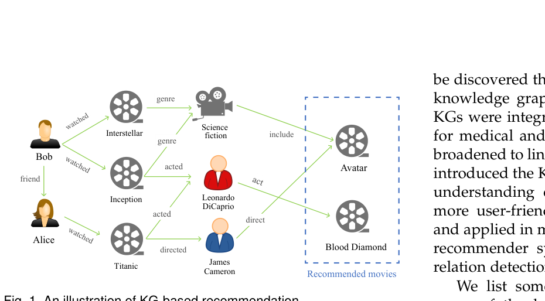
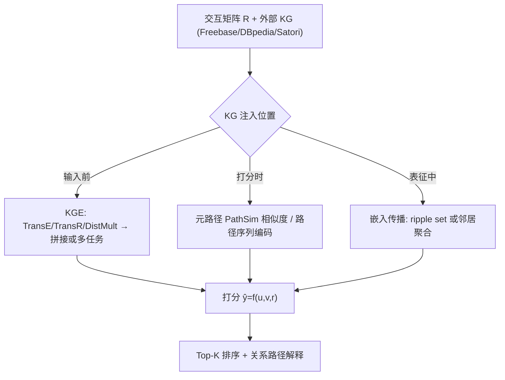

# A Survey on Knowledge Graph-Based Recommender Systems (基于知识图谱的推荐系统综述)

- **会议/期刊**: IEEE TKDE (arXiv 2020-02-28)
- **作者与机构**: Qingyu Guo, Fuzhen Zhuang, Chuan Qin, Hengshu Zhu, Xing Xie, Hui Xiong, Qing He（中科院计算所、百度人才数据中心、MSRA、HKUST 等）
- **推荐链路定位**: 召回（KG 增强表征/路径证据），可延伸至可解释重排
- **研究方向**: 图神经网络与知识图谱推荐 / 冷启动与长尾推荐
- **论文原文**: [https://arxiv.org/abs/2003.00911v1](https://arxiv.org/abs/2003.00911v1)
- **开源代码**: 暂未开源

## TL;DR (1分钟核心速览)

协同过滤在交互稀疏与新物品冷启动时表征不足，且难以给出推荐理由。本文以“知识图谱如何被使用”为唯一划分轴，把 39 篇工作归为**嵌入式**（KGE 富化物品/用户向量）、**路径式**（元路径/元图连通性相似度或路径编码）、**统一式**（嵌入传播，兼顾语义与连通性）三范式，并系统整理 MovieLens / Book-Crossing / Yelp / Bing-News 等 7 类场景的构图方式。其价值不在单点 SOTA，而在于给出可解释性与可扩展性的取舍地图，并指出动态图、KG 补全多任务、用户侧信息与 KGE 选型四大空白。

## Background & Motivation (背景与核心矛盾)

- **主流范式**: CF 用交互矩阵学隐向量，混合式引入物品属性、评论、社交网络等 side information；KG 以 `<head, relation, tail>` 三元组统一承载多类型实体与关系。
- **前人局限**: ①纯 CF 在长尾物品与零交互新用户上无法度量相似度；②多源 side information 各自为政，缺少跨类型高阶语义关联，且推荐结果对用户是黑箱。
- **核心洞察 (Key Insight)**: KG 同时提供两种可复用的信号——**语义相关性**（实体/关系嵌入可迁移到物品向量）与**连通性证据**（用户—物品间多跳路径本身即解释），二者恰好对应“精度”与“可解释”两个诉求。
- **本文切入点**: 不再按模型结构（GNN/CNN/RL）分类，而按“KG 参与计算的深度”切分三范式，从而让精度—解释—开销的权衡可比较。

<figure class="paper-figure" markdown="span">
  <figcaption>图1. 基于KG的推荐示意图。</figcaption>
</figure>

## Method (核心方法设计)

### 1. 整体框架 (Overall Architecture)

统一符号下，推荐即学用户 $\mathbf{u}_i$、物品$\mathbf{v}_j$与打分函数$\hat{y}_{ij}=f(\mathbf{u}_i,\mathbf{v}_j)$；三范式的差别仅在于 KG 在哪一步注入：嵌入式在**输入前**用 KGE 预训练并拼接/多任务共享；路径式在**打分时**以元路径相似度作正则或把路径序列编码为交互向量；统一式在**表征过程中**沿 KG 边迭代传播邻居信息。三者最终都回到 Top-K 排序，只是路径式与统一式额外保留了可用于解释的关系序列。

### 2. 关键设计拆解 (Key Designs)

1. **嵌入式：把 KG 当“特征工厂”**：痛点是物品向量信息量不足。CKE 将结构知识 $x_j$、文本$z_{t,j}$、视觉$z_{v,j}$与交互偏置$\eta_j$直接相加得$\mathbf{v}_j=\eta_j+x_j+z_{t,j}+z_{v,j}$；更主流的是多任务共享，$\mathcal{L}=\mathcal{L}_{rec}+\lambda\mathcal{L}_{KG}$，用 KG 补全的 hinge loss 约束实体向量，使物品嵌入与 KG 实体对齐。直觉：KG 补全任务强迫“同关系实体相邻”，从而把语义邻近性注入 CF。
2. **路径式：把连通性当“相似度先验”**：痛点是高阶协同信号无法由内积表达。用 PathSim 度量元路径连通度 $s_{x,y}=\frac{2\times|\{p_{x\leadsto y}\}|}{|\{p_{x\leadsto x}\}|+|\{p_{y\leadsto y}\}|}$，再以$\sum_l\theta_l\sum_{i,j}s^l_{i,j}\|\mathbf{u}_i-\mathbf{u}_j\|_F^2$作为图正则；或直接编码路径$\mathbf{h}=g(\mathbf{h}_p)$、$\hat{y}_{ij}=f(\mathbf{u}_i,\mathbf{v}_j,\mathbf{h})$，PGPR 进一步用 RL 在 KG 上采样“合理路径”。优点是可解释，代价是元路径需领域知识或搜索开销。
3. **统一式：用传播同时吃语义与结构**：RippleNet 从用户历史物品出发，在关系空间算注意力 $\alpha_i=\frac{\exp(\mathbf{v}_j^\top\mathbf{R}_i\mathbf{e}_{h_i})}{\sum_{(h,r,t)\in S_u^1}\exp(\mathbf{v}_j^\top\mathbf{R}_r\mathbf{e}_h)}$，逐跳聚合$\mathbf{o}_u^1=\sum_i\alpha_i\mathbf{e}_{t_i}$得$\mathbf{u}_i=\sum_h\mathbf{o}_u^h$；KGCN 反向做邻居聚合$\mathbf{e}_h^{(k)}=\sigma(\mathbf{W}(\mathbf{e}_h^{(k-1)}+\mathbf{e}_{S_v}^{(k)})+\mathbf{b})$，并**固定采样邻居数**把复杂度压到$O(H\cdot d\cdot|\mathcal{N}|)$。前者的传播方向是“用户兴趣外扩”，后者是“物品邻居内聚”，KGAT 则把传播搬到用户—物品图上统一处理。

## Experimental Setup & Evaluation Protocol (实验设置与评估协议)

- **数据集与场景**（综述统计，原文未给统一规模表）：

| 场景 | 常用数据集 | 反馈/内容特点 | KG 构图来源 |
| :--- | :--- | :--- | :--- |
| Movie | ML-100K/1M/20M, DoubanMovie | 评分 + 标签 + 社交 | Satori/DBpedia/Freebase/CN-DBpedia/IMDB |
| Book | Book-Crossing, Amazon-Book, DBbook2014, IntentBooks, DoubanBook | 隐式/显式反馈 | Satori/DBpedia/Freebase |
| News | Bing-News | 标题实体 + 点击日志 | 标题实体链接后取 Satori 子图 |
| Product | Amazon Product, Alibaba Taobao | 评论、类目、行为 | Freebase 或站内数据 |
| POI | Yelp, Dianping-Food, CEM | check-in、评论文本 | 站内属性构图 |
| Music | Last.FM, KKBox | 收听序列 | Freebase/Satori 或站内描述 |
| Social | Weibo, DBLP, MeetUp | 关注/情感链接 | Satori 富化目标实体 |

- **数据划分与防穿越**: 综述汇总的文献多为 `Leave-One-Out` 或用户内比例划分，仅少数按全局时间戳切分；**本文未做事后统一复核，故跨论文数字不可横比**。
- **排名评测协议**: 绝大多数为 `Sampled Ranking`（1 正 + N 负，N 常取 1–100），`Full-Ranking` 少见；指标以 AUC、HR@K、NDCG@K、Recall@K 为主，缺少统一的显著性检验与方差上报。
- **对比基线与超参**: 嵌入维度普遍 $d\in\{8,16,32,64\}$，KGE 以 TransR/TransE/DistMult 为主；基线多为 BPR-MF、LibFM、CKE、RippleNet 等自选组合。

## Key Experimental Results (实验关键数据)

### 1. 主实验对比 (Main Results)

综述不含统一实验，故以“范式—机制—代价”对照替代数值表（不做任何数值杜撰）：

| 范式 | 代表工作 | KG 用法核心算子 | 可解释性 | 主要短板 |
| :--- | :--- | :--- | :--- | :--- |
| 嵌入式 | CKE (KDD'16), DKN (WWW'18), KSR (SIGIR'18), MKR (WWW'19), KTUP (WWW'19), RCF (SIGIR'19) | KGE 预训练 + 拼接 / $\mathcal{L}_{rec}+\lambda\mathcal{L}_{KG}$ 多任务 | 弱（仅实体级） | 丢弃连通结构，需离线重训 KGE |
| 路径式 | Hete-MF/HeteRec(-p), FMG (KDD'17), MCRec (KDD'18), RKGE (RecSys'18), KPRN (AAAI'19), RuleRec/PGPR (WWW/SIGIR'19) | PathSim 图正则 / 路径序列 CNN-LSTM 编码 / RL 路径搜索 | 强（显式元路径） | 元路径需人工定义，路径枚举昂贵 |
| 统一式 | RippleNet (CIKM'18), KGCN (WWW'19), KGAT (KDD'19), KGCN-LS, AKUPM, KNI, IntentGC, AKGE | ripple 注意力传播 / 固定邻居采样聚合 / 图注意力 | 中强（传播路径） | 层数受限、过平滑、采样方差 |

### 2. 消融实验 (Ablation Study)

原文未提供可复核的统一消融数值，下表仅归纳被综述文献反复验证的**机制必要性方向**，不填造数字：

| 移除组件 | 典型被验证模型 | 性能变化方向 | 说明 |
| :--- | :--- | :--- | :--- |
| 去掉 KG 辅助任务 $\mathcal{L}_{KG}$ | MKR, KTUP, RCoLM | 显著下降 | 多任务共享正则是嵌入式收益主源 |
| 去掉多跳传播（退化为 1-hop） | RippleNet, KGCN, KGAT | 下降，随 $H$先升后降 |$H$ 过大引入噪声与过平滑 |
| 去掉注意力/关系权重 | RippleNet, KGAT | 下降 | 关系统一权重会混淆不同语义边 |
| 去掉元路径正则 | Hete-MF, HeteRec | 下降 | 路径式收益几乎全部来自该正则 |

### 3. 关键实验发现 (Key Findings)

1. **范式迁移的时间拐点清晰**：按表 3 统计的 39 篇中，嵌入式 14 篇、路径式 15 篇、统一式 10 篇，但统一式的 10 篇里有 9 篇发表于 2019 年及以后，说明 RippleNet 之后“传播”已取代“预训练拼接”成为主流。
2. **多任务是最稳的增量**：明确联合训练 KG 补全与推荐的仅 KTUP、RCoLM 两篇，却均报告了相对单任务 backbone（TUP、AKUPM）的提升，暗示“KG 补全作为辅助监督”比单纯引入更多三元组更划算。
3. **数据集复用高度集中且用户侧信息被忽视**：MovieLens-1M 被 13 篇使用、Yelp 被 10 篇、Book-Crossing 被 7 篇；而把用户节点或其社交边真正入图的仅 CFKG、SHINE、KNI、IntentGC、AKGE 等少数工作，冷启动收益缺乏严格 zero-shot 划分验证。

## Highlights & Limitations (亮点、对比与审稿批判)

- **与代表作对比 (vs. Prior Work)**: 相较 CKE 只做特征拼接、DKN 只做新闻实体增强，本综述指出 RippleNet/KGCN 的关键跃迁是“让 KG 参与表征计算而非仅参与初始化”；相较同期的 GNN 推荐综述，本文额外把**可解释性来源**（元路径 vs 传播路径 vs 实体相似）显式对齐到三类范式。
- **可迁移亮点**: ①把 KG 补全作为辅助任务做参数共享，几乎可零成本挂到任意 CF backbone；②固定大小邻居采样（KGCN）是控制 KG 推荐在线开销最实用的工程技巧。
- **审稿级局限批判**: ①**无统一实验台**——各文划分、负采样比、指标各异，综述给出的“有效”结论缺乏可复现的量化背书；②对 KGE 选型（TransE vs TransR vs DistMult）只列不判，未回答“何时该用哪种”，也未讨论 KG 噪声与缺失事实对传播的放大效应；③“缓解冷启动”被反复声称，却缺少严格 zero-shot 新用户/新物品分桶实验。

## Rating (四维评分)

- **方法创新性 (Novelty)**: ⭐⭐⭐ （综述本身无新算法，但“按 KG 注入位置”而非按网络结构分类的视角具有组织价值）
- **评估协议与实验扎实度 (Protocol & Experiments)**: ⭐⭐ （无统一基准与显著性检验，跨论文数值不可横比，仅数据集与范式梳理扎实）
- **写作与数学规范度 (Clarity & Rigor)**: ⭐⭐⭐⭐ （符号表、ripple set/H-hop 邻居等概念定义完备，PathSim、聚合器与多任务损失公式表述清晰）
- **工业落地与复现价值 (Industrial & Practical Value)**: ⭐⭐⭐ （给出构图来源与采样式传播的可落地路径，但无开源代码与统一复现脚本，工程选型仍需自行试错）

