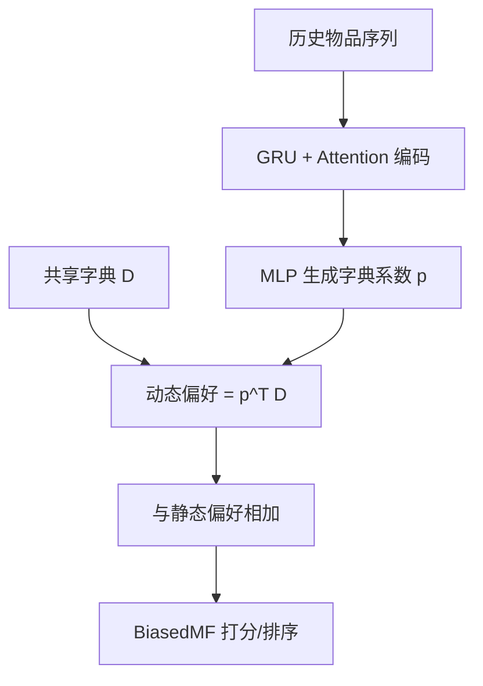
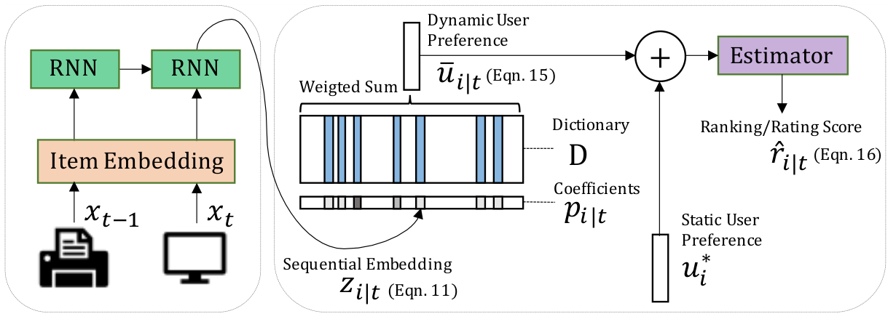

# Modeling Dynamic User Preference via Dictionary Learning for Sequential Recommendation (基于字典学习的序列推荐动态用户偏好建模)

- **会议/期刊**: IEEE TKDE 2022
- **作者与机构**: Chao Chen, Dongsheng Li, Junchi Yan, Xiaokang Yang；上海交通大学、微软亚洲研究院、复旦大学
- **推荐链路定位**: 召回/排序（序列推荐，rating + top-k）
- **研究方向**: 序列与会话推荐 / 协同过滤
- **论文原文**: [论文原文链接](https://arxiv.org/abs/2204.00752v1)
- **开源代码**: [开源代码仓库链接](https://github.com/cchao0116/S2PNM-TKDE2021)

## TL;DR (1分钟核心速览)

针对用户偏好随时间漂移、静态与动态偏好常在不同隐空间难以融合的问题，本文提出 S2PNM：用共享字典表示跨用户动态偏好基，以 GRU+Attention 从历史序列生成字典系数，再将动态偏好与静态偏好直接相加。Netflix 按时间 9:1 切分下 RMSE 较 SVD++ 降 2.18%；Baby Care 上 NDCG@5 较 SASRec 升 6.10%。

## Background & Motivation (背景与核心矛盾)

- **主流范式**: 静态 MF 用单一用户向量概括历史；RNN/记忆网络/注意力序列模型则直接编码行为序列做下一物品预测。
- **前人局限**: 其一，SVD++/GLOMA/MRMA 等忽略序列漂移；其二，RRN/NADE/RUM 等虽有动态建模，却常把序列模式与用户偏好放在不同空间，融合依赖复杂估计器。
- **核心洞察 (Key Insight)**: 用户动态偏好可由一组跨用户共享的“偏好基”线性组合表达；若把序列翻译到静态偏好同一隐空间，简单加法即可融合。
- **本文切入点**: 将序列推荐转化为监督字典学习：学字典 $\mathbf{D}$ 与序列到系数的映射，用残差监督动态偏好。

## Method (核心方法设计)

### 1. 整体框架 (Overall Architecture)

S2PNM 先由 GRU+Attention 编码用户历史物品序列，得到序列表示；再由 MLP 解码出字典系数 $\mathbf{p}_{i|t}$，对共享字典行加权求和得到动态偏好$\bar{\mathbf{u}}_{i|t}$；最后与静态偏好$\mathbf{u}_i^*$ 相加，经 BiasedMF 式内积输出评分/排序分。训练端到端，静态偏好用 BiasedMF 预训练；长序列用滑动窗口 mini-batch 并行。

<figure class="paper-figure" markdown="span">
  <figcaption>图 1. 序列到偏好（Seq2Pref）神经网络架构。首先将第 i 个用户的历史物品 {x1, . . . , xT} 输入 RNNs，以将序列依赖嵌入隐藏向量 z_{i|t}；随后通过对字典 D 的各行赋予不同权重，从 z_{i|t} 转换得到动态用户偏好 ū_{i|t}，对更（更不）有助于匹配用户当前兴趣的行赋予更高（更低）的权重 p_{i|t}。最后，估计器可利用动态用户偏好 ū_{i|t} 和静态用户偏好 u∗ 为推荐提供评分/排序分 ˆr_{ij|t}。</figcaption>
</figure>

### 2. 关键设计拆解 (Key Designs)

1. **共享字典与残差监督**：解决静态/动态偏好异空间问题。动态偏好 $\bar{\mathbf{u}}_{i|t}=\mathbf{p}_{i|t}^{\top}\mathbf{D}$，组合偏好$\mathbf{u}_{i|t}=\mathbf{u}_i^*+\bar{\mathbf{u}}_{i|t}$；令残差$\mathbf{r}_i^{\mathrm{res}}=\mathbf{r}_i-\mathbf{u}_i^*\mathbf{V}^{\top}$，则字典学习等价于$\min_{\mathbf{p}_{i|t},\mathbf{D}'}\|\mathbf{r}_i^{\mathrm{res}}-\mathbf{p}_{i|t}\mathbf{D}'\|$，且$\mathbf{p}_{i|t}\ge0,\sum_k p_{i|t}(k)=1$。非负约束使字典行“组合”而非抵消，提升可解释性与融合稳定性。
2. **Seq2Pref 序列翻译器**：解决序列模式与偏好空间不对齐。用 GRU 得隐藏态 $\mathbf{h}_t$，注意力聚合得$\mathbf{g}_t$，拼接二阶交互$\mathbf{z}_t=[\mathbf{h}_t,\mathbf{g}_t,\mathbf{h}_t-\mathbf{g}_t,\mathbf{h}_t\circ\mathbf{g}_t]$，再经 MLP 与稀疏非负归一化得$p_{i|t}(k)=c'_{t,k}/\sum_j c'_{t,j}$。注意力适配不同时间尺度，系数解码把序列信号投影为偏好基权重。
3. **训练目标、负采样与推理**：rating 用 MSE，ranking 用加权 MSE；总损失 $\mathcal{L}=\sum_{(i,j,t)\in\mathcal{I}_{\mathrm{train}}}w_{ij}(r_{ij}-\hat{r}_{ij|t})^2+R(\theta)$。ranking 对未交互物品采样负例，正样本权重大、负样本权重小；推理仅需 GRU+MLP 前向与字典线性组合，开销约$O(d_{\mathrm{dict}}d_{\mathrm{user}})$。

## Experimental Setup & Evaluation Protocol (实验设置与评估协议)

- **数据集与预处理**:

| 数据集 | #Users | #Items | #Interactions | 密度 | 场景 |
| :--- | :---: | :---: | :---: | :---: | :--- |
| Amazon Instant Video | 1,372 | 7,957 | 23,181 | 0.43% | 视频购买/评分 |
| Amazon Baby Care | 5,057 | 10,420 | 77,787 | 0.15% | 母婴商品 |
| Netflix Prize | 480,188 | 17,769 | 100,462,737 | 1.18% | 电影评分 |

- **数据划分与防穿越**: Netflix 按全局时间顺序 9:1 切分；Amazon 保留每用户至少 10 条记录，按购买时间排序，前 70% 训练、后 30% 测试。
- **排名评测协议**: 训练对未交互物品采样负例（加权 MSE）；评测报告 Precision@5、HR@5、NDCG@5。原文未明确全库候选池，按可复现信息应视为“负采样训练 + top-k 排序”，非严格 Full-Ranking。
- **对比基线与超参**: MF 类 SVD++/TimeSVD++/GLOMA/MRMA/I-AutoRec；神经类 RRN/NADE；排序类 BPR/eALS/NeuMF/RUM/SHAN/SASRec。$d_{\mathrm{user}}\in\{50,200,300\}$，$d_{\mathrm{dict}}=1000$（Netflix）/5000（Baby Care），$d_{\mathrm{GRU}}=256$，Adam、dropout 0.02、batch 16/128；未报告显著性检验。

## Key Experimental Results (实验关键数据)

### 1. 主实验对比 (Main Results)

**表2 Netflix rating prediction（RMSE↓）**

| 方法 | 类型 | RMSE | vs SVD++ |
| :--- | :--- | :---: | :---: |
| SVD++ | MF | 0.89267 | +0.00% |
| TimeSVD++ | MF | 0.90762 | -1.67% |
| GLOMA | MF | 0.89326 | -0.06% |
| MRMA | MF | 0.89210 | +0.06% |
| I-AutoRec | 神经 | 0.92185 | -3.27% |
| RRN | 神经 | 0.89014 | +0.28% |
| NADE | 神经 | 0.88876 | +0.43% |
| **S2PNM (d=300)** | 神经 | **0.87322** | **+2.18%** |

**表3 Baby Care item ranking（%，越高越好）**

| 方法 | P@5 | HR@5 | NDCG@5 |
| :--- | :---: | :---: | :---: |
| SVD++ | 0.618 | 3.108 | 0.650 |
| BPR | 0.689 | 3.334 | 0.694 |
| eALS | 0.677 | 3.262 | 0.725 |
| NeuMF | 0.802 | 3.579 | 0.779 |
| RUM | 0.692 | 3.590 | 0.791 |
| SHAN | 0.764 | 3.703 | 0.759 |
| SASRec | 0.812 | 3.901 | 0.787 |
| **S2PNM** | **0.820** | **4.000** | **0.835** |

较 SASRec，S2PNM 在 P@5/HR@5/NDCG@5 上分别提升 **0.99%/2.54%/6.10%**。

### 2. 消融实验 (Ablation Study)

| 变体 | RMSE | P@5 | HR@5 | NDCG@5 |
| :--- | :---: | :---: | :---: | :---: |
| S2PNM-stat | 最高 | 较低 | 较低 | 较低 |
| S2PNM-dynm | 中 | 与完整相近 | 与完整相近 | 明显低于完整 |
| **S2PNM** | **最低** | **最高** | **最高** | **最高** |

（Instant Video 图2–5趋势；原文未给表值）

### 3. 关键实验发现 (Key Findings)

1. Netflix 上 S2PNM 的 RMSE 为 0.87322，较 SVD++ 的 0.89267 相对降 2.18%，说明同空间动态偏好比纯静态 MF 更贴合真实时间切分。
2. Baby Care 上 S2PNM 的 NDCG@5 达 0.835，较 SASRec 的 0.787 升 6.10%，且 HR@5 从 3.901 升至 4.000，表明字典翻译对 top-k 排序尤其有效。
3. 稀疏用户收益更明显：相对 MRMA，评分数少于 5 的用户 RMSE 改善 3.3%；相对 RUM，评分数少于 10 的用户 HR@5 提升 17.0%，验证“把序列翻译为偏好”对少历史用户更稳。

## Highlights & Limitations (亮点、对比与审稿批判)

- **与代表作对比 (vs. Prior Work)**: RUM 用固定窗口外部记忆直接产生动态部分，本文用共享字典把序列翻译到静态偏好空间；RRN/NADE 主要做序列或评分分布建模，未显式保证静态/动态同空间融合；SASRec 靠自注意力建模序列，但缺少静态-动态字典式分解。
- **可迁移亮点**: 共享字典+残差监督可作为跨用户动态偏好基；静态 MF 预训练初始化可加速并提升序列模型稳定性。
- **审稿级局限批判**: 其一，Amazon 仅两个类目，ranking 训练采负例且候选池/显著性检验披露不足，尚非严格全库评测；其二，Netflix 最长序列达 17770，单卡每轮约 4 分钟、双卡约 3 分钟，字典 $d_{\mathrm{dict}}$ 与 GRU 规模使线上部署成本偏高，且非可微 mask 为启发式近似。

## Rating (四维评分)

- **方法创新性 (Novelty)**: ⭐⭐⭐⭐ （字典学习将序列翻译为动态偏好并与静态偏好同空间相加，思路清晰，但组件多为成熟模块组合）
- **评估协议与实验扎实度 (Protocol & Experiments)**: ⭐⭐⭐ （Netflix 时间切分较严谨且有稀疏分桶分析，但 Amazon 类目少、负采样候选与显著性未充分披露）
- **写作与数学规范度 (Clarity & Rigor)**: ⭐⭐⭐⭐ （从字典系数、残差监督到预测函数链路完整，非可微 mask 与复杂度分析略简）
- **工业落地与复现价值 (Industrial & Practical Value)**: ⭐⭐⭐ （代码开源、静态预训练与滑窗并行实用，但长序列训练开销与大字典推理成本限制大规模上线）

