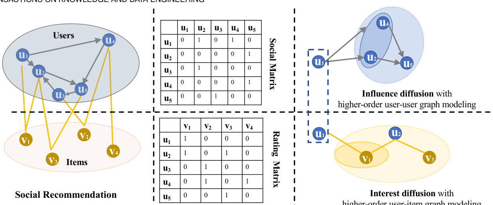
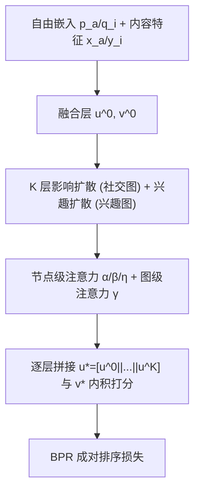
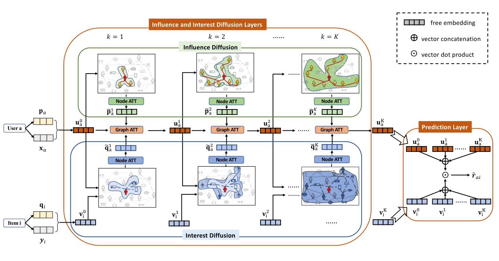

# DiffNet++: A Neural Influence and Interest Diffusion Network for Social Recommendation（神经影响与兴趣双扩散社交推荐网络）

- **会议/期刊**: IEEE TKDE (arXiv 2020, 期刊版 2021/2022)
- **作者与机构**: Le Wu, Junwei Li, Peijie Sun, Richang Hong, Yong Ge, Meng Wang（合肥工业大学、亚利桑那大学）
- **推荐链路定位**: 召回（用户/物品表征 + 内积打分）
- **研究方向**: 社交与群组推荐 / 图神经网络推荐
- **论文原文**: [https://arxiv.org/abs/2002.00844v4](https://arxiv.org/abs/2002.00844v4)
- **开源代码**: [https://github.com/PeiJieSun/diffnet](https://github.com/PeiJieSun/diffnet)

## TL;DR (1分钟核心速览)

社交推荐此前要么只用一阶社交邻居做正则（SocialMF/TrustSVD），要么只在高阶社交图上扩散（作者前作 DiffNet），忽视了用户同处「用户-物品兴趣图」中的高阶协同信号。DiffNet++ 把两类行为重构成一张异构图，在每一层同时从「上一层自身表征 + 社交邻居影响聚合 + 兴趣邻居兴趣聚合」三源迭代更新用户向量，并用「节点级 + 图级」双层注意力自适应地为每个用户分配两类图的信息权重。在 4 个真实数据集、1:1000 采样排序协议下，Yelp HR@10 达 0.3694（较最强基线 +21.4%），Flickr +27.8%。

## Background & Motivation (背景与核心矛盾)

- **主流范式**: 以 BPR/FM 的隐向量内积为骨架，社交侧通过社交正则项（SocialMF）或把好友隐向量拼进用户表征（TrustSVD）注入一阶社交信息。
- **前人局限**: ① 只把社交图降维成一阶邻居，无法刻画「$u_1\to u_2\to u_5$」这类高阶递归影响；② 反过来只建模高阶兴趣图（NGCF）或只建模高阶社交图（DiffNet），二者割裂，兴趣图上「$u_1\leftrightarrow v_1\leftrightarrow u_2\leftrightarrow v_3$」的高阶协同路径被丢弃。
- **核心洞察**: 用户是两张图的共同枢纽，影响扩散与兴趣扩散应当**在同一表征空间中同步递归**；且不同用户对「被好友带偏」与「坚持自我口味」的偏好差异极大，融合权重必须个性化。
- **本文切入点**: 把两图并成异构图，用统一的逐层扩散算子 + 多层注意力实现「节点级取邻居、图级取来源」的两级自适应聚合。

<figure class="paper-figure" markdown="span">
  <figcaption>图1. 社交推荐的整体示意图。第二列展示了传统模型如何用用户两类行为的矩阵表示来处理该问题。本文尝试用用户两类行为的图表示来同时建模影响扩散和兴趣扩散。</figcaption>
</figure>

## Method (核心方法设计)

### 1. 整体框架 (Overall Architecture)

输入用户自由向量 $\mathbf{p}_a$、物品自由向量$\mathbf{q}_i$与可选内容特征$\mathbf{x}_a,\mathbf{y}_i$；融合层产出第 0 层表征$\mathbf{u}_a^0,\mathbf{v}_i^0$；随后$K$层扩散层在兴趣图$G_I$与社交图$G_S$上交替做邻居聚合与自身残差融合，每层注意力权重均由两层 MLP 现场生成；最后把各层表征**拼接**后内积预测，用 BPR 成对损失训练。推理阶段只需一次$K$ 层前向 + 内积，可离线预计算用户/物品向量接入 ANN 召回。

<figure class="paper-figure" markdown="span">
  <figcaption>图2. DiffNet++ 模型的整体结构。如图所示，我们用 Node ATT 表示每个图中的节点级注意力层，用 Graph ATT 表示融合兴趣图表示和社交图表示时的图注意力层。</figcaption>
</figure>

### 2. 关键设计拆解 (Key Designs)

1. **双图同步扩散算子（兴趣侧 + 影响侧残差聚合）**：痛点是把两图分开做 message passing，兴趣信号无法在高阶路径上回流到用户。本文令物品先从兴趣图聚合用户、用户再从两图同时聚合：
$\mathbf{v}_i^{k+1}=\mathbf{v}_i^{k}+\sum_{a\in R_i}\eta_{ia}^{k+1}\mathbf{u}_a^{k}$，$\mathbf{u}_a^{k+1}=\mathbf{u}_a^{k}+\gamma_{a1}^{k+1}\tilde{\mathbf{p}}_a^{k+1}+\gamma_{a2}^{k+1}\tilde{\mathbf{q}}_a^{k+1}$，其中$\tilde{\mathbf{p}}_a=\sum_{b\in S_a}\alpha_{ab}\mathbf{u}_b^{k}$、$\tilde{\mathbf{q}}_a=\sum_{i\in R_a}\beta_{ai}\mathbf{v}_i^{k}$。加性残差保证「不丢弃自我口味」，同时$K$次迭代把$K$ 阶社交与协同路径显式编码进向量——这正是 DiffNet 缺失的兴趣半边。

2. **多层（节点级 + 图级）注意力**：均值池化把「易被好友影响者」与「口味稳定者」同等对待。节点级用 $\alpha_{ab}^{k+1}=\mathrm{MLP}_2([\mathbf{u}_a^k,\mathbf{u}_b^k])$、$\beta_{ai}^{k+1}=\mathrm{MLP}_3([\mathbf{u}_a^k,\mathbf{v}_i^k])$、$\eta_{ia}^{k+1}=\mathrm{MLP}_1([\mathbf{v}_i^k,\mathbf{u}_a^k])$打分并 softmax 归一；图级再用$\gamma_{a1}^{k+1}=\mathrm{MLP}_4([\mathbf{u}_a^k,\tilde{\mathbf{p}}_a^k])$、$\gamma_{a2}=\mathrm{MLP}_4([\mathbf{u}_a^k,\tilde{\mathbf{q}}_a^k])$且$\gamma_{a1}+\gamma_{a2}=1$ 做来源级 softmax。由于图级输入含已聚合的邻居信息，权重是「内容感知」的个性化值，且可整批写成稀疏矩阵乘（式 24），工程上高度可并行。

3. **训练目标、负采样与推理开销**：$\mathcal{L}=\min_{\Theta}\sum_{(a,i)\in R^+}\sum_{(a,j)\in R^-}-\ln\sigma(\hat{r}_{ai}-\hat{r}_{aj})+\lambda\|\Theta\|_2$，每轮每正样本随机采 8 个未观测负样本（Uniform，非 hard negative）。预测用$\hat{r}_{ai}=[\mathbf{u}_a^0\|\cdots\|\mathbf{u}_a^K]^{\top}[\mathbf{v}_i^0\|\cdots\|\mathbf{v}_i^K]$的逐层拼接（借鉴 LR-GCCF，缓解深层过平滑）。额外复杂度为$O(K(M(L_s+L_i)+NL_u)D)$，随用户数、物品数与$K$ 线性增长；最大数据集 Dianping 单 epoch 仅 25.6 s，百轮内收敛。

## Experimental Setup & Evaluation Protocol (实验设置与评估协议)

- **数据集与预处理**: 评分 >3 置 1（隐式反馈），过滤评分数与社交连边数均 <2 的用户、被评 <2 次的物品；随机 10% 测试、训练内 10% 作验证。

| 数据集 | #Users | #Items | #Interactions | 密度 | 特征/场景 |
| :--- | :---: | :---: | :---: | :---: | :--- |
| Yelp | 17,237 | 38,342 | 204,448 | 0.03% | 商家点评 LBSN，含属性 |
| Flickr | 8,358 | 82,120 | 327,815 | 0.05% | 图片社交，含属性，社交边最密 |
| Epinions | 18,202 | 47,449 | 298,173 | 0.03% | 商品评测信任网，无属性 |
| Dianping | 59,426 | 10,224 | 934,334 | 0.12% | 中国本地生活，无属性 |

- **数据划分与防穿越**: 随机比例划分（10% 测试），非全局时间戳切分，存在弱时序穿越风险。
- **排名评测协议**: **Sampled Ranking**——每个测试正样本对 1000 个随机未交互负样本混排取 Top-N，重复 5 次取均值；指标 HR@N、NDCG@N（N=5/10/15）。
- **对比基线与超参**: BPR、FM、SocialMF、TrustSVD、ContextMF、CNSR、GraphRec、PinSage、NGCF、DiffNet；嵌入维度 $D\in\{16,32,64\}$，$\lambda=0.01$，Adam 学习率 1e-3，batch 512。

## Key Experimental Results (实验关键数据)

### 1. 主实验对比 (Main Results)

HR@10 / NDCG@10，$D=64$（**粗体**为全局最优）：

| Model | Yelp HR | Yelp NDCG | Flickr HR | Flickr NDCG | Epinions HR | Epinions NDCG | Dianping HR | Dianping NDCG |
| :--- | :---: | :---: | :---: | :---: | :---: | :---: | :---: | :---: |
| BPR | 0.2632 | 0.1554 | 0.0795 | 0.0628 | 0.2822 | 0.1812 | 0.2299 | 0.1319 |
| SocialMF | 0.2785 | 0.1677 | 0.1174 | 0.0964 | 0.2893 | 0.1857 | 0.2410 | 0.1416 |
| TrustSVD | 0.2939 | 0.1749 | 0.1404 | 0.1083 | 0.2884 | 0.1848 | 0.2341 | 0.1390 |
| ContextMF | 0.3043 | 0.1818 | 0.1433 | 0.1102 | — | — | — | — |
| GraphRec | 0.2912 | 0.1812 | 0.1231 | 0.0930 | 0.3156 | 0.2051 | 0.2622 | 0.1556 |
| NGCF | 0.3042 | 0.1828 | 0.1189 | 0.0945 | 0.3192 | 0.1958 | 0.2584 | 0.1534 |
| DiffNet | 0.3461 | 0.2118 | 0.1657 | 0.1271 | 0.3407 | 0.2191 | 0.2645 | 0.1555 |
| **DiffNet++** | **0.3694** | **0.2263** | **0.1832** | **0.1420** | **0.3503** | **0.2288** | **0.2713** | **0.1605** |
| Improv.% (vs 最强非本文基线) | +21.4% | +22.0% | +27.8% | +28.9% | +2.8% | +4.4% | +2.6% | +3.1% |

### 2. 消融实验 (Ablation Study)

| 变体 | Yelp HR@10 | Yelp NDCG@10 | Flickr HR@10 | Flickr NDCG@10 |
| :--- | :---: | :---: | :---: | :---: |
| 节点 AVG + 图 AVG（无注意力） | 0.3631 | 0.2224 | 0.1733 | 0.1329 |
| 节点 ATT + 图 AVG | 0.3657 (+0.72%) | 0.2235 (+0.49%) | 0.1792 (+3.40%) | 0.1368 (+2.93%) |
| 节点 AVG + 图 ATT | 0.3662 (+0.85%) | 0.2249 (+1.12%) | 0.1814 (+4.67%) | 0.1387 (+4.36%) |
| 节点 ATT + 图 ATT（完整） | **0.3694 (+1.74%)** | **0.2263 (+1.75%)** | **0.1832 (+5.71%)** | **0.1420 (+6.85%)** |
| $K=0$（退化为 BPR） | 0.2632 (-28.32%) | 0.1554 (-30.81%) | 0.0795 (-55.21%) | 0.0628 (-53.86%) |
| $K=1$ | 0.3566 (-2.89%) | 0.2159 (-3.87%) | 0.1676 (-5.58%) | 0.1283 (-5.73%) |
| $K=3$ | 0.3626 (-1.25%) | 0.2215 (-1.38%) | 0.1743 (-1.80%) | 0.1347 (-1.03%) |

### 3. 关键实验发现 (Key Findings)

1. **高阶扩散是性能主引擎，但 2 跳即饱和**：$K$从 0→2，Yelp HR 由 0.2632 升至 0.3694（+40.3% 相对），而$K=3$ 反降 1.25%，说明 2 跳已覆盖有效社交/协同路径，更深层引入噪声邻居并加剧过平滑。
2. **图级注意力比节点级更值钱、且收益与数据分布强相关**：Flickr 上仅图级注意力即 +4.67% HR，叠加节点级共 +5.71%；Yelp 上二者合计仅 +1.74%。注意力统计显示 Yelp $k=2$时社交权重均值仍为 0.6888，而 Flickr 因一阶社交边更密，$k=2$ 时社交权重跌至 0.0727、兴趣权重 0.9273——模型确实学到了「按数据集结构自动切换两图占比」。
3. **稀疏用户获益最大**：评分 <8 条的用户分桶中，DiffNet++ 相对最强基线在 Yelp / Flickr 分别提升 22.4% / 45.0%，远高于全库平均的 21.4% / 27.8%，验证社交侧信号对冷/稀用户的补位价值。

## Highlights & Limitations (亮点、对比与审稿批判)

- **与代表作对比**: 相比 SocialMF/TrustSVD 只用一阶社交邻居做正则或加性偏置，本文把社交关系升格为可递归传播的图层；相比 NGCF 只做兴趣图、作者前作 DiffNet 只做社交图，DiffNet++ 是首批把两图放到同一扩散循环里的工作；相比 GraphRec 的深度网络融合（每对边过 MLP，Dianping 单 epoch 43 s），本文用双层注意力的稀疏矩阵乘实现更优精度-效率折中（25.6 s）。
- **可迁移亮点**: ① 逐层表征拼接（$[\mathbf{u}^0\|\cdots\|\mathbf{u}^K]$ 内积）作为廉价的过平滑抑制手段；② 「节点级权重→聚合→图级权重」的级联注意力范式，可直接搬到多行为/多场景（多图）融合召回中做来源级 gating。
- **审稿级局限批判**: ① 评测为 1:1000 采样排序且只用 HR/NDCG，缺少 Full-Ranking 与 MRR/Recall 等指标，且随机比例划分未做时间切分，难以排除未来信息泄漏，社交图本身也可能含测试期边；② 社交图为有向/无向混用（S 非对称但聚合仅用出边），且负采样固定 8:1、未做 hard negative 或采样比敏感性分析；$K$ 与 λ 的敏感性只在两个带属性数据集上报告，Dianping 上相对提升仅 2.6%，说明对超大稠密兴趣图收益有限。

## Rating (四维评分)

- **方法创新性 (Novelty)**: ⭐⭐⭐⭐ （双图同步递归扩散 + 两级注意力的组合在当时具开创性，但单看每个算子（GCN 聚合、BPR、层拼接）均为已有组件的合理编排）
- **评估协议与实验扎实度 (Protocol & Experiments)**: ⭐⭐⭐ （4 数据集 + 稀疏度分桶 + 深度/注意力消融较完整，但采样排序、随机划分与缺显著性检验削弱说服力）
- **写作与数学规范度 (Clarity & Rigor)**: ⭐⭐⭐⭐ （符号与矩阵形式推导清晰、复杂度与退化情形讨论到位；注意力归一化在正文中被省略，需对照代码补全）
- **工业落地与复现价值 (Industrial & Practical Value)**: ⭐⭐⭐⭐ （代码开源、单 epoch 秒级、可预计算向量接 ANN 召回，适合社交/内容平台冷启动场景）

