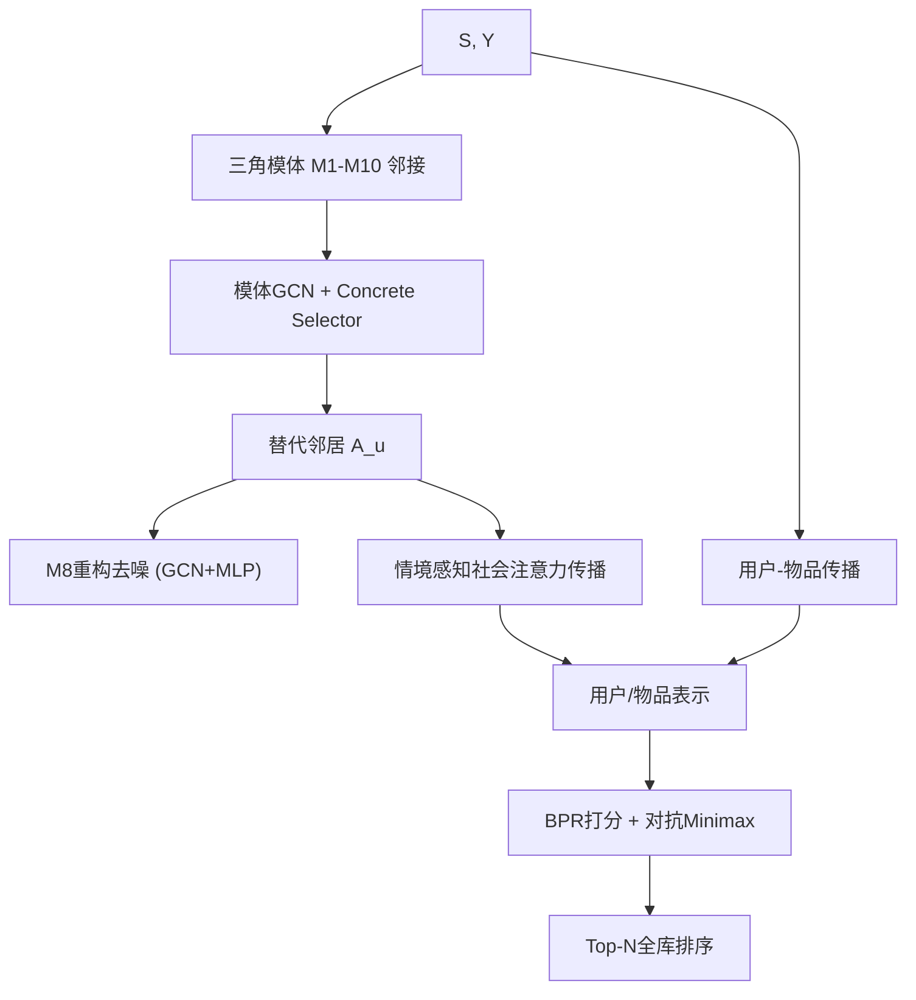
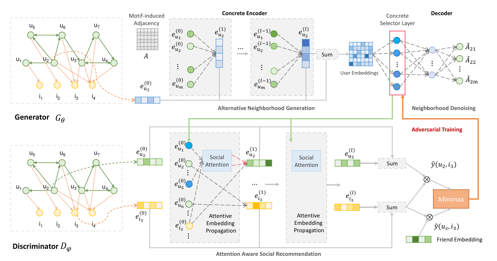

# Enhancing Social Recommendation with Adversarial Graph Convolutional Networks（基于对抗图卷积网络的社交推荐增强）

- **会议/期刊**: IEEE TKDE
- **作者与机构**: Junliang Yu, Hongzhi Yin, Jundong Li, Min Gao, Zi Huang, Lizhen Cui；昆士兰大学、弗吉尼亚大学、重庆大学、山东大学
- **推荐链路定位**: 精排（Top-N 全库排序打分）
- **研究方向**: 社交与群组推荐 / 图神经网络推荐
- **论文原文**: [论文原文链接](https://arxiv.org/abs/2004.02340v4)
- **开源代码**: 暂未开源

## TL;DR (1分钟核心速览)

针对社交推荐中“关系稀疏、社交噪声、关系多面向强度异质”三大痛点，提出 ESRF：模体 GCN 生成替代邻居，具体自编码器重构去噪，情境感知社会注意力建模异质信任，并用 Minimax 对抗统一。在 LastFM/Douban/Gowalla 的 Full-Ranking 协议下，NDCG@10 较最强基线提升 6.75%–7.73%，冷启动平均提升超 9%。

## Background & Motivation (背景与核心矛盾)

- **主流范式**: 基于同质性假设，将显式社交关系作为正则项或图传播边，代表作有 SoRec、TrustMF、GraphRec、DiffNet++、LightGCN 等。
- **前人局限**: 工业反馈显示多数用户社交邻居极少，社交关系与交互同样稀疏；社交链构建成本低、噪声大，却被无差别使用；关系在不同物品/情境下强度异质，并非普遍适用。
- **现有补救的不足**: CUNE/IF-BPR 过滤或挖掘隐式朋友，但过滤后更稀疏，且与推荐过程未耦合；RSGAN 用对抗选择可靠关系，却只覆盖稀疏问题，且依赖稀缺的可靠朋友标签。
- **核心洞察 (Key Insight)**: 三角模体能捕获超越成对关系的高阶连接；共同购买可增强/补全社交边；若替代邻居能重构可靠社会画像，则其有效性可被约束；社会注意力需以物品情境衡量关系强度。
- **本文切入点**: 用“模体生成—重构去噪—情境注意力推荐—对抗统一”闭环，同时处理稀疏、噪声与多面向问题。

## Method (核心方法设计)

### 1. 整体框架 (Overall Architecture)

输入用户-物品反馈 $\mathbf{Y}$与有向社会图$\mathbf{S}$；先枚举$M_1$–$M_{10}$三角模体，得到模体诱导邻接并拼成$\mathbf{A}$；LightGCN 式传播得用户表示，经 Concrete Selector（Gumbel-softmax）为每用户采样$k$个离散替代邻居；以$M_8$ 诱导关系为可靠画像，用 GCN+MLP 自编码器重构去噪；替代邻居替换显式邻居进入情境感知社会注意力传播，并与用户-物品传播相加；最后以模体 GCN 为生成器、注意力推荐模块为判别器做 Minimax 对抗，联合 BPR 与重构损失训练，推理用最终用户/物品嵌入内积全库排序。

<figure class="paper-figure" markdown="span">
  <figcaption>图1. 我们框架的示意图。实线箭头表示信息流，虚线箭头表示神经网络的计算操作。</figcaption>
</figure>

### 2. 关键设计拆解 (Key Designs)

1. **模体诱导替代邻域生成（Motif-based Alternative Neighborhood）**：痛点在于随机游走/一阶邻域只能看线性上下文，难捕获高阶三角闭合。本文枚举 $M_1$–$M_{10}$，其中$M_8/M_9$用共同购买增强已有边，$M_{10}$连接无边但共购的用户；模体邻接由稀疏矩阵运算$(PQ)\odot T$高效计算，如$\mathbf{A}_{M8}=(\mathbf{Y}\mathbf{Y}^\top)\odot\mathbf{B}$。随后用无特征变换/非线性的 GCN 传播 \(\mathbf{E}^{(l+1)}_\theta=\mathbf{D}_A^{-1}\mathbf{A}\mathbf{E}^{(l)}_\theta\)，$\mathbf{A}=\mathbf{S}+\sum_{k=1}^{10}\mathbf{A}_{M_k}$；Concrete Selector 以 \(\mathbf{v}_i=\mathrm{softmax}((\log\boldsymbol{\alpha}_i+\mathbf{g})/\tau)\) 输出可微离散邻居。直觉：三角模体把“朋友的朋友/共同购买者”转成高阶候选，离散选择保证端到端可训练。

2. **重构去噪 + 情境感知社会注意力**：生成邻居是无监督的，可能引入新噪声。本文用 $M_8$ 诱导关系作为显式社交中较可靠子集，令 GCN 为编码器、MLP 为解码器，最小化 \(\mathcal{L}_s=\|\mathbf{A}_{M8}-\tilde{\mathbf{A}}\|_2^2\)，迫使替代邻居保留可靠社会画像。推荐侧用社会注意力传播：\(\alpha_{u,v}=\frac{\exp(\mathbf{q}^\top\sigma(\mathbf{W}_1(\mathbf{e}_u+\mathbf{e}_v)\oplus\mathbf{W}_2\mathbf{e}_i))}{\sum_{v'\in A_u}\exp(\cdots)}\)。与仅拼接两用户表示的注意力不同，这里把物品嵌入作为情境，使同一好友在不同物品上获得不同权重，从而建模关系多面向与强度异质。

3. **对抗统一、负采样与推理效率**：BPR 损失 \(\mathcal{L}_r=-\sum_{(u,i,j)\in O}\log\sigma(\hat y_{u,i}-\hat y_{u,j})+\lambda\|\Phi\|_2^2\)；对抗项 \(\mathcal{L}_{adv}=\min_{D}\max_{G}-\log\sigma(\hat y_{u,i}-\hat y_{u',i})\)，$u'\sim P_G(\Theta|u,A)$。生成器希望替代邻居与当前用户对已购物品打分接近，判别器则要求用户本人打分更高，从而筛掉偏好不相关邻居。总损失 \(\mathcal{L}=\mathcal{L}_s+\mathcal{L}_r+\beta\mathcal{L}_{adv}\)。训练先以$\mathcal{L}_r$预训练判别器、以$\mathcal{L}_s$预训练生成器，再对抗训练；$\mathcal{L}_s$仅预训练与每轮末尾微调，避免过拟合显式关系和生成器模式崩塌。负采样：BPR 用未观测物品作负例；邻居生成用$k$个 Gumbel Concrete 样本（$k=40/30/40$）。推理为$\hat y_{u,i}={\mathbf{e}_u^{*}}^\top\mathbf{e}_i^{*}$全库排序，无需负采样；主要开销为$O(|A^+|d)$ 稀疏传播加注意力。

## Experimental Setup & Evaluation Protocol (实验设置与评估协议)

- **数据集与预处理**:

| 数据集 | #Users | #Items | #Interactions | #Relations | 特征/场景说明 |
| :--- | :---: | :---: | :---: | :---: | :--- |
| LastFM | 1,892 | 17,632 | 92,834 | 25,434 | 音乐社交，交互与关系均稀疏 |
| Douban | 2,848 | 39,586 | 894,887 | 35,770 | 保留评分 $>2$ 作为正反馈 |
| Gowalla | 18,737 | 32,510 | 1,278,274 | 86,985 | 签到社交，最稀疏、规模最大 |

- **数据划分与防穿越 (Splitting Strategy)**: 采用 **10 次重复 5 折交叉验证**并报告均值；原文未采用全局时间戳切分，冷启动实验仅保留历史购买记录 $<20$ 的用户构成训练子集。
- **排名评测协议 (Ranking Protocol)**: **Full-Ranking（全库未交互候选排序）**，计算 Precision@10、Recall@10、NDCG@10，而非采样负例排序。
- **对比基线与超参设置**: 对比 BPR、SBPR、IF-BPR、DiffNet++、RSGAN、LightGCN；嵌入维度 $d=50$，$\lambda=0.005$，batch size$=512$，GCN 层数 LastFM/Douban/Gowalla 为$4/3/4$，$k=40/30/40$，$\beta=0.3/0.6/0.5$，$\tau=0.2$。原文未报告显著性检验$p$ 值，仅给多次交叉验证均值。

## Key Experimental Results (实验关键数据)

### 1. 主实验对比 (Main Results)

下表保留 NDCG@10 作为核心排序指标，覆盖通用与冷启动场景；`Improv.` 为相对该行最强基线的提升。

| 数据集/场景 | BPR | SBPR | IF-BPR | DiffNet++ | RSGAN | LightGCN | ESRF | Improv. |
| :--- | :---: | :---: | :---: | :---: | :---: | :---: | :---: | :---: |
| LastFM 通用 | 0.10763 | 0.12188 | 0.13043 | 0.14316 | 0.13509 | 0.14371 | **0.15341** | +6.75% |
| LastFM 冷启动 | 0.11577 | 0.12128 | 0.13855 | 0.13901 | 0.14017 | 0.13127 | **0.15230** | +8.65% |
| Douban 通用 | 0.15855 | 0.17245 | 0.18551 | 0.19641 | 0.19469 | 0.19488 | **0.21033** | +7.09% |
| Douban 冷启动 | 0.04784 | 0.05716 | 0.06246 | 0.06767 | 0.06447 | 0.06037 | **0.07240** | +6.99% |
| Gowalla 通用 | 0.06311 | 0.05459 | 0.07279 | 0.07077 | 0.07450 | 0.07197 | **0.08026** | +7.73% |
| Gowalla 冷启动 | 0.05782 | 0.05276 | 0.06262 | 0.05812 | 0.06487 | 0.05804 | **0.07171** | +9.54% |

ESRF 的 P@10/R@10 同样最优：LastFM 10.723/16.076，Douban 18.231/6.546，Gowalla 5.842/6.907；冷启动 Gowalla P@10 为 3.993，相对 RSGAN 提升 12.16%。

### 2. 消融实验 (Ablation Study)

原文图3仅给柱高、未标逐项数值；下表为相对趋势，非精确百分比。

| 变体 | 图3趋势 | 主要观察 |
| :--- | :---: | :--- |
| w/o Motif | 下降 | 稀疏 Gowalla 更明显；替代邻居退化为显式关系卷积 |
| w/o Denoising | 较小下降 | 对抗与注意力可部分替代去噪；密集集影响较小 |
| w/o Adversarial | **最大下降** | 生成器/判别器失协调，证明对抗统一是关键 |
| w/o Attention | 次大下降 | 无法建模关系异质强度，多面向问题复发 |
| Full ESRF | **最高** | 四模块互补，通用与冷启动均最优 |

### 3. 关键实验发现 (Key Findings)

1. **替代邻居对稀疏场景收益最大**：通用 NDCG@10 提升 6.75%/7.09%/7.73%，冷启动提升 8.65%/6.99%/9.54%；最稀疏的 Gowalla 冷启动 P@10 相对 RSGAN 提升 12.16%，说明模体补边确实缓解了“少数邻居用户无法受益”的问题。
2. **收益来自“选对邻居”而非“多连边”**：将替代邻居随机替换为同数量关系并停用生成器后，Random 在三个数据集上均低于所有基线；LastFM 上超过 70% 用户显式关系少于 20 条，替代邻居与显式关系平均重叠 32.44%，且替代邻居更少孤立。
3. **对抗训练贡献最大，注意力次之**：消融中移除对抗下降最明显，移除注意力次之；在 Gowalla 上模体比去噪更重要，因为显式连接极稀时高阶发现优先；判别器仅 2 层即可超过全部基线，最佳层数为 4/3/4，$k$与$\beta$ 过大均会引入噪声或压制推荐目标。

## Highlights & Limitations (亮点、对比与审稿批判)

- **与代表作对比**: CUNE/IF-BPR 仅用网络嵌入/评分相似度找隐式朋友，未与推荐耦合且缺高阶模体；RSGAN 同样做对抗关系选择，但只解稀疏且依赖可靠朋友标签；DiffNet++/GraphRec 直接用显式社交扩散，忽略噪声与多面向。ESRF 首次把模体生成、重构去噪、情境注意力与对抗训练统一。
- **可迁移亮点**: 模体邻接的稀疏矩阵批量计算 $(PQ)\odot T$ 可直接复用到社交/知识图谱；Concrete Selector 自编码器适合离散邻居/特征选择；把物品嵌入注入社会注意力可作为多行为推荐的关系加权模块；先预训练再对抗的稳定化 schedule 可迁移到 GAN 式召回。
- **审稿级局限批判**: 未开源代码，复现成本高；模体计数与全库排序在亿级图上的工程开销未充分评估；未报告显著性检验，消融仅给柱状趋势；冷启动阈值 $<20$较武断；对抗训练对$\beta/k/$层数敏感，且仅对用户-用户边加注意力，未验证物品侧与自适应模体选择。

## Rating (四维评分)

- **方法创新性 (Novelty)**: ⭐⭐⭐⭐ （首次将对抗训练与 GCN 结合用于社交推荐，模体替代邻居+Concrete Selector 有明确增量，但 GAN4Rec 思路与 RSGAN 有延续性）
- **评估协议与实验扎实度 (Protocol & Experiments)**: ⭐⭐⭐⭐ （三真实数据集、10×5 折、Full-Ranking、冷启动子集与 6 个强基线较完整；缺显著性检验且消融只有定性柱图）
- **写作与数学规范度 (Clarity & Rigor)**: ⭐⭐⭐⭐ （公式、复杂度与训练流程清楚；个别实验设置前后不完全一致，如 $k$ 的设定值与敏感性峰值表述）
- **工业落地与复现价值 (Industrial & Practical Value)**: ⭐⭐⭐ （模型轻、稀疏矩阵可扩展，但无开源代码、全库排序与对抗训练稳定性仍是线上落地门槛）

