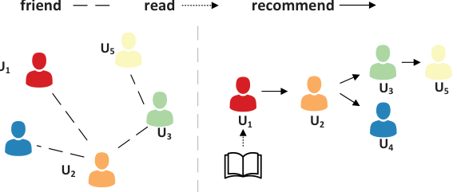
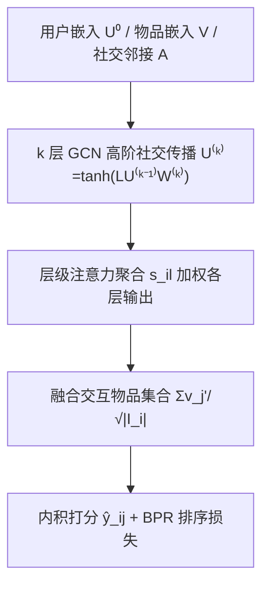
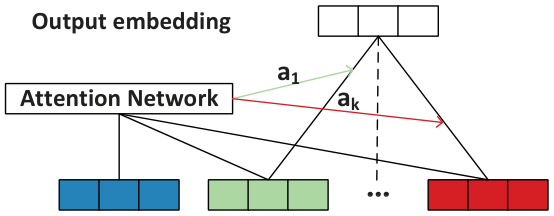

# Modelling High-Order Social Relations for Item Recommendation (面向物品推荐的高阶社交关系建模)

- **会议/期刊**: IEEE TKDE (arXiv 2020-03)
- **作者与机构**: Yang Liu, Liang Chen, Xiangnan He, Jiaying Peng, Zibin Zheng, Jie Tang（中山大学、新加坡国立大学、清华大学）
- **推荐链路定位**: 召回（用户表征学习 + 内积打分）
- **研究方向**: 社交与群组推荐 / 图神经网络推荐
- **论文原文**: [https://arxiv.org/abs/2003.10149v1](https://arxiv.org/abs/2003.10149v1)
- **开源代码**: 暂未开源

## TL;DR (1分钟核心速览)

主流社交推荐把社交关系当作**额外正则项**（SocialMF / NSCR / IF-BPR），既需精细调正则系数，又只用一阶直接好友，忽略了"朋友的朋友"的口碑传导。本文提出 HOSR：把社交图直接当作**预测模型的一部分**，用堆叠 GCN 沿社交图做 $k$步嵌入传播，让用户向量显式吞入$k$阶邻居影响；再用层级注意力为不同稀疏度用户自适应加权各阶信息。在 Yelp/Douban 全库排序下，$d{=}10$ 时 Recall@20 相对最强基线提升 5.63%/22.28%，MAP@20 提升 15.57%/29.49%。

## Background & Motivation (背景与核心矛盾)

- **主流范式**: 社交推荐分三派——① 图正则（SocialMF、CSR、NSCR）在损失上加平滑/拟合项；② 重排式排序约束（SBPR、IF-BPR 把物品划成 5 类强制序关系）；③ 表征拼接（TrustSVD、RSTE 直接把一阶好友向量加权进用户表征）。
- **前人局限**: 正则派把社交信息用得"太隐式"，社交正则系数 $\lambda$ 需精调，TrustSVD 原文即指出很多情况下其效果甚至不如纯交互的 SVD++；而唯一真正拼接社交表征的 TrustSVD 只用一阶邻居，无法刻画 U1→U2→U3→U5 的传导链。
- **第二个矛盾（高阶不可直接用）**: 社交图节点度呈长尾分布（图 5），三阶邻居在 Douban 人均 7413 个、是二阶的 5.6 倍、一阶的 500 倍（表 1），直接展开计算不可行；且高阶关系对 hub 用户是噪声、对孤立用户才是救命信息，权重必须因人而异。

<figure class="paper-figure" markdown="span">
  <figcaption>图1：社交网络中“口碑”影响传播的示例。用户U1是U5的高阶（三阶）邻居，并间接影响U5的选择。</figcaption>
</figure>

- **核心洞察 (Key Insight)**: "口碑"影响沿社交链传播，其作用等价于在社交图上做多跳消息传递；因此不必展开高阶边，只需**递归传播**即可用线性代价注入高阶影响。
- **本文切入点**: 用 GCN 的逐层传播替代"加正则"，再用注意力解决"不同用户需要不同阶数"的问题，把社交关系从 loss 项搬进 $\hat{y}$ 的分子里。

## Method (核心方法设计)

### 1. 整体框架 (Overall Architecture)

输入用户-物品交互矩阵 $\boldsymbol{Y}$与用户社交邻接矩阵$\boldsymbol{A}$。用户/物品各初始化$d$维嵌入；随后$k$个 GCN 层沿社交图（含自连接）做逐层传播，第$l$层输出$\boldsymbol{U}^{(l)}$编码$l$阶邻居信息；注意力层对$\{\boldsymbol{U}^{(1)},\dots,\boldsymbol{U}^{(k)}\}$按用户个性化加权求和得$\boldsymbol{u}_i^{(a)}$；最后融合用户交互过的物品嵌入，与目标物品做内积打分，用 BPR 损失端到端训练，训练期加图 dropout 与嵌入 dropout 抗过拟合。推理阶段仅需一次前向传播与内积检索，无需采样邻居。

### 2. 关键设计拆解 (Key Designs)

1. **高阶社交嵌入传播（把 $k$阶邻居压进线性代价）**: 痛点是不展开高阶边又要建模传导。一层传播内，$i'$向$i$传递的消息为$\boldsymbol{p}_{ii'}^{(k)}=\frac{1}{\sqrt{|\mathcal{A}_i||\mathcal{A}_{i'}|}}\boldsymbol{u}_{i'}^{(k-1)}\boldsymbol{W}^{(k)}$，聚合写成矩阵形式$\boldsymbol{U}^{(k)}=\tanh(\boldsymbol{L}\boldsymbol{U}^{(k-1)}\boldsymbol{W}^{(k)})$，其中$\boldsymbol{L}=\boldsymbol{D}^{-\frac12}(\boldsymbol{A}+\boldsymbol{I})\boldsymbol{D}^{-\frac12}$含自连接与对称度归一化。直觉：度归一化抑制 hub 用户淹没邻居，自连接保留用户自身偏好，堆$k$层即半径$k$的影响域，总代价$O(k|L|d^2)$ 仍是边数线性。

2. **层级注意力聚合（解决"阶数因人而异"）**: 层数过大对 hub 用户引发过平滑、对孤立用户又不够。以原始嵌入与第 $l$层输出共同打分：$a_{il}=\mathrm{ReLU}(\boldsymbol{u}_i\boldsymbol{P}_u+\boldsymbol{u}_i^{(l)}\boldsymbol{P}_o)\boldsymbol{h}^{\top}$，$s_{il}=\mathrm{softmax}(a_{il})$，最终$\boldsymbol{u}_i^{(a)}=\sum_{l=1}^{k}s_{il}\boldsymbol{u}_i^{(l)}$。直觉：让模型自己学"这个用户该看几阶"——实验证实注意力权重随用户社交度与交互数上升而下降（图 7），即自动给 hub 降高阶权重。

<figure class="paper-figure" markdown="span">
  <figcaption>图4：注意力层示意图：聚合各GCN层的输出嵌入。</figcaption>
</figure>

3. **训练目标、正则与推理**: 排序目标用 BPR：$\mathcal{L}=\sum_{(i,j^+,j^-)}-\ln\sigma(\hat{y}_{ij^+}-\hat{y}_{ij^-})+\lambda\|\boldsymbol{\Theta}\|_2^2$，负样本为均匀随机采样的未观测物品；打分融合交互历史$\hat{y}_{ij}=(\boldsymbol{u}_i^{(a)}+\frac{1}{\sqrt{|\mathcal{I}_i|}}\sum_{j'\in\mathcal{I}_i}\boldsymbol{v}_{j'})\boldsymbol{v}_j^{\top}$（消融显示$1/\sqrt{|\mathcal{I}_i|}$优于加入$|\mathcal{A}_j|$的对称归一化）。由于层层聚合易过拟合，采用两种 dropout：以$p_1$丢弃第$k$层输出嵌入、以$p_2$随机丢弃社交边（等价于每个 epoch 只保留$(1-p_2)$的非零邻接），最终配置$p_1{=}0$、$p_2{=}0.2$。

## Experimental Setup & Evaluation Protocol (实验设置与评估协议)

- **数据集与预处理**:

| 数据集 | #Users | #Items | #Interactions | 交互密度 | 社交密度 | 特征/场景说明 |
| :--- | :---: | :---: | :---: | :---: | :---: | :--- |
| Yelp | 10,580 | 14,284 | 171,102 | 0.11% | 0.15% | 本地商户点评，人均交互 16.17、人均好友 15.99 |
| Douban | 12,748 | 22,348 | 785,272 | 0.28% | 0.11% | 豆瓣图书评分，交互稠密但社交更稀疏 |

- **数据划分与防穿越 (Splitting Strategy)**: 两数据集均**随机 80%/20% 划分**训练/测试（非时间戳切分，存在轻度未来信息穿越风险）；两数据集均保证每个用户至少 1 条社交边。
- **排名评测协议 (Ranking Protocol)**: **Full-Ranking**（用户所有未交互物品均视为候选负例），报告 Recall@20 与 MAP@20；显著性以 $p<0.05$报告逐基线$p$-value。
- **对比基线与超参**: 基线 6 个——纯交互 BPR / NCF，社交类 TrustSVD / NSCR / IF-BPR+，高阶传播类 DeepInf（随机游走采样固定邻居 + GCN）；嵌入维度 $d\in\{5,10\}$，batch=512，RMSprop，学习率$\{1\text{e-}4,\dots,5\text{e-}3\}$，$L_2$系数$\{1\text{e-}4,1\text{e-}3,1\text{e-}2,1\text{e-}1\}$，NCF/NSCR/DeepInf/HOSR 均 3 层。

## Key Experimental Results (实验关键数据)

### 1. 主实验对比 (Main Results)

| 数据集 | 维度 | 指标 | BPR | NCF | TrustSVD | NSCR | IF-BPR+ | DeepInf | **HOSR** | Improv. |
| :--- | :---: | :--- | :---: | :---: | :---: | :---: | :---: | :---: | :---: | :---: |
| Douban | d=5 | R@20 | 0.0659 | 0.0680 | 0.0698 | 0.0684 | 0.0663 | 0.0706 | **0.0732** | +3.68% |
| Douban | d=5 | MAP@20 | 0.0198* | 0.0201 | 0.0213 | 0.0203 | 0.0194 | 0.0212 | **0.0225** | +6.13% |
| Douban | d=10 | R@20 | 0.0677 | 0.0712 | 0.0709 | 0.0708 | 0.0705 | 0.0713 | **0.0757** | +5.63% |
| Douban | d=10 | MAP@20 | 0.0213 | 0.0219 | 0.0244 | 0.0230 | 0.0232 | 0.0229 | **0.0282** | +15.57% |
| Yelp | d=5 | R@20 | 0.0495 | 0.0519 | 0.0530 | 0.0522 | 0.0437 | 0.0548 | **0.0598** | +9.12% |
| Yelp | d=5 | MAP@20 | 0.0134 | 0.0143 | 0.0147 | 0.0148 | 0.0131 | 0.0151 | **0.0164** | +8.61% |
| Yelp | d=10 | R@20 | 0.0509 | 0.0531 | 0.0570 | 0.0557 | 0.0440 | 0.0562 | **0.0697** | +22.28% |
| Yelp | d=10 | MAP@20 | 0.0140 | 0.0154 | 0.0151 | 0.0150 | 0.0144 | 0.0156 | **0.0202** | +29.49% |

（*原文表 3 该单元格为 0.1981，与同列量级不符，判定为排版笔误，此处按 0.0198 呈现。）

### 2. 消融实验 (Ablation Study)

层数 × 聚合方式（Base=仅取最后一层，Average=各层等权平均，Attention=本文注意力）：

| 变体 | Douban R@20 | Douban MAP@20 | Yelp R@20 | Yelp MAP@20 |
| :--- | :---: | :---: | :---: | :---: |
| HOSR-1 (Base) | 0.0716 | 0.0229 | 0.0636 | 0.0176 |
| HOSR-2 (Base) | 0.0747 | 0.0241 | 0.0657 | 0.0183 |
| HOSR-2 (Average) | 0.0734 | 0.0231 | 0.0637 | 0.0177 |
| HOSR-3 (Base) | 0.0726 | 0.0239 | 0.0640 | 0.0179 |
| HOSR-3 (Average) | 0.0743 | 0.0247 | 0.0674 | 0.0187 |
| HOSR-3 (Attention) | 0.0757 | **0.0282** | **0.0697** | **0.0202** |
| HOSR-4 (Attention) | **0.0773** | 0.0260 | 0.0641 | 0.0179 |

### 3. 关键实验发现 (Key Findings)

1. **收益主要来自高阶传播而非社交正则**：同为社交模型，TrustSVD（一阶拼接）在 Yelp $d{=}10$ 只有 0.0570/0.0151，HOSR 达 0.0697/0.0202（+22.28%/+29.49%）；而显式建模高阶的 IF-BPR+ 反而全场最差（0.0440/0.0144），说明"手动划分 5 类物品序关系"的隐式做法会引入路径噪声、且跨数据集不泛化。
2. **稀疏用户是最大受益群体**：按训练交互数分四组，增益集中在 Douban ≤60 与 61–120 组、Yelp ≤24 / 25–52 / 53–100 组，而最活跃组（Douban 222–2041、Yelp 101–512）几乎与 BPR 持平——高阶社交信号是交互不足时的**替代性证据源**，交互充分时边际为零。
3. **层数与聚合方式存在硬上限，注意力是"消上界"的关键**：Base 模型在 2 层时最好、3 层起掉点（Douban 0.0747→0.0726），是典型过平滑；注意力把 3 层 Douban MAP@20 从 0.0239 推到 0.0282（+18%），但 4 层后仍回落（0.0260），说明注意力只能缓解、不能消除过平滑。同时图 dropout（$p_2{=}0.2$）稳定有益，嵌入 dropout 全程无增益甚至掉点，佐证传播后的嵌入已混入邻居信息、再随机置零损失过大。

## Highlights & Limitations (亮点、对比与审稿批判)

- **与代表作对比 (vs. Prior Work)**: 相比 TrustSVD——同为"在预测模型内融合社交"，HOSR 把一阶拼接扩展为 $k$阶递归传播，代价仅从$O(|A|d+|Y|d)$升到$O(k|L|d^2+|Y|d)$；相比 NSCR / IF-BPR+——二者把社交写进 loss，本文写进$\hat{y}$，免除正则系数调参；相比 DeepInf——同样用 GCN 建模高阶，但 DeepInf 靠随机游走采样固定 50 个邻居（丢信息、需调采样规模与回返概率），HOSR 用全图归一化传播 + 层级注意力自适应阶数。
- **可迁移亮点**: ① 层级注意力 + 度分桶分析（权重随 #neighbor 单调下降）可作为"多跳 GNN 是否过平滑"的通用诊断工具；② 图 dropout（随机丢边）比嵌入 dropout 更适配传播式模型，这一结论可直接迁移到 LightGCN 类召回模型的正则设计。
- **审稿级局限批判**: ① 监督信号只有 BPR 交互项，注意力权重 $s_{il}$缺乏直接约束，可解释性停留在事后可视化，且结构上存在"用社交度决定阶数"的自我实现风险；② 传播只在**用户侧**做，物品侧与 user-item 二部图未联合传播（作者自陈为 future work），因此无法借力"共同购买"的高阶协同信号；③ 评估为单次随机 80/20 划分、未做时间切分与多轮种子方差报告，$p$-value 却报到$10^{-43}$ 量级，显著性叙述略显激进；④ 表 3 存在数值排版笔误，削弱可复现对照性。

## Rating (四维评分)

- **方法创新性 (Novelty)**: ⭐⭐⭐⭐ （把社交从正则项搬到预测模型、并以层级注意力自适应阶数，思路上是社交推荐范式的清晰切换，但 GCN + 注意力的组件本身并不新颖）
- **评估协议与实验扎实度 (Protocol & Experiments)**: ⭐⭐⭐⭐ （Full-Ranking + 6 个强基线 + 逐基线 $p$-value + 稀疏分桶 + 层数/聚合/dropout 三维消融相当完整，扣分在单次划分与表 3 笔误）
- **写作与数学规范度 (Clarity & Rigor)**: ⭐⭐⭐⭐ （传播的向量式与矩阵式双写法、复杂度 $O(k|L|d^2+|Y|d)$的推导清晰；注意力符号$s_{ul}$与$s_{il}$ 存在前后不一致）
- **工业落地与复现价值 (Industrial & Practical Value)**: ⭐⭐⭐⭐ （只需社交邻接矩阵即可离线预计算用户嵌入、推理与 MF 同阶，工程改造成本低；但未开源，且社交图需全量加载，超大规模下仍需邻居采样）

