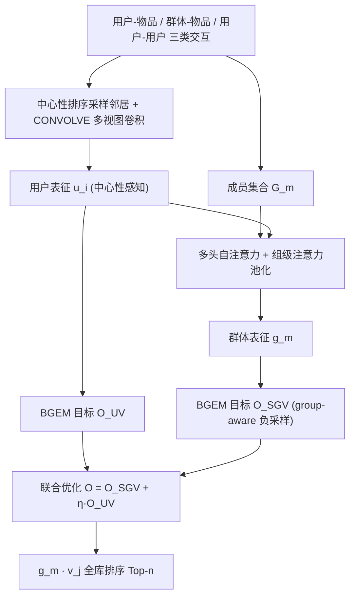
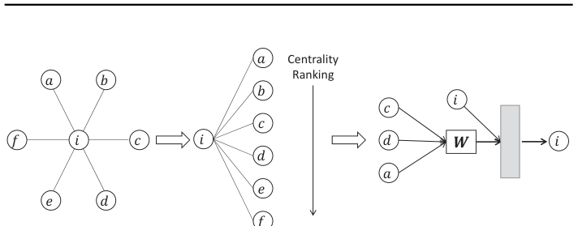

# Overcoming Data Sparsity in Group Recommendation (克服群体推荐中的数据稀疏性)

- **会议/期刊**: IEEE TKDE (Transactions on Knowledge and Data Engineering)
- **作者与机构**: Hongzhi Yin, Qinyong Wang, Xiaofang Zhou (University of Queensland)；Kai Zheng (UESTC)；Zhixu Li (Soochow University)
- **推荐链路定位**: 召回（群体 Top-N 候选生成）
- **研究方向**: 社交与群组推荐 / 冷启动与长尾推荐
- **论文原文**: [https://arxiv.org/abs/2010.00813v1](https://arxiv.org/abs/2010.00813v1)
- **开源代码**: 暂未开源（三个大规模数据集经作者主页公开）

## TL;DR (1分钟核心速览)

面向"偶发群体 (occasional group)"推荐：群体-物品交互平均仅 1.1–1.5 条，且用户-物品也极度稀疏。CAGR 用**多头自注意力+注意力池化**从成员表征端到端生成群体表征（替代 average/least-misery 等静态聚合），并用**中心性感知多视图图卷积 (GraphCSC)** 在社交网上传播邻居信息以增强用户表征；再用 Bernoulli 联合优化把群-物、用户-物、用户-用户三类交互并入统一目标。在 Yelp / Douban-Event / Meetup 三数据集、按时间戳 80% 切分、全库排序的 Hits@n 与 MRR 上均显著优于 SIGR、GroupSA 等 SOTA（$p<0.01$）。

## Background & Motivation (背景与核心矛盾)

- **主流范式**: 偶发群体推荐走"早聚合"路线——先学成员表征再加权求和成群体向量（SIGR 的社交影响力加权、AGREE 的注意力聚合），或走"晚聚合"——先给每人出推荐列表再用 average / least misery / maximum pleasure 合并。
- **前人局限 1**: 静态聚合策略是人工预设、非数据驱动，无法刻画真实群决策（"低影响力成员让步于意见领袖"这类非对称妥协），且没有任何一种预定义策略在所有数据上最优。
- **前人局限 2**: SIGR 两阶段训练（先用 PageRank/DeepWalk 抽网络特征监督社交影响力）非端到端、需额外监督；且它只把 BGEM 套在用户-物品图上，忽略了用户-物品本身也稀疏，用户表征本身就不可靠。
- **核心洞察 (Key Insight)**: 群-物交互矩阵比用户-物更稀疏（Douban：群体 1.48 条 vs 用户 48.38 条），因此**群体表征必须由成员表征诱导，而成员表征必须由社交网络的同质性与中心性来补全**——"少数高中心性邻居"携带的信息量足以支撑目标节点表征。
- **本文切入点**: 把"群体聚合策略"与"用户表征补全"都变成可学习算子，并在同一目标函数下联合优化。

## Method (核心方法设计)

### 1. 整体框架 (Overall Architecture)

模型有三路输入：用户-物品二部图 $\mathcal{G}_{UV}$、群体-物品二部图$\mathcal{G}_{GV}$、用户社交图$\mathcal{G}_{UU}$。用户表征由 GraphCSC 在社交图上做中心性引导的邻域卷积得到，再以 BGEM 式目标对齐到物品空间；群体表征$\vec{g}_m$不直接学习，而由成员表征经多头自注意力 + 组级上下文向量注意力池化生成（解决新群体冷启动）；两个目标函数以概率$\frac{1}{1+\eta}$/$\frac{\eta}{1+\eta}$轮流采样边做 SGD，推理时$\vec{g}_m$ 与全部物品做内积全库排序取 Top-n。整体设计见图 2 的中心性感知嵌入流程。

<figure class="paper-figure" markdown="span">
  <figcaption>图2：基于CONVOLVE算法生成中心性感知网络嵌入的简化流程。</figcaption>
</figure>

### 2. 关键设计拆解 (Key Designs)

1. **自注意力群体表征 + 影响力池化**：痛点是把成员向量线性加权（$\vec{g}_m=\sum_i\lambda_{im}\vec{u}_i$）表达力不足、且$\lambda$需两阶段监督。本文先把成员表征打包为$Q,K,V$做多头自注意力$O=\mathrm{Concat}(M_1,\dots,M_h)W^O$，让成员在同一序列内互相"对话"建模群内协商；再用组级上下文向量$\vec{a}_s$二次池化挑出真正拍板的人：$\lambda_i=\mathrm{softmax}(\vec{a}_i^{\top}\vec{a}_s),\ \vec{g}_m=\sum_i\lambda_i\vec{a}_i$。直觉：群决策不是票数平均，而是"高影响力者的偏好被放大"，注意力权重即数据驱动的社会影响力，且全程可微、无需网络特征前置抽取。
2. **中心性感知多视图图卷积 (GraphCSC)**：痛点是用纯 BGEM 学用户向量时，用户-物品交互太稀疏，且传统网络嵌入只保留邻近性、丢掉"谁在社交网中更有话语权"。算子为：先按某种中心性 $c$对邻居排序、只取 Top-$\|\mathcal{N}_i\|$，再执行$\vec{h}_i=\mathrm{POOL}(\{\mathrm{ReLU}(P\vec{u}_n+\vec{p})\})$、$\vec{u}_i^{\text{new}}=\mathrm{ReLU}(W\cdot\mathrm{Concat}(\vec{u}_i,\vec{h}_i)+\vec{w})$并 L2 归一化；多种中心性（PageRank / betweenness / closeness / eigenvector）各构成一个视图，最终$\vec{u}_i=\sum_{k=1}^{|C|}\alpha_i^{c_k}\vec{u}_i^{c_k}$，权重$\alpha_i^{c_k}=\mathrm{softmax}(\vec{z}_k\cdot\vec{u}_i^{C})$由节点自身决定哪类中心性对它信息量最大。直觉：拼接（而非平均）保留自我信息，Top-$\|\mathcal{N}_i\|$ 采样则以极低开销注入全局重要性信号。
3. **联合优化与群体感知负采样**：总目标 $\mathcal{O}_{GUV}=\mathcal{O}_{SGV}+\eta\mathcal{O}_{UV}$，其中$\mathcal{O}$均为 BGEM 的 KL 目标加负采样形式$\log\sigma(\vec{g}_m\cdot\vec{v}_j)+\sum_{k=1}^{M}\mathbb{E}_{v_k\sim P_n}[\log\sigma(-\vec{g}_m\cdot\vec{v}_k)]$。因$\mathcal{G}_{GV}$边远少于$\mathcal{G}_{UV}$，若合并边集均匀采样则群-物边几乎采不到，故按 Bernoulli 先选图再选边，等价于给$\mathcal{O}_{UV}$加权$\eta$。负采样上，经典$P_n(v)\propto d_v^{0.75}$在极稀疏群-物图上退化为均匀采样、负例"太假"；本文改为群体感知分布$P_n^{g_m}(v_k)\propto(d_{v_k}^{g_m}+\gamma)^{0.75}$，$d_{v_k}^{g_m}=\sum_{u_j\in G_m}w_{jk}$为物品在**该群体成员中**的流行度，$\gamma$做平滑——负例变成"群体里很多人都看过、但这个群体没选"的困难样本，直接逼自注意力学到有判别力的权重。单步复杂度$O(d\cdot M\cdot|C|)$，整体$O(d\cdot N)$。

## Experimental Setup & Evaluation Protocol (实验设置与评估协议)

- **数据集与预处理**: 现有 CAMRa2011 / Movielens-Group 规模小、无社交网，故作者自建三个代表数据集（Yelp 取 LA 餐厅；Douban-Event 与 Meetup 用"社交连通用户同一时刻访问同一餐厅/活动"抽隐式群体；Meetup 按 [38] 反构社交网）：

| 数据集 | #Users | #Items | #Groups | 平均群体规模 | 群体均交互 | 用户均交互 | 用户均好友 |
| :--- | :---: | :---: | :---: | :---: | :---: | :---: | :---: |
| Yelp | 34,504 | 22,611 | 24,103 | 4.45 | 1.12 | 13.98 | 20.77 |
| Douban-Event | 70,743 | 60,028 | 110,597 | 4.82 | 1.48 | 48.38 | 86.08 |
| Meetup | 24,631 | 19,031 | 13,552 | 8.79 | 1.40 | 5.15 | 35.75 |

- **数据划分与防穿越 (Splitting Strategy)**: 按交互时间戳排序后取 **80 分位** 切分，之前为训练、之后为测试；训练集末尾 10% 作为验证集调 $\eta$、$M$。
- **排名评测协议 (Ranking Protocol)**: **Full-Ranking（全库排序）**——对测试对 $(g,v)$给$v$ 及该群体**从未交互过的全部物品**打分排序，报 `Hits@1/5/10/15/20` 与 `MRR`。
- **对比基线与超参设置**: SIGR（本文前作，两阶段社交影响力加权）、GroupSA（堆叠社交自注意力 + item/social 双聚合）、SACML（自注意力 + 协同度量学习）、SA-NCF（自注意力 + NCF），以及 BGEM+avg / +mp / +ml 三种预定义聚合；最优 $d=128$、$h=16$、$M=6$、$\|\mathcal{N}_i\|=4$、$N\approx4\text{M}$；显著性$p<0.01$。

## Key Experimental Results (实验关键数据)

### 1. 主实验对比 (Main Results)

Yelp 上全库排序结果（CAGR 为原文数值表；标 ≈ 者为图 3 读数近似，误差 ±0.005；三个数据集趋势一致）：

| 模型 | Hits@1 | Hits@10 | Hits@20 | MRR |
| :--- | :---: | :---: | :---: | :---: |
| BGEM + average | ≈0.031 | ≈0.152 | ≈0.224 | ≈0.091 |
| BGEM + maximum pleasure | ≈0.036 | ≈0.161 | ≈0.236 | ≈0.097 |
| BGEM + least misery | ≈0.039 | ≈0.172 | ≈0.249 | ≈0.103 |
| SA-NCF | ≈0.041 | ≈0.180 | ≈0.258 | ≈0.107 |
| SACML | ≈0.046 | ≈0.196 | ≈0.276 | ≈0.117 |
| SIGR | ≈0.056 | ≈0.222 | ≈0.309 | ≈0.130 |
| GroupSA | ≈0.061 | ≈0.241 | ≈0.331 | ≈0.142 |
| **CAGR** | **0.0685** | **0.2681** | **0.3547** | **0.1578** |
| Improv. (vs. 最强基线 GroupSA) | +12.3% | +11.2% | +7.1% | +11.1% |

### 2. 消融实验 (Ablation Study)

| 变体 | 配置说明 | Hits@10 | MRR | 结论 |
| :--- | :--- | :---: | :---: | :--- |
| ST | 仅用群-物交互训练 | ≈0.221 | ≈0.128 | 用户表征不可靠 |
| TST | 两阶段（先 $O_{UV}$后$O_{SGV}$） | ≈0.252 | ≈0.148 | 两空间不兼容 |
| JT-C | 联合训练 + 度基负采样 | ≈0.259 | ≈0.152 | 负例过易 |
| **JT-G** | 联合训练 + 群体感知负采样 | **0.2681** | **0.1578** | 完整模型 |
| CAGR-N | 无 GCN，仅纯 BGEM 学用户 | ≈0.235 | ≈0.135 | 社交信息缺失 |
| CAGR-G | 换 vanilla GraphSAGE | ≈0.251 | ≈0.147 | 缺中心性信号 |
| **CAGR-C** | GraphCSC（本文） | **0.2681** | **0.1578** | 中心性生效 |

### 3. 关键实验发现 (Key Findings)

1. **稀疏互补是主要增益来源**：CAGR-N→CAGR-C 的 Hits@10 提升约 14%，而预定义聚合（BGEM+avg）→CAGR 提升近 76%——说明"用户表征补全"与"聚合策略可学习"两个稀疏瓶颈必须同时解，任一单独处理都不足以追平。
2. **联合训练优于两阶段，负采样质量再贡献一半**：JT-G 相对 TST 的提升来自同一目标下两个嵌入空间对齐，而 JT-C→JT-G（同一联合框架，仅换群体感知负采样）的 Hits@10 仍提升约 3.5%、MRR 约 3.8%，证明"困难负例"对自注意力权重的判别性至关重要。
3. **中心性引导的邻居采样应"少而精"**：$\|\mathcal{N}_i\|$从 1→4 时 Hits@10 由 0.249 升至 0.262（+5.2%）、MRR 由 0.143 升至 0.151（+5.6%），此后 4→10 完全持平；$d$从 16→128 提升 27.6% 但 128→512 明显过拟合（Hits@10 回落至 0.234），$M>6$、$N>4\text{M}$ 后性能饱和，训练开销可控。

## Highlights & Limitations (亮点、对比与审稿批判)

- **与代表作对比 (vs. Prior Work)**: 相比 SIGR（本文前作），CAGR 把两阶段加权求和换成端到端多头自注意力 + 影响力池化，并追加 GraphCSC 与联合优化；相比 GroupSA，差异在于显式注入**中心性**而非只用社交邻接做聚合，且 GroupSA 的 group 表征仍依赖群-物交互直学；相比 AGREE/PIT，二者要么无法用社交网、要么无法用用户-物交互，且 AGREE 严重依赖直接学习群体偏好向量，对零交互冷启动群体不可用。
- **可迁移亮点**: ①"按中心性排序取 Top-k 邻居"的采样式图卷积，可直接插到 LightGCN 类模型做社交正则，开销 $O(d)$；②群体感知负采样$P_n\propto(\sum_{u\in G}d_{uv}+\gamma)^{0.75}$ 的思路可平移到任何"用小群体-物品信号学聚合函数"的场景（如会话推荐、多任务场景聚合）。
- **审稿级局限批判**: ①三个数据集均由作者自行构造（Yelp/Douban 的隐式群体由"社交连通 + 同时同地"启发式推断），没有直接在 CAMRa2011 / Movielens-Group 上报告，跨数据集可比性与复现性偏弱，且无开源代码；②推理时群体表征需对每个成员做注意力 + 多视图卷积，群体规模大（Meetup 均值 8.79）时线上开销随 $|G_m|\cdot|C|\cdot\|\mathcal{N}_i\|$增长，论文只给了训练复杂度而缺少 serving 延迟分析；③$\eta$、$M$、$\|\mathcal{N}_i\|$、$h$ 均需网格搜索，对稀疏度差异极大的业务场景可能需重新调参；④ 评测只用 Hits/MRR，未报告 NDCG 与多样性/公平性，且未处理评分倾向性偏差（作者列为未来工作）。

## Rating (四维评分)

- **方法创新性 (Novelty)**: ⭐⭐⭐⭐ （首次同时打通群-物与用户-物双重稀疏；自注意力聚合与中心性多视图卷积的组合在当时属清晰增量，不过各组件均为已有模块的有机拼装）
- **评估协议与实验扎实度 (Protocol & Experiments)**: ⭐⭐⭐⭐ （三数据集全库排序、$p<0.01$ 显著性、RQ1–RQ4 覆盖主实验/嵌入/优化/超参四层，但主结果仅以图呈现、数据集为自建）
- **写作与数学规范度 (Clarity & Rigor)**: ⭐⭐⭐⭐ （目标函数从 BGEM 到 $O_{SGV}$、$O_{UV}$、$O_{GUV}$ 逐层推导完整，含伪代码与复杂度分析；但图 3–5 无数值表、部分指标只能估读）
- **工业落地与复现价值 (Industrial & Practical Value)**: ⭐⭐⭐ （训练复杂度 $O(dN)$ 与 Top-k 邻居采样都轻量，负采样技巧易迁移；但代码未开源、需额外维护社交图与多视图邻接，冷启动群体线上收益依赖社交链路覆盖率）

