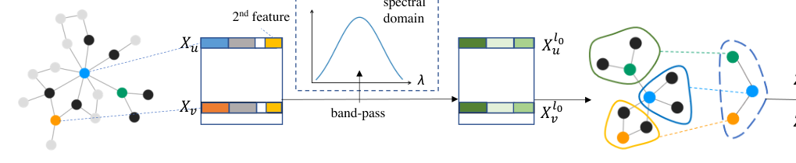
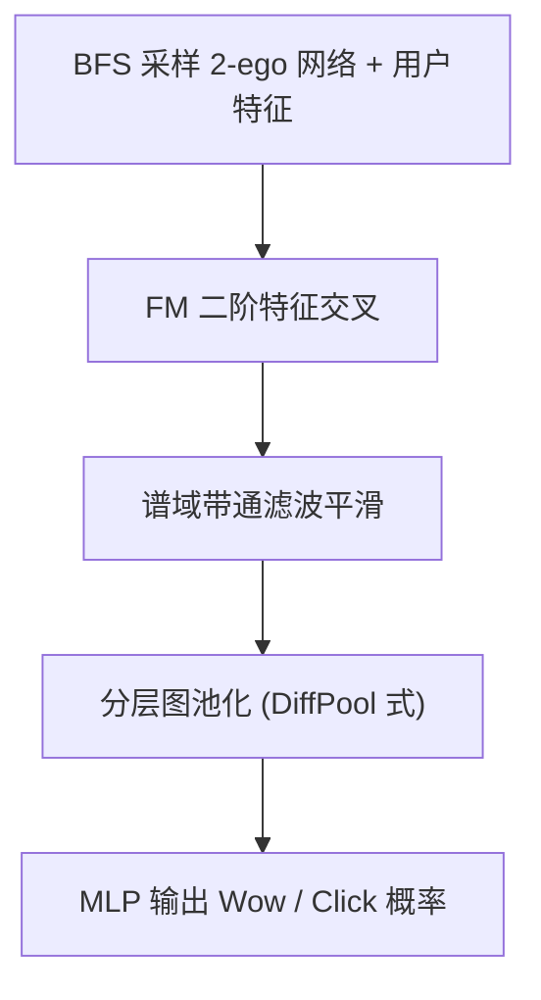

# Understanding WeChat User Preferences and "Wow" Diffusion (理解微信用户偏好与"Wow"扩散)

- **会议/期刊**: IEEE TKDE 2021
- **作者与机构**: Fanjin Zhang, Jie Tang 等（清华大学、腾讯微信搜索应用部、微软研究院、UIC）
- **推荐链路定位**: 精排（社交行为预测打分）
- **研究方向**: 社交与群组推荐 / 图神经网络推荐
- **论文原文**: [https://arxiv.org/abs/2103.02930v1](https://arxiv.org/abs/2103.02930v1)
- **开源代码**: [https://github.com/zfjsail/wechat-wow-analysis](https://github.com/zfjsail/wechat-wow-analysis)

## TL;DR (1分钟核心速览)

微信"看一看"中用户存在两种不对称反馈：私密 **click** 与好友可见的 **"Wow"**（类转发扩散）。本文在 74 亿级交互的真实数据上做多层次相关性分析，发现固定活跃好友数下，活跃好友自我网络的连通分量数 #CC 越大，**"Wow"概率越低、点击概率反而越高**（结构多样性悖论）。据此提出 DiffuseGNN：FM 二阶特征 + 谱域带通滤波去噪 + DiffPool 式分层图池化 + 点积注意力。在微信 Wow/Click 与公开微博数据上，AUC 分别达 87.69/78.27/83.08，较最强基线 SAGPool 提升约 1.2–2.0%。

## Background & Motivation (背景与核心矛盾)

- **主流范式**: 社交影响力局部性（social influence locality）研究用人工特征 + GAT 学习自我网络（ego network）表征来预测用户行为（DeepInf、Wang et al.）。
- **前人局限**: (1) 现有方法将 click 与"Wow"视为同质反馈，忽略了前者私密、后者具扩散性的本质差异；(2) 未刻画自我网络内部的**群组/连通分量结构**，而社会学结构多样性理论恰恰强调其对分享意愿的抑制作用。
- **核心洞察 (Key Insight)**: 作者观察到"Wow"与 click 在 #CC 上呈现**方向相反的单调性**——好友分散在多个圈子时用户"不愿重复传播"，但"更愿意阅读多方认可的内容"；且对自我网络做 1-core 清洗后该区分度显著增强（图9）。
- **本文切入点**: 将上述统计规律显式编码进模型：用可学习带通滤波剔除离群好友噪声，用分层聚类显式建模连通分量层级结构。

<figure class="paper-figure" markdown="span">
  <figcaption>图10. 模型框架：(a) 处理后的自我网络示意图；(b) 输入层，其中每个用户的预训练嵌入与手工特征及其影响特征拼接，该影响特征表示其活跃状态以及其是否为自我用户；(c) 特征平滑层，其中每个用户的拼接输入特征在谱域经带通滤波器滤波；(d) 每个自我网络的特征被输入分层图表示学习模型；(e) 输出层，其中采用MLP层基于图……预测用户行为。</figcaption>
</figure>

## Method (核心方法设计)

### 1. 整体框架 (Overall Architecture)

对每个交互 $(u,d,ts)$，以 BFS 从 2-ego 网络采样固定$m=32$节点的自我网络（扩散高度局部化，BFS 优于 RWR）。输入层拼接人口统计、社交角色（PageRank 前 1% 意见领袖 / Tarjan 割点结构洞）、上下文（是否 ego、是否已 Wow）、ProNE 全局嵌入，并经 FM 生成二阶交叉特征；特征平滑层在谱域用带通滤波调制后传播；分层图表示学习迭代聚类生成多粒度子图嵌入；输出层 MLP 分别预测"Wow"与 click 概率（统计表明$P(\text{click})=P(\text{click}|\text{wow})$，两行为近似独立，故分训两模型）。

### 2. 关键设计拆解 (Key Designs)

1. **谱域带通特征平滑 (Feature Smoothing)**：预训练嵌入只含全局结构，且自我网络中随机加好友的离群点构成噪声。作者用随机游走拉普拉斯 $L=I_m-D^{-1}A=U\Lambda U^\top$，以可训练高斯型带通核调制特征值，$\tilde{L}=U\,\mathrm{diag}(g(\lambda_1),\dots,g(\lambda_m))U^\top$，再经$X_{l_0}=D^{-1}A(I_m-\tilde{L})X$传播，其中$g(\lambda)=e^{-\frac{1}{2}[(\lambda-\mu)^2-1]\theta}$，$\mu$可学习、$\theta$ 控制峰值。直觉：小特征值对应全局聚类、大特征值对应局部平滑，带通只保留社群级信息，滤除离群边高频噪声。用 Chebyshev 展开避免显式特征分解。

2. **分层图表示学习 (Hierarchical Pooling)**：为编码 #CC 这一子结构，借鉴 DiffPool 迭代生成分配矩阵 $B_{l_{k+1}}=\mathrm{softmax}(\mathrm{GNN}_{k,pool}(A_{l_k},X_{l_k}))$，粗化$X_{l_k}=B_{l_k}^\top Z_{l_k}$、$A_{l_k}=B_{l_k}^\top A_{l_{k-1}}B_{l_k}$，各层池化拼接$Z_{graph}=\Vert_{k=1}^{L_n}\sigma(Z_{l_k})$。可视化显示模型自动将活跃好友聚入同一簇（正例）或分散多簇（负例），与 #CC 分析一致。

3. **点积注意力与训练目标**：GAT 的加性注意力 $\alpha^{AA}_{ij}$无法建模邻居特征交互，本文改为$\alpha^{DA}_{ij}\propto\exp(\mathrm{act}((a_{src}^\top W_p x_i+b_{src})\cdot(a_{dst}^\top W_p x_j+b_{dst})))$，交叉项显式刻画二元相关性。损失为逐任务交叉熵$\mathcal{L}=-\sum_i[y_i\log \hat{y}_i+(1-y_i)\log(1-\hat{y}_i)]$，无对比负采样，直接对采样正负例二分类；推理仅需一次前向，$m=32$、池化 2 层，开销可控。

## Experimental Setup & Evaluation Protocol (实验设置与评估协议)

- **数据集与预处理**: 微信数据先筛选**至少 10 次交互**的用户，交互层面再筛选**至少 5 位好友 Wow 过**的样本；微博沿用 DeepInf 设置。

| 数据集 | #Users | #Items | #Interactions | 说明 |
| :--- | :---: | :---: | :---: | :--- |
| WeChat 原始 | 48.08M | 61.25M | 7.46B | 脱敏抽样 |
| WeChat 实验集 | — | — | 5,121,571 正例 | Wow 3.16M + Click 2.18M |
| Weibo | — | — | 779,164 | 转推预测，2012 |

- **数据划分与防穿越**: 按交互**全局时间戳切分**，早→训练/验证，晚→测试；微博 50%/25%/25%。
- **排名评测协议**: 属二分类行为预测，**Sampled 负采样**（Wow 正负比 1.5:1，Click 1:1），指标为 Precision/Recall/F1/AUC，非 Full-Ranking。AUC 为主判据（F1 依赖阈值）。
- **对比基线与超参**: 传统分类器 LR/RF、特征交叉 xDeepFM、社交基线 DeepInf/Wang et al.、图池化 SAGPool/ASAP/StructPool；ProNE 嵌入 64 维、ego 网络 $m=32$、GAT 8 头×16 维、$\mu=0.4$、$\theta=7$、coarsening 2 步、Adagrad。**未报告显著性检验**。

## Key Experimental Results (实验关键数据)

### 1. 主实验对比 (Main Results)

| 方法 | WeChat Wow F1 | Wow AUC | Click F1 | Click AUC | Weibo F1 | Weibo AUC |
| :--- | :---: | :---: | :---: | :---: | :---: | :---: |
| Random | 48.92 | 50.05 | 36.45 | 50.02 | 33.55 | 50.15 |
| LR | 69.06 | 76.73 | 51.41 | 70.07 | 53.64 | 76.38 |
| xDeepFM | 72.85 | 78.25 | 52.94 | 71.61 | 42.88 | 64.38 |
| DeepInf | 75.46 | 83.06 | 55.65 | 74.50 | 57.56 | 81.46 |
| Wang et al. | 74.27 | 81.91 | 53.79 | 72.31 | 56.59 | 80.26 |
| SAGPool | 78.46 | 86.18 | 58.66 | 77.37 | 54.97 | 78.89 |
| ASAP | 75.22 | 83.28 | 56.62 | 75.48 | 56.12 | 79.87 |
| StructPool | 72.92 | 79.46 | 53.19 | 71.54 | 42.98 | 61.83 |
| **DiffuseGNN_AA** | **80.67** | 87.64 | 59.46 | 78.05 | **59.37** | **83.08** |
| **DiffuseGNN_DA** | 80.62 | **87.69** | **59.52** | **78.27** | 59.01 | 82.76 |
| **Improv.% (AUC)** | — | **+1.75%** | — | **+1.16%** | — | **+1.99%** |

### 2. 消融实验 (Ablation Study)

| 变体 | Wow F1 | Wow AUC | Click F1 | Click AUC | Weibo AUC |
| :--- | :---: | :---: | :---: | :---: | :---: |
| Full (DA) | 80.62 | 87.69 | 59.52 | 78.27 | 82.76 |
| w/o pre-train | 76.65 | 84.91 | 57.00 | 76.09 | 81.51 |
| w/o node feature | 80.08 | 87.10 | 58.71 | 77.64 | 81.10 |
| w/o 2nd feature | 80.16 | 87.50 | 59.39 | 78.16 | 81.03 |
| w/o smoothing | 78.39 | 86.04 | 58.18 | 76.89 | 82.13 |

### 3. 关键实验发现 (Key Findings)

1. **预训练嵌入与谱域平滑是两大主力**：移除 ProNE 使 Wow AUC 掉 2.78、Click 掉 2.18；移除平滑层掉 1.65/1.38，二者贡献远超二阶特征（Wow AUC 仅降 0.19），说明全局结构先验 + 去噪比特征交叉更关键。
2. **Wow 比 Click 更可预测、且更能拉开差距**：最强基线到本文，Wow AUC 提升 1.51，而 Click 仅 0.90；作者归因于点击更依赖文章内容（本文刻意排除文章特征），而 Wow 更受社交影响力驱动。
3. **分层池化优于扁平 GNN**：0 层池化（扁平表征）明显劣于 1–2 层（图11），验证 #CC 层级结构确实是有效信号；但步数过多收益饱和，WeChat Wow/Weibo 最优为 1 步、Click 为 2 步，说明聚类粒度需任务自适应。

## Highlights & Limitations (亮点、对比与审稿批判)

- **与代表作对比 (vs. Prior Work)**: 相比 DeepInf（仅 GAT 建模二元影响）与 Wang et al.（WL 拓扑特征），本文首次将**连通分量层级结构**显式池化编码；相比 SAGPool/ASAP/StructPool 等通用图池化，本文的谱域滤波与分层设计均由微信数据的统计规律驱动，而非黑箱堆叠。
- **可迁移亮点**: (1) 用可学习带通滤波对自我网络去噪，可迁移到任何社交/序列图推荐中的离群邻居抑制；(2) "私密行为 vs 公开扩散行为分训双模型"的范式，可推广至点赞/收藏/转发等多反馈场景。
- **审稿级局限批判**: (1) 采用采样的正负例二分类而非全库排序，且**未报告显著性检验**，AUC 提升 1–2% 的稳健性存疑；(2) 刻意排除文章内容特征，与真实推荐系统的多模态精排存在差距，泛化到含内容场景的收益未知；(3) 谱域滤波的 Chebyshev 近似与 $\theta$ 敏感度（图12 显示 Weibo 上先升后降）对调参提出较高要求。

## Rating (四维评分)

- **方法创新性 (Novelty)**: ⭐⭐⭐⭐ （谱域带通滤波与分层池化的组合由真实统计规律驱动，结构多样性建模新颖，但各模块均为已有技术的有据改造）
- **评估协议与实验扎实度 (Protocol & Experiments)**: ⭐⭐⭐ （三数据集+9 基线+完整消融较扎实，但采样二分类非排序、缺显著性检验、无线上 A/B）
- **写作与数学规范度 (Clarity & Rigor)**: ⭐⭐⭐⭐ （公式与符号定义清晰，分析与模型模块一一对应，推导完整；复杂度分析略简）
- **工业落地与复现价值 (Industrial & Practical Value)**: ⭐⭐⭐⭐ （代码开源、微信亿级数据验证、$m=32$ 采样与单次前向推理工程友好，但依赖大规模社交图与预训练嵌入）

