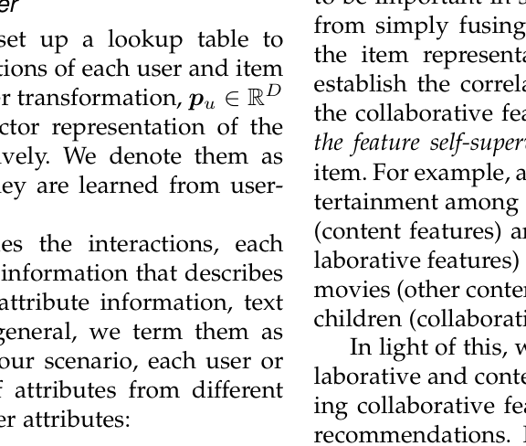
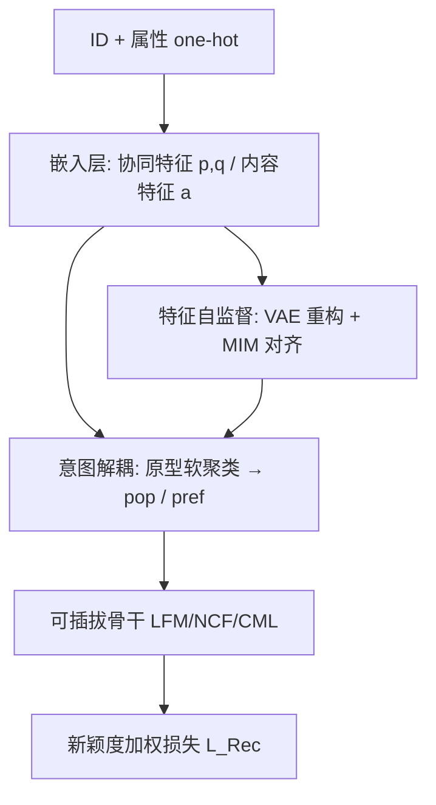

# Intent Disentanglement and Feature Self-supervision for Novel Recommendation (面向新颖推荐的意图解耦与特征自监督)

- **会议/期刊**: IEEE TKDE (arXiv 2106.14388, 2021 预印)
- **作者与机构**: Tieyun Qian, Yile Liang, Qing Li, Xuan Ma, Ke Sun, Zhiyong Peng (武汉大学、香港理工大学)
- **推荐链路定位**: 召回（端到端训练，可插拔骨干层）
- **研究方向**: 冷启动与长尾推荐 / 自监督与交互去噪
- **论文原文**: [https://arxiv.org/abs/2106.14388v1](https://arxiv.org/abs/2106.14388v1)
- **开源代码**: 暂未开源

## TL;DR (1分钟核心速览)

现有长尾/新颖推荐要么用两阶段重排（第一阶段热度偏置仍在），要么一味推尾部物品导致精度暴跌，且**从不区分用户对"流行"的从众程度差异**，更未覆盖零交互冷启动物品。本文提出 IDS4NR：用"意图原型"把用户/物品表征显式解耦为**从众（热度）**与**偏好**两因子，用物品新颖度 $\alpha_v$ 加权两路损失；再用 VAE + 互信息最大化把内容特征与协同特征对齐，为冷启动物品"生成"缺失的协同表征。在 3 个数据集、20% 物品严格冷启动的全库排序协议下，F1@5 相对最优基线提升 32.46%/45.35%/32.32%。

## Background & Motivation (背景与核心矛盾)

- **主流范式**: 长尾推荐分两支——重排式（GANC 等对已生成列表后处理）与端到端式（PPNW 改 BPR 权重、TailNet 调偏好机制、MIRec 从头物品迁移知识）；冷启动则依赖内容/图/元学习（DropoutNet、HERS、MetaEmb、AGNN）。
- **前人局限**: ①重排式无法消除第一阶段的流行度偏置；②PPNW/TailNet 过度推尾部，精度断崖式下跌；③所有方法都把"用户爱不爱热门"当同质处理，忽略从众心理的个体差异；④冷启动物品（长尾的极端情形）从未被纳入新颖推荐，而冷启动方法又不面向长尾。
- **核心洞察 (Key Insight)**: 面对同一热门物品，不同用户可能"从众购买"或"坚持自我"，因此交互行为应被分解为从众影响与个人兴趣两部分；解耦后自然获得精度（偏好因子）与新颖性（热度因子）的可控平衡。冷启动物品的协同特征缺失，但其**内容特征与协同特征之间存在强相关**（动画片 ↔ 少儿观众行为），可作自监督信号。
- **本文切入点**: 以"意图原型 + 新颖度加权"端到端解耦意图，以"生成式 + 对比式"自监督打通内容-协同两个视角。

<figure class="paper-figure" markdown="span">
  <figcaption>图 2：我们的 IDS4NR 模型概览。(a) 整体框架。(b) 用于缓解冷启动问题的特征自监督模块。(c) 用于从学习到的表示中提取特定因素的显式意图解耦模块。</figcaption>
</figure>

## Method (核心方法设计)

### 1. 整体框架 (Overall Architecture)

四层结构：输入/嵌入层把用户/物品 one-hot ID 与属性字段编码为协同特征 $\mathbf{p}_u,\mathbf{q}_v$与内容特征$\{\mathbf{a}^i\}$；特征自监督层用 VAE 将内容特征映射到与协同特征同分布的隐空间，并以 MIM 拉近"内容隐表征—自身协同特征"、推远负例；意图解耦层以两个可学习原型把全部特征软聚类并聚合为$(\mathbf{p}^{(pop)}_u,\mathbf{p}^{(pref)}_u)$、$(\mathbf{q}^{(pop)}_v,\mathbf{q}^{(pref)}_v)$；最后送入可插拔骨干（LFM/NCF 点式、CML 对式）打分，按物品新颖度加权融合两路损失。

### 2. 关键设计拆解 (Key Designs)

1. **意图原型软解耦（Intent Prototype Disentanglement）**: 前人用 K 个参数化通道做解耦，通道语义只能事后解释且 K 需人工设定；本文只设两个语义明确的原型 $\mathbf{c}^{(pop)},\mathbf{c}^{(pref)}$，对用户$u$ 的每个特征（含 ID 协同特征与各属性）做二路软分配并加权聚合：
$p^{(pop)|i}_{u}=\frac{\exp(\mathbf{c}^{(pop)}\cdot\mathbf{a}^i_u)}{\exp(\mathbf{c}^{(pop)}\cdot\mathbf{a}^i_u)+\exp(\mathbf{c}^{(pref)}\cdot\mathbf{a}^i_u)},\quad \mathbf{p}^{(pop)}_u=\mathrm{FFN}\Big(\sum_{i=0}^{k}p^{(pop)|i}_u\,\mathbf{a}^i_u\Big)$
直觉：属性级软分配让"哪个属性驱动从众、哪个属性驱动偏好"可解释，同时把内容特征一并纳入解耦（DICE 仅用因果图与负采样，未利用内容）。
2. **协同-内容特征自监督（Feature Self-supervision）**: 冷启动物品无交互，$\mathbf{q}_v$学不出来。作者不直接拼接内容，而是建立两视角映射：VAE 以$\mathcal{L}_{VAE}=-D_{KL}(q_\phi(\mathbf{z}_v|\mathbf{x}_v)\|p(\mathbf{z}_v))+\mathbb{E}_{q_\phi}[\log p_\theta(\mathbf{x}'_v|\mathbf{z}_v)]$ 保证隐空间分布一致；MIM 用内积判别器强化判别性：
$\mathcal{L}_{MIM}=-\sum_{(a,v,v')\in\mathcal{O}}\log\sigma\big(f_D(\mathbf{z}_v,\mathbf{q}_v)-f_D(\mathbf{z}_v,\mathbf{q}_{v'})\big)$推理时以$\mathbf{z}_v$ 替代缺失的协同特征，从而在严格冷启动下仍可打分。
3. **新颖度加权目标与训练**: 物品新颖度 $\alpha'_v=\log\frac{|U|}{|U_v|}$经 min-max 归一化为$\alpha_v$；点式骨干用$\mathcal{L}_{Rec}=\alpha_v\mathcal{L}^{(pref)}+(1-\alpha_v)\mathcal{L}^{(pop)}$，对式骨干用$\sigma(\alpha_{v^+}-\alpha_{v^-})$作权重。尾部物品交互主要由偏好解释，热门物品交互主要由从众解释，梯度自然分流。总损失$\mathcal{L}=\mathcal{L}_{Rec}+\gamma\mathcal{L}_{SS}$，$\mathcal{L}_{SS}=\mathcal{L}_{VAE}+\mathcal{L}_{MIM}$；训练对每个正例均匀采 4 个负例，推理为全库内积排序，无额外在线开销。

## Experimental Setup & Evaluation Protocol (实验设置与评估协议)

| 数据集 | #Users | #Items | #Interactions | 稀疏度 | 特征/场景说明 |
| :--- | :---: | :---: | :---: | :---: | :--- |
| MovieLens-100K | 943 | 1,682 | 100,000 | 93.70% | 电影评分，性别/年龄/职业属性 |
| Music | 5,541 | 3,568 | 64,706 | 99.67% | Amazon 乐器评论，5-core |
| Beauty | 8,159 | 5,863 | 98,566 | 99.79% | Amazon 美妆评论，5-core |

- **数据划分与防穿越**: `冷启动划分`——按平均交互时间取最新的 **20% 物品**为冷启动物品，其**全部交互仅入测试集**（训练期完全不可见）；另每用户随机抽 10% 历史交互入测试集，其余为训练集。评分为二值化隐式反馈。
- **排名评测协议**: 无偏 `Full-Ranking`——对每用户在训练集未交互物品中全库排序。
- **指标**: Rec@N（精度）、Cov@N（覆盖）、Nov@N（前 20% 热门以外物品占比，含冷启动）、F1@N（三者调和平均，$N\in\{5,10\}$）。
- **对比基线与超参**: 长尾基线 GANC/PPNW/TailNet/MIRec，冷启动基线 DropoutNet/HERS/MetaEmb/AGNN，经典骨干 LFM/NCF/CML；$d=50$，batch=128，lr=0.001，Adam，每正例 4 负例；LFM/NCF/CML 训练 40/40/30 epoch。

## Key Experimental Results (实验关键数据)

### 1. 主实验对比 (Main Results)

| Model | ML Rec@5 | ML Cov@5 | ML Nov@5 | ML F1@5 | ML F1@10 | Music F1@5 | Music F1@10 | Beauty F1@5 | Beauty F1@10 |
| :--- | :---: | :---: | :---: | :---: | :---: | :---: | :---: | :---: | :---: |
| GANC | 0.0686 | 0.3565 | 0.4445 | 0.0375 | 0.0648 | 0.0427 | 0.0601 | 0.0036 | 0.0076 |
| PPNW | 0.0328 | 0.4349 | 0.6937 | 0.0256 | 0.0470 | 0.0422 | 0.0717 | 0.0088 | 0.0158 |
| TailNet | 0.0761 | 0.3565 | 0.2483 | 0.0297 | 0.0493 | 0.0236 | 0.0385 | 0.0055 | 0.0086 |
| MIRec | 0.0713 | 0.3357 | 0.4627 | 0.0382 | 0.0727 | 0.0562 | 0.0979 | 0.0170 | 0.0309 |
| DropoutNet | 0.0811 | 0.3689 | 0.2517 | 0.0322 | 0.0569 | 0.0198 | 0.0411 | 0.0045 | 0.0114 |
| HERS | 0.0855 | 0.3701 | 0.1862 | 0.0275 | 0.0510 | 0.0580 | 0.0935 | 0.0192 | 0.0341 |
| MetaEmb | 0.0826 | 0.4159 | 0.2430 | 0.0337 | 0.0570 | 0.0591 | 0.0908 | 0.0198 | 0.0340 |
| AGNN | **0.0996** | 0.3184 | 0.1756 | 0.0281 | 0.0522 | 0.0608 | 0.0983 | 0.0151 | 0.0259 |
| CML | 0.0886 | 0.3755 | 0.1836 | 0.0283 | 0.0494 | 0.0335 | 0.0544 | 0.0102 | 0.0168 |
| IDS4NR(+LFM) | 0.0870 | 0.4414 | 0.3870 | 0.0487 | 0.0871 | 0.0719 | 0.1158 | 0.0190 | 0.0321 |
| IDS4NR(+NCF) | 0.0852 | 0.4670 | **0.3906** | 0.0494 | 0.0865 | **0.0859** | **0.1287** | 0.0253 | 0.0417 |
| IDS4NR(+CML) | 0.0752 | **0.5519** | 0.4296 | **0.0506** | **0.0903** | 0.0838 | 0.1232 | **0.0262** | **0.0432** |
| **Improv. (F1@5)** | — | — | — | **+32.46%** | +24.21% | **+45.35%** | +31.46% | **+32.32%** | +26.69% |

### 2. 消融实验 (Ablation Study)

| 变体 (骨干 CML) | ML Rec@5 | ML Cov@5 | ML Nov@5 | ML F1@5 | Music F1@5 | Beauty F1@5 |
| :--- | :---: | :---: | :---: | :---: | :---: | :---: |
| IDS4NR (full) | 0.0752 | 0.5519 | 0.4296 | **0.0506** | **0.0838** | **0.0262** |
| w/o-SS | 0.0793 | 0.4295 | 0.4025 | 0.0451 | 0.0810 | 0.0227 |
| w/o-SS, Exp ($\alpha_v\!\equiv\!0.5$) | 0.0767 | 0.4238 | 0.3687 | 0.0413 | 0.0772 | 0.0218 |
| w/o-SS, ID（去掉解耦） | **0.0966** | 0.3196 | 0.2803 | 0.0373 | 0.0633 | 0.0201 |

### 3. 关键实验发现 (Key Findings)

1. **解耦是"精度-新颖性"矛盾的解药而非精度插件**：去掉意图解耦（w/o-SS, ID）后 MovieLens Rec@5 从 0.0752 涨到 0.0966（+28%），但 Cov@5 从 0.5519 崩至 0.3196、Nov@5 从 0.4296 跌到 0.2803，F1@5 反降 26%——说明单纯的内容相似度召回被热门偏置支配，覆盖与新颖性的收益全部来自解耦。
2. **新颖度加权不可替换为等权**：把 $\alpha_v$ 固定为 0.5（Exp）后 F1@5 在三个数据集分别再降 8.4%/4.7%/4.0%，且 Nov@5 从 0.4025→0.3687，证明"按物品热度调节两路梯度"确实让偏好因子学到更纯的尾部信号。
3. **自监督对冷启动/覆盖贡献最大**：移除 SS 后 F1@5 仅降 10.9%，但 Cov@5 从 0.5519 掉到 0.4295（-22%），且 Music/Beauty 上精度几乎无损而覆盖显著下滑，说明 VAE+MIM 主要在为无交互物品"补"协同表征；同时该框架对三种骨干普适，F1@5 相对各自骨干提升 60.73%/50.61%/78.80%（MovieLens）至 150%+（Beauty CML）。

## Highlights & Limitations (亮点、对比与审稿批判)

- **与代表作对比 (vs. Prior Work)**: 相较 PPNW/TailNet 的"改损失/改偏好权重"，本文给出可解释的双因子分解而非黑盒加权；相较 DICE 的因果嵌入+负采样，本文用原型软聚类且同时利用内容特征并服务长尾目标；相较 AGNN/MetaEmb 等冷启动方法，本文首次把冷启动物品视作长尾极端情形纳入统一评测。
- **可迁移亮点**: ①用 $\log(|U|/|U_v|)$ 归一化后作双路损失权重，是无需额外模型的"流行度解耦"轻量技巧；②以 VAE+MIM 建立"内容隐空间↔协同空间"映射，可迁移到任何模态缺失（新物品、跨域冷启）场景。
- **审稿级局限批判**: ①冷启动为"按平均交互时间取最新 20% 物品"的**离线模拟**，与真实新品上线分布差异大，且与长尾物品评测混在同一榜单，未单独报告纯冷启动子集指标；②参数量约膨胀 3–4 倍（LFM 0.13M→0.57M，Beauty 0.72M→1.19M），且 VAE 采样与原型软分配带来额外前向开销，论文未给训练/推理时延；③仅 3 个中小规模数据集、$d=50$，未做显著性检验，亦未与图神经/生成式新基线比较。

## Rating (四维评分)

- **方法创新性 (Novelty)**: ⭐⭐⭐⭐ （双原型意图解耦 + 内容-协同自监督的组合新颖，把"从众心理"落成可算的软分配算子，但单原型二路分解的表达力有限）
- **评估协议与实验扎实度 (Protocol & Experiments)**: ⭐⭐⭐⭐ （全库排序 + 严格冷启动划分 + 三骨干普适性验证较扎实，但冷启动为模拟构造、缺显著性检验与冷启子集单独报告）
- **写作与数学规范度 (Clarity & Rigor)**: ⭐⭐⭐⭐ （公式与模块对应清晰、符号统一，但部分设计（如 FFN 维度、$\gamma$ 敏感性）缺少推导与复杂度分析）
- **工业落地与复现价值 (Industrial & Practical Value)**: ⭐⭐⭐ （可插拔骨干、推理无额外开销、新颖度权重实现极简，利于落地；但未开源、参数与显存开销上升，冷启动上线需真实流量验证）

