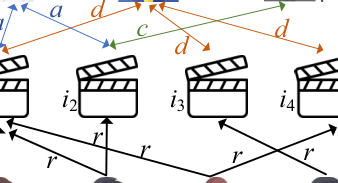
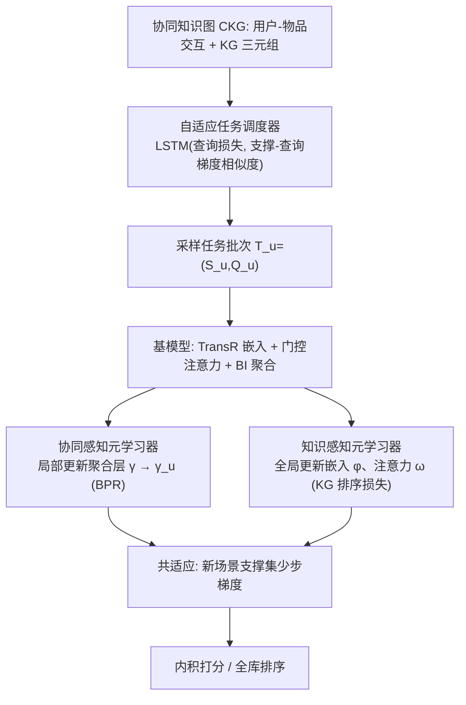
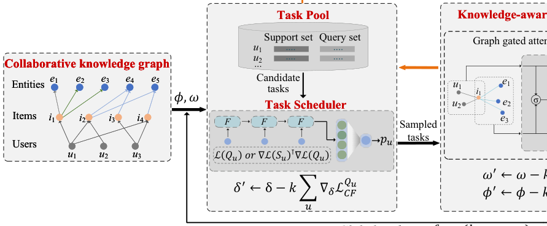

# MetaKG: Meta-learning on Knowledge Graph for Cold-start Recommendation (知识图谱上的元学习冷启动推荐)

- **会议/期刊**: IEEE TKDE (Accepted 2022)
- **作者与机构**: Yuntao Du, Xinjun Zhu, Lu Chen, Ziquan Fang, Yunjun Gao（浙江大学计算机学院）
- **推荐链路定位**: 召回（用户/物品表征学习与全库打分）
- **研究方向**: 冷启动与长尾推荐 / 图神经网络与知识图谱推荐
- **论文原文**: [arXiv:2202.03851v2](https://arxiv.org/abs/2202.03851v2)
- **开源代码**: [ZJU-DBL/MetaKG](https://github.com/ZJU-DBL/MetaKG)

## TL;DR (1分钟核心速览)

KG 类推荐（KGAT/CKAN）靠海量交互做高阶传播，一旦用户或物品只有个位数交互便因过拟合与流行度偏置而崩塌。MetaKG 将"每个用户的偏好学习"视作一个元任务，在协同知识图 CKG 上并行训练两个元学习器：协同感知元学习器在任务内**局部更新聚合层**捕获高阶协同信号，知识感知元学习器跨任务**全局更新嵌入层与注意力层**（KG 三元组排序损失）固化实体语义；再用 LSTM 任务调度器按"查询损失 + 支撑/查询梯度相似度"筛掉噪声任务。在 Yelp2018/Last-FM/Amazon-book 的 UC/IC/UIC 三场景、Full-Ranking Recall@20/NDCG@20 下平均相对提升 62.14%/74.95%/67.28%，且单 epoch 训练仅 3.2s。

## Background & Motivation (背景与核心矛盾)

- **主流范式**: KG 推荐分三支——嵌入型（CKE/CFKG/UGRec）用 KGE 补语义、路径型（MCRec/RippleNet）靠手工 meta-path 连接用户与物品、传播型（KGCN/KGAT/CKAN）在协同知识图上做注意力消息传递。
- **前人局限**: ①三类方法全部从"数据层"扩语义，依赖大量 user-item 反馈，冷启动下高阶路径稀疏导致过拟合与流行度偏置（如 $u_4 \to i_3 \to e_2 \to i_4$这条冷门路径被热门$i_1$ 压制）；②已有元学习冷启动工作 MeLU/MetaHIN 只用**单一**元学习器优化单一评分损失，且 MetaHIN 仍依赖手工语义 meta-path，无法同时刻画协同高阶关系与 KG 实体语义。
- **核心洞察 (Key Insight)**: 冷启动本质是"任务级少样本"问题——把每个用户看作一个任务 $T_u=(S_u,Q_u)$，则跨任务可共享的**先验**有两类：任务内特有的用户偏好（应局部适配）与任务间通用的实体语义（应全局共享）。二者优化目标不同，必须解耦到两个元学习器。
- **本文切入点**: 首次把优化型元学习（MAML）搬到 CKG 上，用双元学习器 + 可学习任务调度器同时解决"协同信息稀缺"与"知识先验如何迁移"两个挑战。

<figure class="paper-figure" markdown="span">
  <figcaption>图 1. 基于知识图谱的电影推荐</figcaption>
</figure>

## Method (核心方法设计)

### 1. 整体框架 (Overall Architecture)

输入是以物品为桥梁把 user-item 二部图 $G_u$与 KG$G_k$对齐后得到的协同知识图$\mathcal{G}$（用户与物品均视为实体，交互视为关系）。基模型$f_\theta=(h_\phi,g_\omega,y_\gamma)$依次做 TransR 初始化+线性投影嵌入、关系感知门控注意力传播、bi-interaction 聚合、内积打分。元训练阶段由任务池驱动：调度器按概率采样任务批次，对每个任务先在支撑集$S_u$上**局部位移**聚合层参数得$\gamma_u$，再由知识感知元学习器在全部任务上用 KG 三元组损失**全局更新**$\phi,\omega$；两阶段交替共适应。推断时仅需对新用户/新物品的支撑集做几步（实验中 1 步即够）梯度适配，再对全库打分排序。

<figure class="paper-figure" markdown="span">
  <figcaption>图 3. MetaKG 框架概览</figcaption>
</figure>

### 2. 关键设计拆解 (Key Designs)

1. **双通道门控注意力传播（区分协同邻居与知识邻居）**：KGAT/CKAN 把物品的邻居用户与邻居实体一视同仁地聚合，语义被稀释。MetaKG 分别对协同三元组集 $N^c_h$与知识三元组集$N^k_h$做关系感知注意力$\alpha(h,r,u)=\text{softmax}\big((\mathbf{W}_r\mathbf{e}_u)^\top\tanh(\mathbf{W}_r\mathbf{e}_h+\mathbf{e}_r)\big)$，再用 GRU 式融合门自适应配比：
$\mathbf{g}_h=\sigma(\mathbf{W}_c\vec{\mathbf{e}}^c_h+\mathbf{W}_k\vec{\mathbf{e}}^k_h),\ \vec{\mathbf{e}}_h=\mathbf{g}_h\odot\vec{\mathbf{e}}^c_h+(1-\mathbf{g}_h)\odot\vec{\mathbf{e}}^k_h$。
直觉：冷启动物品协同邻居极少时，门自动向知识侧倾斜，避免"协同空信号"污染表征。

2. **双元学习器解耦"局部偏好 vs 全局语义"**：这是全文最核心的增量。协同感知元学习器仅对聚合层做任务内一步局部更新
$\gamma_u=\gamma-v\,\partial \mathcal{L}^{S_u}_{CF}(\phi,\omega,\mathbf{e}^\star_u)/\partial\gamma$，
捕获用户特有多阶协同关系（无需 meta-path）；知识感知元学习器用 TransR 能量 $s(h,r,t)=\|\mathbf{W}_r\mathbf{e}_h+\mathbf{e}_r-\mathbf{W}_r\mathbf{e}_t\|_2^2$构造成对排序损失$\mathcal{L}_{KG}$，在**所有任务上**全局更新$\phi,\omega$，使实体嵌入不被单任务拉偏。前者治 Challenge I（交互稀缺），后者治 Challenge II（语义迁移），互为正则。

3. **自适应任务调度器（防噪声任务腐蚀）**：均匀采样假设任务等价值，但冷启动任务池小而噪声大。调度器 $z_\delta$（双向 LSTM，隐单元 10）以任务历史信息为输入，输出采样概率
$p_u=z_\delta\big(\mathcal{L}(Q_u),\ \nabla\mathcal{L}(S_u)^\top\nabla\mathcal{L}(Q_u)\big)$，
关键在第二项：查询损失大且梯度相似度高 = 真难任务（值得学）；查询损失大但相似度低 = 噪声任务（应降权）。$\delta$ 与模型联合优化。

4. **训练目标、负采样与推理效率**：局部用 BPR 损失（每正样本配 1 个未观测负样本），全局用 KG 成对排序损失（随机替换尾实体构造伪三元组），无额外难负采样挖掘。总训练复杂度 $O(m|\mathcal{G}_k|d_ld_{l-1}+|\mathcal{T}|d^2_{lstm}+|\mathcal{G}|d_pd_e+\sum_l|G_u|d_l)$；由于只局部更新聚合层$m$ 次、全局更新数步，Yelp2018 单 epoch 训练 3.2s、推断 0.3s。

## Experimental Setup & Evaluation Protocol (实验设置与评估协议)

- **数据集与预处理**（均采用 `10-core` 过滤，KG 来自 Freebase / Yelp 本地商户网络）：

| 数据集 | #Users | #Items | #Interactions | #Entities | #Relations | #Triplets |
| :--- | :---: | :---: | :---: | :---: | :---: | :---: |
| Yelp2018 | 45,919 | 45,538 | 1,185,068 | 90,961 | 42 | 1,853,704 |
| Last-FM | 23,566 | 48,123 | 3,034,796 | 58,266 | 9 | 464,567 |
| Amazon-book | 70,679 | 24,915 | 847,733 | 88,572 | 39 | 2,557,746 |

- **数据划分与防穿越**: 按用户加入时间/物品上架时间划分老/新，训练集仅保留"老用户 × 老物品"交互；测试构造 **UC**（新用户-老物品）、**IC**（老用户-新物品）、**UIC**（双冷）三场景，另设 Non-cold 对照，属严格冷启动划分。每个任务固定 $|Q_u|=10$，其余交互为支撑集$S_u$，两者互斥。
- **排名评测协议**: 无偏 **Full-Ranking（全库未交互物品排序）**，指标 Recall@20 与 NDCG@20。
- **对比基线与超参**: 覆盖 FM/NFM、CKE/CFKG/UGRec、MCRec/RippleNet、KGCN/KGAT/CKAN、MeLU/MetaHIN 共 12 个基线；嵌入维度 $d=64$，3 层传播 + 3 个融合门，全局/局部/调度器学习率 0.0001 / 0.01 / 0.001，Adam + Xavier。原文未报告显著性检验。

## Key Experimental Results (实验关键数据)

### 1. 主实验对比 (Main Results)

| 场景 / 数据集 | 指标 | KGAT | CKAN | MeLU | MetaHIN | **MetaKG** | Improv.(vs 最强基线) |
| :--- | :---: | :---: | :---: | :---: | :---: | :---: | :---: |
| Yelp UC | R@20 / N@20 | 0.1240 / 0.1110 | 0.0844 / 0.0802 | 0.1102 / 0.1051 | 0.1260 / 0.1204 | **0.1362 / 0.1236** | +8.1% / +2.7% |
| Yelp IC | R@20 / N@20 | 0.0905 / 0.0788 | 0.1360 / 0.1204 | 0.0712 / 0.0620 | 0.0670 / 0.0528 | **0.1571 / 0.1356** | +15.5% / +12.6% |
| Yelp UIC | R@20 / N@20 | 0.1498 / 0.1360 | 0.1462 / 0.1166 | 0.1308 / 0.1237 | 0.1430 / 0.1382 | **0.1747 / 0.1513** | +16.6% / +9.5% |
| Last-FM UC | R@20 / N@20 | 0.2821 / 0.2744 | 0.1634 / 0.1649 | 0.2439 / 0.2344 | 0.2610 / 0.2628 | **0.3927 / 0.3598** | +39.2% / +31.1% |
| Last-FM IC | R@20 / N@20 | 0.3445 / 0.3272 | 0.2758 / 0.2946 | 0.2217 / 0.2119 | 0.2399 / 0.2266 | **0.4780 / 0.4616** | +32.6% / +39.3% |
| Last-FM UIC | R@20 / N@20 | 0.3352 / 0.3182 | 0.2854 / 0.2943 | 0.2071 / 0.1875 | 0.2030 / 0.1871 | **0.4227 / 0.4287** | +26.1% / +34.7% |
| Amazon UC | R@20 / N@20 | 0.2804 / 0.2712 | 0.2650 / 0.2567 | 0.2265 / 0.2207 | 0.2569 / 0.2504 | **0.3291 / 0.3213** | +17.4% / +18.5% |
| Amazon UIC | R@20 / N@20 | 0.2670 / 0.2305 | 0.2750 / 0.2273 | 0.2498 / 0.2014 | 0.2656 / 0.2285 | **0.2857 / 0.2587** | +3.9% / +13.2% |
| Yelp Non-cold | R@20 / N@20 | 0.1270 / 0.1166 | 0.0868 / 0.0692 | 0.1266 / 0.1183 | 0.1420 / 0.1226 | **0.1562 / 0.1436** | +10.0% / +17.1% |

三数据集三场景**平均相对提升**：Yelp2018 62.14%、Last-FM 74.95%、Amazon-book 67.28%。

### 2. 消融实验 (Ablation Study)

UIC 场景（Last-FM 给出精确数值，其余为相对下降幅度）：

| 变体 | Last-FM R@20 | Last-FM N@20 | Yelp2018 / Amazon 趋势 |
| :--- | :---: | :---: | :---: |
| **MetaKG (full)** | **0.4227** | **0.4287** | 最优 |
| w/o 协同感知元学习器 (CF−) | 0.4096 | 0.4081 | 一致下降 |
| w/o 知识感知元学习器 (KG−) | ↓5.98% | ↓6.57% | 一致下降 |
| w/o 自适应任务调度器 (ATS−) | ↓3.45% | ↓5.07% | 一致下降 |
| w/o 元学习框架 (Base Model) | 显著下降 | 显著下降 | 下降最大 |

效率对比（s/epoch，T=训练 / I=推断）：MetaKG 3.2/0.3（Yelp）、3.9/0.3（Last-FM），vs NFM 4.9/1.5、KGAT 107.2/0.3、MetaHIN 220.1/4.8。

### 3. 关键实验发现 (Key Findings)

1. **冷启动越"极端"，元学习越吃香**：IC 场景增益普遍高于 UC（Last-FM IC 相对 MetaHIN 提升 99%+，Yelp IC 相对 CKAN 提升 15.5% R@20），说明新物品可借 KG 语义 + 跨任务先验快速定位，而新用户仍受偏好个性化上限约束。
2. **知识感知元学习器贡献略大于协同感知元学习器**：去掉后者 Last-FM R@20 由 0.4227 降至 0.4096（-3.1%），去掉前者降 5.98%，印证"跨任务共享实体语义"是冷启动泛化的主引擎，局部适配是精细化补充，两者不可替代。
3. **冷启动框架不牺牲通用性且更高效**：Non-cold 场景仍全面最优（Yelp R@20 0.1562 vs MetaHIN 0.1420），同时训练单 epoch 仅 3.2s，比 KGAT 快 33 倍、比 MetaHIN 快 69 倍——因只需少量梯度步即可泛化，且避免了 meta-path 构造开销。

## Highlights & Limitations (亮点、对比与审稿批判)

- **与代表作对比**: 相比 KGAT/CKAN（传播型，需大量交互且参数全量更新），MetaKG 用元学习把"参数更新范围"压缩到聚合层局部 + 嵌入/注意力全局两条通道；相比 MeLU（仅交互、单目标），它引入 KG 三元组作为第二优化目标；相比 MetaHIN（HIN + 手工 meta-path），它用门控注意力自动学习高阶连通性，去掉人工语义路径且训练快两个数量级。
- **可迁移亮点**: ①"局部更新任务特异层 / 全局更新共享语义层"的参数解耦范式，可直接迁移到跨域推荐与多场景建模；②用"查询损失 + 支撑-查询梯度相似度"作为任务质量信号，是通用的元任务去噪策略，可复用于多任务学习中的任务加权。
- **审稿级局限批判**: ①任务级定义绑定"每用户一任务"，冷启动物品（IC）无法自然形成独立任务，只能靠全局 KG 分支间接获益，未针对物品侧设计任务；②调度器引入 LSTM 与逐任务梯度相似度计算，任务池大时采样开销上升，且文中未给出调度器的收敛性/方差分析；③实验仅 3 个数据集、单一 $|Q_u|=10$设定，且缺少显著性检验与置信区间，$p<0.05$ 的稳定性表述缺失；④KG 三元组损失在冷启动物品上仍依赖其存在 KG 链接，若新物品无实体对齐则优势会显著衰减。

## Rating (四维评分)

- **方法创新性 (Novelty)**: ⭐⭐⭐⭐ （首次将 MAML 双目标解耦引入 CKG，协同/知识两元学习器分工清晰，任务调度器设计有巧思但本质是已有 ATS 的迁移）
- **评估协议与实验扎实度 (Protocol & Experiments)**: ⭐⭐⭐⭐ （UC/IC/UIC + Non-cold 四场景、12 个基线、全库排序，覆盖充分；扣分在无显著性检验与单一 $|Q_u|$ 设定）
- **写作与数学规范度 (Clarity & Rigor)**: ⭐⭐⭐⭐ （门控融合、TransR 能量、局部/全局更新公式链条完整，复杂度分析到位；部分符号如 $\gamma$ 同时表参数与聚合函数略易混淆）
- **工业落地与复现价值 (Industrial & Practical Value)**: ⭐⭐⭐⭐ （代码开源、单 epoch 3.2s 训练 / 0.3s 推断、参数量与 NFM 同级，适合在线冷启动兜底；但需维护 CKG 与实体对齐流水线）

