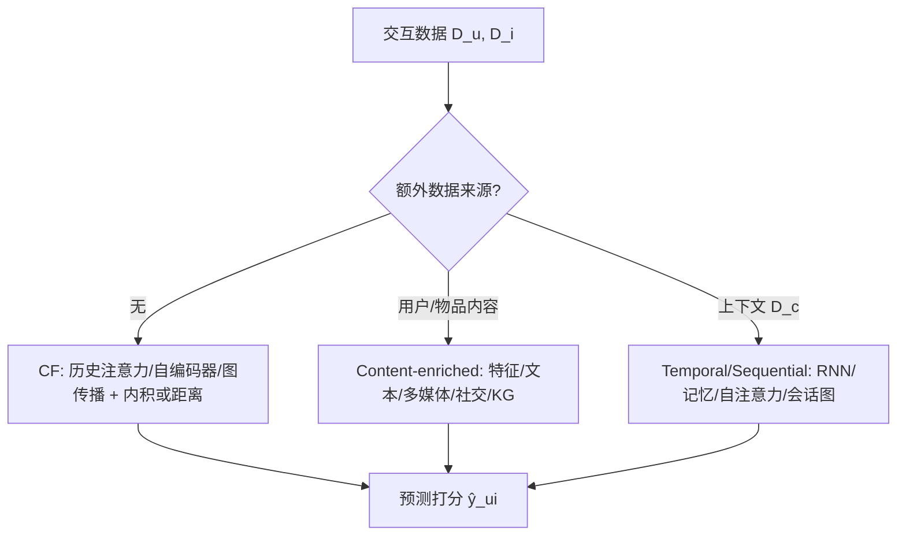

# A Survey on Accuracy-oriented Neural Recommendation: From Collaborative Filtering to Information-rich Recommendation (面向准确性的神经推荐综述：从协同过滤到信息富化推荐)

- **会议/期刊**: IEEE TKDE
- **作者与机构**: Le Wu、Xiangnan He、Xiang Wang、Kun Zhang、Meng Wang（合肥工业大学 / 中科大 / 新加坡国立大学）
- **推荐链路定位**: 召回 / 粗排（表征学习与交互建模为主）
- **研究方向**: 协同过滤与双塔召回 / 图神经网络与知识图谱推荐
- **论文原文**: [论文原文链接](https://arxiv.org/abs/2104.13030v3)
- **开源代码**: [开源代码仓库链接](https://github.com/lmcRS/AWS-recommendation-papers)

## TL;DR (1分钟核心速览)

本文不从深度学习技术出发，而以**数据使用**为轴重构神经推荐综述：用统一函数 $\hat{y}_{u,i,c}=f(D_u,D_i,D_c)$ 将模型正交划分为协同过滤（仅交互）、内容增强（交互+用户/物品侧信息）与时空序列（交互+上下文）三类。逐类梳理"表征学习 + 交互建模"、特征/文本/多媒体/社交/KG 五路融合、RNN/记忆/自注意力/会话图 的演进脉络，并点明基准缺失、可复现性与长短期兴趣建模等开放问题，为按场景选型提供路线图。

## Background & Motivation (背景与核心矛盾)

- **主流范式**: 推荐研究由记忆型 CF → 矩阵分解 MF（2008–2016 主流）→ 神经推荐模型演进，神经网凭强大表征力泛化并超越线性分解。
- **前人局限**: 其一，MF 的线性本质难以刻画复杂交互及富语义物品（文本、图像）；其二，已有综述多按 DL 技术（MLP/RNN/注意力）归类，只讲"用了什么网络"，说不清"为何、何时该技术有效"。
- **核心洞察 (Key Insight)**: 各类模型实质是对三类数据 $D_u$、$D_i$、$D_c$ 的不同取用，可置于同一预测函数下对齐；不同层承担不同目标，模型间可低成本"改动组件"迁移到另一场景。
- **本文切入点**: 以数据维度做正交分类，跳出技术堆叠式罗列。

## Method (核心方法设计)

### 1. 整体框架 (Overall Architecture)

综述给出统一建模视角 $\hat{y}_{u,i,c}=f(D_u,D_i,D_c)$，并据此三分：CF 只吃交互（忽略$D_c$、仅用$D_u/D_i$的 ID 或历史）；内容增强在$D_u/D_i$上附加档案、社交、KG、多模态；时空序列引入交互相关上下文$D_c$（时间、位置、历史序列）。三类的共性拆解是"表征学习（把用户/物品映射为向量）+ 交互建模（给定向量打分）"，作者借助这种分层结构指出跨类迁移路径。

### 2. 关键设计拆解 (Key Designs)

1. **CF 双支柱：表征 + 交互函数**：自由 embedding 受稀疏困扰，历史聚合（FISM/SVD++）与目标感知注意力（NAIS 的 $\alpha(i,j)=\exp(F(q_i,q_j))/[\sum_{k}\exp(F(q_i,q_k))]^{\beta}$）让历史 item 依目标动态加权。图路线把一阶历史扩展为高阶连通，$p_u^{(l+1)}=\rho(W_l[p_u^{l},\mathrm{Agg}(q_j^{l}\,|\,j\in R_u)])$；而 LightGCN 等简化版去掉变换与非线性，因 CF 图无节点特征、复杂算子反而冗余。交互侧，内积违背三角不等式且仅线性，距离/翻译度量（CML 的$\|p_u-q_i\|_2^2$、LRML 的$s_{ui}=\|p_u+e-q_i\|_F^2$）补足关系传播，NCF 用 MLP 拟合非线性。

2. **内容增强的三级融合范式**：早期拼接 → 联合正则（CDL：$q_i=f_e(x_i)+\theta_i$，评分损失与重构损失共训）→ 端到端双空间（VBPR：$\hat{r}_{ui}=p_u^{\top}q_i+w_u^{\top}f(\mathrm{CNN}(x_i))$）。KG 侧三路线：路径池化$c=f_{\mathrm{Pooling}}(\{f_{\mathrm{Embed}}(p)\,|\,p\in P(u,i)\})$、正则（CKE）、GNN 消息传递（KGAT 在协同知识图上注意力聚合）。融合好坏取决于"选哪种辅助数据 + 如何对齐"。

3. **时空序列建模与训练目标**：RNN 状态演化（RRN：$p_u^{t}=\mathrm{RNN}(p_u^{t-1},Wx_u^{t})$）、记忆网络读写、自注意力（SASRec 免递归卷积）、会话图（SR-GNN 以共现边构图捕获远距转移）、层次注意力平衡长短期。综述统一讨论 BPR/softmax 交叉熵与多任务联合损失，并区分全排序与采样排序、负采样策略等训练实践。

## Experimental Setup & Evaluation Protocol (实验设置与评估协议)

本文为**综述**，无原创实验，下表汇总其分类体系与代表性模型的典型评测习惯：

| 类别 | 代表模型 | 核心机制 | 典型评测 |
| :--- | :--- | :--- | :--- |
| CF-图 | NGCF / LightGCN | 高阶邻域传播（简化版去非线性） | Leave-One-Out + Full-Ranking |
| CF-交互 | NCF | MLP 融合内积 | 采样排序 |
| 特征交叉 | DeepFM / DCN | 显式 K 阶交叉 | CTR-AUC |
| 文本 | DeepCoNN | 双 TextCNN + FM | 评分回归 |
| 多媒体 | VBPR / ACF | 双空间解耦 | BPR 排序 |
| 社交 | DiffNet++ | 兴趣+影响双图扩散 | LOO 排序 |
| KG | KGAT | 协同知识图注意力 | 全库排序 |
| 序列 | SASRec | 自注意力 | Next-Item |
| 会话 | SR-GNN | 会话图 | Recall@K |

- **数据与划分**: 综述引用的主流实践为 `5-core` 过滤、`Leave-One-Out` 或时间戳切分。
- **排名协议**: 区分无偏 `Full-Ranking` 与 `Sampled Ranking`（并指出采样评估易高估）。
- **可复现性**: 作者在讨论部分专门批评基准不统一、数据处理不一致导致跨论文不可比。

### 消融式组件有效性归纳（综述层面）

| 移除/简化组件 | 影响（综述归纳） | 证据来源 |
| :--- | :--- | :--- |
| 图传播阶数 | 高阶连通显著提升表征质量 | NGCF→LightGCN |
| 变换矩阵/非线性激活 | 简化后性能不降反升 | LR-GCCF/LightGCN |
| 目标感知注意力 | 动态用户表征优于静态 | NAIS/ACF |
| 辅助信息融合 | 缓解稀疏、提升准确率 | CDL/VBPR/KGAT |

### 3. 关键实验发现 (Key Findings)

- **图传播是 CF 表征的当前最优解，且"做减法"更好**：综述明确指出 LR-GCCF/LightGCN 去除 embedding 变换与非线性后在实践中反而更优，说明无节点特征的 CF 二部图上复杂 GNN 算子并非必要。
- **简单内积的精度-效率权衡仍难被取代**：尽管距离/翻译度量修复了三角不等式与线性交互两个缺陷，作者强调大规模在线场景内积配 ANN 依旧高效，复杂交互函数的收益常不抵其开销。
- **辅助信息收益高度条件化**：KG/GNN 擅长高阶与可解释推理，但构图与元路径工程成本高；注意力是跨文本/多媒体/社交"选择相关信息"的通用粘合剂。

## Highlights & Limitations (亮点、对比与审稿批判)

- **与代表作对比**: 相比 Zhang et al. 按 MLP/RNN/注意力技术组织的综述、以及侧信息/跨域/可解释等单主题综述，本文以统一预测函数与"数据三分"实现跨场景对齐，并给出组件级迁移路径。
- **可迁移亮点**: 目标感知注意力（依目标 item 动态构造用户向量）、双空间解耦（协同空间 + 视觉/语义空间）、会话图构图，可直接复用到召回与序列建模。
- **审稿级局限批判**: (1) 定位 `accuracy-oriented`，基本不覆盖公平性、多样性、隐私与深度可解释；(2) 时间截止 2021，缺 LLM4Rec、生成式/扩散推荐、语义 ID 等新范式；(3) 仅定性归纳、未建统一基准与显著性检验，跨论文可比性受限。

## Rating (四维评分)

- **方法创新性 (Novelty)**: ⭐⭐⭐ （属综述视角重构而非方法创新，统一框架与数据三分是有价值的组织增量）
- **评估协议与实验扎实度 (Protocol & Experiments)**: ⭐⭐⭐ （覆盖面广、对采样评估与可复现性问题批判到位，但无原创统一基准与定量验证）
- **写作与数学规范度 (Clarity & Rigor)**: ⭐⭐⭐⭐ （统一公式 + 五张分类表 + 三类范式归纳，脉络清晰，符号一致）
- **工业落地与复现价值 (Industrial & Practical Value)**: ⭐⭐⭐⭐ （提供按场景选型路线图与配套论文仓库，工程与入门价值高）

